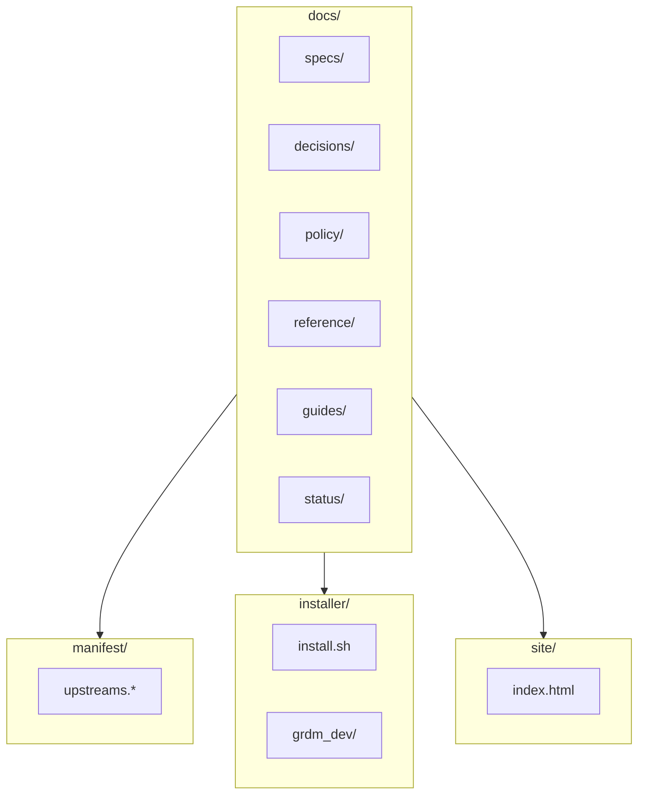

# RDM-developer-guide — GakuNin RDM Developer Environment 2027 / 開発環境 2027 版

> **Summary:** Developer guide for the GakuNin RDM 2027 environment, including specifications, decisions, policies, guides, and status
> **概要:** GakuNin RDM 2027 開発環境の開発者ガイド。仕様、決定、方針、ガイド、進捗を含みます

**Jump:** [English](#english) · [日本語](#japanese)

- Version / 版: 0.2 — 2026-11-06. **Learned:** a glossary term is only explained for the reader when its note and REF-01 link sit at the first prose use, counting lower-case and plural forms, so first-use notes with links were added in both halves (SPEC-06 §3). ／ 用語注と REF-01 へのリンクは、小文字や複数形も含めた本文の初出に置かなければ読者に届かないと分かったため、英和両方の初出にリンク付きの用語注を補った（SPEC-06 §3）。
- Version / 版: 0.1 — 2026-11-05
- Normative for: `README.md`
- Related: [SPEC-06 Documentation Conventions](docs/spec/06_documentation_conventions.md) · [POL-01 Position](docs/policy/POL-01_Developer_Environment_2027_Position.md)

---

## English

[→ 日本語版へ](#japanese)

### 🚀 Quick start

> Available from milestone M2.

1. `git clone https://github.com/.../RDM-developer-guide.git`
2. `./installer/install.sh --yes`
3. Open http://127.0.0.1:5000 in your browser

### 🧭 Map

### 📚 Documents

- [Documentation index](docs/README.md) - every document, by folder
- [Manifest](manifest/README.md) - what the installer builds (names and pinned SHAs)

#### Specifications / 仕様

- [SPEC-00 Overview](docs/spec/00_overview.md) - Overview / 概要
- [SPEC-01 Manifest](docs/spec/01_manifest.md) - Manifest format / マニフェスト形式
- [SPEC-02 Installer CLI](docs/spec/02_installer_cli.md) - Installer command / インストーラー CLI
- [SPEC-03 Security Gate](docs/spec/03_security_gate.md) - Security gate (the checkpoint a build must pass before anyone may use it; see [REF-01](docs/reference/REF-01_Glossary.md)) / セキュリティゲート
- [SPEC-04 Acceptance Tests](docs/spec/04_acceptance_tests.md) - Acceptance tests / 受け入れ試験
- [SPEC-05 Upstream Tracking](docs/spec/05_upstream_tracking.md) - Upstream tracking (Upstream: the original place our copies come from; see [REF-01](docs/reference/REF-01_Glossary.md)) / アップストリーム追跡
- [SPEC-06 Documentation Conventions](docs/spec/06_documentation_conventions.md) - Documentation conventions / 文書規約

#### Policies & Decisions / 方針と決定

Each record explains one choice. Repository (a folder that remembers every change; see [REF-01](docs/reference/REF-01_Glossary.md)) placement comes first, then the network model, the staged security gate, the autonomy of AI agents, and the test IdP (the server where you log in; see [REF-01](docs/reference/REF-01_Glossary.md)) that stands in for a Shibboleth (the software that lets you log in once with your university account; see [REF-01](docs/reference/REF-01_Glossary.md)) login.

- [POL-01 Position](docs/policy/POL-01_Developer_Environment_2027_Position.md) - Developer environment position / 開発環境の位置づけ
- [ADR-01 Integration Repository Placement](docs/decisions/ADR-01_Integration_Repository_Placement.md) - Integration repository / 統合リポジトリ配置
- [ADR-02 Network Model](docs/decisions/ADR-02_Network_Model.md) - Network model / ネットワークモデル
- [ADR-03 Staged Security Gate](docs/decisions/ADR-03_Staged_Security_Gate.md) - Staged security gate / 階段式セキュリティゲート
- [ADR-04 AI Autonomy and Roles](docs/decisions/ADR-04_AI_Autonomy_and_Roles.md) - AI autonomy and roles / AI 自律性と役割
- [ADR-05 Test IdP for Shibboleth](docs/decisions/ADR-05_Test_IdP_for_Shibboleth.md) - Test IdP for Shibboleth / Shibboleth 用テスト IdP
- [ADR-06 Wiki Frontend Overlay](docs/decisions/ADR-06_Wiki_Frontend_Overlay.md) - Wiki frontend overlay / Wiki フロントエンドのオーバーレイ

#### References / 参考資料

- [REF-01 Glossary](docs/reference/REF-01_Glossary.md) - Glossary / 用語集

#### Guides / ガイド

- [Guides index](docs/guides/README.md) - Guides for addon development and environment setup / アドオン開発と環境セットアップのガイド

#### Status / 進捗状況

- [Status](docs/status/README.md) - Project status and milestones / プロジェクト進捗とマイルストーン

### 🛡️ Security

This public repository contains only documentation, manifest, and installer code. Integration code is in the private RDM-<name>-dev2027 repository. A staged security gate is applied before code reaches production (see [SPEC-03 Security Gate](docs/spec/03_security_gate.md)).

### 🌐 HTML version

The human-readable HTML version lives at [site/index.html](site/index.html) (entry page: [index.html](index.html)). It is generated from `docs/` by MkDocs (a tool that turns Markdown files into a website; see [REF-01](docs/reference/REF-01_Glossary.md)) through `grdm-dev docs build` (see [SPEC-02](docs/spec/02_installer_cli.md)); do not edit `site/` by hand.

### License

MIT License — See [LICENSE](LICENSE) for details.

---

## 日本語

[→ To English](#english)

### 🚀 クイックスタート

> M2 マイルストーンから利用可能。

1. `git clone https://github.com/.../RDM-developer-guide.git`
2. `./installer/install.sh --yes`
3. ブラウザで http://127.0.0.1:5000 を開く

### 🧭 地図

### 📚 文書

- [文書の索引](docs/README.md) - フォルダごとの全文書
- [マニフェスト](manifest/README.md) - インストーラーが組み立てる対象（名前と固定 SHA）

#### 仕様

- [SPEC-00 概要](docs/spec/00_overview.md) - Overview / 概要
- [SPEC-01 マニフェスト](docs/spec/01_manifest.md) - Manifest format / マニフェスト形式
- [SPEC-02 インストーラー CLI](docs/spec/02_installer_cli.md) - Installer command / インストーラー CLI
- [SPEC-03 セキュリティゲート](docs/spec/03_security_gate.md) - Security gate / セキュリティゲート（導入が必ず通る検問所。[REF-01](docs/reference/REF-01_Glossary.md)）
- [SPEC-04 受け入れ試験](docs/spec/04_acceptance_tests.md) - Acceptance tests / 受け入れ試験
- [SPEC-05 アップストリーム追跡](docs/spec/05_upstream_tracking.md) - Upstream tracking / アップストリーム追跡（上流＝写しの元の場所。[REF-01](docs/reference/REF-01_Glossary.md)）
- [SPEC-06 文書規約](docs/spec/06_documentation_conventions.md) - Documentation conventions / 文書規約

#### 方針と決定

各記録は一つの選択を説明します。まずリポジトリ（変更を全部覚えているフォルダ。[REF-01](docs/reference/REF-01_Glossary.md)）の置き場、次にネットワークモデル、段階的なセキュリティゲート、AI エージェントの自律性、そして Shibboleth（大学のアカウントで一度ログインすれば済むようにするソフト。[REF-01](docs/reference/REF-01_Glossary.md)）ログインの代わりを務めるテスト IdP（ログインする場所のサーバ。[REF-01](docs/reference/REF-01_Glossary.md)）です。

- [POL-01 開発環境の位置づけ](docs/policy/POL-01_Developer_Environment_2027_Position.md) - Developer environment position / 開発環境の位置づけ
- [ADR-01 統合リポジトリ配置](docs/decisions/ADR-01_Integration_Repository_Placement.md) - Integration repository / 統合リポジトリ配置
- [ADR-02 ネットワークモデル](docs/decisions/ADR-02_Network_Model.md) - Network model / ネットワークモデル
- [ADR-03 階段式セキュリティゲート](docs/decisions/ADR-03_Staged_Security_Gate.md) - Staged security gate / 階段式セキュリティゲート
- [ADR-04 AI 自律性と役割](docs/decisions/ADR-04_AI_Autonomy_and_Roles.md) - AI autonomy and roles / AI 自律性と役割
- [ADR-05 Shibboleth 用テスト IdP](docs/decisions/ADR-05_Test_IdP_for_Shibboleth.md) - Test IdP for Shibboleth / Shibboleth 用テスト IdP
- [ADR-06 Wiki フロントエンドのオーバーレイ](docs/decisions/ADR-06_Wiki_Frontend_Overlay.md) - Wiki frontend overlay / Wiki フロントエンドのオーバーレイ

#### 参考資料

- [REF-01 用語集](docs/reference/REF-01_Glossary.md) - Glossary / 用語集

#### ガイド

- [ガイド一覧](docs/guides/README.md) - Guides for addon development and environment setup / アドオン開発と環境セットアップのガイド

#### 進捗状況

- [進捗](docs/status/README.md) - Project status and milestones / プロジェクト進捗とマイルストーン

### 🛡️ セキュリティ

このパブリックリポジトリにはドキュメント、マニフェスト、インストーラーコードのみが含まれます。統合コードは非公開の RDM-<name>-dev2027 リポジトリにあります。本番環境にコードが到達する前に段階的なセキュリティゲートが適用されます（[SPEC-03 セキュリティゲート](docs/spec/03_security_gate.md) 参照）。

### 🌐 HTML バージョン

人が読む HTML 版は [site/index.html](site/index.html)（入口ページは [index.html](index.html)）にあります。`docs/` から MkDocs（Markdown のファイルを Web サイトに変える道具。[REF-01](docs/reference/REF-01_Glossary.md)）が `grdm-dev docs build` で生成します（[SPEC-02](docs/spec/02_installer_cli.md)）。`site/` を手で編集しないでください。

### ライセンス

MIT License — 詳細は [LICENSE](LICENSE) を参照。

---

## Glossary / 用語

| Term | English note | 日本語注 |
|---|---|---|
| repository | A folder that stores code, documents, and configuration. | コードや文書、設定を保管するフォルダ。 |
| branch | A separate version of the code that can be developed independently. | コードの独立して開発できる別のバージョン。 |
| installer | A program that prepares other programs so they can run. | 他のプログラムを実行可能にするための準備をするプログラム。 |
| manifest | A list that says exactly which version of each source repository we use. | 使用する各ソースリポジトリのバージョンを正確に示すリスト。 |
| MkDocs | A tool that turns Markdown files into a website. | Markdown のファイルを Web サイトに変える道具。 |

