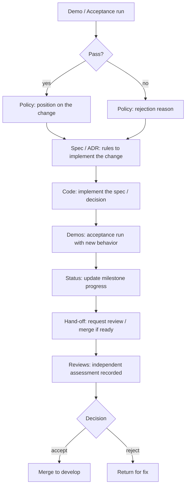
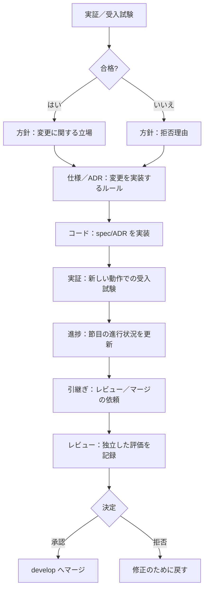

# Documentation Index / 文書索引

> **Summary:** The index of all documents in this repository: policies (our position), specifications (rules to implement), decisions (why we chose), demos (records of what was actually done), status (milestone progress), hand-offs (requests to other teams), reviews (review records), and reference (external facts). A Mermaid diagram shows how a change flows through the process.
> **概要:** このリポジトリのすべての文書の索引。方針（私たちの立場）、仕様（実装するルール）、決定（なぜ選んだか）、実証（実際にやったことの記録）、進捗（節目の進行状況）、引継ぎ（他のチームへの依頼）、レビュー（レビュー記録）、参考（外部事実）。Mermaid 図は、変更がプロセスを通る流れを示します。

**Jump:** [English](#english) · [日本語](#japanese)

- Version / 版: 0.1 — 2026-11-05. **Learned:** without a single index page, it was unclear which folder to check for the latest milestone status or review records; putting everything in one place makes the documentation tree navigable. ／ 単一の索引ページが無ければ、最新の節目進捗やレビュー記録をどのフォルダで探すべきか分からず、文書ツリーのナビゲートが不可能になると分かった。
- Normative for: every document under `docs/`, especially README.md files.
- Related: [../README.md](../README.md) · [site/index.html](../site/index.html)

---

## English

[→ 日本語版へ](#japanese)

### 1. Document folders

| Folder | Description |
|---|---|
| [policy/](policy/README.md) | Our position on what we will and will not do. Each document states our stance on a topic. |
| [spec/](spec/README.md) | Rules to implement: specifications, acceptance tests, security gate, installer CLI. |
| [decisions/](decisions/README.md) | Decision records: why we chose one way and not another. |
| [demo/](demo/README.md) | Records of what was actually done: acceptance runs, integration test results. |
| [status/](status/README.md) | Milestone progress: M1–M5 status, open items, upstream tracking reports. |
| [handoff/](handoff/README.md) | Requests to other teams: dated files, named YYYY-MM-DD_<Title>.md. |
| [reviews/](reviews/README.md) | Review records: dated files, named YYYY-MM-DD_<Title>_rN.md. |
| [reference/](reference/README.md) | External facts: glossary, tool versions, upstream metadata. |

### 2. How a change flows

### 3. Links

- [../README.md](../README.md) — Root index of the whole repository.
- [site/index.html](../site/index.html) — HTML site built by MkDocs.

---

## 日本語

[→ To English](#english)

### 1. 文書フォルダ

| フォルダ | 説明 |
|---|---|
| [policy/](policy/README.md) | 我々が何をし、何をしないかの立場。各文書はトピックに関する私たちの姿勢を述べます。 |
| [spec/](spec/README.md) | 実装するルール：仕様、受入試験、セキュリティの門、インストーラー CLI。 |
| [decisions/](decisions/README.md) | 決定の記録：なぜその道を選び、ほかを選ばなかったか。 |
| [demo/](demo/README.md) | 実際にやったことの記録：受入試験、統合試験結果。 |
| [status/](status/README.md) | 節目の進行状況：M1〜M5 の進捗、未解決項目、上流追従報告。 |
| [handoff/](handoff/README.md) | 他のチームへの依頼：日付付きファイル、YYYY-MM-DD_<Title>.md の形式。 |
| [reviews/](reviews/README.md) | レビュー記録：日付付きファイル、YYYY-MM-DD_<Title>_rN の形式。 |
| [reference/](reference/README.md) | 外部事実：用語集、道具の版、上流メタデータ。 |

### 2. 変更が流れる流れ

### 3. リンク

- [../README.md](../README.md) — リポジトリ全体のルート索引。
- [site/index.html](../site/index.html) — MkDocs が生成する HTML サイト。

---

## Glossary / 用語

| Term | English note | 日本語注 |
|---|---|---|
| Policy | A statement of our position on what we will and will not do. | 我々が何をし、何をしないかの立場。 |
| Specification | A rule book that implementers must follow. | 実装する人が守るルールブック。 |
| Decision record (ADR) | A note explaining why we chose one way and not another. | なぜその道を選び、ほかを選ばなかったかのメモ。 |
| Demo | Records of what was actually done, including acceptance runs. | 実際にやったことの記録、受入試験を含む。 |
| Milestone | A checkpoint with a pass/fail test. | 合否の試験がある関門。 |
| Hand-off | A request to another team or agent. | 他のチーム・エージェントへの依頼。 |
| Review | An independent assessment of a pull request. | プルリクエストの独立した評価。 |
| Reference | External facts such as glossaries, tool versions. | 用語集や道具の版などの外部事実。 |
