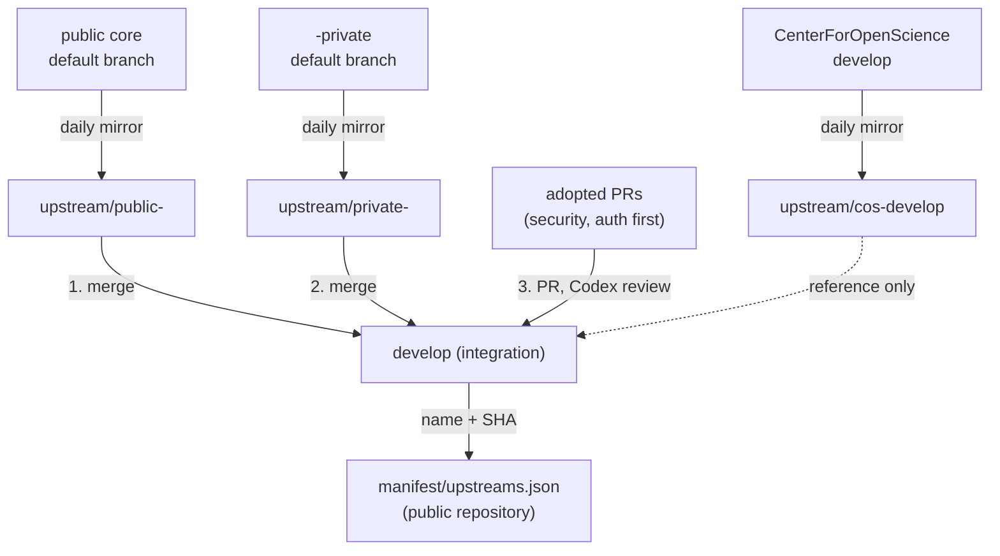
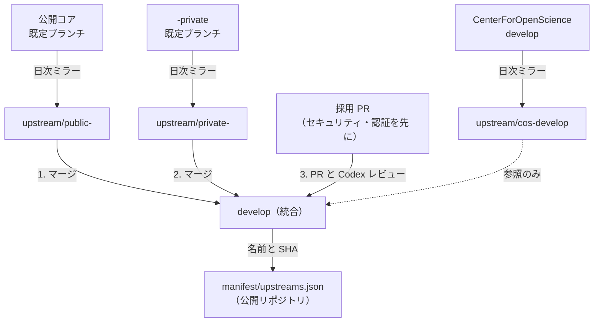

# ADR-01 Integration Repository Placement / 統合リポジトリの置き場

> **Summary:** Where the code that combines the public cores, the `-private` security versions and the subsystems is kept: new private repositories `RDM-<name>-dev2027` inside RCOSDP, with a `develop` integration branch and `upstream/*` tracking branches, never in this public repository.
> **概要:** 公開コア・`-private` セキュリティ版・サブシステムを重ねたコードをどこに置くか。RCOSDP 内に新設する非公開リポジトリ `RDM-<name>-dev2027` に置き、`develop` を統合ブランチ、`upstream/*` を追跡ブランチとする。公開のこのリポジトリには置かない。

**Jump:** [English](#english) · [日本語](#japanese)

- Version / 版: 0.4 — 2026-11-05. **Learned:** a strict public-first reconstruction needs the public upstream recorded in the manifest; Shibboleth-SP had a public upstream that was mirrored but not recorded (review SR-02). ／ 公開が先の厳密再構築には、公開上流が manifest に記録されている必要がある。Shibboleth-SP はミラーされていたのに記録がなかった（レビュー SR-02）。
  0.3 — 2026-11-05. **Learned:** the owner prefers a literal, reproducible integration order over a convenient bootstrap, so the first construction is redone public-first on a new branch and proposed as a superseding pull request. ／ 所有者は便利な初回構築より、文字どおり再現できる統合順を選ぶと分かった。初回構築は新しいブランチで「公開が先」にやり直し、置き換えの PR として提案する。
  0.2 — 2026-11-05. **Learned:** the first construction of a `-dev2027` repository cannot literally replay "public → private → adopted PRs", so the rule needs a stated bootstrap interpretation; it is proposed in §5 and awaits the owner. ／ `-dev2027` の初回構築では「公開 → private → 採用 PR」を文字どおり再現できないため、初回構築の解釈を明文化する必要があると分かった。§5 に提案し所有者の承認を待つ。
  0.1 — 2026-11-05. **Learned:** GitHub refuses a fork inside the same organization, so "fork and integrate" had to become "new repository with history pushed", and that in turn made the no-force-push and no-delete rules the only way to keep the pushed history trustworthy. ／ GitHub は同じ組織内へのフォークを許さないため「フォークして統合」は「履歴を push した新規リポジトリ」になり、その結果 force push 禁止と削除禁止が、push した履歴を信じられるものに保つ唯一の手段だと分かった。
- Status: Accepted by the owner, 2026-11-05 (plan-interview).
- Records a decision for: [POL-01 §2 item 5](../policy/POL-01_Developer_Environment_2027_Position.md) · [SPEC-01 Manifest](../spec/01_manifest.md) · [SPEC-05 Upstream Tracking](../spec/05_upstream_tracking.md)
- Related: [docs/README.md](../README.md) · [SPEC-00 Overview](../spec/00_overview.md) · [ADR-02 Network Model](ADR-02_Network_Model.md) · [ADR-04 AI Autonomy and Roles](ADR-04_AI_Autonomy_and_Roles.md) · [REF-01 Glossary](../reference/REF-01_Glossary.md)

---

<a id="english"></a>
## English

[→ 日本語版へ](#japanese)

### 1. Context

A *decision record* (ADR) explains why we chose one way and not another. This one is about where the integration code lives.

We must combine, without contradiction, three groups of code kept in GitHub *repositories* (folders that remember every change):

- six public cores: `RDM-osf.io`, `RDM-waterbutler`, `RDM-modular-file-renderer`, `RDM-ember-osf-web`, `RDM-cas-overlay`, `RDM-wiki-frontend`;
- six `-private` security-verified versions, each of which already contains the history of its public core (so it is a superset, not a rival);
- five private subsystems: y-websocket, OASys, Shibboleth-SP, rdmcp, aipf_mcp_data_grdm. Two of them also have a public upstream that the manifest records and the integration repository tracks as `upstream/public-<branch>`: y-websocket (RDM-y-websocket, `master`) and Shibboleth-SP (RDM-Shibboleth-SP, `main`). OASys, rdmcp and aipf_mcp_data_grdm are private-only, so their first construction starts from the `-private` tip (review SR-02, 2026-11-05).

Three constraints shaped the choice:

1. **Same-organization forks are impossible.** On GitHub a *fork* (your own copy of someone's repository that remembers where it came from) cannot be created inside the same organization that owns the original. All these repositories are in RCOSDP, so a plain fork is unavailable.
2. **Write boundary.** The agents on this plan may write only to this repository (`RDM-developer-guide`) and to repositories they create. Existing repositories, including the `-private` ones, are read-only to us. Deleting a repository or branch and *force-pushing* (overwriting shared history) are forbidden.
3. **This repository is public.** Members abroad read it. Anything derived from `-private` code — files, patches, even URLs of private repositories — must not appear here.

### 2. Options considered

```toon
options[4]{id,option,keeps_private_code_private,within_write_boundary,upstream_follow_cost,verdict}:
  A,"New private repositories RDM-<name>-dev2027 in RCOSDP, history pushed, develop = integration, upstream/* tracking",yes,yes,low,chosen
  B,"Fork to a personal GitHub account",no,yes,low,rejected
  C,"Keep patches inside this public repository and apply at install time",no,yes,high,rejected
  D,"Use the -private repositories directly as the canon and integrate there",yes,no,low,rejected
```

- **B** puts code derived from private sources under a personal account, outside the organization's access control. Rejected.
- **C** keeps a pile of *patches* (small text files describing changes) that must be re-fitted every time an upstream repository moves; with eleven moving upstreams the conflicts arrive faster than they are solved, and any patch touching `-private` code would leak it into a public repository. Rejected.
- **D** would be the simplest, but we are not allowed to write to the `-private` repositories, and integrating in them would mix verification work with security verification history. Rejected.

### 3. Decision

1. For each of the eleven upstream repositories, create a **private** repository in RCOSDP named `RDM-<name>-dev2027` (for example `RDM-osf.io-dev2027`). Push the full history of the public core so that `git log` remains truthful and *SHAs* (fingerprints of commits) match upstream.
2. Branches in each `-dev2027` repository:
   - `develop` — the integration branch; the only branch the installer builds from (its SHA is recorded in the manifest, see [SPEC-01](../spec/01_manifest.md));
   - one tracking branch per upstream listed in the manifest, named `upstream/<kind>-<branch>` where `<kind>` is `public`, `private`, or `cos` and `<branch>` is the upstream branch name with `/` replaced by `-` ([SPEC-01 §4](../spec/01_manifest.md#4-rules) rule 7);
   - `upstream/public-<branch>` — an exact *mirror* (identical copy, refreshed automatically) of the public core's default branch: `upstream/public-develop` for osf.io, waterbutler, mfr, cas-overlay, wiki-frontend; `upstream/public-master` for ember-osf-web and y-websocket;
   - `upstream/private-<branch>` — a mirror of the `-private` default branch: `upstream/private-develop`, `upstream/private-master` (ember-osf-web, y-websocket), or `upstream/private-main` (OASys, Shibboleth-SP, rdmcp, aipf_mcp_data_grdm, which have no public upstream and only this branch);
   - `upstream/cos-develop` — a mirror of the CenterForOpenScience original, for reference only (not for wiki-frontend, which has no COS original);
   - a second upstream of the same kind gets a tag: `upstream/private-sec-test-fix-sec-test` mirrors `RDM-osf.io-private` (branch `fix/sec-test`) as a candidate.
   Mirrors are refreshed daily ([SPEC-05](../spec/05_upstream_tracking.md)).
3. **Integration order** on `develop`: public `develop` → `-private` → adopted *pull requests* (proposed changes waiting for review). Merged upstream changes are taken in full; unmerged PRs are adopted one by one, security and authentication first, and listed as candidates in the manifest.
4. **No force-push, no deletion.** Conflicts are solved by new commits in a PR, never by rewriting history. Branches are archived with a tag rather than deleted.
5. **Nothing from a `-dev2027` repository is copied into this public repository** except names, branch names, SHAs, dates and PR numbers. Image builds from `-private` code go only to local Docker or to a private registry, never to a public one.



### 4. Consequences

- **Good:** one place per component where "public + private + adopted PRs" is resolved; the installer needs only a name and a SHA; daily mirrors keep diffs small; history is complete and auditable.
- **Good:** the write boundary is respected without asking for new permissions on existing repositories.
- **Cost:** eleven more repositories to watch. Mitigated by automation in [SPEC-05](../spec/05_upstream_tracking.md) and the status board.
- **Cost:** `-dev2027` repositories are private, so GitHub Actions minutes and self-hosted runner usage count against the Team plan. Accepted.
- **Risk — leakage into this public repository.** A single careless copy of a file, a stack trace or a URL from a `-dev2027` or `-private` repository would publish private security work. Controls: secret scanning in CI is mandatory; reviewers check every PR to this repository for private paths and URLs; the manifest schema allows only names, branches, SHAs, dates and PR numbers; documents name private repositories but never link to them ([SPEC-06 §5](../spec/06_documentation_conventions.md)).
- **Risk — drift between public and private cores.** On 2026-11-05 the public `RDM-osf.io` develop was newer than its `-private` counterpart. The integration order (public first, then private) and daily mirrors make such drift visible as a merge, not as a silent overwrite.
- **Open:** how to treat `RDM-osf.io-private` (branch `fix/sec-test`), which is distinct from `RDM-osf.io-develop-private`. It is mirrored as `upstream/private-sec-test-fix-sec-test` and listed in the manifest with `status: candidate` ([SPEC-01 §4](../spec/01_manifest.md#4-rules) rule 6); the owner decides whether it is merged.

---

### 5. Bootstrap of the integration order (decided 2026-11-05: strict reconstruction)

**Status:** the owner **rejected** the proposed interpretation "seed from the `-private` tip and merge the newer public tip" (review r1/r2 of RDM-osf.io-dev2027 PR #1, finding R2). The integration order of [SPEC-01 §4](../spec/01_manifest.md) applies literally, also to the first construction.

**Procedure for every `-dev2027` repository:**

1. Start a branch `integrate/strict-<YYYYMMDD>` at the tip of `upstream/public-<branch>`.
2. Merge `upstream/private-<branch>` into it with a normal two-parent merge (`--no-ff`), resolving conflicts on the branch.
3. Re-apply adopted PRs from the manifest, each as its own merge.
4. Open a pull request from that branch to `develop`. The `develop` branch is never force-pushed or deleted; the pull request supersedes any earlier integration pull request, which is closed with a comment pointing to the new one.
5. Review by REV, check by QAE, merge by the owner (ADR-04).

**Consequence:** the first `develop` of each repository (seeded from the `-private` tip during bootstrap) stays in history. The strictly reconstructed branch is merged on top of it, so from the first strict merge onward every `develop` carries the public-first order.

---

<a id="japanese"></a>
## 日本語

[→ To English](#english)

### 1. 背景

「決定の記録」（ADR）は、なぜその道を選び、ほかを選ばなかったかを残すメモです。この記録は、統合コードをどこに置くかについてのものです。

GitHub の「リポジトリ」（変更を全部覚えているフォルダ）に置かれた三つの群のコードを、矛盾なく重ねる必要があります。

- 公開コア 6 本: `RDM-osf.io`、`RDM-waterbutler`、`RDM-modular-file-renderer`、`RDM-ember-osf-web`、`RDM-cas-overlay`、`RDM-wiki-frontend`。
- `-private` のセキュリティ検証版 6 本。いずれも対応する公開コアの履歴を含んでいる（つまり対立ではなく上位互換）。
- 非公開サブシステム 5 本: y-websocket、OASys、Shibboleth-SP、rdmcp、aipf_mcp_data_grdm。このうち 2 本には公開の上流もあり、manifest に記録して統合リポジトリで `upstream/public-<branch>` として追跡する: y-websocket（RDM-y-websocket、`master`）と Shibboleth-SP（RDM-Shibboleth-SP、`main`）。OASys、rdmcp、aipf_mcp_data_grdm は private のみで、初回構築は `-private` の先端から始める（レビュー SR-02、2026-11-05）。

選択を決めた制約は三つです。

1. **同じ組織内へのフォークはできない。** GitHub の「フォーク」（他人のリポジトリの自分用の写しで、出どころを覚えているもの）は、元のリポジトリを持つ組織の中には作れません。対象は全部 RCOSDP にあるので、普通のフォークは使えません。
2. **書込の境界。** この計画のエージェントが書き込めるのは、このリポジトリ（`RDM-developer-guide`）と自分で新設したリポジトリだけです。`-private` を含む既存リポジトリは読み取り専用です。リポジトリやブランチの削除と「force push」（共有の履歴の上書き）は禁止です。
3. **このリポジトリは公開。** 海外のメンバーが読みます。`-private` 由来のもの — ファイル、パッチ、非公開リポジトリの URL まで — をここに出してはいけません。

### 2. 検討した選択肢

```toon
options[4]{id,option,keeps_private_code_private,within_write_boundary,upstream_follow_cost,verdict}:
  A,"RCOSDP 内に非公開の RDM-<name>-dev2027 を新設、履歴を push、develop = 統合、upstream/* で追跡",yes,yes,low,採用
  B,"個人の GitHub アカウントへフォーク",no,yes,low,不採用
  C,"公開のこのリポジトリにパッチを同梱し導入時に当てる",no,yes,high,不採用
  D,"-private リポジトリを直接正本にしてそこで統合",yes,no,low,不採用
```

- **B** は非公開由来のコードを、組織のアクセス管理の外にある個人アカウントの下に出します。不採用。
- **C** は「パッチ」（変更内容を書いた小さな文字ファイル）の山を持ち、上流が動くたびに当て直す必要があります。11 本の上流が動くと、衝突は解く速さより早く届きます。しかも `-private` に触るパッチは公開リポジトリへの漏えいになります。不採用。
- **D** は最も単純ですが、`-private` リポジトリへの書込は許されておらず、そこで統合するとセキュリティ検証の履歴と統合作業が混ざります。不採用。

### 3. 決定

1. 上流 11 本それぞれに、RCOSDP 内に **非公開** のリポジトリ `RDM-<name>-dev2027`（例: `RDM-osf.io-dev2027`）を新設します。公開コアの全履歴を push し、`git log` が本当のことを示し、「SHA」（コミットの指紋）が上流と一致するようにします。
2. 各 `-dev2027` のブランチ:
   - `develop` — 統合ブランチ。インストーラーが組み立てる唯一のブランチ（その SHA を manifest に記録。[SPEC-01](../spec/01_manifest.md)）。
   - manifest に載せた上流ごとに一本の追跡ブランチ。名前は `upstream/<kind>-<branch>` で、`<kind>` は `public`・`private`・`cos`、`<branch>` は上流のブランチ名の `/` を `-` に置き換えたもの（[SPEC-01 §4](../spec/01_manifest.md#4-規則) の規則 7）。
   - `upstream/public-<branch>` — 公開コアの既定ブランチの正確な「ミラー」（自動で更新される同一の写し）。osf.io・waterbutler・mfr・cas-overlay・wiki-frontend は `upstream/public-develop`、ember-osf-web と y-websocket は `upstream/public-master`。
   - `upstream/private-<branch>` — `-private` の既定ブランチのミラー。`upstream/private-develop`、`upstream/private-master`（ember-osf-web、y-websocket）、または `upstream/private-main`（OASys、Shibboleth-SP、rdmcp、aipf_mcp_data_grdm。公開の上流がないのでこの一本だけ）。
   - `upstream/cos-develop` — CenterForOpenScience 本家のミラー。参照のみ（COS 本家のない wiki-frontend にはない）。
   - 同じ kind の二つ目の上流にはタグを挟む。`upstream/private-sec-test-fix-sec-test` は `RDM-osf.io-private`（ブランチ `fix/sec-test`）を候補として写したもの。
   ミラーは日次で更新します（[SPEC-05](../spec/05_upstream_tracking.md)）。
3. **`develop` への統合順**: 公開 `develop` → `-private` → 採用した「プルリクエスト」（レビュー待ちの変更の提案）。上流でマージ済みの変更は全件取り込み、未マージ PR はセキュリティ・認証系を先に一件ずつ採否を決め、候補は manifest に載せます。
4. **force push なし、削除なし。** 衝突は PR 上の新しいコミットで解き、履歴は書き換えません。ブランチは削除せずタグで保管します。
5. **`-dev2027` から公開のこのリポジトリへ写すのは、名前、ブランチ名、SHA、日付、PR 番号だけ。** `-private` 由来のコードから作るイメージは、ローカルの Docker か非公開レジストリにだけ置き、公開レジストリには出しません。



### 4. 結果

- **良い点:** 「公開＋非公開＋採用 PR」を解く場所が部品ごとに一つになる。インストーラーは名前と SHA だけで足りる。日次ミラーで差分が小さく保たれる。履歴が完全で監査できる。
- **良い点:** 既存リポジトリへの新しい権限を求めずに、書込の境界を守れる。
- **コスト:** 見守るリポジトリが 11 本増える。[SPEC-05](../spec/05_upstream_tracking.md) の自動化と進捗ボードで和らげる。
- **コスト:** `-dev2027` は非公開のため、GitHub Actions の実行時間とセルフホストランナーの利用が Team プランの枠を使う。受け入れる。
- **リスク — 公開のこのリポジトリへの漏えい。** `-dev2027` や `-private` からファイル、スタックトレース、URL を一つ不注意に写すだけで、非公開のセキュリティ作業が公開されます。対策: CI の秘密スキャンを必須にする。レビュワはこのリポジトリへの全 PR で非公開のパスと URL を確かめる。manifest のスキーマは名前・ブランチ・SHA・日付・PR 番号しか許さない。文書は非公開リポジトリを名前で呼び、リンクしない（[SPEC-06 §5](../spec/06_documentation_conventions.md)）。
- **リスク — 公開と非公開のずれ。** 2026-11-05 時点で公開 `RDM-osf.io` の develop は `-private` より新しかった。統合順（公開を先、次に非公開）と日次ミラーにより、こうしたずれは黙った上書きではなくマージとして見えます。
- **未決:** `RDM-osf.io-develop-private` とは別物の `RDM-osf.io-private`（ブランチ `fix/sec-test`）の扱い。`upstream/private-sec-test-fix-sec-test` としてミラーし、manifest には `status: candidate` で載せています（[SPEC-01 §4](../spec/01_manifest.md#4-規則) の規則 6）。マージするかは所有者が決めます。

---

### 5. 統合順の初回構築（2026-11-05 決定: 厳密に再構築する）

**状態:** 所有者は「`-private` の先端を起点にして、より新しい公開の先端をマージする」という解釈の提案を **退けた**（RDM-osf.io-dev2027 PR #1 のレビュー r1/r2、指摘 R2）。[SPEC-01 §4](../spec/01_manifest.md) の統合順は、初回構築にも文字どおり適用する。

**各 `-dev2027` リポジトリの手順:**

1. `upstream/public-<branch>` の先端からブランチ `integrate/strict-<YYYYMMDD>` を切る。
2. そこへ `upstream/private-<branch>` を通常の 2 親マージ（`--no-ff`）で取り込み、衝突はそのブランチ上で解消する。
3. manifest の採用 PR を、それぞれ独立したマージとして再適用する。
4. そのブランチから `develop` へ PR を出す。`develop` は force push も削除もしない。この PR は以前の統合 PR を置き換え、以前の PR は新しい PR を示すコメントを付けて閉じる。
5. REV のレビュー、QAE の検査、所有者のマージ（ADR-04）。

**結果:** 各リポジトリの最初の `develop`（初回構築で `-private` の先端から作ったもの）は履歴に残る。厳密に再構築したブランチはその上にマージされるので、最初の厳密マージ以降、どの `develop` も「公開が先」の順序を持つ。

---

## Glossary / 用語

| Term | English note | 日本語注 |
|---|---|---|
| Fork | Your own copy of someone's repository that remembers where it came from. | 他人のリポジトリの自分用の写し。出どころを覚えている。 |
| Mirror | An identical copy that is refreshed automatically. | 自動で更新される、そっくり同じ写し。 |
| Pull request (PR) | A proposed change waiting for someone to review and accept it. | 誰かが見て受け入れるのを待っている、変更の提案。 |
| Patch | A small text file that describes a change to code. | コードの変更内容を書いた小さな文字ファイル。 |
| Force push | Overwriting shared history; forbidden here. | 共有の履歴の上書き。ここでは禁止。 |

Full shared glossary: [REF-01 Glossary](../reference/REF-01_Glossary.md).
