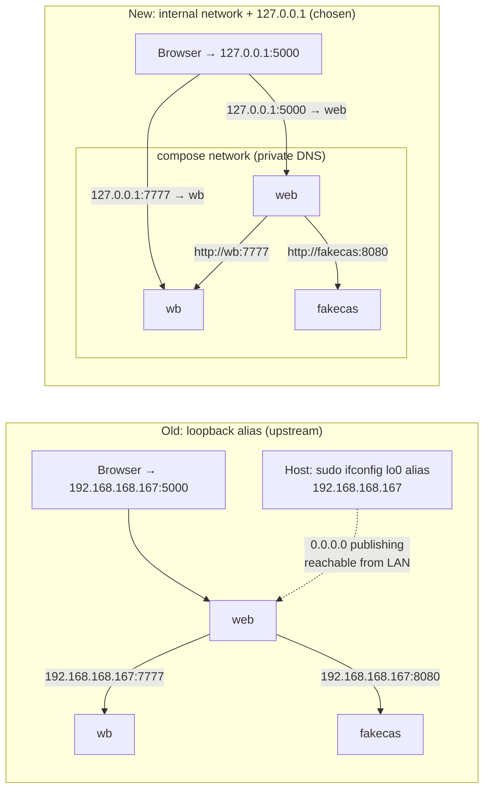
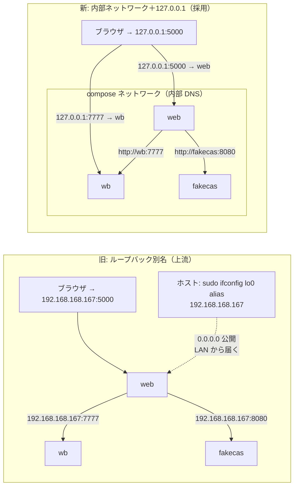

# ADR-02 Network Model / ネットワーク方式

> **Summary:** We drop the upstream loopback alias `192.168.168.167` (which needed `sudo` and exposed services to the local network) and use the Docker Compose internal network for service-to-service traffic plus `127.0.0.1`-only publishing for the browser.
> **概要:** 上流のループバック別名 `192.168.168.167`（`sudo` が要り、サービスを LAN に露出した）をやめ、サービス間は Docker Compose の内部ネットワーク、ブラウザ向けは `127.0.0.1` だけへの公開にする。

**Jump:** [English](#english) · [日本語](#japanese)

- Version / 版: 0.3 — 2026-11-06. **Learned:** a glossary term is only explained for the reader when its note and REF-01 link sit at the first prose use, counting lower-case and plural forms, so first-use notes with links were added in both halves (SPEC-06 §3). ／ 用語注と REF-01 へのリンクは、小文字や複数形も含めた本文の初出に置かなければ読者に届かないと分かったため、英和両方の初出にリンク付きの用語注を補った（SPEC-06 §3）。
- Version / 版: 0.2 — 2026-11-05. **Learned:** Docker cannot publish ports from an internal network, so "one internal network" became two networks with an explicit egress switch (PR #21 review r1, finding 8). ／ Docker は内部ネットワークからポートを公開できないため、「内部ネットワーク一つ」は二つのネットワークと明示的な egress の切替になった（PR #21 レビュー r1、指摘 8）。
  0.1 — 2026-11-05. **Learned:** the alias existed only so that one address worked both inside containers and in the browser; once services talk by Compose service name and the browser talks to `127.0.0.1`, no shared address is needed and the `sudo` step disappears with it. ／ 別名は「一つのアドレスがコンテナの中でもブラウザでも通る」ためだけに存在していた。サービス間が Compose のサービス名で、ブラウザが `127.0.0.1` で話せば共通アドレスは不要になり、`sudo` の手順も一緒に消えると分かった。
- Status: Accepted by the owner, 2026-11-05 (plan-interview).
- Records a decision for: [POL-01 §5](../policy/POL-01_Developer_Environment_2027_Position.md) · [SPEC-02 Installer CLI](../spec/02_installer_cli.md) · [SPEC-03 Security Gate](../spec/03_security_gate.md)
- Related: [docs/README.md](../README.md) · [SPEC-00 Overview](../spec/00_overview.md) · [SPEC-04 Acceptance Tests](../spec/04_acceptance_tests.md) · [ADR-01](ADR-01_Integration_Repository_Placement.md) · [ADR-03](ADR-03_Staged_Security_Gate.md) · [REF-01 Glossary](../reference/REF-01_Glossary.md) · legacy guide `docs/guides/environment/README.md` (moved from `Environment.md`)

---

<a id="english"></a>
## English

[→ 日本語版へ](#japanese)

### 1. Context

The upstream `docker-compose.yml` of `RDM-osf.io` and its `README-docker-compose.md` ask the developer to add `192.168.168.167` as an *alias* (an extra name or address for the same thing) on the *loopback* interface (the network path that leads back to your own computer; `127.0.0.1` and `localhost` are its usual names). The alias is configured with administrator rights:

- macOS: `sudo ifconfig lo0 alias 192.168.168.167/24`
- Linux: an interface configuration or `ip addr add` with `sudo`
- Windows: `netsh interface ip add address "Loopback" 192.168.168.167 255.255.255.0` as administrator

The reason is a single address that works in two places. *Containers* (boxes that hold one program and everything it needs) talk to each other — the `web` service calls `wb` (waterbutler), `mfr` and `fakecas`; the browser on the host also needs those addresses in redirects and in JavaScript. Giving the host a fixed alias and publishing every *port* (a numbered door on an address through which one program listens) on `0.0.0.0` made both paths use one address.

This conflicts with three rules of the 2027 environment ([POL-01](../policy/POL-01_Developer_Environment_2027_Position.md)):

1. **localhost only** (localhost is the network address that leads back to your own computer; see [REF-01](../reference/REF-01_Glossary.md)) — nothing listens on an address reachable from the local network;
2. **no LAN exposure** — `0.0.0.0` publishing is not allowed, because a development instance with EOL (end-of-life: no longer fixed by its makers; see [REF-01](../reference/REF-01_Glossary.md)) components must never be reachable by a neighbour on the same Wi-Fi;
3. **no sudo** — the installer runs as an ordinary user, so it is safe to run on a laptop managed by someone else and simple to run in CI (continuous integration: automatic checks on every change; see [REF-01](../reference/REF-01_Glossary.md)).

The alias also fails in practice: it disappears after reboot on macOS, Windows setups were never confirmed, and port `5000` collides with macOS AirPlay Receiver on macOS 15 and later (the legacy guide already recommends remapping it).

### 2. Options considered

```toon
options[3]{id,option,needs_sudo,lan_exposure,matches_upstream_docs,test_matrix,verdict}:
  A,"Keep the 192.168.168.167 loopback alias as upstream does",yes,yes,yes,1,rejected
  B,"Drop the alias: Compose internal network for services, 127.0.0.1 publishing for the browser",no,no,no,1,chosen
  C,"Support both, selected by --legacy-network",partly,partly,partly,2,rejected
```

- **A** keeps upstream documents literally true but violates all three rules above. Rejected.
- **C** doubles the test matrix (every acceptance test twice) and keeps `sudo` code paths alive in the installer. Rejected; a developer who really needs the alias can still follow the upstream README by hand, outside the installer.

### 3. Decision

1. **Service-to-service traffic uses the internal Compose network `grdm` (`internal: true`).** Every service addresses another by its Compose service name (`web`, `api`, `wb`, `mfr`, `fakecas`, `cas`, `postgres`, `elasticsearch`, `rabbitmq`, `redis`, `mongo`); the built-in DNS of Docker (the tool that builds images and runs containers; see [REF-01](../reference/REF-01_Glossary.md)) resolves them, no fixed IP addresses. An internal network has no egress. Browser-facing services are additionally attached to the plain bridge `grdm-edge`, from which their ports are published on `127.0.0.1` (decision 2). A service that needs the Internet is attached to `grdm-edge` explicitly with `compose render --egress`, recorded in `runtime/.env` (`GRDM_EGRESS_SERVICES`); the default grants none.
2. **Browser-facing traffic is published on `127.0.0.1` only.** The generated Compose file writes `127.0.0.1:<host-port>:<container-port>`, never `0.0.0.0` or a bare port. The default host ports are defined once, in the ports table of [SPEC-02 §4](../spec/02_installer_cli.md#2-en-ports) (`5000` web, `8000` api, `8001` admin, `7777` wb, `7778` mfr, `8080` fakecas, `4200` ember). The installer checks each port is free and remaps on collision (macOS AirPlay on `5000` is the known case), recording the mapping in `runtime/.env` and the install report.
3. **Settings that differ from upstream documents are rewritten by the installer**, not by hand:
   - `website/settings/local.py` and `api/base/settings/local.py`: `DOMAIN`, `API_DOMAIN`, `WATERBUTLER_URL`, `MFR_SERVER_URL`, `CAS_SERVER_URL` and similar — the *internal* URLs use service names, the *external* (browser) URLs use `http://127.0.0.1:<port>/`;
   - `.docker-compose.env`, `.docker-compose.wb.env`, `.docker-compose.mfr.env`, `.docker-compose.sharejs.env`: hostnames and ports as above; secrets are random values generated at install time ([SPEC-03](../spec/03_security_gate.md));
   - `runtime/docker-compose.yml` is generated from the manifest and the host profile ([SPEC-02 §3](../spec/02_installer_cli.md#english)); the upstream `docker-compose.yml` files in the integration repositories are left untouched so upstream diffs stay clean.
4. **`grdm-dev health --network`** fails if any container port is listening on an address other than `127.0.0.1` on the host ([SPEC-04](../spec/04_acceptance_tests.md)).
5. **Browser behaviour:** acceptance tests and users open `http://127.0.0.1:5000/`. `localhost` is accepted as an equivalent in docs, but the installer writes `127.0.0.1` to avoid IPv6 `::1` surprises in Node-based services.



### 4. Consequences

- **Exposure to be aware of.** The seven browser-facing services (`web`, `api`, `admin`, `wb`, `mfr`, `fakecas`, `ember_osf_web`) sit on the ordinary bridge `grdm-edge` so that their ports can be published; on that network they also have outbound access to the Internet. All other services have no egress by default. Add-on development against external providers from a non-publishing service requires `compose render --egress <service>`; every grant, implicit or explicit, is visible to the security gate.

- **Good:** no `sudo`, nothing survives a reboot that must be redone, nothing is reachable from the LAN, the same Compose file works on macOS, Ubuntu and WSL2 (a way to run Linux inside Windows; see [REF-01](../reference/REF-01_Glossary.md)), and CI can run it unmodified.
- **Good:** fewer moving parts for the security gate — the "listening address" check in [SPEC-03](../spec/03_security_gate.md) becomes a one-line rule.
- **Cost — divergence from upstream documents.** `README-docker-compose.md` in the public cores still describes the alias. Every place where our settings differ is explained in the environment guide at `docs/guides/environment/README.md`, with a table "upstream says / we do / why". Developers who copy commands from upstream must read that table first.
- **Cost — redirects and absolute URLs.** OSF (the software GRDM is built on; see [REF-01](../reference/REF-01_Glossary.md)) builds absolute URLs from `DOMAIN` and `API_DOMAIN`; if a service receives an internal name and echoes it to the browser, the browser cannot resolve it. The installer therefore separates internal and external URL settings, and the acceptance tests include a redirect-chain check (login via fakecas, file download via wb, preview via mfr).
- **Cost — Chrome cookie sharing.** The legacy guide noted that Chrome did not share cookies between fakecas and the web UI under the alias. With everything on `127.0.0.1` and distinct ports, cookies are per host, so the same caution applies; the login scenario of the acceptance tests (Chromium, [SPEC-04 §1](../spec/04_acceptance_tests.md#english)) catches it.
- **Not provided:** access from another machine on the LAN (for example, testing from a phone). If needed later, it is a separate, explicit decision, not a flag.

---

<a id="japanese"></a>
## 日本語

[→ To English](#english)

### 1. 背景

`RDM-osf.io` の上流 `docker-compose.yml` と `README-docker-compose.md` は、開発者に `192.168.168.167` を「ループバック」（自分の計算機へ戻ってくるネットワークの道。普段は `127.0.0.1` や `localhost` と呼ぶ）の「別名」（同じものに付ける追加の名前やアドレス）として足すよう求めます。この設定には管理者権限が要ります。

- macOS: `sudo ifconfig lo0 alias 192.168.168.167/24`
- Linux: インタフェース設定ファイル、または `sudo` 付きの `ip addr add`
- Windows: 管理者で `netsh interface ip add address "Loopback" 192.168.168.167 255.255.255.0`

理由は、一つのアドレスを二つの場所で通すためです。「コンテナ」（一つのプログラムと必要なものを入れた箱）同士が話す — `web` が `wb`（waterbutler）、`mfr`、`fakecas` を呼ぶ — 一方で、ホストのブラウザも転送先や JavaScript の中でそのアドレスを必要とします。ホストに固定の別名を付け、全「ポート」（一つのアドレスに付いた番号付きの扉。プログラムはここで待つ）を `0.0.0.0` で公開すれば、両方の道が一つのアドレスで済んだのです。

これは 2027 版の三つの規則（[POL-01](../policy/POL-01_Developer_Environment_2027_Position.md)）と衝突します。

1. **localhost のみ**（localhost は自分の計算機へ戻るネットワークの住所。[REF-01](../reference/REF-01_Glossary.md)）— LAN から届くアドレスで待つものを置かない。
2. **LAN への露出なし** — `0.0.0.0` での公開は認めない。EOL（end of life。作った人がもう直さない。[REF-01](../reference/REF-01_Glossary.md)）部品を含む開発インスタンスが、同じ Wi-Fi の隣人から届いてはならない。
3. **sudo 不要** — インストーラーは一般ユーザーで動く。他人が管理するノート PC でも安全に、CI（continuous integration。変更ごとに自動で走る検査。[REF-01](../reference/REF-01_Glossary.md)）でも簡単に動かせる。

別名は実務でもつまずきます。macOS では再起動で消え、Windows は動作未確認で、ポート `5000` は macOS 15 以降の AirPlay レシーバーと衝突します（旧手引きが既に付け替えを勧めています）。

### 2. 検討した選択肢

```toon
options[3]{id,option,needs_sudo,lan_exposure,matches_upstream_docs,test_matrix,verdict}:
  A,"上流どおり 192.168.168.167 のループバック別名を維持",yes,yes,yes,1,不採用
  B,"別名を廃止。サービス間は Compose 内部ネットワーク、ブラウザ向けは 127.0.0.1 で公開",no,no,no,1,採用
  C,"両対応。--legacy-network で切替",partly,partly,partly,2,不採用
```

- **A** は上流文書を文字どおり正しいままにしますが、上の三つの規則をすべて破ります。不採用。
- **C** は試験の組み合わせを倍にし（全受入試験を二度）、インストーラーに `sudo` の経路を残します。不採用。本当に別名が要る開発者は、インストーラーの外で上流 README を手で追えます。

### 3. 決定

1. **サービス間通信は内部 Compose ネットワーク `grdm`（`internal: true`）を使う。** 各サービスは相手を Compose のサービス名（`web`、`api`、`wb`、`mfr`、`fakecas`、`cas`、`postgres`、`elasticsearch`、`rabbitmq`、`redis`、`mongo`）で呼び、Docker（イメージを作りコンテナを動かす道具。[REF-01](../reference/REF-01_Glossary.md)）内蔵の DNS（名前をアドレスに変える電話帳）が解決する。固定 IP は使わない。内部ネットワークには外向き通信がない。ブラウザ向けサービスは通常の bridge `grdm-edge` にも接続し、そこから `127.0.0.1` にポートを公開する（決定 2）。インターネットが必要なサービスは `compose render --egress` で明示的に `grdm-edge` へ接続し、`runtime/.env`（`GRDM_EGRESS_SERVICES`）に記録する。既定では何も与えない。
2. **ブラウザ向けの公開は `127.0.0.1` だけ。** 生成する Compose ファイルには `127.0.0.1:<ホスト側ポート>:<コンテナ側ポート>` と書き、`0.0.0.0` やポート番号だけの書き方はしません。既定のホスト側ポートは [SPEC-02 §4](../spec/02_installer_cli.md#2-ja-ports) のポート表で一度だけ定めます（`5000` web、`8000` api、`8001` admin、`7777` wb、`7778` mfr、`8080` fakecas、`4200` ember）。インストーラーは各ポートの空きを確かめ、衝突時（macOS の AirPlay と `5000` が既知）は付け替えて `runtime/.env` と導入報告書に記録します。
3. **上流文書と異なる設定は、手ではなくインストーラーが書き換える。**
   - `website/settings/local.py` と `api/base/settings/local.py`: `DOMAIN`、`API_DOMAIN`、`WATERBUTLER_URL`、`MFR_SERVER_URL`、`CAS_SERVER_URL` およびその類。「内部」の URL はサービス名、「外部」（ブラウザ）の URL は `http://127.0.0.1:<ポート>/`。
   - `.docker-compose.env`、`.docker-compose.wb.env`、`.docker-compose.mfr.env`、`.docker-compose.sharejs.env`: ホスト名とポートは上記のとおり。秘密は導入時に乱数で生成（[SPEC-03](../spec/03_security_gate.md)）。
   - `runtime/docker-compose.yml` は manifest とホストのプロファイルから生成（[SPEC-02 §3](../spec/02_installer_cli.md#japanese)）。統合リポジトリ内の上流の `docker-compose.yml` には触れず、上流との差分を汚しません。
4. **`grdm-dev health --network`** は、ホスト上で `127.0.0.1` 以外のアドレスで待つコンテナのポートがあれば不合格にします（[SPEC-04](../spec/04_acceptance_tests.md)）。
5. **ブラウザの挙動:** 受入試験と利用者は `http://127.0.0.1:5000/` を開きます。文書では `localhost` も同義として認めますが、Node 系サービスで IPv6 の `::1` に化ける事故を避けるため、インストーラーは `127.0.0.1` を書きます。



### 4. 結果

- **知っておくべき露出。** ブラウザ向けの 7 サービス（`web`、`api`、`admin`、`wb`、`mfr`、`fakecas`、`ember_osf_web`）はポートを公開するために通常の bridge `grdm-edge` にいて、その網ではインターネットへの外向き通信もできる。それ以外のサービスには既定で外向き通信がない。公開しないサービスから外部プロバイダへ向かうアドオン開発には `compose render --egress <service>` が要り、暗黙・明示を問わずすべての付与はセキュリティの門から見える。

- **良い点:** `sudo` が不要。再起動後にやり直す手順がない。LAN から届くものがない。同じ Compose ファイルが macOS・Ubuntu・WSL2（Windows の中で Linux を動かす仕組み。[REF-01](../reference/REF-01_Glossary.md)）で動き、CI でもそのまま動く。
- **良い点:** セキュリティ門の部品が減る。[SPEC-03](../spec/03_security_gate.md) の「待ち受けアドレス」の検査が一行の規則になる。
- **コスト — 上流文書との差。** 公開コアの `README-docker-compose.md` は今も別名を説明しています。私たちの設定が異なる箇所はすべて `docs/guides/environment/README.md` の環境手引きで、「上流はこう／私たちはこう／理由」の表にして説明します。上流からコマンドを写す開発者は、まずその表を読みます。
- **コスト — 転送と絶対 URL。** OSF（GRDM の土台になったソフト。[REF-01](../reference/REF-01_Glossary.md)）は `DOMAIN` と `API_DOMAIN` から絶対 URL を作ります。サービスが内部名を受け取ってブラウザへそのまま返すと、ブラウザは解決できません。そのためインストーラーは内部用と外部用の URL 設定を分け、受入試験に転送連鎖の確認（fakecas でのログイン、wb でのダウンロード、mfr でのプレビュー）を含めます。
- **コスト — Chrome の Cookie 共有。** 旧手引きは、別名の下では Chrome が fakecas と Web UI の間で Cookie を共有しないと注意していました。すべて `127.0.0.1` で別ポートでも Cookie はホスト単位なので、同じ注意が残ります。受入試験のログインのシナリオ（Chromium。[SPEC-04 §1](../spec/04_acceptance_tests.md#japanese)）がこれを検出します。
- **提供しないもの:** LAN 上の別の計算機からのアクセス（例: スマートフォンからの確認）。後で必要になれば、フラグではなく別の明示的な決定にします。

---

## Glossary / 用語

| Term | English note | 日本語注 |
|---|---|---|
| Loopback / localhost | The network path that leads back to your own computer; `127.0.0.1`. | 自分の計算機へ戻ってくるネットワークの道。`127.0.0.1`。 |
| Alias | An extra name or address for the same thing. | 同じものに付ける追加の名前やアドレス。 |
| Port | A numbered door on an address through which one program listens. | アドレスに付いた番号付きの扉。プログラムはここで待つ。 |
| DNS | The phone book that turns a name into an address. | 名前をアドレスに変える電話帳。 |
| Docker Compose | A tool that starts many containers together from one file. | 一つのファイルから多くのコンテナをまとめて起こす道具。 |
| sudo | Running a command with administrator rights. | 管理者の権限でコマンドを動かすこと。 |

Full shared glossary: [REF-01 Glossary](../reference/REF-01_Glossary.md).
