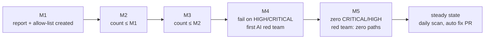
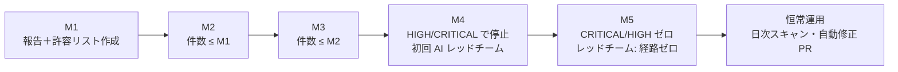

# ADR-03 Staged Security Gate / セキュリティの門の段階化

> **Summary:** We want zero vulnerabilities that would resist a top-tier AI attacker, but every current base image is end-of-life. We decided on a gate that starts as "report plus a shrinking allow-list" at M1 and becomes "zero CRITICAL/HIGH plus a passing AI red team" at M5, instead of enforcing zero from the first day or warning forever.
> **概要:** 最上位の AI 攻撃者にも耐える脆弱性ゼロを目指すが、現行のベースイメージはすべてサポート終了である。初日からゼロを強制する案も、ずっと警告だけの案も採らず、M1 では「報告＋減っていく許容リスト」、M5 では「CRITICAL/HIGH ゼロ＋AI レッドチーム合格」へ厳しくなる門を採った。

**Jump:** [English](#english) · [日本語](#japanese)

- Version / 版: 0.2 — 2026-11-06. **Learned:** a glossary term is only explained for the reader when its note sits at the first occurrence in prose, so first-use notes were added in both halves (SPEC-06 §3). ／ 用語注は本文の初出の位置に置かなければ読者に届かないと分かったため、英和両方の初出に用語注を補った（SPEC-06 §3）。
- Version / 版: 0.1 — 2026-11-05. **Learned:** a safety rule that cannot be met on the day it is written is not a rule but a wish; writing the schedule down turns the wish into something we can measure at each milestone. ／ 書いた日に守れない安全規則は規則ではなく願いにすぎず、予定表として書くことで、節目ごとに測れるものになると分かった。
- Status: Accepted (owner, 2026-11-05). Review date: at the start of M4.
- Related: [SPEC-03 Security Gate](../spec/03_security_gate.md) · [SPEC-00 Overview](../spec/00_overview.md) · [SPEC-02 Installer CLI](../spec/02_installer_cli.md) · [SPEC-05 Upstream Tracking](../spec/05_upstream_tracking.md) · [SPEC-06 Documentation Conventions](../spec/06_documentation_conventions.md) · [POL-01 Position](../policy/POL-01_Developer_Environment_2027_Position.md) · [ADR-01 Integration Repository Placement](ADR-01_Integration_Repository_Placement.md) · [ADR-02 Network Model](ADR-02_Network_Model.md) · [ADR-04 AI Autonomy and Roles](ADR-04_AI_Autonomy_and_Roles.md) · [docs/README.md](../README.md)

---

<a id="english"></a>
## English

[→ 日本語版へ](#japanese)

### 1. Context

The owner's final goal for the developer environment 2027 ([POL-01](../policy/POL-01_Developer_Environment_2027_Position.md)) is to remove *vulnerabilities* (known weak spots that an attacker could use) until the system resists even a top-tier AI attacker, and to keep removing them with AI agents even if COS (the Center for Open Science, the US group that makes OSF) discontinues OSF (the research-sharing software GRDM is built on). A *security gate* (a checkpoint an install must pass) is the tool that makes this measurable: see [SPEC-03](../spec/03_security_gate.md).

The starting point is far from zero. The *base images* (the ready-made operating system and language layers our containers are built on) used by the six core repositories are all *end-of-life* (EOL: the maker no longer publishes security fixes):

```toon
base_images_2026_11[9]{service,base,eol_status}:
  osf.io,"node:12 + Python 3.6",EOL
  waterbutler,"Python 3.6",EOL
  mfr,"Python 3.5",EOL
  ember-osf-web,"node:8",EOL
  cas-overlay,"JDK 8",EOL
  postgres,"9.6",EOL
  mongo,"3.4",EOL
  elasticsearch,"2.x",EOL
  elasticsearch,"6.3.1",EOL
```

A first scan with Trivy (a scanner that reads our images and lists the security holes it knows about) of such a stack reports hundreds of CVEs, dozens of them HIGH or CRITICAL, and most of them cannot be fixed without the Python 3.13 port planned for M4 and the middleware consolidation planned for M5. If the gate demanded zero at M1, no install would ever complete, and we would have no running baseline to measure the acceptance tests of [SPEC-04](../spec/04_acceptance_tests.md) against. On the other hand, a gate that only warns gives nobody a reason to fix anything, and the final goal would never be reached.

### 2. Options considered

| Option | Description | Why rejected / chosen |
|---|---|---|
| A. Enforce zero from M1 | `grdm-dev install` stops on any HIGH or CRITICAL from the first day. | Rejected. Every install would fail. There would be no running environment to port against, no regression baseline, and no evidence of what the fixes change. |
| B. Warn only, forever | Scan, print the counts, never stop. | Rejected. Contradicts the owner's goal. The counts would stay high because nothing forces them down. Overseas distribution (M5) would ship known weaknesses. |
| **C. Staged gate with a shrinking allow-list (chosen)** | M1–M3: baseline controls are mandatory; CVEs are reported and listed in an allow-list whose entry count must never grow between milestones. M4: fail on HIGH/CRITICAL not allow-listed; first AI red team. M5: fail on any CRITICAL/HIGH; AI red team reports zero unresolved intrusion paths. | Chosen. Installs run from day one, the direction of travel is enforced by the never-increasing count, and the final state equals the owner's goal. |

A variant of C that counted only CRITICAL at M4 was considered and dropped: the Python 3.13 port removes most HIGH findings at the same time, so splitting the threshold would buy nothing.

### 3. Decision

1. The gate follows the schedule in [SPEC-03 §5.2](../spec/03_security_gate.md). The current milestone is stored in `manifest/milestone.json` and only the owner changes it.
2. The *baseline controls* of [SPEC-03 §3](../spec/03_security_gate.md) (random secrets with mode 0600, publish only on `127.0.0.1`, internal network, non-root, no privileged, resource limits, pinned digests, secret scanning in CI) have **no stage and no allow-list**. They fail the gate at every milestone, including M1.
3. The *allow-list* (`manifest/allowlist.json`) is the only way to pass a known finding. Every entry carries a CVE (the public ID number of one known security hole), component, reason, owner, and expiry date. The entry count is compared with the previous milestone's baseline and **must never increase**. Only the owner approves additions.
4. From M4, any HIGH or CRITICAL finding not in the allow-list stops `grdm-dev install` with exit code 50 ([SPEC-02](../spec/02_installer_cli.md)).
5. At M5 and in steady state, CRITICAL and HIGH must be zero, the allow-list may contain no CRITICAL or HIGH entry, and the AI red team ([SPEC-03 §6](../spec/03_security_gate.md)) must report zero unresolved intrusion paths.
6. The environment is documented as development-only and never exposed outside `127.0.0.1` while any allow-list entry exists ([ADR-02](ADR-02_Network_Model.md)).



### 4. Consequences

Positive:

- Installs work from M1, so acceptance tests and the Python 3.13 port have a running baseline.
- Every milestone has a number the owner can check: the allow-list count, which may only go down.
- The final state (M5) is exactly the owner's goal, written in a form that `grdm-dev scan` can verify.
- The non-staged baseline controls mean that even an M1 install is not exposed to the LAN and has no default passwords.

Negative and how we handle them:

- Between M1 and M3 the environment knowingly runs EOL software. We state this in every report header and in [docs/README.md](../README.md), and we keep the environment on `127.0.0.1` only.
- The allow-list needs maintenance: expiry dates force re-evaluation at each milestone. AID (AI開発担当者) proposes, REV (担当レビュワ) and QAE (QA担当) check, the owner approves ([ADR-04](ADR-04_AI_Autonomy_and_Roles.md)).
- The jump from M3 to M4 is large. The M4 switch is therefore done only after the Python 3.13 port lands, and this decision is reviewed at the start of M4 (see §5).

### 5. Review

This decision is reviewed at the start of M4. Questions to answer then: whether the allow-list count has in fact decreased at M2 and M3; whether the M4 threshold should include MEDIUM for network-facing services; and which model and runner the AI red team uses (open item in [POL-01](../policy/POL-01_Developer_Environment_2027_Position.md)).

---

<a id="japanese"></a>
## 日本語

[→ To English](#english)

### 1. 背景

開発環境 2027 版の所有者の最終ゴール（[POL-01](../policy/POL-01_Developer_Environment_2027_Position.md)）は、「脆弱性」（攻撃者が侵入に使えると分かっている弱い所）を最上位の AI 攻撃者にも耐えるまで除去し、COS（OSF を作る米国の団体 Center for Open Science）が OSF（GRDM の土台になった研究共有ソフト）を廃止しても AI エージェントで除去を続けることです。「セキュリティの門」（導入が必ず通る検問所）は、これを測れるようにする道具です（[SPEC-03](../spec/03_security_gate.md)）。

出発点はゼロから遠い所にあります。コア 6 本が使う「ベースイメージ」（コンテナの土台になる、出来合いの OS と言語の層）は、すべて「サポート終了」（EOL。作り手が安全上の修正を出さなくなった状態）です。

```toon
base_images_2026_11[9]{service,base,eol_status}:
  osf.io,"node:12 + Python 3.6",EOL
  waterbutler,"Python 3.6",EOL
  mfr,"Python 3.5",EOL
  ember-osf-web,"node:8",EOL
  cas-overlay,"JDK 8",EOL
  postgres,"9.6",EOL
  mongo,"3.4",EOL
  elasticsearch,"2.x",EOL
  elasticsearch,"6.3.1",EOL
```

この構成を Trivy（イメージを読んで既知の穴を並べるスキャナ）で初めてスキャンすると数百件の CVE（既知の穴一つに付けられた公開の番号）が出て、そのうち数十件が HIGH か CRITICAL で、大半は M4 予定の Python 3.13 移植と M5 予定のミドルウェア集約なしには直せません。門が M1 でゼロを求めれば、導入は一度も完了せず、[SPEC-04](../spec/04_acceptance_tests.md) の受入試験を測る動く基準環境も得られません。逆に、警告だけの門では誰にも直す理由がなく、最終ゴールには永遠に届きません。

### 2. 検討した選択肢

| 選択肢 | 内容 | 退けた・採った理由 |
|---|---|---|
| A. M1 からゼロを強制 | 初日から HIGH か CRITICAL が一件でもあれば `grdm-dev install` を止める。 | 退けた。すべての導入が失敗する。移植の土台となる動く環境も、回帰の基準も、修正が何を変えたかの証拠も得られない。 |
| B. ずっと警告のみ | スキャンして件数を出すだけで、止めない。 | 退けた。所有者のゴールと矛盾する。減らす力が働かず件数は高いまま。海外配布（M5）で既知の弱点を出荷することになる。 |
| **C. 減っていく許容リスト付きの段階的な門（採用）** | M1〜M3: 基本対策は必須。CVE は報告し、節目をまたいで件数が増えない許容リストに載せる。M4: 許容リスト外の HIGH/CRITICAL で停止。初回の AI レッドチーム。M5: CRITICAL/HIGH が一件でもあれば停止。AI レッドチームが未解決の侵入経路ゼロを報告。 | 採用。初日から導入が動き、「増えない件数」が進む方向を強制し、最終状態が所有者のゴールと一致する。 |

C の変種として、M4 では CRITICAL だけを数える案も検討して落としました。Python 3.13 移植が HIGH の大半も同時に取り除くため、基準を分けても得るものがないからです。

### 3. 決定

1. 門は [SPEC-03 §5.2](../spec/03_security_gate.md) の予定表に従う。現在の節目は `manifest/milestone.json` に置き、変更できるのは所有者だけ。
2. [SPEC-03 §3](../spec/03_security_gate.md) の「基本対策」（乱数の秘密をモード 0600 で、`127.0.0.1` のみ公開、内部ネットワーク、非 root、privileged なし、資源制限、ダイジェスト固定、CI での秘密スキャン）には**段階も許容リストもない**。M1 を含むすべての節目で門を落とす。
3. 既知の検出を通す唯一の方法は「許容リスト」（`manifest/allowlist.json`）。各項目は CVE 番号、部品、理由、担当、期限を持つ。件数は前の節目の基準と比べ、**決して増えてはならない**。追加の承認は所有者だけ。
4. M4 から、許容リストにない HIGH・CRITICAL の検出は `grdm-dev install` を終了コード 50 で止める（[SPEC-02](../spec/02_installer_cli.md)）。
5. M5 と恒常運用では、CRITICAL と HIGH はゼロ、許容リストに CRITICAL・HIGH の項目があってはならず、AI レッドチーム（[SPEC-03 §6](../spec/03_security_gate.md)）が未解決の侵入経路ゼロを報告しなければならない。
6. 許容リストに項目がある間は、環境を開発専用と明記し、`127.0.0.1` の外へ出さない（[ADR-02](ADR-02_Network_Model.md)）。



### 4. 結果

良い点:

- M1 から導入が動くので、受入試験と Python 3.13 移植に動く基準環境がある。
- 各節目に所有者が確かめられる数字がある。許容リストの件数で、減る方向にしか動かない。
- 最終状態（M5）は所有者のゴールそのもので、`grdm-dev scan` が検証できる形で書かれている。
- 段階のない基本対策により、M1 の導入でも LAN に露出せず、既定のパスワードもない。

悪い点とその扱い:

- M1〜M3 の間、環境は承知の上でサポート終了のソフトを動かす。これを全報告のヘッダと [docs/README.md](../README.md) に明記し、環境を `127.0.0.1` だけに留める。
- 許容リストには手入れが要る。期限が各節目で再評価を強制する。AID（AI開発担当者）が提案し、REV（担当レビュワ）と QAE（QA担当）が確認し、所有者が承認する（[ADR-04](ADR-04_AI_Autonomy_and_Roles.md)）。
- M3 から M4 への段差が大きい。そのため M4 への切替は Python 3.13 移植が入った後にだけ行い、この決定を M4 の開始時に見直す（§5）。

### 5. 見直し

この決定は M4 の開始時に見直します。そのとき答える問い: M2・M3 で許容リストの件数が実際に減ったか。ネットワークに面するサービスについて M4 の基準に MEDIUM を含めるべきか。AI レッドチームに使うモデルと実行基盤をどうするか（[POL-01](../policy/POL-01_Developer_Environment_2027_Position.md) の未決事項）。

---

## Glossary / 用語

| Term | English note | 日本語注 |
|---|---|---|
| End-of-life (EOL) | The maker no longer publishes security fixes for that version. | 作り手がその版の安全上の修正を出さなくなった状態。 |
| Base image | The ready-made OS and language layer a container is built on. | コンテナの土台になる、出来合いの OS と言語の層。 |
| Allow-list | Known findings we accept for a limited time, with a reason and an owner. | 理由と担当を付けて期限付きで受け入れる既知の検出の一覧。 |
| Threshold | The line that decides pass or fail. | 合格と不合格を分ける線。 |
| Exit code | The number a program returns when it finishes; 0 means success. | プログラムが終わるときに返す番号。0 は成功。 |
