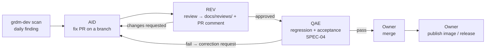
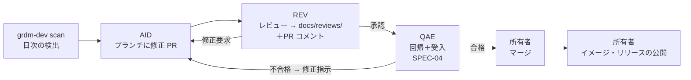

# ADR-04 AI Autonomy and Roles / AI の自律度と役割

> **Summary:** AI agents detect vulnerabilities, write fix pull requests, review them, and run regression and acceptance tests on their own. Humans keep two actions: merge and publish. This record names who plays which role (AID, QAE, REV, owner), what the agents may never do, and the one question left open.
> **概要:** AI エージェントは脆弱性の検出、修正 PR の作成、レビュー、回帰・受入試験の実行までを自律的に行う。人に残すのはマージと公開の二つ。誰がどの役割（AID・QAE・REV・所有者）を担うか、エージェントが決してしてはならないこと、残した一つの未決事項を記す。

**Jump:** [English](#english) · [日本語](#japanese)

- Version / 版: 0.5 — 2026-11-06. **Learned:** a glossary term is only explained for the reader when its note and REF-01 link sit at the first prose use, counting lower-case and plural forms, so first-use notes with links were added in both halves (SPEC-06 §3). ／ 用語注と REF-01 へのリンクは、小文字や複数形も含めた本文の初出に置かなければ読者に届かないと分かったため、英和両方の初出にリンク付きの用語注を補った（SPEC-06 §3）。
- Version / 版: 0.4 — 2026-11-06. **Learned:** per-PR delegation questions interrupt the owner several times a day during a review-heavy milestone; a standing delegation with explicit conditions and an expiry keeps the human rule while removing the waits. ／ レビューの多い節目では PR ごとの委任確認が一日に何度も所有者を止める。条件と期限を明示した常設委任なら、人の規則を保ちつつ待ちをなくせる。
  0.3 — 2026-11-06. **Learned:** each delegated merge batch is recorded before it is executed, with the review records that justify it, so that the human-merge rule stays auditable. ／ 委任されたマージは一括でも実行前に、根拠となるレビュー記録とともに記録し、「人がマージする」規則を監査できる状態に保つ。
  0.2 — 2026-11-05. **Learned:** a one-time delegation must be written down with scope, grantor and evidence before it is used, or the human-merge rule erodes silently. ／ 一回限りの委任でも、使う前に範囲・許可者・証跡を書き残さなければ「人がマージする」規則が静かに崩れると分かった。
  0.1 — 2026-11-05. **Learned:** the line between "automatic" and "human" is easiest to defend when it sits on two concrete commands, merge and publish, rather than on a judgment such as "important changes". ／ 「自動」と「人」の境目は、「重要な変更」のような判断ではなく、マージと公開という二つの具体的な操作に置くと最も守りやすいと分かった。
- Status: Accepted (owner, 2026-11-05). Review date: after steady-state operation has run for one month (open question in §5).
- Related: [SPEC-00 Overview](../spec/00_overview.md) · [SPEC-02 Installer CLI](../spec/02_installer_cli.md) · [SPEC-03 Security Gate](../spec/03_security_gate.md) · [SPEC-04 Acceptance Tests](../spec/04_acceptance_tests.md) · [SPEC-05 Upstream Tracking](../spec/05_upstream_tracking.md) · [SPEC-06 Documentation Conventions](../spec/06_documentation_conventions.md) · [POL-01 Position](../policy/POL-01_Developer_Environment_2027_Position.md) · [ADR-01 Integration Repository Placement](ADR-01_Integration_Repository_Placement.md) · [ADR-02 Network Model](ADR-02_Network_Model.md) · [ADR-03 Staged Security Gate](ADR-03_Staged_Security_Gate.md) · [docs/README.md](../README.md)

---

<a id="english"></a>
## English

[→ 日本語版へ](#japanese)

### 1. Context

The owner's goal ([POL-01](../policy/POL-01_Developer_Environment_2027_Position.md)) is that GRDM keeps being provided even if COS (the Center for Open Science, the US group that makes OSF; see [REF-01](../reference/REF-01_Glossary.md)) discontinues OSF (the research-sharing software GRDM is built on; see [REF-01](../reference/REF-01_Glossary.md)), through *continuous vulnerability remediation* (finding and fixing weak spots again and again, every day, not once) done by *AI agents* (programs that read, write, and test code on their own when given a task). The security gate of [SPEC-03](../spec/03_security_gate.md) produces a daily list of findings; someone must turn each finding into a fix.

At the same time, the development policy POL-05 of the GRDM core repository, which this repository inherits, draws two lines that must not move:

- **An author never accepts their own work.** The one who wrote a change does not judge whether it passes.
- **Merge and publish are human actions.** (Merge: accepting a change into the shared branch; see [REF-01](../reference/REF-01_Glossary.md).) No agent commits to the main branch or publishes an image or a release.

The question is how much of the path between "finding" and "merge" AI agents may walk alone.

### 2. Options considered

| Option | Description | Why rejected / chosen |
|---|---|---|
| 1. Detect only | Agents scan and open issues; humans do everything else. | Rejected. Does not scale to daily findings across eleven repositories. The owner would be the bottleneck, and the goal of continued provision without COS would not be met. |
| **2. Detect → fix PR → review → automatic regression and acceptance; humans merge and publish (chosen)** | Agents do all the work that produces evidence. Humans do the two actions that change what others receive. | Chosen. Keeps both POL-05 lines intact. Author (AID), reviewer (REV), and judge (QAE) are three different agents, so no one accepts their own work. The owner sees a PR with review and test evidence attached and only decides. |
| 3. Auto-merge after review | Same as 2, but the PR merges itself when review and tests pass. | Rejected for now. Conflicts with POL-05 "merge by humans". A narrow exception for vulnerability-only fixes is kept as an open question (§5). |

### 3. Decision

#### 3.1 Roles

Role abbreviations follow the table in `AGENTS.md`. In records, write the abbreviation with the Japanese role name, for example `AID（AI開発担当者）`.

```toon
roles[4]{abbr,ja_name,who,runs_on,does}:
  AID,AI開発担当者,"Orca Open Code 2 workers","local LLM Qwen 3 Coder Next (model id lmstudio/qwen3-coder-next-mlx)","implement to spec, write fix PRs, propose allow-list entries"
  QAE,QA担当,"Claude Code Fable","Claude Code session on Mac Studio","check implementations, run regression and acceptance (SPEC-04), judge pass/fail, write correction requests"
  REV,担当レビュワ,"Codex Astra (model id gpt-6-astra)","Orca worker","independent review of every PR; record in docs/reviews/ and as a PR comment"
  owner,所有者,"Yusuke Komiyama","human","merge, publish, exceptions, milestone changes, red-team approval"
```

The three agent roles are played by three different models on purpose, so that an error habit of one model is not shared by its reviewer or its judge.

#### 3.2 Flow



- Every step up to and including QAE's judgment is automatic and may run without a human present.
- The owner merges with `gh pr merge` (Japanese subject) or declines. The owner publishes images to `ghcr.io/rcosdp` and tags releases.
- *Subagents* (helper agents an agent starts to split its work) are unlimited in number. The role that started them is responsible for their output.

#### 3.3 Evidence trail

Every PR carries, before the owner sees it:

1. The finding it fixes (CVE id or scan report path from [SPEC-03 §7](../spec/03_security_gate.md)).
2. REV's review record in `docs/reviews/YYYY-MM-DD_<Title>_rN.md` and the same text as a PR comment.
3. QAE's test record: the `grdm-dev accept` and `grdm-dev scan` TOON (a compact text form of JSON; see [REF-01](../reference/REF-01_Glossary.md)) excerpts, pass or fail, and the commit SHA (the fingerprint of one commit; see [REF-01](../reference/REF-01_Glossary.md)) tested.
4. A Japanese commit subject with a scoped prefix (`fix(security):`).

A PR without all four is not ready for the owner; QAE returns it to AID.

#### 3.4 Forbidden for every agent

- `git push --force` to any branch, ever.
- Deleting branches, tags, repositories, images, or data of any kind.
- Writing (push, PR creation, issue creation, comments) to any upstream repository: RCOSDP public cores, RCOSDP `-private` variants, or CenterForOpenScience. Agents write only to this repository and to the `-dev2027` repositories.
- Merging to `develop` or any protected branch; enabling auto-merge; changing branch protection.
- Publishing images, releases, or documentation sites.
- Copying `-private` code, secrets, or private repository URLs into this public repository ([ADR-01](ADR-01_Integration_Repository_Placement.md)).
- Running red-team techniques against anything outside the isolated environment ([SPEC-03 §6](../spec/03_security_gate.md)).

### 4. Consequences

- Remediation keeps pace with daily scans without waiting for human working hours; the owner's work shrinks to reading evidence and clicking merge.
- Three different models in three roles raise the cost of a shared blind spot and satisfy "no self-acceptance" structurally.
- Local LLM (large language model: an AI that reads and writes text; see [REF-01](../reference/REF-01_Glossary.md)) workers (AID) have variable quality. The spec-first rule (specifications in `docs/spec/` are written before work is handed to AID) and the QAE check are the compensation. A PR that fails QAE twice is closed and restarted from the spec.
- Running three agent systems costs Mac Studio resources. Concurrency of Open Code 2 (the AI program that writes our code; see [REF-01](../reference/REF-01_Glossary.md)) workers is an open item of [POL-01](../policy/POL-01_Developer_Environment_2027_Position.md).
- Review time from the owner is the only remaining latency. If it becomes the bottleneck for vulnerability fixes, §5 is revisited.

### 5. Open question

**Should vulnerability-only fixes be allowed to auto-merge after REV approval and QAE pass?** Arguments for: faster closure of HIGH findings in steady state. Arguments against: POL-05 keeps merge human; a wrong automatic merge in a security path is the most expensive kind of error. Decision deferred until steady-state operation has run for about one month and the owner has seen the real volume and quality of fix PRs. Until then, option 2 stands as written.

---

### Recorded exceptions

| Date | Exception | Scope | Granted by | Evidence |
|---|---|---|---|---|
| 2026-11-05 | QAE (Claude Code Fable) merges PR #19 of RDM-developer-guide itself, using the repository administrator path of the branch protection because the author cannot approve its own pull request | This one pull request only. Merge, not approve; no other repository | Owner, in the session dialogue | REV r3 record `docs/reviews/2026-11-05_RDM-developer-guide_M1_Skeleton_PR_r3.md` (approve recommended), CI 6/6 green on the merged head |
| 2026-11-06 | QAE (Claude Code Fable) merges, under the owner's explicit delegation given in the session dialogue: RDM-developer-guide PR #20 (manifest: Shibboleth-SP public upstream; ADR-01 §3/§5; Codex r4 pass) and PR #21 (installer M2 stage 1; Codex r5 pass, CI 6/6), and the seven strict-reconstruction pull requests in the private `-dev2027` repositories (Codex r1 pass for five, r2 confirmation for osf.io #2 and Shibboleth-SP #1). Repository-administrator path because the author cannot approve its own pull requests | These nine pull requests only; merge, not approve; no force-push | Owner, in the session dialogue (2026-11-06) | Review records `docs/reviews/2026-11-05_RDM-developer-guide_PR20_*_r4.md`, `2026-11-06_RDM-developer-guide_PR21_Installer_r5.md`, `2026-11-05_dev2027_Strict_Reconstruction_PRs_r1.md`/`_r2.md` |
| 2026-11-06 | **Standing delegation for milestone M2:** QAE (Claude Code Fable) merges any pull request in RDM-developer-guide or a `-dev2027` repository once REV (Codex Astra) has recorded a pass verdict in `docs/reviews/` and every CI check is green on the merged head. Each merge is still listed in this table or in the status board with its review record. Publishing (tags, releases, registry pushes) stays with the owner | Pull requests only, while M2 is in progress; revoked automatically when M2 is marked done on the status board unless renewed | Owner, in the session dialogue (2026-11-06) | This row; per-merge references in `docs/status/README.md` |

The rule "merge and publish are human" is unchanged; every further merge needs its own recorded exception or the owner's hand.

---

<a id="japanese"></a>
## 日本語

[→ To English](#english)

### 1. 背景

所有者のゴール（[POL-01](../policy/POL-01_Developer_Environment_2027_Position.md)）は、COS（OSF を作る米国の団体 Center for Open Science。[REF-01](../reference/REF-01_Glossary.md)）が OSF（GRDM の土台になった研究共有ソフト。[REF-01](../reference/REF-01_Glossary.md)）を廃止しても、「AI エージェント」（課題を与えると自分でコードを読み・書き・試すプログラム）による「継続的な脆弱性対応」（弱い所を一度でなく毎日くり返し見つけて直すこと）で GRDM の提供を続けることです。[SPEC-03](../spec/03_security_gate.md) の門は毎日検出の一覧を出します。誰かがその一件一件を修正に変えなければなりません。

一方で、このリポジトリが継承する GRDM コアの開発方針 POL-05 は、動かしてはならない二本の線を引いています。

- **作者は自分の成果を受け入れない。** 変更を書いた者が合否を判定しない。
- **マージと公開は人の操作。**（マージ＝変更を共有ブランチへ受け入れること。[REF-01](../reference/REF-01_Glossary.md)）どのエージェントも主ブランチにコミットせず、イメージやリリースを公開しない。

問いは、「検出」から「マージ」までの道のどこまでを AI エージェントが一人で歩いてよいかです。

### 2. 検討した選択肢

| 選択肢 | 内容 | 退けた・採った理由 |
|---|---|---|
| 1. 検出のみ | エージェントはスキャンして issue を開き、残りは人が行う。 | 退けた。11 本のリポジトリで毎日出る検出に追いつかない。所有者がボトルネックになり、COS なしで提供を続けるゴールに届かない。 |
| **2. 検出 → 修正 PR → レビュー → 回帰・受入の自動実行。マージと公開は人（採用）** | 証拠を作る仕事はすべてエージェントが行う。他者が受け取るものを変える二つの操作だけを人が行う。 | 採用。POL-05 の二本の線をそのまま守れる。作者（AID）、レビュワ（REV）、判定者（QAE）が別々のエージェントなので、誰も自分の成果を受け入れない。所有者はレビューと試験の証拠が付いた PR を見て、決めるだけでよい。 |
| 3. レビュー後に自動マージ | 2 と同じだが、レビューと試験に合格すると PR が自分でマージされる。 | 今は退けた。POL-05 の「マージは人」と衝突する。脆弱性修正だけの狭い例外は未決事項として残す（§5）。 |

### 3. 決定

#### 3.1 役割

役割の略称は `AGENTS.md` の対応表に従います。記録では `AID（AI開発担当者）` のように略称と日本語の役割名を併記します。

```toon
roles[4]{abbr,ja_name,who,runs_on,does}:
  AID,AI開発担当者,"Orca の Open Code 2 ワーカー","ローカル LLM Qwen 3 Coder Next（モデル ID lmstudio/qwen3-coder-next-mlx）","仕様どおりの実装、修正 PR の作成、許容リスト項目の提案"
  QAE,QA担当,"Claude Code Fable","Mac Studio 上の Claude Code セッション","実装の検査、回帰・受入の実行（SPEC-04）、合否の判定、修正指示の作成"
  REV,担当レビュワ,"Codex Astra（モデル ID gpt-6-astra）","Orca ワーカー","全 PR の独立レビュー。docs/reviews/ と PR コメントに記録"
  owner,所有者,"込山悠介","人","マージ、公開、例外、節目の変更、レッドチームの承認"
```

三つのエージェントの役割を三つの異なるモデルに割り当てるのは意図的です。一つのモデルの間違いの癖を、そのレビュワや判定者が共有しないようにするためです。

#### 3.2 流れ



- QAE の判定までのすべての段階は自動で、人がいなくても動いてよい。
- 所有者は `gh pr merge`（日本語の件名）でマージするか、却下する。所有者が `ghcr.io/rcosdp` にイメージを公開し、リリースにタグを付ける。
- 「サブエージェント」（エージェントが仕事を分けるために起こす補助のエージェント）の数に制限はない。起こした役割がその成果に責任を持つ。

#### 3.3 証跡

所有者が見る前に、すべての PR は次を持ちます。

1. 直す検出（CVE 番号か、[SPEC-03 §7](../spec/03_security_gate.md) のスキャン報告のパス）。
2. REV のレビュー記録 `docs/reviews/YYYY-MM-DD_<題>_rN.md` と、同じ文の PR コメント。
3. QAE の試験記録: `grdm-dev accept` と `grdm-dev scan` の TOON（JSON を短く書いた文字の形。[REF-01](../reference/REF-01_Glossary.md)）抄録、合否、試験したコミット SHA（コミット一つの指紋。[REF-01](../reference/REF-01_Glossary.md)）。
4. 接頭辞付きの日本語のコミット件名（`fix(security):`）。

四つがそろわない PR は所有者に出す状態ではなく、QAE が AID へ戻します。

#### 3.4 すべてのエージェントに禁止すること

- どのブランチへも、いつでも、`git push --force` をしない。
- ブランチ、タグ、リポジトリ、イメージ、あらゆるデータを削除しない。
- 上流リポジトリ（RCOSDP の公開コア、RCOSDP の `-private` 版、CenterForOpenScience）へ書き込まない（push、PR 作成、issue 作成、コメント）。エージェントが書くのはこのリポジトリと `-dev2027` 群だけ。
- `develop` や保護されたブランチへマージしない。自動マージを有効にしない。ブランチ保護を変えない。
- イメージ、リリース、文書サイトを公開しない。
- `-private` のコード、秘密、非公開リポジトリの URL をこの公開リポジトリに写さない（[ADR-01](ADR-01_Integration_Repository_Placement.md)）。
- 隔離環境の外のどこにもレッドチームの手法を使わない（[SPEC-03 §6](../spec/03_security_gate.md)）。

### 4. 結果

- 修正が人の勤務時間を待たずに日次スキャンと同じ速さで進む。所有者の仕事は証拠を読んでマージを押すことに縮む。
- 三つの役割に三つの異なるモデルを置くことで、共通の盲点が生まれにくくなり、「自己受入の禁止」が構造として満たされる。
- ローカル LLM（大規模言語モデル。文章を読み書きする AI。[REF-01](../reference/REF-01_Glossary.md)）のワーカー（AID）は品質がばらつく。仕様先行の決まり（`docs/spec/` の仕様を書いてから AID に渡す）と QAE の検査がその補いになる。QAE に二度落ちた PR は閉じ、仕様からやり直す。
- 三つのエージェント体系を動かすと Mac Studio の資源を使う。Open Code 2（コードを書く AI プログラム。[REF-01](../reference/REF-01_Glossary.md)）ワーカーの同時実行数は [POL-01](../policy/POL-01_Developer_Environment_2027_Position.md) の未決事項。
- 残る待ち時間は所有者のレビュー時間だけ。それが脆弱性修正のボトルネックになったら §5 を見直す。

### 5. 未決事項

**脆弱性修正だけの PR に、REV 承認と QAE 合格の後の自動マージを認めるか。** 賛成の理由: 恒常運用で HIGH の検出をより早く閉じられる。反対の理由: POL-05 はマージを人に残している。セキュリティの経路での誤った自動マージは最も高くつく種類の誤りである。恒常運用を約一か月回し、所有者が修正 PR の実際の量と質を見てから決める。それまでは選択肢 2 を書いたとおりに適用する。

---

### 記録した例外

| 日付 | 例外 | 範囲 | 許可者 | 証跡 |
|---|---|---|---|---|
| 2026-11-05 | QAE（Claude Code Fable）が RDM-developer-guide 自身の PR #19 をマージする。作者は自分の PR を承認できないため、ブランチ保護の管理者経路を使う | この PR 1 件のみ。承認ではなくマージ。他リポジトリには及ばない | 所有者（セッション内の対話） | REV r3 記録 `docs/reviews/2026-11-05_RDM-developer-guide_M1_Skeleton_PR_r3.md`（approve 推奨）、マージ対象 head で CI 6/6 合格 |
| 2026-11-06 | QAE（Claude Code Fable）が、セッション内で所有者が明示した委任により次をマージする: RDM-developer-guide PR #20（manifest: Shibboleth-SP の公開上流、ADR-01 §3/§5。Codex r4 合格）と PR #21（インストーラー M2 第 1 段。Codex r5 合格、CI 6/6）、および非公開 `-dev2027` リポジトリの厳密再構築 PR 7 本（Codex r1 で 5 本合格、osf.io #2 と Shibboleth-SP #1 は r2 で対応確認）。作者は自分の PR を承認できないためリポジトリ管理者の経路を使う | この 9 件の PR のみ。承認ではなくマージ。force push なし | 所有者（セッション内の対話、2026-11-06） | レビュー記録 `docs/reviews/2026-11-05_RDM-developer-guide_PR20_*_r4.md`、`2026-11-06_RDM-developer-guide_PR21_Installer_r5.md`、`2026-11-05_dev2027_Strict_Reconstruction_PRs_r1.md`/`_r2.md` |
| 2026-11-06 | **節目 M2 の間の常設委任:** REV（Codex Astra）が `docs/reviews/` に合格の判定を記録し、マージ対象の head で CI がすべて緑の PR は、RDM-developer-guide と `-dev2027` のいずれでも QAE（Claude Code Fable）がマージする。各マージはこの表か進捗ボードにレビュー記録とともに残す。公開（タグ・リリース・レジストリへの push）は引き続き所有者が行う | PR のみ。M2 進行中に限る。進捗ボードで M2 が完了になった時点で、更新がなければ自動的に失効 | 所有者（セッション内の対話、2026-11-06） | この行と、`docs/status/README.md` のマージごとの参照 |

「マージと公開は人が行う」という規則は変わらない。以後のマージはそれぞれ例外の記録か所有者の手を要する。

---

## Glossary / 用語

| Term | English note | 日本語注 |
|---|---|---|
| AI agent | A program that reads, writes, and tests code on its own when given a task. | 課題を与えると自分でコードを読み・書き・試すプログラム。 |
| Subagent | A helper agent that an agent starts to split its work. | エージェントが仕事を分けるために起こす補助のエージェント。 |
| Pull request (PR) | A proposed change that others can review before it joins the main code. | 主なコードに入る前に、他の人が確かめられる変更の提案。 |
| Merge | Joining a reviewed change into the main branch. | レビュー済みの変更を主ブランチに入れること。 |
| Publish | Making an image, release, or site available to others. | イメージ、リリース、サイトを他の人が使える状態にすること。 |
| Force push | Overwriting shared history on a branch; it can erase other people's work. | 共有された履歴を上書きすること。他の人の作業を消すことがある。 |
| Self-acceptance | An author judging that their own work passes. | 作者が自分の成果を合格と判定すること。 |
