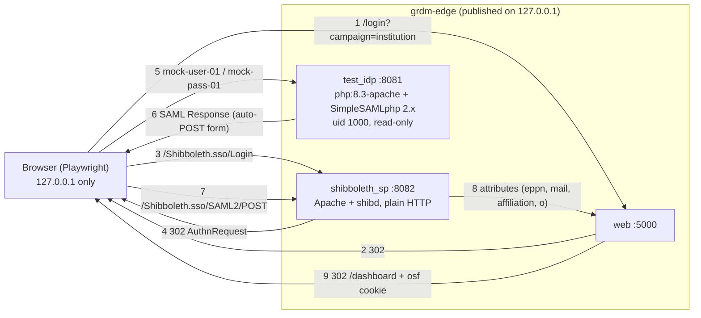
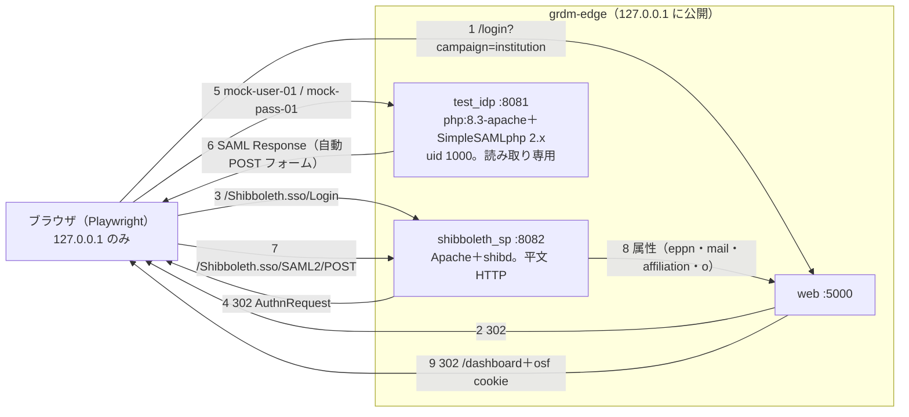

# ADR-05 Test IdP for Shibboleth / Shibboleth 用テスト IdP

> **Summary:** The `--auth shibboleth` profile needs a login server that the Shibboleth SP can trust without the Internet. We compared a ready-made SimpleSAMLphp image, Keycloak's SAML server, and the Shibboleth IdP itself, and chose to build our own tiny `test-idp` image from the official SimpleSAMLphp release on `php:8.3-apache`: small, scriptable, arm64 and amd64, non-root, read-only, and populated only with clearly labelled mock users.
> **概要:** `--auth shibboleth` プロファイルには、インターネットなしで Shibboleth SP が信頼できるログインサーバが要る。既製の SimpleSAMLphp イメージ、Keycloak の SAML サーバ、Shibboleth IdP 本体を比べ、SimpleSAMLphp 公式リリースを `php:8.3-apache` に載せた自前の小さな `test-idp` イメージを組むことにした。小さく、設定を機械で書け、arm64 と amd64 で動き、非 root・読み取り専用で、明確に模擬と分かる利用者だけを持つ。

**Jump:** [English](#english) · [日本語](#japanese)

- Version / 版: 0.1 — 2026-11-06. **Learned:** every ready-made test IdP image we found fails at least one baseline control of SPEC-03 §3 (root, amd64 only, floating tag, or a Java heap larger than the rest of the profile), so the smallest honest option is to own the image: a few lines of Dockerfile over an official multi-arch base, with the configuration rendered from templates like every other service. ／ 見つけた既製のテスト IdP イメージはどれも SPEC-03 §3 の基本対策のどこかに外れる（root、amd64 のみ、動くタグ、プロファイル全体より大きい Java ヒープ）。だから最も小さく正直な選択は、公式のマルチアーキテクチャのベースに数行の Dockerfile を載せた自前のイメージを持ち、設定はほかのサービスと同じくテンプレートから描画することだと分かった。
- Status: Proposed for the owner's approval, 2026-11-06 (M3 preparation). Review date: start of M4.
- Records a decision for: [SPEC-04 §5](../spec/04_acceptance_tests.md#english) · [SPEC-02 §4](../spec/02_installer_cli.md#2-en-ports) · [SPEC-03 §3](../spec/03_security_gate.md#english)
- Related: [docs/README.md](../README.md) · [ADR-02 Network Model](ADR-02_Network_Model.md) · [ADR-03 Staged Security Gate](ADR-03_Staged_Security_Gate.md) · [POL-01 Position](../policy/POL-01_Developer_Environment_2027_Position.md) · [REF-01 Glossary](../reference/REF-01_Glossary.md) · `installer/grdm_dev/templates/idp/README.md` · `installer/acceptance/fixtures/idp/README.md`

---

<a id="english"></a>
## English

[→ 日本語版へ](#japanese)

### 1. Context

GakuNin RDM logs institutional users in through *Shibboleth* (the software universities use for single sign-on): the *SP* (service provider, the GRDM-side part that trusts a login) receives a *SAML* message (the document format an IdP and an SP use to pass a login result) from the institution's *IdP* (identity provider, the server that checks who you are). The `full` profile with `--auth shibboleth` ([SPEC-02 §4](../spec/02_installer_cli.md#2-en-ports)) removes `fakecas` and starts `shibboleth_sp` (built from `RDM-Shibboleth-SP-dev2027`, Apache httpd + shibd on a CentOS base) plus a bundled `test_idp`, so that acceptance scenario S5 ([SPEC-04 §5.1](../spec/04_acceptance_tests.md#english)) can prove the SP → IdP → GRDM path with one success and one rejection case.

The developer environment imposes conditions that a production IdP never meets:

1. **Offline.** The `grdm` network has no egress ([ADR-02](ADR-02_Network_Model.md)); metadata, certificates and users must come from files the installer renders.
2. **Two architectures.** Mac Studio (arm64) and Ubuntu amd64 ([POL-01](../policy/POL-01_Developer_Environment_2027_Position.md)); an amd64-only image runs under emulation on arm64, slowly and with a `build_platform` exception.
3. **Baseline controls** of [SPEC-03 §3](../spec/03_security_gate.md#english): non-root, `read_only`, `cap_drop: [ALL]`, digest-pinned image, resource limits. `manifest/hardening.json` already carries exceptions for `shibboleth_sp` and `test_idp` (the latter written for a Java IdP); each exception is a debt with a review date.
4. **Loopback, plain HTTP.** The browser must reach both the SP and the IdP, and the acceptance guard allows only `http://127.0.0.1:<port>` ([SPEC-04 §3.4](../spec/04_acceptance_tests.md#english)). TLS on loopback would add nothing and would break the guard.
5. **GakuNin attributes.** The mock users must carry what GakuNin releases — `eduPersonPrincipalName`, `eduPersonTargetedID` and its successor `pairwise-id`, `mail`, `o`, `jaOrganizationName`, `eduPersonAffiliation`, `eduPersonScopedAffiliation`, `eduPersonEntitlement`, `isMemberOf` — with Japanese values where GakuNin defines them.
6. **Mock, never real.** POL-05 §4 (the canon in `niirdcplus`, linked from [POL-01](../policy/POL-01_Developer_Environment_2027_Position.md)) separates mock data from real data; names like `Test User 01` are not safe enough in a screenshot.

### 2. Options considered

```toon
options[4]{id,option,offline,arm64_and_amd64,non_root_read_only,image_size,scriptable_config,gakunin_attributes,maintenance,verdict}:
  A,"Ready-made SimpleSAMLphp image (kristophjunge/test-saml-idp style)",yes,"no (amd64 only)","no (root, writes config at start)","~400 MB","partly (2 users via env vars; more needs a rebuild)","partly (static attributes only)","unmaintained, SimpleSAMLphp 1.x, floating tag",rejected
  B,"Keycloak as SAML IdP (quay.io/keycloak/keycloak, realm import)",yes,yes,"yes (uid 1000) but read_only needs several volumes","~600 MB + 1 GB heap","yes (realm JSON)","yes (attribute mappers; ePTID/pairwise-id need custom mappers)","heavy; slow start (40-90 s); more RAM than any core service",rejected
  C,"Shibboleth IdP (Jetty + Java, community images)",yes,"partly (unofficial images, mostly amd64)","no (root, writes idp.home)","~700 MB + heap","partly (XML, many files, hand-tuned)","yes (closest to GakuNin)","complex; a day of configuration for a test fixture",rejected
  D,"Own image `test-idp`: official SimpleSAMLphp 2.x release tarball on php:8.3-apache, Apache on 8080 as uid 1000",yes,"yes (official multi-arch base)","yes (tmpfs for log, data, run)","~150 MB","yes (config, metadata and users rendered from templates/idp/)","yes (authsources + authproc TargetedID / PairwiseID)","a 20-line Dockerfile we own; SimpleSAMLphp 2.x is maintained",chosen
```

- **A** is the usual quick answer and fails three conditions at once: amd64 only, root, and users limited to two environment variables. Its SimpleSAMLphp 1.x line is end-of-life. Rejected.
- **B** works everywhere and is non-root, but a Keycloak container costs more memory than `web` and takes longer to start than the whole `core` profile; `eduPersonTargetedID` and `pairwise-id` need custom protocol mappers that nobody on the team would read. A test fixture must not be the heaviest service in the stack. Rejected.
- **C** is the most faithful to GakuNin and the least suited to a fixture: Java, large configuration, no official container image, root. If a future scenario needs IdP-side behaviour that only Shibboleth has (attribute release policies, consent), this decision is revisited. Rejected for M3.
- **D** gives us everything the scenario needs in a small image whose every line we can read: the official `php:8.3-apache` base is multi-arch and maintained; SimpleSAMLphp 2.x is the current line; Apache can listen on `8080` as uid `1000` with `/run`, `/tmp`, `log/` and `data/` on tmpfs, so `read_only: true` and `cap_drop: [ALL]` hold; users and attributes are PHP arrays that the installer renders from templates. **Chosen.**

### 3. Decision

1. **Component.** A new manifest component `test-idp` (role `subsystem`, profile `full`, platforms `linux/arm64` and `linux/amd64`, no upstream) provides the service `test_idp`; it is built by `grdm-dev build` like any other component from a Dockerfile of a few lines: `php:8.3-apache` pinned by digest, the official SimpleSAMLphp release tarball pinned by SHA-256, Apache configured to listen on `8080`, `USER 1000:1000`. `test_idp` leaves the `services[]` of `Shibboleth-SP`. The `test_idp` exception in `manifest/hardening.json` is removed when the image lands (follow-up F-3/F-4 in `installer/grdm_dev/templates/idp/README.md`).
2. **Network and ports.** `test_idp` publishes `127.0.0.1:<GRDM_PORT_TEST_IDP>` (default `8081`) and `shibboleth_sp` publishes `127.0.0.1:<GRDM_PORT_SHIBBOLETH_SP>` (default `8082`); both therefore sit on `grdm-edge` like the other browser-facing services ([ADR-02 §3](ADR-02_Network_Model.md#english)). Both speak plain HTTP; the SP runs `handlerSSL="false"` and its session cookie is `HttpOnly; SameSite=Lax` without `Secure`. The two rows are added to the ports table of [SPEC-02 §4](../spec/02_installer_cli.md#2-en-ports) (follow-up F-4).
3. **Configuration is rendered, never hand-edited.** `installer/grdm_dev/templates/idp/` holds `config.php`, `authsources.php`, `saml20-idp-hosted.php`, `saml20-sp-remote.php` for the IdP and `shibboleth2.xml`, `attribute-map.xml`, `idp-metadata.xml` for the SP, with `${...}` placeholders for ports, entityIDs and certificates that `compose render` fills from `runtime/.env` (follow-up F-1). EntityIDs are the services' own loopback URLs.
4. **Keys and secrets come from `secrets init`.** It generates `TEST_IDP_SECRET_SALT`, `TEST_IDP_ADMIN_PASSWORD` and two self-signed RSA-2048 pairs (`idp.key`/`idp.crt`, `sp.key`/`sp.crt`, keys mode `0600`) under `runtime/config/idp/cert/`; `secrets rotate` regenerates them (follow-up F-2). No default value exists anywhere ([SPEC-03 §3.1](../spec/03_security_gate.md#english)).
5. **Mock-attribute rule.** Every user and every attribute value of the test IdP is invented and visibly so: values start with `mock-`, `MOCK` or `モック`, or end in the reserved domain `idp.mock.test`; group and entitlement URIs live under `https://idp.mock.test/`; the file carries a `MOCK` label. The canonical list is `installer/acceptance/fixtures/idp/mock_users.json` (bilingual README beside it); `authsources.php.tmpl` must agree and a unit test checks it. Real institution attributes never enter `installer/`.
6. **Rejection rule of S5.** The SP's RequestMap requires `eduPersonAffiliation` to contain `member` (the common GakuNin value, `SP_REQUIRED_AFFILIATION`); `mock-user-noaff` carries only `affiliate` and must stop at the SP's 403 page with no GRDM session. [SPEC-04 §5](../spec/04_acceptance_tests.md#english) states the scenario.



### 4. Consequences

- **Good:** the fixture obeys the same controls as the product services (non-root, read-only, pinned, loopback), so the security gate needs no new exception; it starts in seconds and costs about 128 MB.
- **Good:** a reviewer can read every line that defines a mock user, and `grdm-dev accept` can select S5 from the mock list without a second source of truth.
- **Cost:** we own a Dockerfile. It changes when SimpleSAMLphp publishes a release; `grdm-dev upstream` does not track it, so the version pin is reviewed at every milestone with the other base images ([ADR-03](ADR-03_Staged_Security_Gate.md)).
- **Cost:** the SP runs plain HTTP on loopback, unlike any production SP. The configuration is development-only by construction (loopback entityIDs, `handlerSSL="false"`); the environment guide must say so where it explains the Shibboleth profile.
- **Open:** whether the real RDM institution login passes through `cas-overlay` before the SP or reaches the SP directly is confirmed against `RDM-Shibboleth-SP-dev2027` at M3; the acceptance design marks the entry path `TODO(M3)`. If `cas-overlay` is in the path, the SP template gains a `CAS_INTERNAL_URL` and the RequestMap moves accordingly; the IdP side does not change.
- **Not provided:** a discovery service, multiple IdPs, encryption of assertions, or a GakuNin metadata feed. Each would be a new decision.

---

<a id="japanese"></a>
## 日本語

[→ To English](#english)

### 1. 背景

GakuNin RDM は機関の利用者を *Shibboleth*（大学がシングルサインオンに使うソフトウェア）でログインさせます。*SP*（サービスプロバイダ。ログイン結果を信頼する GRDM 側の部品）が、機関の *IdP*（アイデンティティプロバイダ。「あなたが誰か」を確かめるサーバ）から *SAML*（IdP と SP がログイン結果を渡し合う文書の形式）のメッセージを受け取ります。`--auth shibboleth` 付きの `full` プロファイル（[SPEC-02 §4](../spec/02_installer_cli.md#2-ja-ports)）は `fakecas` を外し、`shibboleth_sp`（`RDM-Shibboleth-SP-dev2027` から組む CentOS ベースの Apache httpd + shibd）と同梱の `test_idp` を起動します。受入シナリオ S5（[SPEC-04 §5.1](../spec/04_acceptance_tests.md#japanese)）が SP → IdP → GRDM の経路を成功と拒否の各一件で示すためです。

開発環境には、本番の IdP が満たさない条件があります。

1. **オフライン。** `grdm` ネットワークに外向き通信はない（[ADR-02](ADR-02_Network_Model.md)）。メタデータ・証明書・利用者はインストーラーが描画するファイルから来なければならない。
2. **二つのアーキテクチャ。** Mac Studio（arm64）と Ubuntu の amd64（[POL-01](../policy/POL-01_Developer_Environment_2027_Position.md)）。amd64 だけのイメージは arm64 でエミュレーションになり、遅く、`build_platform` の例外が要る。
3. **[SPEC-03 §3](../spec/03_security_gate.md#japanese) の基本対策。** 非 root、`read_only`、`cap_drop: [ALL]`、ダイジェスト固定、資源制限。`manifest/hardening.json` には既に `shibboleth_sp` と `test_idp`（後者は Java の IdP を想定して書かれた）の例外があり、例外はどれも見直し期日付きの負債である。
4. **ループバックの平文 HTTP。** ブラウザは SP と IdP の両方に届く必要があり、受入の監視は `http://127.0.0.1:<port>` しか通さない（[SPEC-04 §3.4](../spec/04_acceptance_tests.md#japanese)）。ループバック上の TLS は何も足さず、監視を壊す。
5. **GakuNin の属性。** 模擬利用者は GakuNin が送る属性 — `eduPersonPrincipalName`、`eduPersonTargetedID` とその後継 `pairwise-id`、`mail`、`o`、`jaOrganizationName`、`eduPersonAffiliation`、`eduPersonScopedAffiliation`、`eduPersonEntitlement`、`isMemberOf` — を、GakuNin が定める日本語値も含めて持つ。
6. **模擬であり、実在ではない。** POL-05 §4（`niirdcplus` の正本。[POL-01](../policy/POL-01_Developer_Environment_2027_Position.md) からリンク）は模擬データと実データを分ける。`Test User 01` のような名前はスクリーンショットの中では十分に安全でない。

### 2. 検討した選択肢

```toon
options[4]{id,option,offline,arm64_and_amd64,non_root_read_only,image_size,scriptable_config,gakunin_attributes,maintenance,verdict}:
  A,"既製の SimpleSAMLphp イメージ（kristophjunge/test-saml-idp 系）",yes,"no（amd64 のみ）","no（root。起動時に設定を書く）","約 400 MB","一部（環境変数で 2 利用者。それ以上は再ビルド）","一部（静的属性のみ）","保守されていない。SimpleSAMLphp 1.x。動くタグ",不採用
  B,"Keycloak を SAML IdP に（quay.io/keycloak/keycloak、レルムの取り込み）",yes,yes,"yes（uid 1000）。ただし read_only には複数のボリュームが要る","約 600 MB＋ヒープ 1 GB","yes（レルム JSON）","yes（属性マッパー。ePTID と pairwise-id は独自マッパー）","重い。起動 40〜90 秒。コアのどのサービスより多い RAM",不採用
  C,"Shibboleth IdP（Jetty＋Java。コミュニティのイメージ）",yes,"一部（非公式イメージ。ほぼ amd64）","no（root。idp.home に書く）","約 700 MB＋ヒープ","一部（XML が多数。手で調整）","yes（GakuNin に最も近い）","複雑。試験用の部品に設定一日",不採用
  D,"自前イメージ `test-idp`。SimpleSAMLphp 2.x 公式リリースの tarball を php:8.3-apache に載せ、Apache を 8080 で uid 1000 として動かす",yes,"yes（公式のマルチアーキテクチャのベース）","yes（log・data・run は tmpfs）","約 150 MB","yes（設定・メタデータ・利用者を templates/idp/ から描画）","yes（authsources＋authproc の TargetedID / PairwiseID）","自分たちが持つ 20 行の Dockerfile。SimpleSAMLphp 2.x は保守中",採用
```

- **A** はよく使われる手軽な答えですが、三つの条件を同時に外します。amd64 のみ、root、利用者は環境変数二つまで。SimpleSAMLphp 1.x 系はサポート終了です。不採用。
- **B** はどこでも動き非 root ですが、Keycloak のコンテナは `web` より多くのメモリを使い、`core` プロファイル全体より起動が遅い。`eduPersonTargetedID` と `pairwise-id` にはチームの誰も読まない独自のプロトコルマッパーが要ります。試験用の部品がスタックで最も重いサービスになってはいけません。不採用。
- **C** は GakuNin に最も忠実で、部品としては最も不向きです。Java、大量の設定、公式コンテナイメージなし、root。将来、Shibboleth にしかない IdP 側の挙動（属性送出ポリシー、同意画面）がシナリオに要るなら、この決定を見直します。M3 では不採用。
- **D** は、全行を読める小さなイメージでシナリオに必要なものをすべて与えます。公式の `php:8.3-apache` はマルチアーキテクチャで保守されており、SimpleSAMLphp 2.x は現行系。Apache は `/run`・`/tmp`・`log/`・`data/` を tmpfs に置けば uid `1000` で `8080` を待ち受けられ、`read_only: true` と `cap_drop: [ALL]` が成り立つ。利用者と属性は PHP の配列で、インストーラーがテンプレートから描画する。**採用。**

### 3. 決定

1. **部品。** manifest に新しい部品 `test-idp`（role `subsystem`、profile `full`、platforms `linux/arm64` と `linux/amd64`、上流なし）を置き、サービス `test_idp` を提供する。ほかの部品と同じく `grdm-dev build` が数行の Dockerfile から組む。ダイジェスト固定の `php:8.3-apache`、SHA-256 固定の SimpleSAMLphp 公式リリース tarball、`8080` を待ち受ける Apache 設定、`USER 1000:1000`。`test_idp` は `Shibboleth-SP` の `services[]` から外す。イメージができたら `manifest/hardening.json` の `test_idp` の例外を外す（`installer/grdm_dev/templates/idp/README.md` の後続 F-3/F-4）。
2. **ネットワークとポート。** `test_idp` は `127.0.0.1:<GRDM_PORT_TEST_IDP>`（既定 `8081`）、`shibboleth_sp` は `127.0.0.1:<GRDM_PORT_SHIBBOLETH_SP>`（既定 `8082`）を公開し、ほかのブラウザ向けサービスと同じく `grdm-edge` に乗る（[ADR-02 §3](ADR-02_Network_Model.md#japanese)）。両方とも平文 HTTP で、SP は `handlerSSL="false"`、セッション cookie は `Secure` なしの `HttpOnly; SameSite=Lax`。二行を [SPEC-02 §4](../spec/02_installer_cli.md#2-ja-ports) のポート表に加える（後続 F-4）。
3. **設定は描画し、手で直さない。** `installer/grdm_dev/templates/idp/` に IdP 用の `config.php`・`authsources.php`・`saml20-idp-hosted.php`・`saml20-sp-remote.php` と SP 用の `shibboleth2.xml`・`attribute-map.xml`・`idp-metadata.xml` を置き、ポート・entityID・証明書の `${...}` プレースホルダを `compose render` が `runtime/.env` から埋める（後続 F-1）。entityID はサービス自身のループバック URL とする。
4. **鍵と秘密は `secrets init` から。** `TEST_IDP_SECRET_SALT`、`TEST_IDP_ADMIN_PASSWORD`、自己署名の RSA-2048 鍵対二組（`idp.key`/`idp.crt`、`sp.key`/`sp.crt`。鍵はモード `0600`）を `runtime/config/idp/cert/` に生成し、`secrets rotate` で作り直す（後続 F-2）。既定値はどこにもない（[SPEC-03 §3.1](../spec/03_security_gate.md#japanese)）。
5. **模擬属性の規則。** テスト IdP の利用者と属性値はすべて作り物で、見てそう分かる。値は `mock-`・`MOCK`・`モック` で始まるか、予約ドメイン `idp.mock.test` で終わる。グループと entitlement の URI は `https://idp.mock.test/` の下。ファイルは `MOCK` の表示を持つ。正本は `installer/acceptance/fixtures/idp/mock_users.json`（隣に二言語の README）。`authsources.php.tmpl` はこれと一致しなければならず、単体試験が確かめる。実在の機関属性は `installer/` に決して入れない。
6. **S5 の拒否規則。** SP の RequestMap は `eduPersonAffiliation` が `member`（GakuNin の共通値。`SP_REQUIRED_AFFILIATION`）を含むことを求める。`mock-user-noaff` は `affiliate` しか持たず、SP の 403 画面で止まり GRDM のセッションは作られない。シナリオは [SPEC-04 §5](../spec/04_acceptance_tests.md#japanese) に書く。



### 4. 結果

- **良い点:** 部品が製品のサービスと同じ対策（非 root、読み取り専用、固定、ループバック）に従うので、セキュリティの門に新しい例外が要らない。数秒で起動し、約 128 MB で済む。
- **良い点:** 模擬利用者を定める全行をレビュワが読め、`grdm-dev accept` は第二の正本なしに模擬一覧から S5 を選べる。
- **コスト:** Dockerfile を自分たちで持つ。SimpleSAMLphp のリリースごとに変わり、`grdm-dev upstream` は追跡しないので、版の固定はほかのベースイメージと一緒に節目ごとに見直す（[ADR-03](ADR-03_Staged_Security_Gate.md)）。
- **コスト:** SP は本番のどの SP とも違い、ループバックの平文 HTTP で動く。設定は作りからして開発専用（ループバックの entityID、`handlerSSL="false"`）であり、環境手引きの Shibboleth プロファイルの説明にそう書く。
- **未決:** 実際の RDM の機関ログインが SP の前に `cas-overlay` を通るのか、SP に直接届くのかは、M3 で `RDM-Shibboleth-SP-dev2027` と照合する。受入の設計は入口のパスを `TODO(M3)` としている。`cas-overlay` が経路にあるなら SP のテンプレートに `CAS_INTERNAL_URL` が加わり RequestMap もそれに合わせて動くが、IdP 側は変わらない。
- **提供しないもの:** ディスカバリサービス、複数の IdP、アサーションの暗号化、GakuNin のメタデータ配信。それぞれ新しい決定になる。

---

## Glossary / 用語

| Term | English note | 日本語注 |
|---|---|---|
| IdP / SP | The server that checks who you are / the service that trusts that answer. | 「あなたが誰か」を確かめるサーバ／その答えを信頼するサービス。 |
| SAML | The message format an IdP and an SP use to pass a login result. | IdP と SP がログイン結果を渡し合うための文書の形式。 |
| Shibboleth | The software universities use for single sign-on; GRDM's SP is built on it. | 大学がシングルサインオンに使うソフトウェア。GRDM の SP はこれで作る。 |
| GakuNin | The Japanese academic access federation that GRDM logs in through. | GRDM がログインに使う、日本の学術認証フェデレーション。 |
| SimpleSAMLphp | A small PHP program that can act as a SAML IdP or SP. | SAML の IdP や SP になれる小さな PHP のプログラム。 |
| Keycloak | An identity server from Red Hat that speaks SAML and OpenID Connect. | SAML と OpenID Connect を話す Red Hat 製の認証サーバ。 |
| entityID | The unique name of an IdP or SP in SAML, usually a URL. | SAML における IdP や SP の一意な名前。たいてい URL。 |
| Mock | Invented data that stands in for the real thing in a test. | 試験で本物の代わりに使う、作り物のデータ。 |
