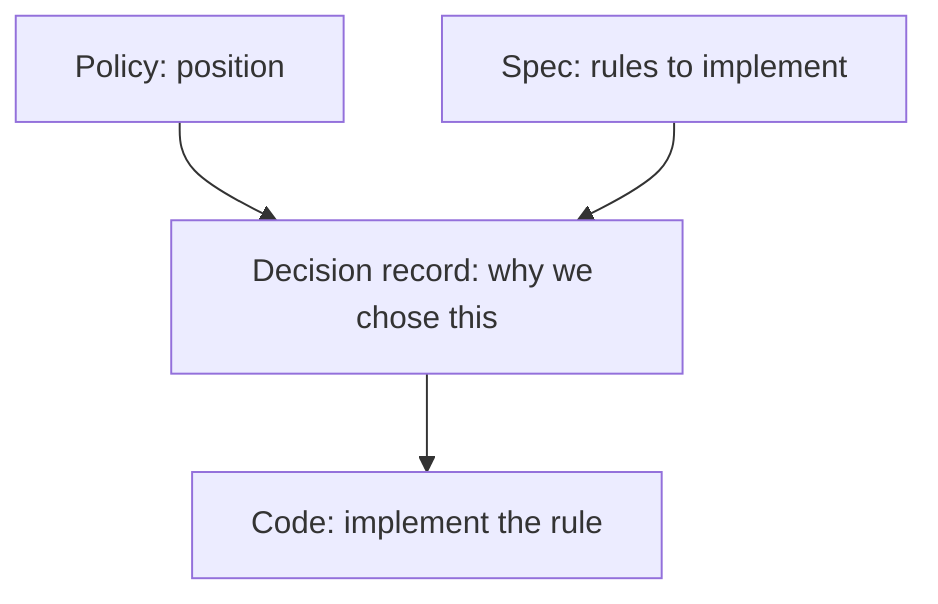
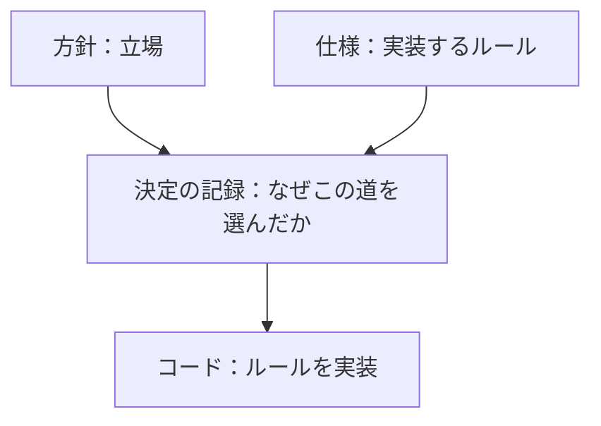

# Decision Records / 決定の記録

> **Summary:** Documents explaining why we chose one way and not another: integration repository placement, network model, staged security gate, AI autonomy and roles. Each record captures the context, options considered, and final decision.
> **概要:** なぜその道を選び、ほかを選ばなかったかを説明する文書：統合リポジトリの置き場、ネットワーク方式、セキュリティ門の段階化、AI の自律度と役割。各記録は文脈、検討した選択肢、最終決定を捉えます。

**Jump:** [English](#english) · [日本語](#japanese)

- Version / 版: 0.2 — 2026-11-06. **Learned:** a test fixture that logs people in is an architecture choice like any other service, so it needs its own record (ADR-05) rather than a note in a template. ／ 人をログインさせる試験用の部品も他のサービスと同じ設計上の選択であり、テンプレートの注記ではなく独自の記録（ADR-05）が要ると分かった。
  0.1 — 2026-11-05. **Learned:** writing decisions as records turned subjective choices into objective, reviewable documents that explain the reasoning behind each rule. ／ 決定を記録として残すことで、主観的な選択を客観的でレビュー可能な文書にし、各ルールの背後にある推論を説明できるようになったと分かった。
- Normative for: [ADR-01 Integration Repository Placement](./ADR-01_Integration_Repository_Placement.md) through [ADR-05 Test IdP for Shibboleth](./ADR-05_Test_IdP_for_Shibboleth.md).
- Related: [../README.md](../README.md) · [policy/](../policy/README.md) · [spec/](../spec/README.md) · [reference/REF-01_Glossary.md](./../reference/REF-01_Glossary.md)

---

## English

[→ 日本語版へ](#japanese)

### 1. What belongs here

A *decision record* (ADR) explains why we chose one way and not another. This folder contains:

| ID | File | Purpose |
|---|---|---|
| ADR-01 | [ADR-01_Integration_Repository_Placement.md](./ADR-01_Integration_Repository_Placement.md) | Where integration code lives: new private repos, not in this public repo. |
| ADR-02 | [ADR-02_Network_Model.md](./ADR-02_Network_Model.md) | Drop loopback alias 192.168.168.167; use Compose internal network and 127.0.0.1 only. |
| ADR-03 | [ADR-03_Staged_Security_Gate.md](./ADR-03_Staged_Security_Gate.md) | Gate starts as report-only at M1, becomes zero CRITICAL/HIGH plus red team pass at M5. |
| ADR-04 | [ADR-04_AI_Autonomy_and_Roles.md](./ADR-04_AI_Autonomy_and_Roles.md) | AI detects, fixes, reviews, tests; humans merge and publish. |
| ADR-05 | [ADR-05_Test_IdP_for_Shibboleth.md](./ADR-05_Test_IdP_for_Shibboleth.md) | Bundled test IdP for `--auth shibboleth`: our own SimpleSAMLphp image on `php:8.3-apache`, mock attributes prefixed `mock-`. |

Future decision records may cover:

| Topic | Description |
|---|---|
| ADR-06 | Repository branching strategy |
| ADR-07 | Tool version policy (Docker, Python, Node.js) |
| ADR-08 | Open source license compatibility |

### 2. Creating a new decision record

1. Name the file `ADR-NN_<Title>.md` (two-digit number, next available).
2. Follow [SPEC-06 documentation conventions](../spec/06_documentation_conventions.md).
3. Include: context, options considered (use TOON if multiple), decision, rationale.
4. Link to related policies and specifications.
5. The owner approves.

### 3. How decision records relate to other documents

---

## 日本語

[→ To English](#english)

### 1. ここに属するもの

「決定の記録」（ADR）は、なぜその道を選び、ほかを選ばなかったかを説明する文書です。このフォルダには次が含まれます：

| ID | ファイル | 目的 |
|---|---|---|
| ADR-01 | [ADR-01_Integration_Repository_Placement.md](./ADR-01_Integration_Repository_Placement.md) | 統合コードの置き場：新設非公開リポジトリ、この公開リポジトリには置かない。 |
| ADR-02 | [ADR-02_Network_Model.md](./ADR-02_Network_Model.md) | ループバック別名 192.168.168.167 を廃止；Compose 内部ネットワークと 127.0.0.1 のみを使う。 |
| ADR-03 | [ADR-03_Staged_Security_Gate.md](./ADR-03_Staged_Security_Gate.md) | 門は M1 では報告のみ、M5 で CRITICAL/HIGH ゼロ＋レッドチーム合格へ。 |
| ADR-04 | [ADR-04_AI_Autonomy_and_Roles.md](./ADR-04_AI_Autonomy_and_Roles.md) | AI は検出・修正・レビュー・試験；人はマージと公開。 |
| ADR-05 | [ADR-05_Test_IdP_for_Shibboleth.md](./ADR-05_Test_IdP_for_Shibboleth.md) | `--auth shibboleth` 用の同梱テスト IdP：`php:8.3-apache` 上の自前 SimpleSAMLphp イメージ、`mock-` 接頭辞の模擬属性。 |

今後の決定記録として以下が考えられます：

| トピック | 説明 |
|---|---|
| ADR-06 | リポジトリのブランチ戦略 |
| ADR-07 | 道具版方針（Docker、Python、Node.js） |
| ADR-08 | オープンソースライセンスの互換性 |

### 2. 新しい決定記録をつくるには

1. ファイル名を `ADR-NN_<題>.md`（2 桁の番号、次に空いているもの）にする。
2. [SPEC-06 文書規約](../spec/06_documentation_conventions.md)に従う。
3. 文脈、検討した選択肢（複数ある場合は TOON 使用）、決定、理由を含む。
4. 関連する方針と仕様へリンクする。
5. 所有者が承認。

### 3. 決定記録が他の文書とどう関係するか

---

## Glossary / 用語

| Term | English note | 日本語注 |
|---|---|---|
| Decision record (ADR) | A note explaining why we chose one way and not another. | なぜその道を選び、ほかを選ばなかったかのメモ。 |
| Context | The problem or situation that requires a decision. | 決定を必要とする問題や状況。 |
| Options considered | The alternatives evaluated before choosing one. | 選択する前に評価した代替案。 |
| Rationale | The reasoning behind the final decision. | 最終決定の背後にある推論。 |
| Policy | A statement of our position on what we will and will not do. | 我々が何をし、何をしないかの立場。 |
