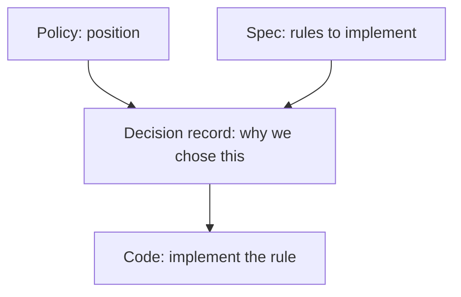
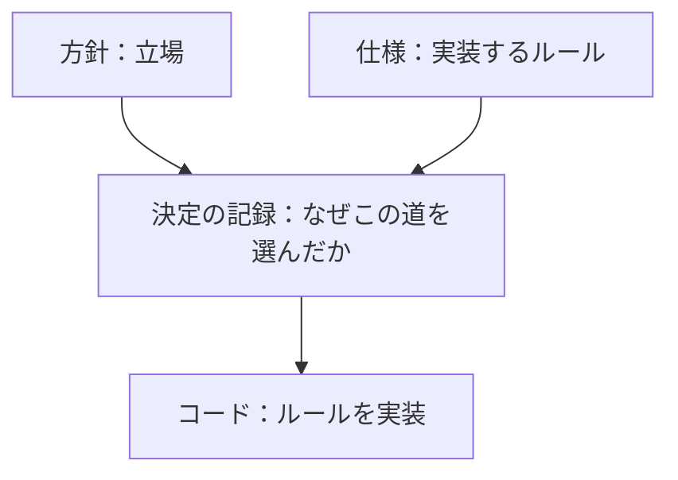

# Decision Records / 決定の記録

> **Summary:** Documents explaining why we chose one way and not another: integration repository placement, network model, staged security gate, AI autonomy and roles, the test IdP, the wiki-frontend overlay, native builds of EOL middleware, PostgreSQL 18 with its data upgrade, and the retirement of Elasticsearch 2 and MongoDB. Each record captures the context, options considered, and final decision.
> **概要:** なぜその道を選び、ほかを選ばなかったかを説明する文書：統合リポジトリの置き場、ネットワーク方式、セキュリティ門の段階化、AI の自律度と役割、テスト IdP、wiki-frontend のオーバーレイ、EOL ミドルウェアのネイティブビルド、PostgreSQL 18 とデータの更新、Elasticsearch 2 と MongoDB の退役。各記録は文脈、検討した選択肢、最終決定を捉えます。

**Jump:** [English](#english) · [日本語](#japanese)

- Version / 版: 0.5 — 2026-11-10. **Learned:** a data-tier change is two records, not one: the PostgreSQL move is proposed with its proof (ADR-12), while the removal of Elasticsearch 2 and MongoDB still needs owner choices (ADR-13); ADR-08 to ADR-11 stay reserved or planned for records on other branches. ／ データ層の変更は一つでなく二つの記録になる。PostgreSQL の移行は証明つきで提案し（ADR-12）、Elasticsearch 2 と MongoDB の撤去はまだ所有者の選択を要する（ADR-13）。ADR-08〜ADR-11 は他のブランチの記録のために予約・予定のまま残す。
  0.4 — 2026-11-06. **Learned:** a cold start turned an emulation cost into an architecture decision (ADR-07): EOL amd64-only middleware is built natively. ／ コールドスタートがエミュレーションのコストを設計判断（ADR-07）に変えた。amd64 のみの EOL ミドルウェアはネイティブで組む。
  0.3 — 2026-11-06. **Learned:** a repository that cannot be built alone because its Dockerfile belongs to another tree is an architecture decision (overlay, not service) and needs its own record (ADR-06). ／ Dockerfile が別の木に属していて単独で組めないリポジトリは、サービスでなくオーバーレイという設計上の決定であり、独自の記録（ADR-06）が要ると分かった。
  0.2 — 2026-11-06. **Learned:** a test fixture that logs people in is an architecture choice like any other service, so it needs its own record (ADR-05) rather than a note in a template. ／ 人をログインさせる試験用の部品も他のサービスと同じ設計上の選択であり、テンプレートの注記ではなく独自の記録（ADR-05）が要ると分かった。
  0.1 — 2026-11-05. **Learned:** writing decisions as records turned subjective choices into objective, reviewable documents that explain the reasoning behind each rule. ／ 決定を記録として残すことで、主観的な選択を客観的でレビュー可能な文書にし、各ルールの背後にある推論を説明できるようになったと分かった。
- Normative for: [ADR-01 Integration Repository Placement](./ADR-01_Integration_Repository_Placement.md) through [ADR-07 Native Builds of EOL Middleware](./ADR-07_Native_Builds_of_EOL_Middleware.md), and [ADR-12 PostgreSQL 18 and Data Directory Upgrade](./ADR-12_PostgreSQL_18_and_Data_Directory_Upgrade.md) and [ADR-13 Retiring Elasticsearch 2 and MongoDB](./ADR-13_Retiring_Elasticsearch_2_and_MongoDB.md); ADR-08 to ADR-11 are reserved or planned.
- Related: [../README.md](../README.md) · [policy/](../policy/README.md) · [spec/](../spec/README.md) · [reference/REF-01_Glossary.md](./../reference/REF-01_Glossary.md)

---

## English

[→ 日本語版へ](#japanese)

### 1. What belongs here

A *decision record* (ADR) explains why we chose one way and not another. This folder contains:

| ID | File | Purpose |
|---|---|---|
| ADR-01 | [ADR-01_Integration_Repository_Placement.md](./ADR-01_Integration_Repository_Placement.md) | Where integration code lives: new private repos, not in this public repo. |
| ADR-02 | [ADR-02_Network_Model.md](./ADR-02_Network_Model.md) | Drop loopback alias 192.168.168.167; use Compose internal network and 127.0.0.1 only. |
| ADR-03 | [ADR-03_Staged_Security_Gate.md](./ADR-03_Staged_Security_Gate.md) | Gate starts as report-only at M1, becomes zero CRITICAL/HIGH plus red team pass at M5. |
| ADR-04 | [ADR-04_AI_Autonomy_and_Roles.md](./ADR-04_AI_Autonomy_and_Roles.md) | AI detects, fixes, reviews, tests; humans merge and publish. |
| ADR-05 | [ADR-05_Test_IdP_for_Shibboleth.md](./ADR-05_Test_IdP_for_Shibboleth.md) | Bundled test IdP for `--auth shibboleth`: our own SimpleSAMLphp image on `php:8.3-apache`, mock attributes prefixed `mock-`. |
| ADR-06 | [ADR-06_Wiki_Frontend_Overlay.md](./ADR-06_Wiki_Frontend_Overlay.md) | wiki-frontend is an overlay of osf.io (`overlay_of`): a bundle-builder image from the merged tree, tagged `<osf_sha12>-<wiki_sha12>`, run once by `wiki_assets` into the volume `wiki_static`; no `wiki` server. |
| ADR-07 | [ADR-07_Native_Builds_of_EOL_Middleware.md](./ADR-07_Native_Builds_of_EOL_Middleware.md) | EOL middleware that only ships amd64 images is built natively for both architectures from the official artefact on a digest-pinned base (`image_build`, MC-15); first Elasticsearch 2.4.6, which took 38 minutes to start under emulation and 5 seconds natively (real install run 19). | Proposed 2026-11-06 |
| ADR-12 | [ADR-12_PostgreSQL_18_and_Data_Directory_Upgrade.md](./ADR-12_PostgreSQL_18_and_Data_Directory_Upgrade.md) | PostgreSQL 9.6 → 18.6 (digest-pinned); md5 host auth until CAS has a SCRAM-capable JDBC driver; `grdm-dev db upgrade` dumps and restores with verification and keeps the old directory, `db rollback` puts it back, `up` refuses a mismatched major (exit 15). Status: Proposed. |
| ADR-13 | [ADR-13_Retiring_Elasticsearch_2_and_MongoDB.md](./ADR-13_Retiring_Elasticsearch_2_and_MongoDB.md) | Measured: osf.io search does not run on ES 6.8 or OpenSearch; search off needs a ~50-line patch; mongo serves only sharejs, whose file-page co-editing is what retirement removes. Retirement steps and owner decisions. Status: Proposed. |

Reserved or planned numbers (no record in this tree yet):

| Number | Topic |
|---|---|
| ADR-08 | Reserved: Per-OS Installer Entry Points (on a separate branch) |
| ADR-09 | Planned: repository branching strategy |
| ADR-10 | Planned: tool version policy (Docker, Python, Node.js) |
| ADR-11 | Planned: open source license compatibility |

### 2. Creating a new decision record

1. Name the file `ADR-NN_<Title>.md` (two-digit number, next available).
2. Follow [SPEC-06 documentation conventions](../spec/06_documentation_conventions.md).
3. Include: context, options considered (use TOON if multiple), decision, rationale.
4. Link to related policies and specifications.
5. The owner approves.

### 3. How decision records relate to other documents

---

## 日本語

[→ To English](#english)

### 1. ここに属するもの

「決定の記録」（ADR）は、なぜその道を選び、ほかを選ばなかったかを説明する文書です。このフォルダには次が含まれます：

| ID | ファイル | 目的 |
|---|---|---|
| ADR-01 | [ADR-01_Integration_Repository_Placement.md](./ADR-01_Integration_Repository_Placement.md) | 統合コードの置き場：新設非公開リポジトリ、この公開リポジトリには置かない。 |
| ADR-02 | [ADR-02_Network_Model.md](./ADR-02_Network_Model.md) | ループバック別名 192.168.168.167 を廃止；Compose 内部ネットワークと 127.0.0.1 のみを使う。 |
| ADR-03 | [ADR-03_Staged_Security_Gate.md](./ADR-03_Staged_Security_Gate.md) | 門は M1 では報告のみ、M5 で CRITICAL/HIGH ゼロ＋レッドチーム合格へ。 |
| ADR-04 | [ADR-04_AI_Autonomy_and_Roles.md](./ADR-04_AI_Autonomy_and_Roles.md) | AI は検出・修正・レビュー・試験；人はマージと公開。 |
| ADR-05 | [ADR-05_Test_IdP_for_Shibboleth.md](./ADR-05_Test_IdP_for_Shibboleth.md) | `--auth shibboleth` 用の同梱テスト IdP：`php:8.3-apache` 上の自前 SimpleSAMLphp イメージ、`mock-` 接頭辞の模擬属性。 |
| ADR-06 | [ADR-06_Wiki_Frontend_Overlay.md](./ADR-06_Wiki_Frontend_Overlay.md) | wiki-frontend は osf.io のオーバーレイ（`overlay_of`）：重ねた木から束を組むイメージ（タグ `<osf の sha12>-<wiki の sha12>`）を `wiki_assets` が一度動かしてボリューム `wiki_static` へ写す。`wiki` サーバは無い。 |
| ADR-07 | [ADR-07_Native_Builds_of_EOL_Middleware.md](./ADR-07_Native_Builds_of_EOL_Middleware.md) | amd64 のイメージしか無い EOL ミドルウェアは、公式成果物からダイジェスト固定のベース上に両アーキテクチャ向けにネイティブで組む（`image_build`、MC-15）。まず Elasticsearch 2.4.6。エミュレーションでは起動に 38 分、ネイティブでは 5 秒（実機第 19 回）。 | 提案 2026-11-06 |
| ADR-12 | [ADR-12_PostgreSQL_18_and_Data_Directory_Upgrade.md](./ADR-12_PostgreSQL_18_and_Data_Directory_Upgrade.md) | PostgreSQL 9.6 → 18.6（ダイジェスト固定）。CAS が SCRAM に対応した JDBC ドライバーを持つまでホスト認証は md5。`grdm-dev db upgrade` は照合つきでダンプと復元を行い旧ディレクトリを残し、`db rollback` はそれを戻し、`up` は版の不一致を拒む（終了 15）。ステータス: 提案中。 |
| ADR-13 | [ADR-13_Retiring_Elasticsearch_2_and_MongoDB.md](./ADR-13_Retiring_Elasticsearch_2_and_MongoDB.md) | 測定: osf.io の検索は ES 6.8 でも OpenSearch でも動かない。検索を切るには約 50 行のパッチが要る。mongo は sharejs にしか使われず、退役で失うのはそのファイルページの共同編集である。退役の手順と所有者の判断。ステータス: 提案中。 |

予約済み・予定の番号（この木にはまだ記録が無い）：

| 番号 | トピック |
|---|---|
| ADR-08 | 予約: OS ごとのインストーラーの入口（別ブランチ） |
| ADR-09 | 予定: リポジトリのブランチ戦略 |
| ADR-10 | 予定: 道具版方針（Docker、Python、Node.js） |
| ADR-11 | 予定: オープンソースライセンスの互換性 |

### 2. 新しい決定記録をつくるには

1. ファイル名を `ADR-NN_<題>.md`（2 桁の番号、次に空いているもの）にする。
2. [SPEC-06 文書規約](../spec/06_documentation_conventions.md)に従う。
3. 文脈、検討した選択肢（複数ある場合は TOON 使用）、決定、理由を含む。
4. 関連する方針と仕様へリンクする。
5. 所有者が承認。

### 3. 決定記録が他の文書とどう関係するか

---

## Glossary / 用語

| Term | English note | 日本語注 |
|---|---|---|
| Decision record (ADR) | A note explaining why we chose one way and not another. | なぜその道を選び、ほかを選ばなかったかのメモ。 |
| Context | The problem or situation that requires a decision. | 決定を必要とする問題や状況。 |
| Options considered | The alternatives evaluated before choosing one. | 選択する前に評価した代替案。 |
| Rationale | The reasoning behind the final decision. | 最終決定の背後にある推論。 |
| Policy | A statement of our position on what we will and will not do. | 我々が何をし、何をしないかの立場。 |
