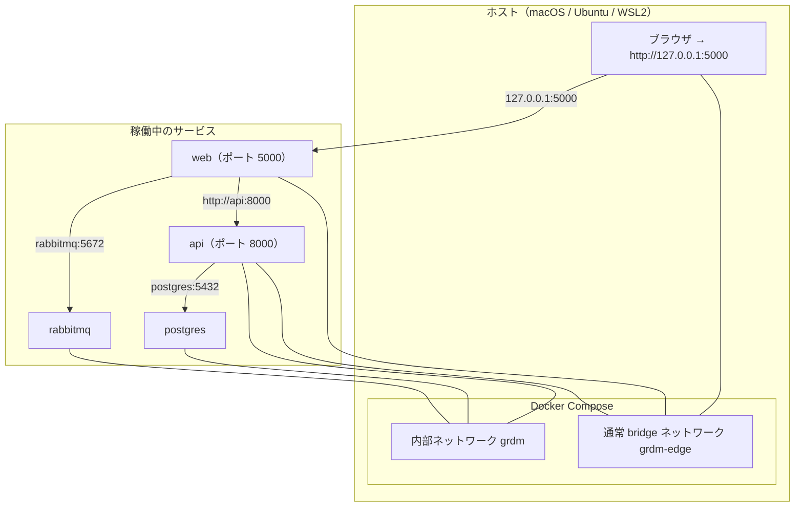

# Environment guide / 環境設定と開発環境

> **Summary:** How to install the 2027 developer environment for GakuNin RDM using the installer script, including prerequisites, step-by-step commands, everyday operations, security notes, and troubleshooting. All services run on `127.0.0.1` with no host network changes.
> **概要:** GakuNin RDM の 2027 開発環境をインストーラーで導入する手順。前提条件、ステップごとのコマンド、日常操作、セキュリティ注意点、トラブルシューティングを含む。すべてのサービスは `127.0.0.1` で動作し、ホストのネットワーク設定は変えません。

**Jump:** [English](#english) · [日本語](#japanese)

- Version / 版: 1.0 — 2026-11-06. **Learned:** full startup cannot yet be verified because the ember-osf-web base image is end-of-life and Docker refuses it; prebuilt images will be added once the integration repositories update their Dockerfiles. ／ ember-osf-web のベースイメージがサポート終了のため Docker が取得を拒否し、完全な起動をまだ検証できない。統合リポジトリが Dockerfile を更新するまで配布済みイメージを追加する。
- Normative for: `docs/guides/environment/`
- Related: [SPEC-02 Installer CLI](../../spec/02_installer_cli.md) · [ADR-02 Network Model](../../decisions/ADR-02_Network_Model.md) · [SPEC-03 Security Gate](../../spec/03_security_gate.md) · [SPEC-04 Acceptance Tests](../../spec/04_acceptance_tests.md) · [SPEC-06 Documentation Conventions](../../spec/06_documentation_conventions.md) · [DEMO-20 Core Install on Mac Studio](../../demo/20_core_install_mac_studio.md)

---

<a id="english"></a>
## English

[→ 日本語版へ](#japanese)

### 1. Quick start

Install the 2027 developer environment for GakuNin RDM with these three commands:

```bash
git clone https://github.com/RCOSDP/RDM-developer-guide.git
cd RDM-developer-guide
./installer/install.sh --yes
```

After the installer completes, open `http://127.0.0.1:5000` in your browser.

#### Prerequisites by OS

- **macOS 14 (Ventura) or newer, Apple Silicon (arm64):** Docker Desktop installed
- **Ubuntu 24.04, amd64 or arm64:** Docker Engine installed
- **Windows 11 with WSL2 (Ubuntu 24.04):** Docker Desktop installed

> **Note:** The installer checks each prerequisite and exits with code 10 if your host is unsupported. See SPEC-02 §8 for the full list.

---

### 2. What you get

The installer creates a self-contained environment under `runtime/` with no changes to your host network. It uses two Docker Compose networks:

- **Internal network `grdm`** — services talk to each other using Compose service names (e.g., `web`, `api`, `postgres`). No ports are published.
- **Publishing network `grdm-edge`** — browser-facing services (`web`, `api`, `admin`, `wb`, `mfr`, `fakecas`, `ember_osf_web`) attach here so their ports can be published on `127.0.0.1`.

```mermaid
flowchart TD
    subgraph HOST["Host computer (macOS / Ubuntu / WSL2)"]
        BROWSER["Browser → http://127.0.0.1:5000"]
        subgraph DOCKER["Docker Compose"]
            INTERNAL[internal network grdm]
            PUBLISHING[public bridge network grdm-edge]
        end
    end
    
    subgraph SERVICES["Running services"]
        web[web (port 5000)]
        api[api (port 8000)]
        postgres[postgres]
        rabbitmq[rabbitmq]
    end
    
    BROWSER -->|"127.0.0.1:5000"| web
    web -->|"http://api:8000"| api
    api -->|"postgres:5432"| postgres
    web -->|"rabbitmq:5672"| rabbitmq
    
    BROWSER --- PUBLISHING
    web --- PUBLISHING
    api --- PUBLISHING
    
    api --- INTERNAL
    postgres --- INTERNAL
    rabbitmq --- INTERNAL
```

---

### 3. Step by step

The installer runs these steps in sequence and stops at the first failure.

#### 3.1 `grdm-dev doctor`

Check that your host meets all requirements:

```bash
./installer/install.sh --yes  # calls grdm-dev doctor first
```

**Success:** You see a TOON report showing your OS, CPU, memory, Docker version.

**Failure exit code:** `10` — unsupported host, missing Docker, or Python < 3.11.

> **Note:** A *virtual environment* (venv) is a private folder of Python and its libraries, separate from the system.

#### 3.2 `grdm-dev plan`

See which images will be built and which services will start:

```bash
.venv/bin/grdm-dev plan --profile core
```

**Success:** You see a TOON report with the services and their published ports.

**Failure exit code:** `20` — manifest invalid or TOON excerpt disagrees with JSON.

#### 3.3 `grdm-dev secrets init`

Generate random secrets and write them to `runtime/.env` with mode `0600` (owner read/write only):

```bash
.venv/bin/grdm-dev secrets init
```

**Success:** A new `runtime/.env` file appears with random database passwords, Django secret key, and CAS keys.

**Failure exit code:** `2` — usage error (e.g., missing `--force` if `runtime/.env` exists).

> **Security note:** The installer *never* writes default or example passwords. Every secret is generated from your OS's random source.

#### 3.4 `grdm-dev compose render`

Generate the Docker Compose file from the manifest and profile:

```bash
.venv/bin/grdm-dev compose render --profile core
```

**Success:** `runtime/docker-compose.yml` appears with all services configured for your host.

**Failure exit code:** `0` on success (this command never fails).

#### 3.5 `grdm-dev build`

Build or pull all images:

```bash
.venv/bin/grdm-dev build
```

**Success:** All images are built or pulled, and a TOON report shows their status.

**Failure exit code:** `30` — image build failed (e.g., EOL base cannot be built for arm64 without emulation).

> **Real cases from DEMO-20:**
>
> - **modular-file-renderer:** Built with emulation (`build_platform: linux/amd64`) because `pandas==0.25.1` has no arm64 wheel.
> - **ember-osf-web:** Build failed because the base image uses Docker manifest v2 schema 1, which current Docker refuses.

#### 3.6 `grdm-dev up`

Start all services and wait for health:

```bash
.venv/bin/grdm-dev up --profile core
```

**Success:** All services report healthy, and the browser opens at `http://127.0.0.1:5000`.

**Failure exit code:** `40` — health check failed or a port listens on a non-loopback address.

#### 3.7 `grdm-dev health`

Manually check service health:

```bash
.venv/bin/grdm-dev health
```

**Success:** All services report healthy.

**Failure exit code:** `40` — one or more services are unhealthy, *or* a port listens on an address other than `127.0.0.1`.

#### 3.8 `grdm-dev scan`

Run the whole security gate:

```bash
.venv/bin/grdm-dev scan --baseline --secrets
```

**Success:** The report shows baseline controls passed, CVE count within the milestone threshold.

**Failure exit code:** `50` — baseline control violated, or CVE count over the threshold.

#### 3.9 `grdm-dev accept`

Run the acceptance tests:

```bash
.venv/bin/grdm-dev accept --profile core
```

**Success:** All tests pass, and a report is written under `docs/demo/runs/<run-id>/`.

**Failure exit code:** `60` — one or more tests failed.

> **Tip:** Run `.venv/bin/grdm-dev accept --seed` first to create disposable test users.

---

### 4. Everyday commands

#### Start, stop, reset

```bash
.venv/bin/grdm-dev up       # start services and wait for health
.venv/bin/grdm-dev down     # stop containers, keep volumes
.venv/bin/grdm-dev reset    # stop and delete runtime/volumes/
```

> **Tip:** Add `--yes` to skip confirmation prompts.

#### View logs

```bash
docker compose -f runtime/docker-compose.yml logs -f web api
```

> **Note:** The generated `runtime/docker-compose.yml` uses the service names from the manifest.

#### Change profile

```bash
.venv/bin/grdm-dev compose render --profile full --yes
.venv/bin/grdm-dev up --yes
```

#### Egress control

Attach services to the publishing network only when needed:

```bash
.venv/bin/grdm-dev compose render --egress rdmcp,aipf_mcp_data_grdm
```

The choice is saved in `runtime/.env` as `GRDM_EGRESS_SERVICES`.

#### Default ports

| Service | Host port | Profile |
|---|---|---|
| web | 5000 | minimum |
| api | 8000 | minimum |
| admin | 8001 | core |
| wb (WaterButler) | 7777 | core |
| mfr (Modular File Renderer) | 7778 | core |
| fakecas | 8080 | minimum |
| ember_osf_web | 4200 | core |

> **Note:** If a port is in use (e.g., macOS AirPlay on 5000), `compose render` finds the next free port and records it in `runtime/.env`.

---

### 5. Security notes

The installer implements these controls from milestone M1:

- **Secrets:** All passwords and keys are generated at install time with random values, written to `runtime/.env` (mode `0600`), and never committed to Git.
- **Network:** Services talk on an internal Compose network (`internal: true`). Browser-facing ports are published *only* on `127.0.0.1`.
- **Container hardening:** Every service runs as a non-root user, has read-only root filesystem, no `privileged: true`, and resource limits (memory, CPU, process count).
- **Supply chain:** Images are pulled by digest (exact fingerprint), never a floating tag such as `latest`.

> **What the installer does *not* protect:**
>
> - Attacks on your operating system itself (e.g., kernel vulnerabilities)
> - Phishing of the developer
> - The production GRDM service (this guide is for development only)

---

### 6. Troubleshooting

#### Port in use (exit 12)

If a default port is already bound by another program, `compose render` moves that service to the next free port (up to 100 above the default), records the choice in `runtime/.env` as `GRDM_PORT_<SERVICE>`, and tells you. Ports already held by this project's own running services are kept. Exit code 12 happens only when no free alternative exists.

**Fix:** Stop the other program if you want the default port back, or simply use the port `grdm-dev plan` reports.

```bash
# macOS: AirPlay shares port 5000
sudo lsof -i :5000
# Kill the process if you do not need AirPlay
```

#### Docker missing (exit 11)

`doctor` fails if Docker is not installed, not running, or lacks the Compose plugin.

**Fix:** Install Docker Desktop (macOS) or Docker Engine (Ubuntu). Version ≥ 27 with Compose v2 plugin is required.

#### Build failed (exit 30)

This happens when the EOL base image cannot be built for your CPU architecture.

**Real cases from DEMO-20:**

1. **modular-file-renderer on arm64:** Built successfully with `build_platform: linux/amd64` (emulation) because the base Python 3.5 image has no arm64 wheel for `pandas==0.25.1`.
2. **ember-osf-web on any platform:** Build failed because the base image uses Docker manifest v2 schema 1, which current Docker refuses to pull.

**Workaround:** The manifest may include `prebuilt_image` entries with digest-pinned images for such components until the integration repositories update their Dockerfiles.

#### Health check failed (exit 40)

The `health` command fails if a service does not respond or listens on an address other than `127.0.0.1`.

**Fix:** Check logs with `docker compose -f runtime/docker-compose.yml logs <service>`, then restart the service.

---

### 7. What changed since the old guide

| Old way | New way (2027 installer) | Why |
|---|---|---|
| Loopback alias `192.168.168.167` | Internal network `grdm` + publishing network `grdm-edge` | No `sudo`, no LAN exposure, same setup on macOS/Ubuntu/WSL2 |
| `docker-compose.override.yml` | `grdm-dev compose render` (generated from manifest + profile) | No manual edits, no risk of committing host-specific settings |
| Manual image pulls with `docker pull` | Manifest-pinned builds or prebuilt images by digest | Exact reproducibility, no stale tags |
| Default passwords (`postgres`/`postgres`) | Generated secrets in `runtime/.env` (random, mode 0600) | No default credentials left behind |

> **Note:** The old instructions are kept verbatim in `README.legacy.md` for historical reference.

---

## Glossary / 用語

| Term | English note | 日本語注 |
|---|---|---|
| Container | A box that holds one program and everything it needs, so it runs the same on any computer. | 一つのプログラムと必要なものを一箱に入れて、どのコンピュータでも同じように動かすための箱。 |
| Docker Compose | A tool that starts many containers together from one description file. | 一つの設定ファイルから多くのコンテナをまとめて起こす道具。 |
| Loopback / 127.0.0.1 | The address that means "this same computer"; nothing outside can reach it. | 「この同じコンピュータ」を指す番地。外からは届かない。 |
| Internal network | A private network inside Docker that services use to talk without publishing ports. | Docker の中 only にある私設ネットワークで、ポートを公開せずにコンテナ同士が通信できる。 |
| Digest | The exact fingerprint of one image version (`sha256:...`). | 一つのイメージ版の正確な指紋（`sha256:...` の形式）。 |
| Non-root user | A regular user account (not the computer's administrator). | コンピュータの管理者でない通常のユーザアカウント。 |
| CVE | A public record number for one known security weakness (e.g., `CVE-2026-12345`). | 一つの既知の弱点に付く公開の番号（例: `CVE-2026-12345`）。 |
| Baseline controls | Security checks that every install must pass from milestone M1. | M1 から全導入に必須のセキュリティチェック。 |

---

<a id="japanese"></a>
## 日本語

[→ To English](#english)

### 1. クイックスタート

GakuNin RDM の 2027 開発環境を以下の三つのコマンドで導入します：

```bash
git clone https://github.com/RCOSDP/RDM-developer-guide.git
cd RDM-developer-guide
./installer/install.sh --yes
```

インストーラーが完了したら、ブラウザで `http://127.0.0.1:5000` を開きます。

#### OS ごとの前提条件

- **macOS 14 (Ventura) 以上、Apple Silicon (arm64):** Docker Desktop をインストール済み
- **Ubuntu 24.04、amd64 または arm64:** Docker Engine をインストール済み
- **Windows 11 + WSL2 (Ubuntu 24.04):** Docker Desktop をインストール済み

> **Note:** インストーラーは各前提条件をチェックし、ホストが未対応の場合は終了コード 10 で終わります。詳しくは SPEC-02 §8 を参照。

---

### 2. 得られるもの

インストーラーはホストのネットワーク設定を一切変えず、`runtime/` の下に自己完結型の環境を作ります。二つの Docker Compose ネットワークを使います：

- **内部ネットワーク `grdm`** — サービス間は Compose のサービス名（例: `web`, `api`, `postgres`）で通信します。ポートは公開されません。
- **公開ネットワーク `grdm-edge`** — ブラウザが届く必要のあるサービス（`web`, `api`, `admin`, `wb`, `mfr`, `fakecas`, `ember_osf_web`）が接続し、ここから `127.0.0.1` にポートを公開します。



---

### 3. ステップごとの手順

インストーラーは以下の手順を順番に実行し、最初の失敗で止まります。

#### 3.1 `grdm-dev doctor`

すべての前提条件を检查します：

```bash
./installer/install.sh --yes  # 最初に grdm-dev doctor を呼ぶ
```

**成功:** OS、CPU、メモリ、Docker のバージョンを TOON で表示します。

**失敗終了コード:** `10` — 対応外のホスト、Docker が無い、または Python < 3.11。

> **Note:** 「仮想環境」（venv）はシステムとは別の、Python とライブラリだけの私用フォルダです。

#### 3.2 `grdm-dev plan`

どのイメージを作り、どのサービスを起動するか確認します：

```bash
.venv/bin/grdm-dev plan --profile core
```

**成功:** サービスと公開ポートの TOON レポートが表示されます。

**失敗終了コード:** `20` — manifest が不正、または TOON の抄録が JSON と一致しない。

#### 3.3 `grdm-dev secrets init`

乱数の秘密を生成し、モード 0600（所有者のみ読み書き可）で `runtime/.env` に書きます：

```bash
.venv/bin/grdm-dev secrets init
```

**成功:** `runtime/.env` が乱数のデータベースパスワード、Django の秘密鍵、CAS の鍵で生成されます。

**失敗終了コード:** `2` — 使用法の誤り（例: `runtime/.env` があるのに `--force` が足りない）。

> **Security note:** インストーラーは *決して* 既定値や例のパスワードを書きません。すべての秘密は OS の乱数源から生成されます。

#### 3.4 `grdm-dev compose render`

manifest とプロファイルから Docker Compose ファイルを生成します：

```bash
.venv/bin/grdm-dev compose render --profile core
```

**成功:** `runtime/docker-compose.yml` がホストに合わせて設定されたサービスで生成されます。

**失敗終了コード:** `0` — 成功（このコマンドは決して失敗しません）。

#### 3.5 `grdm-dev build`

すべてのイメージをビルドまたは取得します：

```bash
.venv/bin/grdm-dev build
```

**成功:** 全イメージがビルドまたは取得され、TOON レポートにその状態が表示されます。

**失敗終了コード:** `30` — イメージのビルドに失敗（例: EOL ベースが arm64 でエミュレーションなしに組めない）。

> **DEMO-20 の実際のケース:**
>
> - **modular-file-renderer on arm64:** `pandas==0.25.1` の arm64 wheel が存在しないため、`build_platform: linux/amd64`（エミュレーション）で正常にビルド。
> - **ember-osf-web on 任意のプラットフォーム:** ベースイメージが Docker manifest v2 schema 1 を使っているため、現行 Docker が取得を拒否しビルド失敗。

#### 3.6 `grdm-dev up`

全サービスを起動し、健康になるまで待ちます：

```bash
.venv/bin/grdm-dev up --profile core
```

**成功:** 全サービスが健康と報告し、ブラウザが `http://127.0.0.1:5000` で開きます。

**失敗終了コード:** `40` — 健康確認に失敗、またはポートが `127.0.0.1` 以外のアドレスで待ち受けている。

#### 3.7 `grdm-dev health`

手動でサービスの健康を检查します：

```bash
.venv/bin/grdm-dev health
```

**成功:** 全サービスが健康と報告します。

**失敗終了コード:** `40` — 一つ以上サービスが不健康、*または* ポートが `127.0.0.1` 以外のアドレスで待ち受けている。

#### 3.8 `grdm-dev scan`

全部のセキュリティ門を動かします：

```bash
.venv/bin/grdm-dev scan --baseline --secrets
```

**成功:** 基本対策が合格し、節目の基準以内の CVE 数を報告します。

**失敗終了コード:** `50` — 基本対策が違反、または CVE 数が基準を超えた。

#### 3.9 `grdm-dev accept`

受入試験を実行します：

```bash
.venv/bin/grdm-dev accept --profile core
```

**成功:** 全試験が合格し、`docs/demo/runs/<run-id>/` に報告が書かれます。

**失敗終了コード:** `60` — 一件以上試験が失敗した。

> **Tip:** 最初に `.venv/bin/grdm-dev accept --seed` を実行し、使い捨ての試験利用者を作ります。

---

### 4. 日常操作

#### 起動、停止、リセット

```bash
.venv/bin/grdm-dev up       # サービス起動し健康になるまで待つ
.venv/bin/grdm-dev down     # コンテナ停止、ボリュームを残す
.venv/bin/grdm-dev reset    # 停止し runtime/volumes/ を削除
```

> **Tip:** 確認プロンプトを省くには `--yes` を追加。

#### ログの確認

```bash
docker compose -f runtime/docker-compose.yml logs -f web api
```

> **Note:** 生成された `runtime/docker-compose.yml` は manifest のサービス名を使います。

#### プロファイルの変更

```bash
.venv/bin/grdm-dev compose render --profile full --yes
.venv/bin/grdm-dev up --yes
```

#### 外向き通信（egress）の制御

必要になるときだけサービスを公開ネットワークに接続します：

```bash
.venv/bin/grdm-dev compose render --egress rdmcp,aipf_mcp_data_grdm
```

選択は `runtime/.env` の `GRDM_EGRESS_SERVICES` に保存されます。

#### 既定のポート

| サービス | ホスト側ポート | プロファイル |
|---|---|---|
| web | 5000 | minimum |
| api | 8000 | minimum |
| admin | 8001 | core |
| wb (WaterButler) | 7777 | core |
| mfr (Modular File Renderer) | 7778 | core |
| fakecas | 8080 | minimum |
| ember_osf_web | 4200 | core |

> **Note:** 既定ポートが使用中なら（例: macOS の AirPlay と 5000）、`compose render` が次の空きポートを取り、`runtime/.env` に記録します。

---

### 5. セキュリティ注意点

インストーラーは M1 から次の対策を実装します：

- **秘密:** 全パスワードと鍵は導入時に乱数で生成し、`runtime/.env`（モード `0600`）に書き、決して Git にコミットしません。
- **ネットワーク:** サービスは内部 Compose ネットワーク（`internal: true`）で通信します。ブラウザ向けのポートは *常に* `127.0.0.1` にだけ公開されます。
- **コンテナ堅牢化:** 全サービスは非 root ユーザーで動かし、読み取り専用ルートファイルシステム、`privileged: true` 禁止、資源制限（メモリ、CPU、プロセス数）を使います。
- **サプライチェーン:** イメージは「ダイジェスト」（正確な指紋）で取得し、`latest` のような動くタグは使いません。

> **インストーラーが守らないもの:**
>
> - OS 自体への攻撃（例: カーネルの脆弱性）
> - 開発者へのフィッシング
> - 本番 GRDM サービス（このガイドは開発用のみ）

---

### 6. トラブルシューティング

#### ポート使用中（終了コード 12）

既定ポートを別のプログラムが使っていると、`compose render` はそのサービスを次の空きポート（既定から最大 100 まで）へ移し、`runtime/.env` に `GRDM_PORT_<SERVICE>` として記録して知らせます。このプロジェクト自身が動かしているサービスのポートはそのまま保ちます。終了コード 12 になるのは空きの代替がまったくないときだけです。

**対応:** 既定のポートを使いたければ相手のプログラムを止める。そうでなければ `grdm-dev plan` が示すポートをそのまま使う。

```bash
# macOS: AirPlay はポート 5000 を使う
sudo lsof -i :5000
# AirPlay が不要ならプロセスを終了させる
```

#### Docker が無い（終了コード 11）

`doctor` は Docker がインストールされていない、動いていない、または Compose プラグインがないと失敗します。

**対応:** Docker Desktop（macOS）または Docker Engine（Ubuntu）をインストール。版 ≥ 27、Compose v2 プラグインが必要です。

#### ビルド失敗（終了コード 30）

EOL ベースイメージがコンピュータのアーキテクチャで組めないときに起きます。

**DEMO-20 の実際のケース:**

1. **modular-file-renderer on arm64:** ベース Python 3.5 イメージが arm64 向けの `pandas==0.25.1` wheel を持たないため、`build_platform: linux/amd64`（エミュレーション）で正常にビルド。
2. **ember-osf-web on 任意プラットフォーム:** ベースイメージが Docker manifest v2 schema 1 を使っているため、現行 Docker が取得を拒みビルド失敗。

**回避策:** 統合リポジトリが Dockerfile を更新するまで、manifest にダイジェスト固定の `prebuilt_image` エントリを追加することで、そのようなコンポーネント向けに配布済みイメージを使えます。

#### 健康確認失敗（終了コード 40）

サービスが応答しない、または `127.0.0.1` 以外のアドレスで待ち受けていると、`health` コマンドが失敗します。

**対応:** `docker compose -f runtime/docker-compose.yml logs <service>` でログを確認し、サービスを再起動します。

---

### 7. 過去のガイドとの違い

| 過去の方法 | 新しい方法（2027 インストーラー） | 理由 |
|---|---|---|
| ループバック別名 `192.168.168.167` | 内部ネットワーク `grdm` + 公開ネットワーク `grdm-edge` | sudo 不要、LAN への露出なし、macOS/Ubuntu/WSL2 で同じ設定 |
| `docker-compose.override.yml` | `grdm-dev compose render`（manifest + プロファイルから生成） | 手動編集なし、ホスト固有の設定をコミットするリスクなし |
| 手動でイメージ取得（`docker pull`） | manifest 固定のビルドまたはダイジェスト固定の配布済みイメージ | 精密再現性、古いタグがない |
| 既定パスワード (`postgres`/`postgres`) | 生成された秘密（乱数、モード 0600） | 既定パスワードを残さない |

> **Note:** 過去の手順は参考のために `README.legacy.md` にそのまま残しており、マイルストーンごとに書き直す予定です。

---

## Glossary / 用語

| Term | English note | 日本語注 |
|---|---|---|
| コンテナ | A box that holds one program and everything it needs, so it runs the same on any computer. | 一つのプログラムと必要なものを一箱に入れて、どのコンピュータでも同じように動かすための箱。 |
| Docker Compose | A tool that starts many containers together from one description file. | 一つの設定ファイルから多くのコンテナをまとめて起こす道具。 |
| ループバック / 127.0.0.1 | The address that means "this same computer"; nothing outside can reach it. | 「この同じコンピュータ」を指す番地。外からは届かない。 |
| 内部ネットワーク | A private network inside Docker that services use to talk without publishing ports. | Docker の中 only にある私設ネットワークで、ポートを公開せずにコンテナ同士が通信できる。 |
| ダイジェスト | The exact fingerprint of one image version (`sha256:...`). | 一つのイメージ版の正確な指紋（`sha256:...` の形式）。 |
| 非 root ユーザー | A regular user account (not the computer's administrator). | コンピュータの管理者でない通常のユーザアカウント。 |
| CVE | A public record number for one known security weakness (e.g., `CVE-2026-12345`). | 一つの既知の弱点に付く公開の番号（例: `CVE-2026-12345`）。 |
| 基本対策 | Security checks that every install must pass from milestone M1. | M1 から全導入に必須のセキュリティチェック。 |
