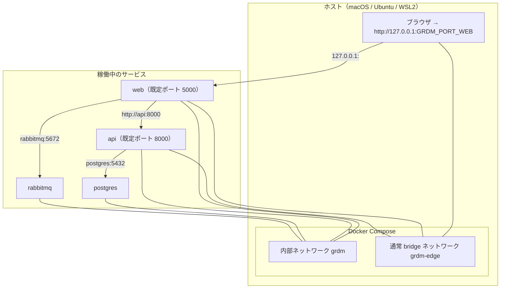

# Environment guide / 環境設定と開発環境

> **Summary:** How to install the 2027 developer environment for GakuNin (Japan's academic identity federation) RDM using the installer script, including prerequisites, step-by-step commands, everyday operations, security notes, and troubleshooting. All services run on `127.0.0.1` with no host network changes.
> **概要:** GakuNin（日本の学術認証連携）RDM の 2027 開発環境をインストーラーで導入する手順。前提条件、ステップごとのコマンド、日常操作、セキュリティ注意点、トラブルシューティングを含む。すべてのサービスは `127.0.0.1` で動作し、ホストのネットワーク設定は変えません。

**Jump:** [English](#english) · [日本語](#japanese)

- Version / 版: 1.11 — 2026-11-13. **Learned:** a sentence that names the current milestone is live state, not history, so it changes in the same PR as `manifest/milestone.json`: the owner closed M2 on 2026-11-13, the file now says M3, and from now on `scan` fails with exit 50 if the allow-list grows past 58 entries. ／ 現在の節目を名指す文は履歴ではなく現在の状態なので、`manifest/milestone.json` と同じ PR で変える。所有者は 2026-11-13 に M2 を閉じ、ファイルは M3 になった。これからは許容リストが 58 項目を超えると `scan` は終了 50 で失敗する。
  1.10 — 2026-11-13. **Learned:** a scan line that reads `ok` has to say what it did not scan: with mandatory sign-in ZAP cannot enter `web`, and the report now lists that target as skipped (`skipped_targets`), not as scanned (PR #56 review r1 R1-01). ／ `ok` と読める検査の行は、検査しなかったものを言わなければならない。必須サインインでは ZAP は `web` に入れず、報告はその対象を検査済みでなく対象外（`skipped_targets`）として載せる（PR #56 レビュー r1 R1-01）。
  1.9 — 2026-11-12. **Learned:** an upgrade guide has to be an order of commands, because each step needs the one before: the new secrets must exist before `compose render`, `compose render` before `build` (tags) and again after it, and the search index rebuild only after `up`; `secrets rotate` is not that first step, since it needs a healthy old stack and rolled back here when the former ember image took more than 300 seconds to start. ／ アップグレードの手引きはコマンドの順序でなければならない。どの段も前の段を要するからである。新しい秘密は `compose render` の前に、`compose render` は `build`（タグ）の前と後に、検索の索引の再構築は `up` の後に要る。`secrets rotate` はその最初の段ではない。健康な旧スタックを要し、ここでは以前の ember のイメージの起動が 300 秒を超えて巻き戻った。
  1.8 — 2026-11-11. **Learned:** a troubleshooting entry that names a workaround goes stale the day the workaround ends: ember-osf-web is built from source again as a static image, so the DEMO-20 cases now say that the prebuilt image was the past state and what `build` does now (RDM-ember-osf-web-dev2027 PR #2 review r1 R1-03). ／ 回避策を名指しする障害対応の項は、その回避策が終わった日に古くなる。ember-osf-web は再びソースから静的なイメージとして組まれるので、DEMO-20 の事例は事前ビルド済みのイメージが過去の状態だったことと、いまの `build` の動きを書くようにした（RDM-ember-osf-web-dev2027 PR #2 レビュー r1 R1-03）。
  1.7 — 2026-11-12. **Learned:** the guide must not promise what an option cannot do: `--timeout` lengthens only the wait of `up`, never the build ([PR #50 review r1](../../reviews/README.md) R2). ／ 手引きは、オプションにできないことを約束してはならない。`--timeout` が延ばすのは `up` の待ちだけで、ビルドではない（[PR #50 レビュー r1](../../reviews/README.md) R2）。
  1.6 — 2026-11-12. **Learned:** an amd64 test machine on Apple Silicon is a fully emulated computer, so it needs two more host tools and a long first start, and it compiled osf.io's scientific Python about ten times slower than Rosetta did (a full build there was not finished after 5 h 12 min); the guide now says so and says how to give `up` a longer wait through the one command, which does not shorten the build ([DEMO-22](../../demo/22_core_install_ubuntu_amd64_lima.md)). ／ Apple Silicon 上の amd64 の試験機は全体をエミュレーションする計算機なので、ホストの道具が二つ多く要り、最初の起動も長く、osf.io の科学計算の Python のコンパイルは Rosetta の約 10 倍遅かった（そこでのビルド全体が 5 時間 12 分後も未完）。手引きはそれを書き、一つのコマンドで `up` の待ちを延ばす方法も示す（ビルドは短くならない）（[DEMO-22](../../demo/22_core_install_ubuntu_amd64_lima.md)）。
  1.5 — 2026-11-10. **Learned:** a safety check should say what it does not cover: the shared-folder check looks for four names directly under each shared mount point, decoded as the kernel escapes them, not for every credential anywhere ([PR #44 review r1](../../reviews/2026-11-10_RDM-developer-guide_PR44_Per_OS_Installers_r1.md) R1). ／ 安全のための検査は、何を見ないかも言うべきである。共有フォルダの検査は、カーネルのエスケープを復号した各共有 mount 先の直下にある四つの名前だけを探し、どこにある資格情報でも見つけるわけではない（[PR #44 レビュー r1](../../reviews/2026-11-10_RDM-developer-guide_PR44_Per_OS_Installers_r1.md) R1）。
  1.4 — 2026-11-10. **Learned:** a test VM is only isolated if nothing of the host is shared by default: Lima's Ubuntu template mounted the host home and showed `~/.config/gh` inside the VM, so the Lima steps below share only read-only mirrors and `install-ubuntu.sh` stops when credentials are visible ([DEMO-21](../../demo/21_core_install_ubuntu_arm64_lima.md)). ／ テスト用の VM は、既定でホストの何も共有しないときだけ隔離されている。Lima の Ubuntu テンプレートはホームを mount し `~/.config/gh` を VM から見せたので、下の Lima の手順は読み取り専用のミラーだけを共有し、`install-ubuntu.sh` は資格情報が見えると止まる（[DEMO-21](../../demo/21_core_install_ubuntu_arm64_lima.md)）。
  1.3 — 2026-11-10. **Learned:** on a Linux server image the acceptance browser needs two more steps than on a Mac, a library for Playwright's driver and Chromium's system libraries, so §3.9 lists them ([DEMO-21](../../demo/21_core_install_ubuntu_arm64_lima.md)). ／ Linux のサーバーイメージでは受入試験のブラウザに Mac より二つ多い手順、Playwright のドライバー用のライブラリと Chromium のシステムライブラリが要るので、§3.9 に載せた（[DEMO-21](../../demo/21_core_install_ubuntu_arm64_lima.md)）。
- Version / 版: 1.2 — 2026-11-10. **Learned:** telling a reader that the installer checks each prerequisite is not the same as helping them get one, so the guide now starts from a script for each OS ([ADR-08](../../decisions/ADR-08_Per_OS_Installer_Entry_Points.md)). ／ 「インストーラーが前提条件を確認する」と伝えることは、それを揃える手助けにはならない。そこで手引きは OS ごとのスクリプトから始める（[ADR-08](../../decisions/ADR-08_Per_OS_Installer_Entry_Points.md)）。
- Version / 版: 1.1 — 2026-11-06. **Learned:** the Project Metadata edit page needs a waffle flag that no setup step turned on, so the legacy startup steps now set `ember_edit_draft_registration_page` once after the first migration (PR #17); the 2027 installer has no equivalent step yet. ／ Project Metadata の編集画面には、どの手順も有効にしていなかった waffle フラグが必要なため、旧ガイドの起動手順に初回マイグレーション後の `ember_edit_draft_registration_page` 設定を追加した（PR #17）。2027 インストーラーには相当する手順がまだ無いと分かった。
- Version / 版: 1.0 — 2026-11-06. **Learned:** full startup is not yet verified by a recorded run: the ember-osf-web (the browser interface) base image is end-of-life and current Docker (the tool that runs containers: boxes that each hold one program and everything it needs) refuses to pull it, so the manifest (the list of components and the exact source revisions they are built from) already configures a digest-pinned prebuilt image for ember-osf-web as a fallback until M4 modernizes its Dockerfile (DEMO-20, `manifest/upstreams.json`). ／ 完全な起動はまだ実行記録で検証できていない。ember-osf-web（ブラウザ画面）のベースイメージがサポート終了で現行 Docker（コンテナ＝一つのプログラムと必要なものを入れた箱を動かす道具）が取得を拒むため、M4 で Dockerfile を近代化するまでの代替として、manifest（部品と、それを組む正確なソース版の一覧）にはダイジェスト固定の配布済みイメージがすでに設定されている（DEMO-20、`manifest/upstreams.json`）。
- Version / 版: 0.1 — 2026-11-05. Initial bilingual skeleton pointing to the legacy guide. ／ 旧ガイドを指す最初の二言語の骨組み。
- Normative for: `docs/guides/environment/`
- Parent index / 親索引: [Guides](../README.md)
- Related: [SPEC-02 Installer CLI](../../spec/02_installer_cli.md) · [ADR-02 Network Model](../../decisions/ADR-02_Network_Model.md) · [ADR-03 Staged Security Gate](../../decisions/ADR-03_Staged_Security_Gate.md) · [SPEC-03 Security Gate](../../spec/03_security_gate.md) · [SPEC-04 Acceptance Tests](../../spec/04_acceptance_tests.md) · [SPEC-06 Documentation Conventions](../../spec/06_documentation_conventions.md) · [DEMO-20 Core Install on Mac Studio](../../demo/20_core_install_mac_studio.md) · [REF-01 Glossary](../../reference/REF-01_Glossary.md)
- Used by: [Guides index](../README.md) · [DEMO-20 Core Install on Mac Studio](../../demo/20_core_install_mac_studio.md)

---

<a id="english"></a>
## English

[→ 日本語版へ](#japanese)

### 1. Quick start

Install the 2027 developer environment for [GakuNin](../../reference/REF-01_Glossary.md#english) RDM with these three commands:

```bash
git clone https://github.com/RCOSDP/RDM-developer-guide.git
cd RDM-developer-guide
./installer/install.sh --yes
```

When the installer completes, `grdm-dev up` opens your browser at the web URL it reports. The default is `http://127.0.0.1:5000`, but if port (a numbered door a program listens on) 5000 was busy the installer chose another port and recorded it in `runtime/.env` as `GRDM_PORT_WEB`; always use the URL or port printed in the report rather than assuming 5000.

> **Caveat (2026-11-06):** a complete startup of the `core` profile (a named subset of services to run) has not yet been verified by a recorded run. The [ember-osf-web](../../reference/REF-01_Glossary.md#english) Dockerfile cannot be built with current [Docker](../../reference/REF-01_Glossary.md#english), so the manifest already runs a digest-pinned prebuilt image for that component (see §3.5 and §6). Expect the next recorded run in DEMO-20.

#### Prerequisites by OS

- **macOS 14 or newer, Apple Silicon (arm64):** Docker Desktop installed
- **Ubuntu 24.04, amd64 (the Intel/AMD type of CPU; Apple Silicon is arm64) or arm64:** Docker Engine installed
- **Windows 11 with WSL2 (Windows Subsystem for Linux 2, a way to run Ubuntu inside Windows; see [REF-01](../../reference/REF-01_Glossary.md#english)) and Ubuntu 24.04:** Docker Desktop installed

> **Note:** The installer checks each prerequisite. It exits with code 10 if your host is unsupported and 11 if Docker is missing, not running, or lacks the Compose or buildx (multi-platform image builder) plugin. See [SPEC-02 §8](../../spec/02_installer_cli.md#english) for the full host list.

#### Prepare the host with the per-OS script

If your computer does not have the prerequisites yet, run the script for your OS instead of `install.sh`. Each one shows what it will change, asks before any administrator action, and ends by running `install.sh`. Add `--yes` to consent to everything in advance, or `--dry-run` to only see the plan. Run them from the repository folder.

| OS | Command |
|---|---|
| Ubuntu 24.04 | `./installer/install-ubuntu.sh` |
| macOS (Apple Silicon) | `./installer/install-macos.sh` |
| Windows 11 (in PowerShell) | `powershell -ExecutionPolicy Bypass -File .\installer\install-windows.ps1` |

Expected result: the plan is printed, and after your answer the installer's report ends with the web URL.

On Windows you only need this one script file from the repository. It enables WSL2, installs Ubuntu 24.04, checks Docker Desktop and its WSL integration, and clones the repository inside WSL, never under `/mnt/c`, because the Windows disk is slow from WSL and changes line endings. Read the script before you run it. `-ExecutionPolicy Bypass` applies to this one run only.

> **Note:** The integration repositories are private. Before the build, give git your own access where the install runs (inside WSL on Windows), for example `gh auth login` and then `gh auth setup-git`. The scripts never ask for, read or store a token.

#### Trying the Ubuntu script in a Lima VM on a Mac

[Lima](https://lima-vm.io/) (a tool that runs Linux virtual machines on macOS) is a quick way to test the Ubuntu path on a Mac ([DEMO-21](../../demo/21_core_install_ubuntu_arm64_lima.md)).

> **Warning:** Lima's Ubuntu template mounts your home directory into the VM (read-only), even when your configuration lists its own `mounts:`, because the template's list is merged in. Your `~/.config/gh/hosts.yml`, which holds your GitHub token, is then readable inside the VM. `install-ubuntu.sh` stops with exit 10 when one of `.config/gh/hosts.yml`, `.git-credentials`, `.netrc` or `.docker/config.json` exists directly under the mount point of a shared folder. It does not search deeper, so the steps below still matter.

Write the VM configuration, create the VM, then remove the home mount **before** you start it. Run on the Mac:

```bash
limactl create --name grdm-ubuntu2404 --tty=false my-vm.yaml   # base: template:ubuntu-24.04, your own mounts
# open ~/.lima/grdm-ubuntu2404/lima.yaml and delete the line  - location: "~"
limactl start grdm-ubuntu2404
limactl shell grdm-ubuntu2404 -- mount | grep -E 'virtiofs|9p|sshfs'
```

Expected result: only the folders you chose are listed; no line ends in your home directory.

To test **Ubuntu amd64** on an Apple Silicon Mac, set `vmType: qemu` and `arch: x86_64` in `my-vm.yaml` and run `brew install qemu lima-additional-guestagents` first (Lima needs QEMU and the amd64 guest agent for this). The whole virtual machine is then emulated, so expect everything to be many times slower than on real hardware, and give the first start a long `--timeout`. To make the user a non-root user whose uid is not 1000, add `user: {name: grdm, uid: 2002, home: /home/grdm}` ([DEMO-22](../../demo/22_core_install_ubuntu_amd64_lima.md)).

To give the VM the private repositories without a token, share read-only bare mirrors (`git clone --mirror` on the Mac) and point git at them inside the VM with `git config --global url."file:///<mirror>.git".insteadOf https://github.com/RCOSDP/<repo>.git`.

> **Note:** Docker Desktop is never installed by these scripts, because its licence depends on your organisation. Homebrew is not installed either; `install-macos.sh` tells you where to get its signed package. See [ADR-08](../../decisions/ADR-08_Per_OS_Installer_Entry_Points.md) for the reasons.

---

### 2. What you get

The installer creates a self-contained environment under `runtime/` with no changes to your host network. It uses two Docker Compose (the tool that starts several containers together from one file) networks:

- **Internal network `grdm`** — services talk to each other using Compose service names (e.g., `web`, `api`, `postgres`). No ports are published and there is no route to the Internet.
- **Publishing network `grdm-edge`** — the seven browser-facing services (`web`, `api`, `admin`, `wb`, `mfr`, `fakecas`, `ember_osf_web`) also attach here so their ports can be published on `127.0.0.1`. Because it is an ordinary bridge network, these seven services already have outbound (egress) access; no other service does unless you grant it (§4).

```mermaid
flowchart TD
    subgraph HOST["Host computer (macOS / Ubuntu / WSL2)"]
        BROWSER["Browser → http://127.0.0.1:GRDM_PORT_WEB"]
        subgraph DOCKER["Docker Compose"]
            INTERNAL[internal network grdm]
            PUBLISHING[public bridge network grdm-edge]
        end
    end
    
    subgraph SERVICES["Running services"]
        web[web (default port 5000)]
        api[api (default port 8000)]
        postgres[postgres]
        rabbitmq[rabbitmq]
    end
    
    BROWSER -->|"127.0.0.1:<web port>"| web
    web -->|"http://api:8000"| api
    api -->|"postgres:5432"| postgres
    web -->|"rabbitmq:5672"| rabbitmq
    
    BROWSER --- PUBLISHING
    web --- PUBLISHING
    api --- PUBLISHING
    
    web --- INTERNAL
    api --- INTERNAL
    postgres --- INTERNAL
    rabbitmq --- INTERNAL
```

---

### 3. Step by step

`./installer/install.sh --yes` creates a Python virtual environment at `.venv/` (a *venv* is a private folder of Python and its libraries, separate from the system), installs `grdm-dev` into it, and then runs `grdm-dev install`. That command executes the following steps in this exact order and stops at the first non-zero exit ([SPEC-02 §2.1](../../spec/02_installer_cli.md#english), `installer/grdm_dev/install.py`):

1. `doctor`
2. `plan`
3. `secrets init` — only when `runtime/.env` does not exist yet
4. `compose render`
5. `build`
6. `up`
7. `health --network`
8. `scan`
9. `report`

The acceptance tests (`accept`, §3.9) are **not** part of this sequence; run them manually afterwards. The subsections below describe each step so you can also run it on its own after the bootstrap has created `.venv/`.

#### 3.1 `grdm-dev doctor`

Check that your host meets all requirements (run on its own after the bootstrap created `.venv/`):

```bash
.venv/bin/grdm-dev doctor
```

**Success:** You see a TOON report (TOON is a compact text form of JSON data that people and AI read easily; see [REF-01](../../reference/REF-01_Glossary.md#english)) showing your OS, CPU, memory, free disk, and Docker version.

**Failure exit codes:** `10` — unsupported host (OS, CPU, memory, or Python < 3.11); `11` — Docker missing, not running, or Compose / buildx plugin absent.

#### 3.2 `grdm-dev plan`

See which images will be built and which services will start:

```bash
.venv/bin/grdm-dev plan --profile core
```

A *manifest* is the list of components and the exact source revisions they are built from (`manifest/upstreams.json`; see [REF-01](../../reference/REF-01_Glossary.md#english)). A *profile* is a named subset of services to run: `minimum`, `core` (default), or `full` ([SPEC-02 §4](../../spec/02_installer_cli.md#english)). The choice is saved in `runtime/.env` as `GRDM_PROFILE` and reused later.

**Success:** You see a TOON report with the services and their published ports.

**Failure exit code:** `20` — manifest invalid or TOON excerpt disagrees with JSON.

#### 3.3 `grdm-dev secrets init`

Generate random secrets and write them to `runtime/.env` with mode `0600` (owner read/write only):

```bash
.venv/bin/grdm-dev secrets init
```

**Success:** A new `runtime/.env` file appears with random database passwords, Django secret key, and CAS (the sign-in service protocol GRDM uses) keys.

**Failure exit code:** `2` — usage error (e.g., missing `--force` if `runtime/.env` exists).

> **Security note:** The installer *never* writes default or example passwords. Every secret is generated from your OS's random source.

#### 3.4 `grdm-dev compose render`

Generate the Docker Compose file from the manifest and profile:

```bash
.venv/bin/grdm-dev compose render --profile core
```

**Success (exit `0`):** `runtime/docker-compose.yml` appears with all services configured for your host, and any port that had to move away from its default is reported.

**Failure exit codes:** `20` — manifest invalid; `2` — usage error, for example `runtime/.env` is missing (run `secrets init` first) or `--egress` names an unknown service; `12` — a required port is in use and no free alternative was found within +100 (§6).

#### 3.5 `grdm-dev build`

Build or pull all images:

```bash
.venv/bin/grdm-dev build
```

**Success:** All images are built or pulled, and a TOON report shows their status (`built`, `prebuilt`, ...).

**Failure exit code:** `30` — image build or prebuilt pull failed (e.g., an EOL base cannot be built for arm64 without emulation). *EOL* means end of life: the vendor no longer fixes bugs or security holes ([REF-01](../../reference/REF-01_Glossary.md#english)). *Emulation* means running an `linux/amd64` image on an arm64 CPU through Docker's built-in CPU translation; it is slower but works for most images.

> **Real cases from DEMO-20:**
>
> - **modular-file-renderer (the file preview service):** Built with emulation (`build_platform: linux/amd64`) because `pandas==0.25.1` has no arm64 *wheel* (a prebuilt Python package file; without one, pip must compile from source, which fails on this EOL base).
> - **ember-osf-web:** At the time, the source build failed on every CPU because the base image used Docker manifest v2 schema 1, which current Docker refuses, so the manifest carried a digest-pinned `prebuilt_image` that `build` pulled instead (DEMO-20). The Dockerfile has since been modernized (RDM-ember-osf-web-dev2027 PR #2): `build` builds ember-osf-web from its pinned commit on your own CPU, without emulation, into a static nginx image, and the row says `built`.

#### 3.6 `grdm-dev up`

Start all services and wait for health:

```bash
.venv/bin/grdm-dev up --profile core
```

**Success:** All services report healthy, and the browser opens at the web URL `up` reports (`http://127.0.0.1:<GRDM_PORT_WEB>`, default port 5000). Add `--no-open` to skip the browser.

**Failure exit code:** `40` — one or more services did not become healthy within the timeout.

#### 3.7 `grdm-dev health` and `health --network`

Manually check service health:

```bash
.venv/bin/grdm-dev health            # service responses only
.venv/bin/grdm-dev health --network  # also verify that every published port listens on 127.0.0.1 only
```

**Success:** All services report healthy; with `--network`, the report also shows `loopback_only: true`.

**Failure exit code:** `40` — one or more services are unhealthy; with `--network`, also when any container port is bound to an address other than `127.0.0.1`. Plain `health` does **not** check host exposure, so only `health --network` proves loopback-only publishing. The automatic `install` sequence runs `health --network`.

#### 3.8 `grdm-dev scan`

Run the whole security gate of [SPEC-03](../../spec/03_security_gate.md):

```bash
.venv/bin/grdm-dev scan
```

Without flags, `scan` runs every part: baseline controls, the Trivy (a scanner that lists known weaknesses in images) image scanner's SBOM (software bill of materials: the list of every part inside an image) and CVE list (a CVE is a public identifier for one known security weakness), the gitleaks secret scan, Semgrep (static analysis that reads source code for dangerous patterns), and the OWASP ZAP (a scanner that probes the running website the way an attacker would) dynamic baseline. The flags `--baseline`, `--secrets`, and `--dynamic` each run **one part only** and are *not* the whole gate:

```bash
.venv/bin/grdm-dev scan --baseline   # subset: baseline controls of runtime/docker-compose.yml and runtime/.env only
.venv/bin/grdm-dev scan --secrets    # subset: gitleaks over the repository only
.venv/bin/grdm-dev scan --dynamic    # subset: OWASP ZAP baseline only (needs healthy services)
```

**Gate rule by milestone** (`manifest/milestone.json`, currently M3 since the owner closed M2 on 2026-11-13, so the allow-list may hold at most the M2 count of 58 entries, see the [status board](../../status/README.md#english); [ADR-03](../../decisions/ADR-03_Staged_Security_Gate.md), [SPEC-03 §5](../../spec/03_security_gate.md)): the gate data — `manifest/milestone.json`, the allow-list `manifest/allowlist.json` (the written list of known findings accepted for a limited time) and its baseline `manifest/allowlist.baseline.json` — must be readable and well-formed at every milestone, M1 included: an unreadable file or an allow-list entry missing one of its six fields exits `50` (SPEC-03 §5.1 rule 1). Baseline-control violations (default secrets, publishing outside loopback, `privileged: true`, a missing `grdm` internal network) also exit `50` at every milestone. Only with valid gate data and passing baseline controls are M1–M3 *report-only* for vulnerability findings: the run exits `0` and records them. From M2 the allow-list may not grow: `scan` compares the entry count with `manifest/allowlist.baseline.json` and a larger count exits `50` (at M1 the count is only reported). At M4 any HIGH or CRITICAL finding not in the allow-list exits `50`; in addition, passing M4 requires that the first real AI red-team run (authorized attack testing of the isolated environment, [SPEC-03 §6](../../spec/03_security_gate.md)) has been completed and every intrusion path it found has been fixed or allow-listed — the red-team *preflight* (`grdm-dev redteam preflight`, a readiness check that proves isolation before a run) is not that run. At M5 every CRITICAL or HIGH finding exits `50`, allow-listed or not; the allow-list may contain no CRITICAL or HIGH entry (`scan` exits `50` if it does); and the AI red team must report zero unresolved intrusion paths. `scan` itself enforces the data validity, baseline, count, and severity rules; the M4 red-team completion and the M5 zero-paths result are milestone acceptance requirements that the owner records with the red-team evidence (SPEC-03 §6–7), not checks `scan` performs.

**Success:** Exit `0`; the report under `runtime/reports/scan_<date>.json` (plus TOON) shows the baseline controls passed and the findings for the current milestone.

**Failure exit codes:** `50` — gate failed for the current milestone (see rule above); `51` — a scanner could not run (Trivy, gitleaks, or Semgrep missing, or its vulnerability database could not be downloaded); `52` — `--dynamic` was requested while services are unhealthy.

**Limit of the dynamic part:** with mandatory sign-in (`ENABLE_PUBLIC_ACCESS=false`, the default) `web` answers an anonymous request only with a redirect to the sign-in page, which ZAP cannot open. When the scan itself confirms that redirect and that it goes to the configured sign-in address, `web` is listed under `skipped_targets` with a note "ZAP NOT RUN on web" and the run can still exit `0`; the pages behind sign-in were then **not** scanned by ZAP. Any other failure to reach a target, such as a redirect elsewhere, stays exit `51`.

#### 3.9 `grdm-dev accept` (manual, separate step)

The acceptance tests ([SPEC-04](../../spec/04_acceptance_tests.md)) are not run by `install`. They need the optional Python extra and a Chromium build in the **existing** `.venv/`, installed once:

```bash
.venv/bin/pip install -e "installer[accept]"
PLAYWRIGHT_BROWSERS_PATH=.venv/.playwright .venv/bin/playwright install chromium
```

On Linux (Ubuntu 24.04) two more commands are needed, both with `sudo` ([DEMO-21](../../demo/21_core_install_ubuntu_arm64_lima.md)). Run this one **before** the two commands above, because Playwright's driver does not start without it:

```bash
sudo apt-get install -y libatomic1
```

and this one **after** them, to add Chromium's system libraries (it asks for `sudo` itself):

```bash
PLAYWRIGHT_BROWSERS_PATH=.venv/.playwright .venv/bin/playwright install-deps chromium
```

Then run the tests with `--seed`, which creates disposable test users, runs the browser scenarios, and removes those users again within the same run (there is no persistent seed step):

```bash
.venv/bin/grdm-dev accept --seed
```

**Success:** All tests pass, and a report is written under `docs/demo/runs/<run-id>/`.

**Failure exit codes:** `2` — the extra or Chromium is not installed (the message repeats the two commands above); `40` — the integration precheck failed, so the browser tests did not start (fix health first); `60` — one or more tests failed.

> **Tip:** `--only <scenario>` runs one scenario; `--headed` shows the browser window.

---

### 4. Everyday commands

#### Start, stop, reset

```bash
.venv/bin/grdm-dev up       # start services and wait for health
.venv/bin/grdm-dev down     # stop containers, keep volumes
.venv/bin/grdm-dev reset    # stop and delete runtime/volumes/
```

> **Tip:** Add `--yes` to skip confirmation prompts.

#### View logs

```bash
docker compose -f runtime/docker-compose.yml logs -f web api
```

> **Note:** The generated `runtime/docker-compose.yml` uses the service names from the manifest.

#### Change profile

```bash
.venv/bin/grdm-dev compose render --profile full --yes
.venv/bin/grdm-dev up --yes
```

#### Egress control

The seven publishing services on `grdm-edge` (`web`, `api`, `admin`, `wb`, `mfr`, `fakecas`, `ember_osf_web`) already have outbound access to the Internet. Every other service has none by default ([ADR-02 §4](../../decisions/ADR-02_Network_Model.md#english)). `--egress` adds that access for the services you name, by attaching them to `grdm-edge` too:

```bash
# Requires the full profile (rdmcp and aipf_mcp_data_grdm are not in core); select it first or in the same command.
.venv/bin/grdm-dev compose render --profile full --egress rdmcp,aipf_mcp_data_grdm
.venv/bin/grdm-dev compose render --egress none   # clear the saved grant
```

The choice is saved in `runtime/.env` as `GRDM_EGRESS_SERVICES`, kept on later renders, shown by `scan --baseline`, and cleared with `--egress none`. Naming a service that is not in the selected profile is a usage error (exit 2).

#### Default ports

| Service | Host port | Profile |
|---|---|---|
| web | 5000 | minimum |
| api | 8000 | minimum |
| admin | 8001 | core |
| wb (WaterButler) | 7777 | core |
| mfr (Modular File Renderer) | 7778 | core |
| fakecas | 8080 | minimum |
| ember_osf_web | 4200 | core |

> **Note:** If a port is in use (e.g., macOS AirPlay on 5000), `compose render` finds the next free port and records it in `runtime/.env` as `GRDM_PORT_<SERVICE>`; see §6.

---

### 5. Security notes

The installer implements these controls from milestone M1 ([SPEC-03 §3](../../spec/03_security_gate.md#english)):

- **Secrets:** All passwords and keys are generated at install time with random values, written to `runtime/.env` (mode `0600`), and never committed to Git.
- **Network:** Services talk on an internal Compose network (`internal: true`). Browser-facing ports are published *only* on `127.0.0.1`; `health --network` verifies it.
- **[Container](../../reference/REF-01_Glossary.md#english) hardening:** Non-root (the program does not run as the all-powerful administrator user) user, read-only root filesystem, and `cap_drop: [ALL]` are the defaults for every service, together with resource limits (memory, CPU, process count). `privileged: true` is forbidden everywhere. A service that cannot tolerate one of the defaults (for example the PostgreSQL, RabbitMQ, or Elasticsearch images, which must write inside the image at start-up) gets a documented per-service exception in [`manifest/hardening.json`](../../../manifest/hardening.json), naming the relaxed control, the reason, the review date, and the milestone at which it is to be removed. Read-only roots therefore apply where the service tolerates them, not to every service.
- **Supply chain:** Images are pulled by digest (exact fingerprint), never a floating tag such as `latest`.
- **Sign-in:** Since RDM-osf.io-dev2027 PR #8 every data page and API route needs a signed-in user (`ENABLE_PUBLIC_ACCESS=false`, the default); `grdm-dev compose render --public-access true` turns anonymous viewing of public projects back on. The admin app asks a one-time code after the password (PR #10): an administrator without one is sent to an enrolment page on the first sign-in, and every administrator signs in again after an upgrade.
- **Search:** Elasticsearch 8 is reached over TLS with its own certificate authority and a user limited to the search indices; no port is published ([ADR-14](../../decisions/ADR-14_Elasticsearch_8_with_TLS_and_Authentication.md)).

> These are the requirements the installer enforces; whether a given running environment satisfies them is shown by `health --network` and `scan`, not by this guide.

> **What the installer does *not* protect:**
>
> - Attacks on your operating system itself (e.g., kernel vulnerabilities)
> - Phishing of the developer
> - The production GRDM service (this guide is for development only)

---

### 6. Troubleshooting

#### A port is in use (exit 12)

`compose render` starts from the port you requested or the one saved in `runtime/.env` (`GRDM_PORT_<SERVICE>`; the SPEC-02 §4 default if neither exists) and searches up to 100 ports above it for a free one. Ports already held by this project's own running containers are kept. If another program holds the port, the service moves to the first free candidate, the choice is recorded as `GRDM_PORT_<SERVICE>`, and the render reports it. Exit code 12 happens only when no free alternative exists in that range.

**Fix:** Stop the other program if you want the original port back, or simply use the port `compose render` / `plan` reports.

```bash
# macOS: AirPlay shares port 5000
sudo lsof -i :5000
# Kill the process if you do not need AirPlay
```

#### Docker missing (exit 11)

`doctor` fails if Docker is not installed, not running, or lacks the Compose plugin.

**Fix:** Install Docker Desktop (macOS, Windows) or Docker Engine (Ubuntu). Version ≥ 27 with Compose v2 plugin is required. On Ubuntu, `./installer/install-ubuntu.sh` installs Docker Engine for you.

#### Build failed (exit 30)

This happens when an image cannot be built for your CPU architecture or a prebuilt image cannot be pulled.

**Real cases from DEMO-20:**

1. **modular-file-renderer on arm64:** Built successfully with `build_platform: linux/amd64` (emulation) because the base Python 3.5 image has no arm64 wheel for `pandas==0.25.1`.
2. **ember-osf-web on any platform:** The source build failed because the base image used Docker manifest v2 schema 1, which current Docker refuses to pull.

**Current state:** ember-osf-web no longer uses a `prebuilt_image`: its modernized Dockerfile (RDM-ember-osf-web-dev2027 PR #2) runs the ember-cli build in a Node stage on your own CPU and produces a static nginx image, so `build` builds it like the other components (`manifest/upstreams.json`). That Node stage needs several GiB of Docker engine memory while it runs; if the ember-osf-web build fails with exit 30, check the engine's memory first.

#### Health check failed (exit 40)

`health` fails if a service does not respond. `health --network` additionally fails if any published port listens on an address other than `127.0.0.1`; the plain command does not perform that check.

**Fix:** Check logs with `docker compose -f runtime/docker-compose.yml logs <service>`, then restart the service. For a non-loopback listener, inspect `runtime/docker-compose.yml` (every `ports:` entry must start with `127.0.0.1:`) and re-run `compose render`.

---

### 7. What changed since the old guide

The rows below compare what `README.legacy.md` actually describes with the 2027 installer.

| Old way (README.legacy.md) | New way (2027 installer) | Why |
|---|---|---|
| Configure a loopback alias `192.168.168.167` on the host (needs `sudo`) so services can reach each other | Internal network `grdm` with Compose service names + publishing network `grdm-edge` on `127.0.0.1` | No `sudo`, no host network change, no LAN exposure, same setup on macOS/Ubuntu/WSL2 ([ADR-02](../../decisions/ADR-02_Network_Model.md)) |
| Copy `local-dist.py` to `local.py` for web and api by hand; one URL serves both the browser and the services | Generated settings separate *internal* URLs (service names) from *external* browser URLs (`http://127.0.0.1:<port>/`) | Redirects and absolute URLs work from the browser without the alias ([ADR-02 §4](../../decisions/ADR-02_Network_Model.md#english)) |
| Hand-written `docker-compose.override.yml` that swaps images to `niicloudoperation/*:latest` and carries commented `platform:` lines per CPU | `grdm-dev compose render` generates `runtime/docker-compose.yml` from the manifest and profile; `platform:` comes from the manifest's `build_platform` | No manual edits, no host-specific file to commit by mistake, same output for everyone |
| Start from distribution images (`niicloudoperation/*:latest`, `quay.io/centerforopenscience/*`) and install Python/Node modules into volumes with the `*_requirements` services | Build from manifest-pinned source revisions; prebuilt images only as documented, digest-pinned exceptions | Exact reproducibility, no floating tags, no stale module volumes |
| Uncomment Elasticsearch limits and single-node settings in `docker-compose.yml` by hand on Apple Silicon | `compose render` writes resource limits scaled from `doctor` and per-service exceptions from `manifest/hardening.json` | One generated file instead of per-host edits |
| Default credentials shipped by the upstream Compose files (e.g., `postgres`/`postgres`; [SPEC-03 §3.1](../../spec/03_security_gate.md#english)) | Random secrets in `runtime/.env` (mode 0600), generated by `secrets init`; `scan --baseline` fails if a default remains | No default credentials left behind |

> **Note:** The old instructions are kept verbatim in `README.legacy.md` for historical reference. The legacy guide itself never documented default passwords; they come from the upstream Compose files it relied on.

### 8. Latest changes

- **2026-11-12 — Elasticsearch 8, y-websocket only, mandatory sign-in, admin two-step sign-in (ADR-13 §6, ADR-14).** An existing installation upgrades in this order: `git pull`; `grdm-dev secrets init --missing` (adds `ELASTIC8_PASSWORD` and `ELASTIC8_OSF_PASSWORD`, keeps every other value, drops `SHAREJS_SECRET`); `grdm-dev compose render`; `grdm-dev build`; `grdm-dev compose render` again; `grdm-dev up`; then once `docker compose exec web invoke migrate_search` to rebuild the search index from PostgreSQL (the Elasticsearch 2 data is not moved; `runtime/volumes/elasticsearch_data`, `mongo_data` and `mongo_tls` are no longer used and can be removed by hand). `sharejs` and `mongo` are gone, so port 7007 is no longer published. The first administrator sign-in after the upgrade asks to enrol a one-time code; keep the recovery codes it shows once.
- **2026-11-06 — Waffle flag for the Metadata addon (PR #17).** The legacy startup steps in [`README.legacy.md`](README.legacy.md) now run `docker compose run --rm web python3 manage.py waffle_flag ember_edit_draft_registration_page --everyone` once, right after the first database migration, in each of the three startup variants. A *waffle flag* (a named on/off switch stored in the database that turns a feature on for chosen users) is required to open the Project Metadata edit page of the Metadata addon. The 2027 installer (`grdm-dev`) does not run this step yet; if you need the Metadata addon, run the same `manage.py waffle_flag` command against the `web` service by hand. Incorporated from PR #17 by yacchin1205 (2026-11-06).

---

<a id="japanese"></a>
## 日本語

[→ To English](#english)

### 1. クイックスタート

[GakuNin](../../reference/REF-01_Glossary.md#japanese) RDM の 2027 開発環境を以下の三つのコマンドで導入します：

```bash
git clone https://github.com/RCOSDP/RDM-developer-guide.git
cd RDM-developer-guide
./installer/install.sh --yes
```

インストーラーが完了すると、`grdm-dev up` が報告した web の URL をブラウザで開きます。既定は `http://127.0.0.1:5000` ですが、ポート（プログラムが待ち受ける番号付きの入口）5000 が使用中だった場合はインストーラーが別のポートを選び、`runtime/.env` に `GRDM_PORT_WEB` として記録しています。5000 と決めつけず、必ず報告に表示された URL またはポートを使ってください。

> **注意（2026-11-06 時点）:** `core` プロファイル（起動するサービスの名前付きの組）の完全な起動は、まだ実行記録で検証できていません。[ember-osf-web](../../reference/REF-01_Glossary.md#japanese) の Dockerfile は現行 [Docker](../../reference/REF-01_Glossary.md#japanese) では組めないため、manifest はこの部品についてダイジェスト固定の配布済みイメージをすでに使う設定になっています（§3.5・§6）。次の実行記録は DEMO-20 に追記されます。

#### OS ごとの前提条件

- **macOS 14 以上、Apple Silicon (arm64):** Docker Desktop をインストール済み
- **Ubuntu 24.04、amd64（Intel/AMD 系の CPU の種類。Apple Silicon は arm64）または arm64:** Docker Engine をインストール済み
- **Windows 11 + WSL2（Windows Subsystem for Linux 2。Windows の中で Ubuntu を動かす仕組み。[REF-01](../../reference/REF-01_Glossary.md#japanese)）の Ubuntu 24.04:** Docker Desktop をインストール済み

> **Note:** インストーラーは各前提条件を確認します。ホストが未対応なら終了コード 10、Docker が無い・動いていない・Compose や buildx（複数 CPU 向けイメージを作る機能）プラグインが無いなら 11 で終わります。対応ホストの一覧は [SPEC-02 §8](../../spec/02_installer_cli.md#japanese) を参照。

#### OS ごとのスクリプトでホストを準備する

前提条件がまだ揃っていないコンピュータでは、`install.sh` の代わりに OS に合ったスクリプトを実行します。どれも変更点を示し、管理者の操作の前に尋ね、最後に `install.sh` を実行します。`--yes` を付けると先にすべて同意し、`--dry-run` を付けると予定を見るだけです。リポジトリのフォルダで実行します。

| OS | コマンド |
|---|---|
| Ubuntu 24.04 | `./installer/install-ubuntu.sh` |
| macOS（Apple Silicon） | `./installer/install-macos.sh` |
| Windows 11（PowerShell で） | `powershell -ExecutionPolicy Bypass -File .\installer\install-windows.ps1` |

期待する結果: 予定が表示され、答えた後にインストーラーの報告が web の URL で終わります。

Windows で必要なのは、リポジトリのこのスクリプトファイル一つだけです。WSL2 を有効にし、Ubuntu 24.04 を入れ、Docker Desktop と WSL 連携を確認し、リポジトリを WSL の中に clone します。Windows のディスクは WSL から遅く改行も変わるので、`/mnt/c` の下には決して置きません。実行する前にスクリプトを読んでください。`-ExecutionPolicy Bypass` はこの一回の実行だけに効きます。

> **Note:** 統合リポジトリは非公開です。ビルドの前に、導入を実行する場所（Windows では WSL の中）で git に自分の権限を設定してください。例: `gh auth login` の後に `gh auth setup-git`。スクリプトはトークンを尋ねず、読まず、保存しません。

#### Mac の Lima VM で Ubuntu のスクリプトを試す

[Lima](https://lima-vm.io/)（macOS で Linux の仮想マシンを動かす道具）を使うと、Mac で Ubuntu の手順を手早く試せます（[DEMO-21](../../demo/21_core_install_ubuntu_arm64_lima.md)）。

> **Warning:** Lima の Ubuntu テンプレートは、設定に独自の `mounts:` を書いても一覧が併合されるため、ホームディレクトリを VM に（読み取り専用で）mount します。すると GitHub のトークンを持つ `~/.config/gh/hosts.yml` が VM の中から読めます。`install-ubuntu.sh` は、共有フォルダの mount 先の直下に `.config/gh/hosts.yml`・`.git-credentials`・`.netrc`・`.docker/config.json` のどれかがあると終了 10 で止まります。それより深くは探さないので、下の手順はやはり必要です。

VM の設定を書いて VM を作り、起動する**前に**ホームの mount を外します。Mac で実行します：

```bash
limactl create --name grdm-ubuntu2404 --tty=false my-vm.yaml   # base: template:ubuntu-24.04 と独自の mounts
# ~/.lima/grdm-ubuntu2404/lima.yaml を開き、  - location: "~"  の行を消す
limactl start grdm-ubuntu2404
limactl shell grdm-ubuntu2404 -- mount | grep -E 'virtiofs|9p|sshfs'
```

期待する結果: 自分で選んだフォルダだけが表示され、ホームディレクトリで終わる行はありません。

Apple Silicon の Mac で **Ubuntu amd64** を試すには、`my-vm.yaml` に `vmType: qemu` と `arch: x86_64` を書き、先に `brew install qemu lima-additional-guestagents` を実行します（Lima はこのために QEMU と amd64 のゲストエージェントを使います）。仮想マシン全体をエミュレーションするので、実機よりずっと遅く、最初の起動の `--timeout` は長くします。uid が 1000 でない一般利用者にするには `user: {name: grdm, uid: 2002, home: /home/grdm}` を足します（[DEMO-22](../../demo/22_core_install_ubuntu_amd64_lima.md)）。

トークン無しで VM に非公開リポジトリを渡すには、読み取り専用の bare ミラー（Mac で `git clone --mirror`）を共有し、VM の中で `git config --global url."file:///<ミラー>.git".insteadOf https://github.com/RCOSDP/<リポジトリ>.git` として git をそこへ向けます。

> **Note:** これらのスクリプトは Docker Desktop を入れません。ライセンスが所属組織によるからです。Homebrew も入れません。`install-macos.sh` が署名付きパッケージの入手先を案内します。理由は [ADR-08](../../decisions/ADR-08_Per_OS_Installer_Entry_Points.md) にあります。

---

### 2. 得られるもの

インストーラーはホストのネットワーク設定を一切変えず、`runtime/` の下に自己完結型の環境を作ります。二つの Docker Compose（一つの設定ファイルから複数のコンテナをまとめて起こす道具）ネットワークを使います：

- **内部ネットワーク `grdm`** — サービス間は Compose のサービス名（例: `web`, `api`, `postgres`）で通信します。ポートは公開されず、インターネットへの経路もありません。
- **公開ネットワーク `grdm-edge`** — ブラウザが届く必要のある 7 サービス（`web`, `api`, `admin`, `wb`, `mfr`, `fakecas`, `ember_osf_web`）がここにも接続し、`127.0.0.1` にポートを公開します。通常の bridge ネットワークなので、この 7 サービスは外向き通信（egress）がすでに可能です。それ以外のサービスは、明示的に付与しない限り外向き通信を持ちません（§4）。



---

### 3. ステップごとの手順

`./installer/install.sh --yes` は `.venv/` に Python の仮想環境（venv。システムとは別の、Python とライブラリだけの私用フォルダ）を作り、そこへ `grdm-dev` をインストールしてから `grdm-dev install` を実行します。このコマンドは次の手順をこの順番どおりに実行し、最初に 0 以外で終わった段で止まります（[SPEC-02 §2.1](../../spec/02_installer_cli.md#japanese)、`installer/grdm_dev/install.py`）：

1. `doctor`
2. `plan`
3. `secrets init` — `runtime/.env` がまだ無いときだけ
4. `compose render`
5. `build`
6. `up`
7. `health --network`
8. `scan`
9. `report`

受入試験（`accept`、§3.9）はこの自動手順に**含まれません**。導入後に手動で実行します。以下の各節は各手順の説明で、初期準備が `.venv/` を作った後なら単独でも実行できます。

#### 3.1 `grdm-dev doctor`

ホストがすべての前提条件を満たすか確認します（初期準備で `.venv/` ができた後に単独で実行）：

```bash
.venv/bin/grdm-dev doctor
```

**成功:** OS、CPU、メモリ、空き容量、Docker のバージョンを TOON（JSON のデータを短く書いたテキスト形式。人にも AI にも読みやすい。[REF-01](../../reference/REF-01_Glossary.md#japanese)）で表示します。

**失敗終了コード:** `10` — 対応外のホスト（OS・CPU・メモリ、または Python < 3.11）。`11` — Docker が無い、動いていない、または Compose / buildx プラグインが無い。

#### 3.2 `grdm-dev plan`

どのイメージを作り、どのサービスを起動するか確認します：

```bash
.venv/bin/grdm-dev plan --profile core
```

*manifest*（マニフェスト）は、どの部品をどの正確なソース版から組むかの一覧です（`manifest/upstreams.json`。[REF-01](../../reference/REF-01_Glossary.md#japanese)）。*プロファイル*は起動するサービスの名前付きの組で、`minimum`・`core`（既定）・`full` があります（[SPEC-02 §4](../../spec/02_installer_cli.md#japanese)）。選択は `runtime/.env` に `GRDM_PROFILE` として保存され、次回以降も使われます。

**成功:** サービスと公開ポートの TOON レポートが表示されます。

**失敗終了コード:** `20` — manifest が不正、または TOON の抄録が JSON と一致しない。

#### 3.3 `grdm-dev secrets init`

乱数の秘密を生成し、モード 0600（所有者のみ読み書き可）で `runtime/.env` に書きます：

```bash
.venv/bin/grdm-dev secrets init
```

**成功:** `runtime/.env` が乱数のデータベースパスワード、Django の秘密鍵、CAS（GRDM が使うサインインの仕組み）の鍵で生成されます。

**失敗終了コード:** `2` — 使用法の誤り（例: `runtime/.env` があるのに `--force` が足りない）。

> **Security note:** インストーラーは *決して* 既定値や例のパスワードを書きません。すべての秘密は OS の乱数源から生成されます。

#### 3.4 `grdm-dev compose render`

manifest とプロファイルから Docker Compose ファイルを生成します：

```bash
.venv/bin/grdm-dev compose render --profile core
```

**成功（終了コード `0`）:** `runtime/docker-compose.yml` がホストに合わせて設定されたサービスで生成され、既定から移動したポートがあれば報告されます。

**失敗終了コード:** `20` — manifest が不正。`2` — 使用法の誤り（例: `runtime/.env` が無い（先に `secrets init` を実行）、`--egress` に知らないサービス名を指定）。`12` — 必要なポートが使用中で、+100 の範囲に空きの代替が無い（§6）。

#### 3.5 `grdm-dev build`

すべてのイメージをビルドまたは取得します：

```bash
.venv/bin/grdm-dev build
```

**成功:** 全イメージがビルドまたは取得され、TOON レポートにその状態（`built`、`prebuilt` など）が表示されます。

**失敗終了コード:** `30` — イメージのビルドまたは配布済みイメージの取得に失敗（例: EOL ベースが arm64 でエミュレーションなしに組めない）。*EOL* は end of life、つまり作った人がバグや穴を直してくれなくなった状態です（[REF-01](../../reference/REF-01_Glossary.md#japanese)）。*エミュレーション*は Docker 内蔵の CPU 変換で `linux/amd64` のイメージを arm64 の CPU 上で動かすことで、遅くなりますが多くのイメージで動きます。

> **DEMO-20 の実際のケース:**
>
> - **modular-file-renderer（ファイルのプレビューを作るサービス）:** `pandas==0.25.1` の arm64 *wheel*（ビルド済みの Python パッケージファイル。無いと pip がソースから組む必要があり、この EOL ベースでは失敗する）が存在しないため、`build_platform: linux/amd64`（エミュレーション）で正常にビルド。
> - **ember-osf-web:** 当時は、ベースイメージが現行 Docker の拒否する Docker manifest v2 schema 1 を使っていたため、ソースからのビルドはどの CPU でも失敗し、manifest にはダイジェスト固定の `prebuilt_image` を設定して `build` がビルドの代わりにそれを取得していました（DEMO-20）。その後 Dockerfile は近代化されました（RDM-ember-osf-web-dev2027 PR #2）。いまの `build` は ember-osf-web を固定コミットからお使いの CPU 上でエミュレーションなしに静的な nginx のイメージへ組み、行は `built` になります。

#### 3.6 `grdm-dev up`

全サービスを起動し、健康になるまで待ちます：

```bash
.venv/bin/grdm-dev up --profile core
```

**成功:** 全サービスが健康と報告し、`up` が報告する web の URL（`http://127.0.0.1:<GRDM_PORT_WEB>`、既定ポート 5000）でブラウザが開きます。ブラウザを開かないなら `--no-open` を付けます。

**失敗終了コード:** `40` — 一つ以上のサービスが制限時間内に健康にならなかった。

#### 3.7 `grdm-dev health` と `health --network`

手動でサービスの健康を確認します：

```bash
.venv/bin/grdm-dev health            # サービスの応答のみ
.venv/bin/grdm-dev health --network  # 加えて、公開ポートがすべて 127.0.0.1 だけで待ち受けているか検証
```

**成功:** 全サービスが健康と報告します。`--network` 付きなら報告に `loopback_only: true` も表示されます。

**失敗終了コード:** `40` — 一つ以上のサービスが不健康。`--network` 付きなら、コンテナのポートが `127.0.0.1` 以外のアドレスに結び付いている場合も。通常の `health` はホストへの露出を**検査しない**ため、ループバック限定公開を証明できるのは `health --network` だけです。自動の `install` 手順は `health --network` を実行します。

#### 3.8 `grdm-dev scan`

[SPEC-03](../../spec/03_security_gate.md) のセキュリティ門を全部動かします：

```bash
.venv/bin/grdm-dev scan
```

フラグなしの `scan` はすべての部分を実行します。基本対策、Trivy（イメージの中の既知の弱点を一覧にするスキャナー）の SBOM（ソフトウェア部品表。イメージに入っている部品の一覧）と CVE 一覧（CVE は既知の弱点一つに付く公開番号）、gitleaks の秘密検査、Semgrep（ソースコードから危険なパターンを探す静的解析）、OWASP ZAP の動的検査（攻撃者のように稼働中のサイトを調べる道具）です。`--baseline`・`--secrets`・`--dynamic` はそれぞれ**一部分だけ**を動かす限定検査で、全検査では*ありません*：

```bash
.venv/bin/grdm-dev scan --baseline   # 限定: runtime/docker-compose.yml と runtime/.env の基本対策のみ
.venv/bin/grdm-dev scan --secrets    # 限定: リポジトリに対する gitleaks のみ
.venv/bin/grdm-dev scan --dynamic    # 限定: OWASP ZAP の baseline のみ（健康なサービスが必要）
```

**節目ごとの門の規則**（`manifest/milestone.json`、現在は M3。所有者が 2026-11-13 に M2 を閉じたので、許容リストは M2 の件数 58 項目までしか持てない。[進捗ボード](../../status/README.md#japanese)を参照。[ADR-03](../../decisions/ADR-03_Staged_Security_Gate.md)、[SPEC-03 §5](../../spec/03_security_gate.md)）: 門のデータ、すなわち `manifest/milestone.json`、許容リスト `manifest/allowlist.json`（知っていて期限付きで受け入れる検出を書いた一覧）とその基準 `manifest/allowlist.baseline.json` は、M1 を含むどの節目でも読めて形が正しくなければならない。読めないファイルや、六つの欄のどれかが欠けた許容リスト項目は終了 `50`（SPEC-03 §5.1 第1項）。基本対策の違反（既定の秘密、ループバック以外への公開、`privileged: true`、内部ネットワーク `grdm` の欠落）もどの節目でも終了 `50`。門のデータが有効で基本対策に合格した場合に限り、M1〜M3 では脆弱性の指摘は*報告のみ*（終了 `0` で記録する）。M2 からは許容リストを増やしてはならない。`scan` は項目数を `manifest/allowlist.baseline.json` と比べ、増えていれば終了 `50`（M1 では件数を報告するだけ）。M4 では許容リストにない HIGH または CRITICAL の指摘が一件でもあれば終了 `50`。加えて M4 の合格には、初回の実際の AI レッドチーム（隔離環境に対して許可を受けて行う攻撃検証。[SPEC-03 §6](../../spec/03_security_gate.md)）を完了し、見つかった侵入経路をすべて修正か許容リスト登録していることが必要で、レッドチームの*事前確認*（`grdm-dev redteam preflight`。実施前に隔離を証明する準備の検査）はこの実検証ではない。M5 では CRITICAL か HIGH の指摘は許容リストにあっても一件で終了 `50`。許容リストに CRITICAL・HIGH の項目があってはならず（あれば `scan` は終了 `50`）、AI レッドチームが未解決の侵入経路ゼロを報告しなければならない。`scan` 自身が強制するのはデータ有効性・基本対策・件数・重大度の規則であり、M4 のレッドチーム完了と M5 の経路ゼロは、所有者がレッドチームの証跡とともに記録する節目の受入条件で（SPEC-03 §6–7）、`scan` が検査するものではない。

**成功:** 終了 `0`。`runtime/reports/scan_<日付>.json`（と TOON）の報告に、基本対策の合格と現在の節目での指摘が示されます。

**失敗終了コード:** `50` — 現在の節目で門に落ちた（上の規則）。`51` — スキャナーが動かせない（Trivy・gitleaks・Semgrep が無い、または脆弱性データベースを取得できない）。`52` — サービスが健康でないのに `--dynamic` を求めた。

**動的部分の限界:** 必須サインイン（`ENABLE_PUBLIC_ACCESS=false`、既定）では、`web` は匿名の要求にサインインのページへの転送しか返さず、ZAP はそれを開けません。スキャン自身がその転送を確かめ、転送先が設定済みのサインインのアドレスであるときだけ、`web` は注「ZAP NOT RUN on web」つきで `skipped_targets` に載り、終了 `0` になりえます。このときサインインの向こうのページは ZAP では**検査されていません**。転送先が別の場所であるなど、対象に届かないほかの失敗は終了 `51` のままです。

#### 3.9 `grdm-dev accept`（手動・別手順）

受入試験（[SPEC-04](../../spec/04_acceptance_tests.md)）は `install` では実行されません。**既存の** `.venv/` に、任意の Python 追加依存と Chromium を一度だけ準備します：

```bash
.venv/bin/pip install -e "installer[accept]"
PLAYWRIGHT_BROWSERS_PATH=.venv/.playwright .venv/bin/playwright install chromium
```

Linux（Ubuntu 24.04）では、`sudo` を使うコマンドがあと二つ要ります（[DEMO-21](../../demo/21_core_install_ubuntu_arm64_lima.md)）。次のコマンドは上の二つの**前に**実行します。これが無いと Playwright のドライバーが起動しません：

```bash
sudo apt-get install -y libatomic1
```

次のコマンドは上の二つの**後に**実行し、Chromium のシステムライブラリを入れます（自分で `sudo` を求めます）：

```bash
PLAYWRIGHT_BROWSERS_PATH=.venv/.playwright .venv/bin/playwright install-deps chromium
```

次に `--seed` を付けて試験を実行します。`--seed` は使い捨ての試験利用者を作成し、ブラウザのシナリオを実行し、同じ一回の実行の中でその利用者を削除します（事前に別途「シード」しておく手順はありません）：

```bash
.venv/bin/grdm-dev accept --seed
```

**成功:** 全試験が合格し、`docs/demo/runs/<run-id>/` に報告が書かれます。

**失敗終了コード:** `2` — 追加依存または Chromium が未準備（メッセージに上の二つのコマンドが表示される）。`40` — 統合の事前確認に失敗し、ブラウザ試験を開始しなかった（先に health を直す）。`60` — 一件以上の試験が失敗した。

> **Tip:** `--only <シナリオ>` で一つだけ実行、`--headed` でブラウザの画面を表示します。

---

### 4. 日常操作

#### 起動、停止、リセット

```bash
.venv/bin/grdm-dev up       # サービス起動し健康になるまで待つ
.venv/bin/grdm-dev down     # コンテナ停止、ボリュームを残す
.venv/bin/grdm-dev reset    # 停止し runtime/volumes/ を削除
```

> **Tip:** 確認プロンプトを省くには `--yes` を追加。

#### ログの確認

```bash
docker compose -f runtime/docker-compose.yml logs -f web api
```

> **Note:** 生成された `runtime/docker-compose.yml` は manifest のサービス名を使います。

#### プロファイルの変更

```bash
.venv/bin/grdm-dev compose render --profile full --yes
.venv/bin/grdm-dev up --yes
```

#### 外向き通信（egress）の制御

`grdm-edge` 上の公開サービス 7 種（`web`, `api`, `admin`, `wb`, `mfr`, `fakecas`, `ember_osf_web`）は、インターネットへの外向き通信がすでに可能です。それ以外のサービスは既定では持ちません（[ADR-02 §4](../../decisions/ADR-02_Network_Model.md#japanese)）。`--egress` は指定したサービスを `grdm-edge` にも接続して、その外向き通信を追加します：

```bash
# full プロファイルが前提（rdmcp と aipf_mcp_data_grdm は core に含まれない）。先に選ぶか、同じコマンドで指定する。
.venv/bin/grdm-dev compose render --profile full --egress rdmcp,aipf_mcp_data_grdm
.venv/bin/grdm-dev compose render --egress none   # 保存した付与を消す
```

選択は `runtime/.env` の `GRDM_EGRESS_SERVICES` に保存され、以降の render でも維持され、`scan --baseline` の報告に表示され、`--egress none` で消去されます。選択中のプロファイルに無いサービス名を指定すると使用法の誤り（終了 2）です。

#### 既定のポート

| サービス | ホスト側ポート | プロファイル |
|---|---|---|
| web | 5000 | minimum |
| api | 8000 | minimum |
| admin | 8001 | core |
| wb (WaterButler) | 7777 | core |
| mfr (Modular File Renderer) | 7778 | core |
| fakecas | 8080 | minimum |
| ember_osf_web | 4200 | core |

> **Note:** ポートが使用中なら（例: macOS の AirPlay と 5000）、`compose render` が次の空きポートを取り、`runtime/.env` に `GRDM_PORT_<SERVICE>` として記録します（§6）。

---

### 5. セキュリティ注意点

インストーラーは M1 から次の対策を実装します（[SPEC-03 §3](../../spec/03_security_gate.md#japanese)）：

- **秘密:** 全パスワードと鍵は導入時に乱数で生成し、`runtime/.env`（モード `0600`）に書き、決して Git にコミットしません。
- **ネットワーク:** サービスは内部 Compose ネットワーク（`internal: true`）で通信します。ブラウザ向けのポートは `127.0.0.1` に*だけ*公開され、`health --network` がそれを検証します。
- **[コンテナ](../../reference/REF-01_Glossary.md#japanese)堅牢化:** 非 root ユーザー（全権限を持つ管理者ユーザーでプログラムを動かさない）、読み取り専用ルートファイルシステム、`cap_drop: [ALL]` が全サービスの既定で、資源制限（メモリ、CPU、プロセス数）も付きます。`privileged: true` はどこでも禁止です。既定に耐えられないサービス（例: 起動時にイメージ内へ書き込む必要がある PostgreSQL・RabbitMQ・Elasticsearch のイメージ）には、[`manifest/hardening.json`](../../../manifest/hardening.json) にサービスごとの記録付き例外があり、緩める対策、理由、見直し日、解消予定の節目を明記します。したがって読み取り専用ルートは「耐えられるサービス」に適用され、全サービスではありません。
- **サプライチェーン:** イメージは「ダイジェスト」（正確な指紋）で取得し、`latest` のような動くタグは使いません。
- **サインイン:** RDM-osf.io-dev2027 PR #8 以降、すべてのデータのページと API の経路でサインインが必要です（`ENABLE_PUBLIC_ACCESS=false`、既定）。`grdm-dev compose render --public-access true` で、公開プロジェクトの匿名閲覧を戻せます。管理アプリはパスワードのあとにワンタイムコードを求めます（PR #10）。コードを登録していない管理者は、最初のサインインで登録画面へ送られ、アップグレードの後はすべての管理者がもう一度サインインします。
- **検索:** Elasticsearch 8 には、導入ごとの認証局による TLS と、検索の索引に限った利用者で接続し、ポートは公開しません（[ADR-14](../../decisions/ADR-14_Elasticsearch_8_with_TLS_and_Authentication.md)）。

> 上記はインストーラーが課す要求事項です。実際の稼働環境がそれを満たしているかは、このガイドではなく `health --network` と `scan` の結果が示します。

> **インストーラーが守らないもの:**
>
> - OS 自体への攻撃（例: カーネルの脆弱性）
> - 開発者へのフィッシング
> - 本番 GRDM サービス（このガイドは開発用のみ）

---

### 6. トラブルシューティング

#### ポートが使用中（終了コード 12）

`compose render` は、要求したポートまたは `runtime/.env` に保存されたポート（`GRDM_PORT_<SERVICE>`。どちらも無ければ SPEC-02 §4 の既定）を起点に、そこから最大 100 上まで空きポートを探します。このプロジェクト自身の稼働中コンテナが持つポートはそのまま保ちます。別のプログラムがポートを使っていれば、サービスは最初に見つかった空きの候補へ移り、その選択が `GRDM_PORT_<SERVICE>` として記録され、render が報告します。終了コード 12 になるのは、その範囲に空きの代替がまったくないときだけです。

**対応:** 元のポートを使いたければ相手のプログラムを止める。そうでなければ `compose render` / `plan` が示すポートをそのまま使う。

```bash
# macOS: AirPlay はポート 5000 を使う
sudo lsof -i :5000
# AirPlay が不要ならプロセスを終了させる
```

#### Docker が無い（終了コード 11）

`doctor` は Docker がインストールされていない、動いていない、または Compose プラグインがないと失敗します。

**対応:** Docker Desktop（macOS・Windows）または Docker Engine（Ubuntu）をインストール。版 ≥ 27、Compose v2 プラグインが必要です。Ubuntu では `./installer/install-ubuntu.sh` が Docker Engine を入れます。

#### ビルド失敗（終了コード 30）

イメージがコンピュータのアーキテクチャで組めない、または配布済みイメージを取得できないときに起きます。

**DEMO-20 の実際のケース:**

1. **modular-file-renderer on arm64:** ベース Python 3.5 イメージが arm64 向けの `pandas==0.25.1` wheel を持たないため、`build_platform: linux/amd64`（エミュレーション）で正常にビルド。
2. **ember-osf-web on 任意プラットフォーム:** ベースイメージが Docker manifest v2 schema 1 を使っていたため、現行 Docker が取得を拒み、ソースからのビルドは失敗していた。

**現状:** ember-osf-web はもう `prebuilt_image` を使いません。近代化した Dockerfile（RDM-ember-osf-web-dev2027 PR #2）は ember-cli のビルドをお使いの CPU 上の Node の段で実行して静的な nginx のイメージを作るので、`build` はほかの部品と同じようにこれを組みます（`manifest/upstreams.json`）。この Node の段は動いている間 Docker エンジンのメモリを数 GiB 使います。ember-osf-web のビルドが終了 30 で失敗したら、まずエンジンのメモリを確かめてください。

#### 健康確認失敗（終了コード 40）

`health` はサービスが応答しないと失敗します。`health --network` はさらに、公開ポートが `127.0.0.1` 以外のアドレスで待ち受けていると失敗します。通常のコマンドはこの検査を行いません。

**対応:** `docker compose -f runtime/docker-compose.yml logs <service>` でログを確認し、サービスを再起動します。ループバック以外の待受があれば `runtime/docker-compose.yml` を確認し（すべての `ports:` は `127.0.0.1:` で始まる必要がある）、`compose render` をやり直します。

---

### 7. 過去のガイドとの違い

以下の表は、`README.legacy.md` が実際に記述している方法と 2027 インストーラーを比較します。

| 過去の方法（README.legacy.md） | 新しい方法（2027 インストーラー） | 理由 |
|---|---|---|
| サービス同士が通信できるよう、ホストにループバック別名 `192.168.168.167` を設定する（`sudo` が必要） | Compose のサービス名で通信する内部ネットワーク `grdm` + `127.0.0.1` に公開する公開ネットワーク `grdm-edge` | `sudo` 不要、ホストのネットワーク変更なし、LAN への露出なし、macOS/Ubuntu/WSL2 で同じ設定（[ADR-02](../../decisions/ADR-02_Network_Model.md)） |
| web と api の `local-dist.py` を手で `local.py` にコピーする。一つの URL をブラウザとサービスの両方が使う | 生成される設定は*内部* URL（サービス名）と*外部*のブラウザ用 URL（`http://127.0.0.1:<ポート>/`）を分ける | 別名なしでも転送と絶対 URL がブラウザから正しく動く（[ADR-02 §4](../../decisions/ADR-02_Network_Model.md#japanese)） |
| イメージを `niicloudoperation/*:latest` に差し替え、CPU ごとの `platform:` 行をコメントで持つ `docker-compose.override.yml` を手書きする | `grdm-dev compose render` が manifest とプロファイルから `runtime/docker-compose.yml` を生成する。`platform:` は manifest の `build_platform` から決まる | 手動編集なし、ホスト固有のファイルを誤ってコミットしない、全員同じ出力 |
| 配布イメージ（`niicloudoperation/*:latest`、`quay.io/centerforopenscience/*`）から起動し、Python/Node モジュールは `*_requirements` サービスでボリュームにインストールする | manifest で固定したソース版からビルドする。配布済みイメージは記録付き・ダイジェスト固定の例外に限る | 精密な再現性、動くタグなし、古いモジュールのボリュームなし |
| Apple Silicon では `docker-compose.yml` の Elasticsearch の制限・シングルノード設定のコメントを手で外す | `compose render` が `doctor` の結果から資源制限を、`manifest/hardening.json` からサービスごとの例外を書く | ホストごとの編集ではなく一つの生成ファイル |
| 上流の Compose ファイルが同梱する既定認証情報（例: `postgres`/`postgres`。[SPEC-03 §3.1](../../spec/03_security_gate.md#japanese)） | `secrets init` が生成する乱数の秘密を `runtime/.env`（モード 0600）に置く。既定値が残れば `scan --baseline` が失敗する | 既定認証情報を残さない |

> **Note:** 過去の手順は参考のために `README.legacy.md` にそのまま残しています。旧ガイド自体は既定パスワードを記述しておらず、それは旧ガイドが頼っていた上流の Compose ファイルに由来します。

### 8. 最近の変更

- **2026-11-12 — Elasticsearch 8、y-websocket だけ、必須サインイン、管理者の 2 段階サインイン（ADR-13 §6、ADR-14）。** 既存の導入は次の順でアップグレードします。`git pull`、`grdm-dev secrets init --missing`（`ELASTIC8_PASSWORD` と `ELASTIC8_OSF_PASSWORD` を足し、ほかの値は変えず、`SHAREJS_SECRET` を捨てます）、`grdm-dev compose render`、`grdm-dev build`、もう一度 `grdm-dev compose render`、`grdm-dev up`。そのあと一度だけ `docker compose exec web invoke migrate_search` で検索の索引を PostgreSQL から作り直します（Elasticsearch 2 のデータは移しません。`runtime/volumes/elasticsearch_data`・`mongo_data`・`mongo_tls` はもう使われないので、手で消せます）。`sharejs` と `mongo` は無くなったので、ポート 7007 はもう公開されません。アップグレード後の最初の管理者のサインインはワンタイムコードの登録を求めます。一度だけ表示されるリカバリーコードを保管してください。
- **2026-11-06 — Metadata アドオン用の waffle フラグ設定（PR #17）。** [`README.legacy.md`](README.legacy.md) の起動手順では、3 通りの起動手順それぞれで、初回の DB マイグレーション直後に `docker compose run --rm web python3 manage.py waffle_flag ember_edit_draft_registration_page --everyone` を一度実行するようになりました。*waffle フラグ*（データベースに保存される名前付きのオン／オフのスイッチで、選んだ利用者に機能を有効にするもの）は、Metadata アドオンの Project Metadata 編集画面を開くために必要です。2027 インストーラー（`grdm-dev`）にはまだこの手順が無いため、Metadata アドオンが必要な場合は同じ `manage.py waffle_flag` コマンドを `web` サービスに対して手で実行してください。Incorporated from PR #17 by yacchin1205 (2026-11-06).

---

## Glossary / 用語

| Term | English note | 日本語注 |
|---|---|---|
| Container | A box that holds one program and everything it needs, so it runs the same on any computer. | 一つのプログラムと必要なものを一箱に入れて、どのコンピュータでも同じように動かすための箱。 |
| Docker Compose | A tool that starts many containers together from one description file. | 一つの設定ファイルから多くのコンテナをまとめて起こす道具。 |
| Loopback / 127.0.0.1 | The address that means "this same computer"; nothing outside can reach it. | 「この同じコンピュータ」を指す番地。外からは届かない。 |
| Internal network | A private network inside Docker that services use to talk without publishing ports. | Docker の中だけにある私設ネットワークで、ポートを公開せずにコンテナ同士が通信できる。 |
| Egress | Traffic sent from a service to the outside network (the Internet). | サービスから外部ネットワーク（インターネット）へ出る通信。 |
| Manifest | The list of components and the exact source revisions they are built from (`manifest/upstreams.json`). | 部品と、それを組む正確なソース版の一覧（`manifest/upstreams.json`）。 |
| Profile | A named subset of services to run: `minimum`, `core`, or `full`. | 起動するサービスの名前付きの組。`minimum`・`core`・`full`。 |
| TOON | A compact text form of JSON data that people and AI read easily. | JSON のデータを短く書いたテキスト形式。人にも AI にも読みやすい。 |
| Digest | The exact fingerprint of one image version (`sha256:...`). | 一つのイメージ版の正確な指紋（`sha256:...` の形式）。 |
| Non-root user | A regular user account (not the computer's administrator). | コンピュータの管理者でない通常のユーザアカウント。 |
| EOL | End of life: the vendor no longer fixes bugs or security holes. | end of life。作った人がバグや穴を直してくれなくなった状態。 |
| Wheel | A prebuilt Python package file; without one, pip must compile from source. | ビルド済みの Python パッケージファイル。無いと pip がソースから組む必要がある。 |
| Emulation | Running an image built for another CPU (e.g., `linux/amd64` on arm64) through Docker's CPU translation. | 別の CPU 向けのイメージ（例: arm64 上で `linux/amd64`）を Docker の CPU 変換で動かすこと。 |
| WSL2 | Windows Subsystem for Linux 2: a way to run Linux inside Windows. | Windows Subsystem for Linux 2。Windows の中で Linux を動かす仕組み。 |
| CVE | A public record number for one known security weakness (e.g., `CVE-2026-12345`). | 一つの既知の弱点に付く公開の番号（例: `CVE-2026-12345`）。 |
| Baseline controls | Security checks that every install must pass from milestone M1. | M1 から全導入に必須のセキュリティチェック。 |
| Milestone (M1–M5) | A numbered stage of the 2027 plan; the security gate gets stricter at each one. | 2027 計画の番号付き段階。セキュリティ門は段階ごとに厳しくなる。 |
