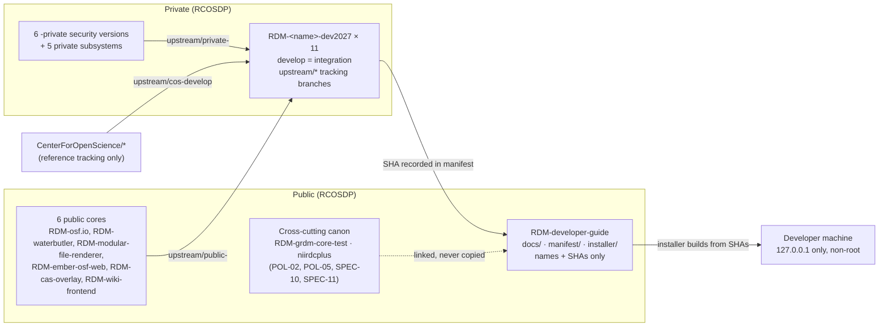
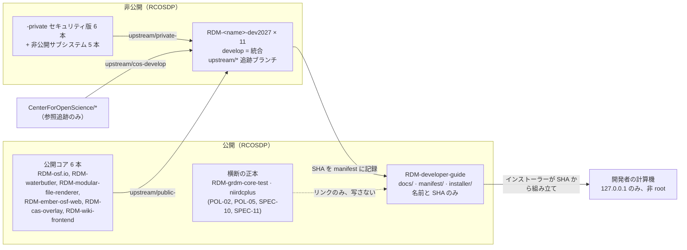

# POL-01 Position on the Developer Environment 2027 / 開発環境 2027 版の位置づけ

> **Summary:** Our stance on why and how we build the GakuNin RDM developer environment 2027: one-shot, multi-architecture, security-first, kept alive by AI agents with humans deciding merge and publication, documented in public while integration code stays private.
> **概要:** GakuNin RDM の開発環境 2027 版を、なぜ・どのように作るかの立場。一発導入、複数アーキテクチャ、安全第一、AI エージェントが保ち、マージと公開は人が決める。文書は公開し、統合コードは非公開に置く。

**Jump:** [English](#english) · [日本語](#japanese)

- Version / 版: 0.1 — 2026-11-05. **Learned:** writing the stance down first showed that "public documentation, private code" is not a detail but the rule every other document depends on, because this repository is read abroad and must never carry private code. ／ 立場を先に書いてみると、「文書は公開、コードは非公開」が細部ではなく他の全文書の前提だと分かった。このリポジトリは海外からも読まれ、非公開のコードを一片でも置けないからである。
- Applies to: everything under this repository and the integration repositories named `RDM-<name>-dev2027`.
- Related: [docs/README.md](../README.md) · [SPEC-00 Overview](../spec/00_overview.md) · [SPEC-01 Manifest](../spec/01_manifest.md) · [SPEC-02 Installer CLI](../spec/02_installer_cli.md) · [SPEC-03 Security Gate](../spec/03_security_gate.md) · [SPEC-04 Acceptance Tests](../spec/04_acceptance_tests.md) · [SPEC-05 Upstream Tracking](../spec/05_upstream_tracking.md) · [SPEC-06 Documentation Conventions](../spec/06_documentation_conventions.md) · [ADR-01](../decisions/ADR-01_Integration_Repository_Placement.md) · [ADR-02](../decisions/ADR-02_Network_Model.md) · [ADR-03](../decisions/ADR-03_Staged_Security_Gate.md) · [ADR-04](../decisions/ADR-04_AI_Autonomy_and_Roles.md) · [REF-01 Glossary](../reference/REF-01_Glossary.md)

---

<a id="english"></a>
## English

[→ 日本語版へ](#japanese)

### 1. Why this policy exists

GakuNin RDM is the research data management service of NII, built on OSF (the Open Science Framework, a web service for sharing research projects, made by COS, the Center for Open Science in the United States). Our copies of the OSF code live in GitHub *repositories* (a repository is a folder whose every change is remembered, so you can always go back) owned by the RCOSDP organization. There are six public core repositories, six `-private` security-verified versions of them, and five private subsystems. Today nobody can install all of them together in one step, and the base images they run on reached *EOL* (end of life: the makers no longer fix bugs or security holes in them).

A *policy* is the position we take. This one says what the "developer environment 2027" is for, what we will and will not do, and where every piece lives. Rules for implementers are in the specifications; the reasons behind individual choices are in the decision records.

### 2. Our stance

1. **Goal.** One command installs a developer environment that combines the public core `develop` branches, the `-private` security versions, and the subsystems, on macOS (Apple Silicon), Ubuntu 24.04 (amd64 and arm64) and Windows 11 with WSL2. It can be handed to partners abroad. AI agents (programs that read, write and test code on their own, under rules we set) keep it secure, so GakuNin RDM continues even if COS stops maintaining OSF.
2. **Modernize rather than tolerate.** When an old library or base image carries known *vulnerabilities* (weak spots an attacker could use), we move to a current version, even when that takes longer. We do not ship a known hole because fixing it is work.
3. **Remove vulnerabilities until top-tier AI attackers fail.** The bar is not "no scanner warnings" but "an approved AI red team (a team whose job is to attack our own system, in an isolated network, to find holes before real attackers do) finds no unresolved way in". We reach that bar in stages through a *security gate* (a checkpoint the build must pass before anyone may use it), defined in [SPEC-03](../spec/03_security_gate.md) and [ADR-03](../decisions/ADR-03_Staged_Security_Gate.md): report-only at first, stop on HIGH at M4, zero CRITICAL/HIGH plus red-team pass at M5.
4. **Humans decide; AI does the work.** AI detects, fixes, reviews and tests. A human decides to *merge* (accept a change into the shared branch), to publish, and to grant exceptions. No AI merges its own work, and no author accepts their own change. Details in [ADR-04](../decisions/ADR-04_AI_Autonomy_and_Roles.md).
5. **This repository is public and holds no code from private sources.** It contains documentation, the *manifest* (a list naming each upstream repository and the exact *SHA*, the fingerprint of one commit, that we build from) and the *installer* (the program that sets everything up). Integration code lives in private repositories named `RDM-<name>-dev2027`. We name them in text but never link to them by URL. Secret scanning in CI (continuous integration: automatic checks that run on every change) is mandatory.
6. **Documents are bilingual and newcomer-readable.** English first, Japanese second, on the same page, with glossary notes on every technical term the first time it appears. Rules in [SPEC-06](../spec/06_documentation_conventions.md); shared terms in [REF-01](../reference/REF-01_Glossary.md).
7. **Relationship to upstream policies.** This repository is GRDM-specific. The cross-cutting canon — the charter, folder rules (POL-02), human/AI responsibilities (POL-05), pull request rules (SPEC-10) and installer form (SPEC-11) — stays in `RDM-grdm-core-test` and `niirdcplus`. We link to it and never copy it, so there is only one place to fix a rule.
8. **Role model and write boundary.** Roles use the three-letter codes of the owning team: AID (AI developer: Orca Open Code 2 workers on a local LLM), QAE (QA engineer: Claude Code Fable), REV (reviewer: Codex Astra), and the owner for policy, acceptance, merge and publication. The agents working on this plan may write only to this repository and to newly created `RDM-<name>-dev2027` repositories. They never write to existing upstream repositories, never delete a repository or branch, and never *force-push* (overwrite shared history).

### 3. Where things live



Read the picture from left to right: upstream code flows into the private integration repositories; only names and SHAs flow into this public repository; the installer on a developer machine builds from those SHAs.

### 4. Milestone ladder

The canonical plan is kept by the owner; the excerpt is in TOON (a compact text form of JSON that people and AI both read easily).

```toon
milestones[5]{id,goal,gate,proof}:
  M1,"docs skeleton, manifest, 11 dev2027 integration repos","report-only scan, allow-list recorded","Codex-reviewed PR merged to develop"
  M2,"6 cores install in one shot on Mac Studio (arm64); amd64 build passes","report-only, allow-list count recorded","Playwright acceptance: login, project, file up/down, wiki co-edit, preview, institution admin; success + rejection"
  M3,"5 subsystems start (y-websocket, OASys, Shibboleth-SP + test IdP, rdmcp, aipf_mcp_data_grdm)","allow-list smaller than M2","one success + one rejection case per subsystem"
  M4,"waterbutler, mfr, osf.io on Python 3.13","install stops on HIGH or above; first AI red team","regression of M2/M3 acceptance passes"
  M5,"ES2 and mongo 3.4 retired; ES8 and PostgreSQL 15+","zero CRITICAL/HIGH; AI red team finds no unresolved path","distributable abroad; licenses settled"
steady_state:
  daily: "upstream mirror, diff report, CVE scan"
  weekly: "AI integration PR → Codex review → regression and acceptance"
  human_only: "merge, publish, exceptions"
```

Deadlines are set by the owner when each milestone starts.

### 5. What we will not do

- We will not keep the loopback *alias* `192.168.168.167` that needed `sudo` (administrator rights) and exposed services to the local network. See [ADR-02](../decisions/ADR-02_Network_Model.md).
- We will not place private code, secrets, or private repository URLs in this repository.
- We will not let an AI merge or publish, nor let an author accept their own change.
- We will not copy the upstream charter or policies here; we link.
- We will not push images built from `-private` code to a public registry.

### 6. How this policy is used

Specifications ([SPEC-00](../spec/00_overview.md) to [SPEC-06](../spec/06_documentation_conventions.md)) implement this stance. Decision records ([ADR-01](../decisions/ADR-01_Integration_Repository_Placement.md) to [ADR-04](../decisions/ADR-04_AI_Autonomy_and_Roles.md)) explain the individual choices. When a specification and this policy disagree, fix both in one commit and record what was learned in the version line.

---

<a id="japanese"></a>
## 日本語

[→ To English](#english)

### 1. なぜこの方針があるのか

GakuNin RDM は NII の研究データ管理サービスで、OSF（Open Science Framework。研究プロジェクトを共有する Web サービス。米国の COS = Center for Open Science が作った）を土台にしています。OSF のコードの私たちの写しは、RCOSDP という GitHub の組織が持つ「リポジトリ」（変更を全部覚えているフォルダ。いつでも前に戻せる）にあります。公開コアが 6 本、それに対応する `-private` のセキュリティ検証版が 6 本、非公開のサブシステムが 5 本です。いま、これら全部を一度に導入する手段はありません。しかも動かしている土台のイメージは全部 EOL（end of life。作った人がバグや穴を直してくれなくなった状態）です。

「方針」は私たちの立場を書いたものです。この方針は、「開発環境 2027 版」が何のためにあり、何をし、何をせず、それぞれの部品がどこに置かれるかを述べます。実装する人が守る規則は仕様に、個々の選択の理由は決定の記録にあります。

### 2. 私たちの立場

1. **ゴール。** 一つのコマンドで、公開コアの `develop`、`-private` のセキュリティ版、サブシステムを重ねた開発環境が、macOS（Apple Silicon）、Ubuntu 24.04（amd64 と arm64）、Windows 11 の WSL2 に入ります。海外の協力者にも渡せます。AI エージェント（私たちの決めた規則のもとで、自分でコードを読み・書き・試すプログラム）が安全に保ち、COS が OSF の保守をやめても GakuNin RDM を続けられます。
2. **我慢せず最新化する。** 古いライブラリや土台のイメージに既知の「脆弱性」（攻撃者が使える弱い場所）があれば、時間がかかっても現行版へ移ります。直すのが大変だからといって、既知の穴を残して出荷しません。
3. **最上位の AI 攻撃者が失敗するまで脆弱性を除く。** 基準は「スキャナの警告がない」ではなく、「承認された AI レッドチーム（本物の攻撃者より先に穴を見つけるために、隔離したネットワークの中で自分たちのシステムを攻める係）が、未解決の侵入経路を見つけない」です。そこへは「セキュリティ門」（通らないと使えない検問所）を段階的に厳しくして到達します。[SPEC-03](../spec/03_security_gate.md) と [ADR-03](../decisions/ADR-03_Staged_Security_Gate.md) に定義し、最初は報告のみ、M4 で HIGH 停止、M5 で CRITICAL/HIGH ゼロとレッドチーム合格を必須にします。
4. **人が決め、AI が働く。** AI は検出・修正・レビュー・試験を行います。「マージ」（変更を共有ブランチへ受け入れること）、公開、例外の付与は人が決めます。AI は自分の成果をマージせず、作者は自分の変更を受け入れません。詳細は [ADR-04](../decisions/ADR-04_AI_Autonomy_and_Roles.md)。
5. **このリポジトリは公開で、非公開由来のコードを持たない。** 置くのは文書、「manifest」（取り込む上流リポジトリの名前と、どのコミットから作るかを示す「SHA」= コミット一つの指紋、を並べた一覧）、「インストーラー」（全部を組み立てるプログラム）だけです。統合コードは `RDM-<name>-dev2027` という非公開リポジトリに置きます。文中では名前だけを書き、URL は書きません。CI（continuous integration。変更ごとに自動で走る検査）での秘密スキャンを必須にします。
6. **文書は二言語で、新入社員が読める。** 同じページに英語を先、日本語を後に置き、専門用語には初出で用語注を付けます。規則は [SPEC-06](../spec/06_documentation_conventions.md)、共通の用語は [REF-01](../reference/REF-01_Glossary.md)。
7. **上流方針との関係。** このリポジトリは GRDM 固有です。横断の正本 — 憲章、置き場の規則（POL-02）、人と AI の責任（POL-05）、PR の規則（SPEC-10）、インストーラーの型（SPEC-11）— は `RDM-grdm-core-test` と `niirdcplus` にあります。リンクで指し、写しません。規則を直す場所を一つにするためです。
8. **役割モデルと書込の境界。** 役割は所属チームの 3 文字略称で表します。AID（AI開発担当者。ローカル LLM で動く Orca の Open Code 2 ワーカー）、QAE（QA担当。Claude Code Fable）、REV（担当レビュワ。Codex Astra）、そして方針・受入・マージ・公開を担う所有者です。この計画で働くエージェントが書き込めるのは、このリポジトリと、新設の `RDM-<name>-dev2027` だけです。既存の上流リポジトリには書かず、リポジトリやブランチを削除せず、「force push」（共有の履歴の上書き）をしません。

### 3. 物の置き場



左から右へ読みます。上流のコードは非公開の統合リポジトリへ流れ、公開のこのリポジトリへは名前と SHA だけが流れ、開発者の計算機のインストーラーがその SHA から組み立てます。

### 4. 節目のはしご

計画の正本は所有者が持ちます。抄録は TOON（JSON を短い字下げ付きの文字で表した形。人も AI も読みやすい）で示します。

```toon
milestones[5]{id,goal,gate,proof}:
  M1,"docs 骨格・manifest・dev2027 統合リポジトリ 11 本","報告のみ、許容リストを記録","Codex レビュー済み PR が develop にマージ"
  M2,"コア 6 本が Mac Studio（arm64）で一発導入、amd64 はビルド確認","報告のみ、許容リスト件数を記録","Playwright 受入: ログイン・プロジェクト・ファイル上下載・Wiki 共同編集・プレビュー・機関管理。成功＋拒否"
  M3,"サブシステム 5 本が起動（y-websocket, OASys, Shibboleth-SP＋テスト IdP, rdmcp, aipf_mcp_data_grdm）","許容リストが M2 より少ない","各 1 本の正常系＋拒否ケース"
  M4,"waterbutler・mfr・osf.io を Python 3.13 へ","HIGH 以上で導入停止、AI レッドチーム初回","M2/M3 受入の回帰が合格"
  M5,"ES2・mongo 3.4 を廃止、ES8・PostgreSQL 15 以降","CRITICAL/HIGH ゼロ、AI レッドチームが未解決経路ゼロ","海外配布可、ライセンス整理済み"
steady_state:
  daily: "上流ミラー、差分報告、CVE スキャン"
  weekly: "AI 統合 PR → Codex レビュー → 回帰・受入"
  human_only: "マージ、公開、例外"
```

各節目の期限は、着手時に所有者が決めます。

### 5. しないこと

- `sudo`（管理者権限）が要り、サービスを LAN に露出させていたループバックの別名 `192.168.168.167` は使いません。[ADR-02](../decisions/ADR-02_Network_Model.md) を参照。
- このリポジトリに非公開のコード、秘密、非公開リポジトリの URL を置きません。
- AI にマージや公開をさせません。作者に自分の変更を受け入れさせません。
- 上流の憲章や方針をここに写しません。リンクします。
- `-private` 由来のコードから作ったイメージを公開レジストリに出しません。

### 6. この方針の使い方

仕様（[SPEC-00](../spec/00_overview.md)〜[SPEC-06](../spec/06_documentation_conventions.md)）がこの立場を実装します。決定の記録（[ADR-01](../decisions/ADR-01_Integration_Repository_Placement.md)〜[ADR-04](../decisions/ADR-04_AI_Autonomy_and_Roles.md)）が個々の選択の理由を説明します。仕様とこの方針が食い違ったら、同じコミットで両方を直し、版の行に分かったことを書きます。

---

## Glossary / 用語

| Term | English note | 日本語注 |
|---|---|---|
| Repository | A folder that remembers every change, so you can always go back. | 変更を全部覚えているフォルダ。いつでも前に戻せる。 |
| SHA | The fingerprint of one saved change (commit); no two are alike. | 保存した変更（コミット）一つの指紋。同じものは二つない。 |
| Manifest | The list of which repositories, at which SHA, we build from. | どのリポジトリのどの SHA から組み立てるかの一覧。 |
| EOL | End of life: the makers no longer fix it. | 作った人が直してくれなくなった状態。 |
| Security gate | A checkpoint the build must pass before anyone may use it. | 通らないと使えない検問所。 |
| AI red team | A team that attacks our own system, in isolation, to find holes first. | 隔離した中で自分のシステムを攻めて、穴を先に見つける係。 |
| Force push | Overwriting shared history on GitHub; forbidden here. | GitHub 上の共有の履歴を上書きすること。ここでは禁止。 |

Full shared glossary: [REF-01 Glossary](../reference/REF-01_Glossary.md).
