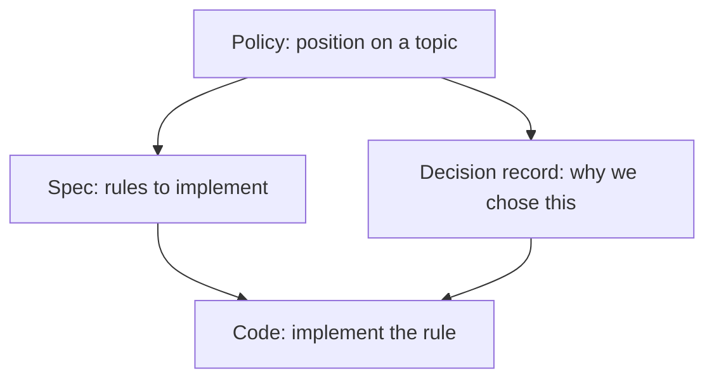
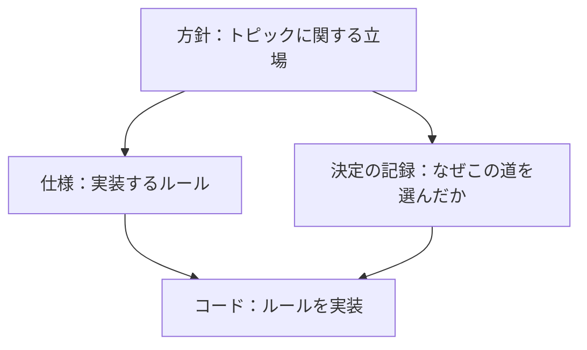

# Policy / 方針

> **Summary:** Documents stating our position on what we will and will not do: developer environment goals, security stance, human/AI responsibilities. Each document states our position on a topic; specifications implement the stance.
> **概要:** 我々が何をし、何をしないかの立場を述べる文書：開発環境のゴール、セキュリティの姿勢、人と AI の責任。各文書はトピックに関する私たちの立場を述べ、仕様がその立場を実装します。

**Jump:** [English](#english) · [日本語](#japanese)

- Version / 版: 0.2 — 2026-11-06. **Learned:** a glossary term is only explained for the reader when its note sits at the first occurrence in prose, so first-use notes were added in both halves (SPEC-06 §3). ／ 用語注は本文の初出の位置に置かなければ読者に届かないと分かったため、英和両方の初出に用語注を補った（SPEC-06 §3）。
- Version / 版: 0.1 — 2026-11-05. **Learned:** writing the stance down first showed that "public documentation, private code" is not a detail but the rule every other document depends on. ／ 立場を先に書いてみると、「文書は公開、コードは非公開」が細部ではなく他の全文書の前提だと分かった。
- Normative for: [POL-01 Position](./POL-01_Developer_Environment_2027_Position.md) and future policy documents.
- Related: [../README.md](../README.md) · [../spec/](../spec/) · [decisions/](../decisions/) · [reference/REF-01_Glossary.md](./../reference/REF-01_Glossary.md)

---

## English

[→ 日本語版へ](#japanese)

### 1. What belongs here

A *policy* is the position we take. This folder contains:

| File | Purpose |
|---|---|
| [POL-01_Developer_Environment_2027_Position.md](./POL-01_Developer_Environment_2027_Position.md) | Our stance on why and how we build the developer environment 2027. |

Future policies may include:

| Topic | Description |
|---|---|
| POL-02 | Folder and file naming rules |
| POL-03 | Pull request rules |
| POL-04 | Release process |
| POL-05 | Human/AI responsibilities |

### 2. How policies relate to other documents

### 3. Creating a new policy

1. Name the file `POL-NN_<Title>.md` (two-digit number).
2. Follow [SPEC-06 documentation conventions](../spec/06_documentation_conventions.md).
3. Link to other documents that depend on this policy.
4. The owner approves; AID (the AI developer role) writes the implementation spec.

---

## 日本語

[→ To English](#english)

### 1. ここに属するもの

「方針」は私たちの立場を書いたものです。このフォルダには次が含まれます：

| ファイル | 目的 |
|---|---|
| [POL-01_Developer_Environment_2027_Position.md](./POL-01_Developer_Environment_2027_Position.md) | 開発環境 2027 版を、なぜ・どのように作るかの立場。 |

今後の方針として以下が考えられます：

| トピック | 説明 |
|---|---|
| POL-02 | フォルダとファイル命名規則 |
| POL-03 | プルリクエスト規則 |
| POL-04 | リリースプロセス |
| POL-05 | 人と AI の責任 |

### 2. 方針が他の文書とどう関係するか

### 3. 新しい方針を作るには

1. ファイル名を `POL-NN_<題>.md`（2 桁の番号）にする。
2. [SPEC-06 文書規約](../spec/06_documentation_conventions.md)に従う。
3. この方針に依存する他の文書へリンクする。
4. 所有者が承認；AID（AI開発担当者）が実装仕様を書く。

---

## Glossary / 用語

| Term | English note | 日本語注 |
|---|---|---|
| Policy | A statement of our position on what we will and will not do. | 我々が何をし、何をしないかの立場。 |
| Spec | A rule book that implementers must follow. | 実装する人が守るルールブック。 |
| Decision record (ADR) | A note explaining why we chose one way and not another. | なぜその道を選び、ほかを選ばなかったかのメモ。 |
| Implementation | Writing code that follows the spec. | 仕様に従ってコードを書くこと。 |
| Owner | The human who approves policies. | 方針を承認する人。 |
