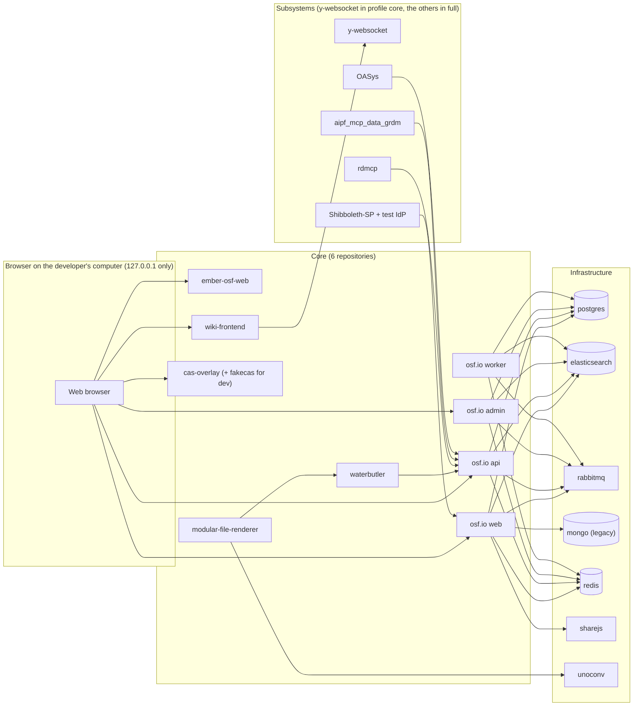
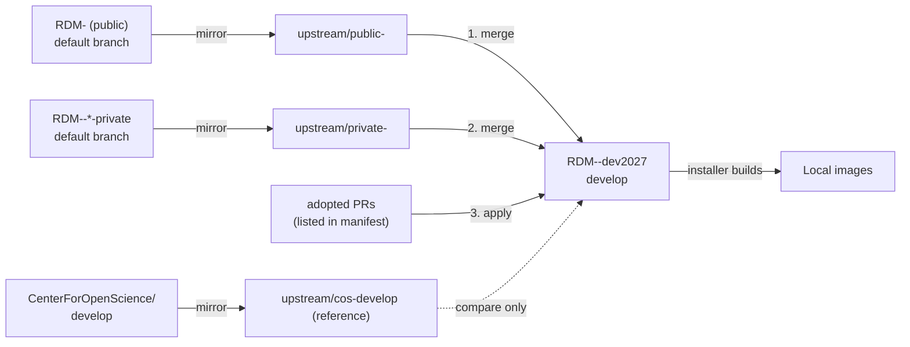
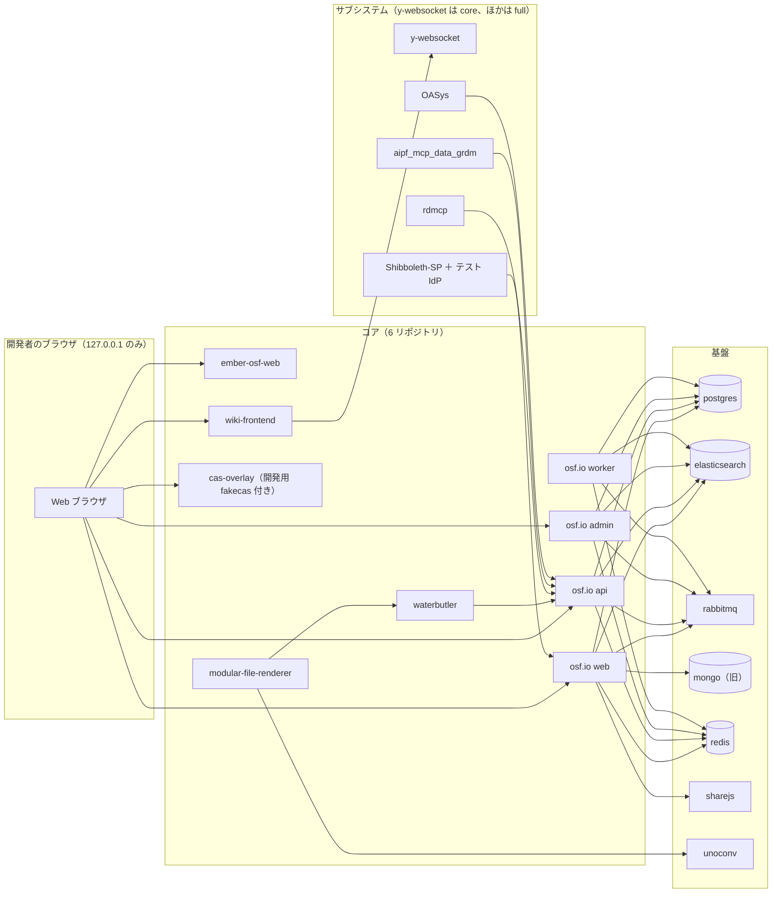
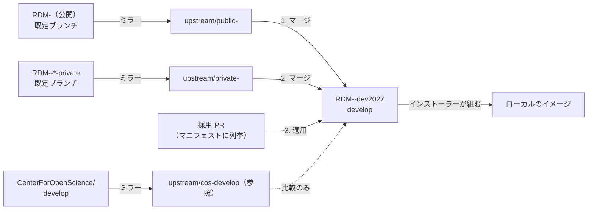

# SPEC-00 Overview and Architecture / 全体像と構成

> **Summary:** What the GakuNin RDM developer environment 2027 is, which parts it is made of, how upstream code is combined, how the network is shaped, which milestones it passes, who does what, and where the other specifications are.
> **概要:** GakuNin RDM 開発環境 2027 版とは何か。どの部品でできているか、上流のコードをどう重ねるか、ネットワークはどんな形か、どの節目を通るか、誰が何をするか、他の仕様はどこにあるか。

**Jump:** [English](#english) · [日本語](#japanese)

- Version / 版: 0.3 — 2026-11-06. **Learned:** a glossary term is only explained for the reader when its note and REF-01 link sit at the first prose use, counting lower-case and plural forms, so first-use notes with links were added in both halves (SPEC-06 §3). ／ 用語注と REF-01 へのリンクは、小文字や複数形も含めた本文の初出に置かなければ読者に届かないと分かったため、英和両方の初出にリンク付きの用語注を補った（SPEC-06 §3）。
- Version / 版: 0.2 — 2026-11-05. **Learned:** the profile of one component (y-websocket) is decided by the milestone that tests it (Wiki co-editing, M2), not by its role, so the overview must mirror SPEC-02 and the manifest. ／ 部品のプロファイルは役割でなく、それを試験する節目（Wiki 共同編集は M2）が決めるため、概要図と抄録は SPEC-02 と manifest に合わせ続けなければならないと分かった。
- Version / 版: 0.1 — 2026-11-05. **Learned:** eleven upstream repositories and three tracking branches per component cannot be held in anyone's head, so the map, the manifest, and the roles had to be written down before the first integration repository was created. ／ 上流 11 本と部品ごとの追跡ブランチ 3 本は頭の中では管理できないので、最初の統合リポジトリを作る前に、地図・マニフェスト・役割分担を文書にする必要があると分かった。
- Normative for: the shape of the whole environment. Every other specification (`01`–`06`) refines one part of this page.
- Related: [POL-01 Position](../policy/POL-01_Developer_Environment_2027_Position.md) · [ADR-01 Integration repository placement](../decisions/ADR-01_Integration_Repository_Placement.md) · [ADR-02 Network model](../decisions/ADR-02_Network_Model.md) · [ADR-03 Staged security gate](../decisions/ADR-03_Staged_Security_Gate.md) · [ADR-04 AI autonomy and roles](../decisions/ADR-04_AI_Autonomy_and_Roles.md) · [SPEC-01 Manifest](01_manifest.md) · [SPEC-05 Upstream tracking](05_upstream_tracking.md) · [SPEC-06 Documentation conventions](06_documentation_conventions.md) · [docs/README.md](../README.md)

---

<a id="english"></a>
## English

[→ 日本語版へ](#japanese)

### 1. Purpose

The *developer environment 2027* is a set of instructions and tools that lets one person start a complete GakuNin RDM (GRDM, the research data management service run by NII; GakuNin is Japan's academic network for logging in with a university account; see [REF-01](../reference/REF-01_Glossary.md)) on one computer with one command. It runs on macOS arm64, Ubuntu 24.04 (amd64 and arm64), and Windows 11 WSL2 (a way to run Linux inside Windows; see [REF-01](../reference/REF-01_Glossary.md)). It has three jobs:

1. Combine the public core repositories, their `-private` security-verified versions, and the private subsystems into one consistent build.
2. Move every base image (a *base image* is the ready-made operating-system layer a program is built on top of) from end-of-life versions to current ones, step by step.
3. Keep removing security vulnerabilities (a *vulnerability* is a weak spot an attacker could use) with AI agents, so GRDM can continue even if the Center for Open Science (COS) stops developing OSF (the software GRDM is based on; see [REF-01](../reference/REF-01_Glossary.md)).

This repository, `RDM-developer-guide`, is **public**. It holds documents, the manifest (the list of exactly which upstream versions we build; see [SPEC-01](01_manifest.md)), and the installer. It never holds code copied from `-private` repositories, secrets, or links to private repositories.

### 2. Component map

A *component* is one program that runs as its own container (a box that holds one program and everything it needs, so it runs the same on any computer). *Core* components are the GRDM application itself. *Infrastructure* components are shared services such as databases. *Subsystems* are optional extras that plug into the core.



The inventory in TOON (a compact text form of JSON; see [SPEC-06 §4](06_documentation_conventions.md#4-diagrams-and-data)). The canonical, machine-read list is `manifest/upstreams.json` ([SPEC-01](01_manifest.md)); this excerpt shows only `id`, `role`, `services`, `integration_repo`, and `profile` (the smallest installer profile that includes the component, [SPEC-02 §4](02_installer_cli.md#2-en-ports)). Service names are the Compose service names.

<!-- canonical: manifest/upstreams.json -->
```toon
components[20]{id,role,services,integration_repo,profile}:
  osf.io,core,"web,api,admin,worker",RDM-osf.io-dev2027,minimum
  waterbutler,core,"wb,wb_worker",RDM-waterbutler-dev2027,core
  modular-file-renderer,core,mfr,RDM-modular-file-renderer-dev2027,core
  ember-osf-web,core,ember_osf_web,RDM-ember-osf-web-dev2027,core
  cas-overlay,core,cas,RDM-cas-overlay-dev2027,core
  wiki-frontend,core,wiki,RDM-wiki-frontend-dev2027,core
  postgres,infra,postgres,null,minimum
  elasticsearch2,infra,elasticsearch,null,minimum
  elasticsearch6,infra,elasticsearch6,null,core
  rabbitmq,infra,rabbitmq,null,minimum
  mongo,infra,mongo,null,core
  redis,infra,redis,null,core
  sharejs,infra,sharejs,null,core
  unoconv,infra,unoconv,null,core
  fakecas,infra,fakecas,null,minimum
  y-websocket,subsystem,y_websocket,RDM-y-websocket-dev2027,core
  OASys,subsystem,oasys,RDM-OASys-dev2027,full
  Shibboleth-SP,subsystem,"shibboleth_sp,test_idp",RDM-Shibboleth-SP-dev2027,full
  rdmcp,subsystem,rdmcp,RDM-rdmcp-dev2027,full
  aipf_mcp_data_grdm,subsystem,aipf_mcp_data_grdm,RDM-aipf_mcp_data_grdm-dev2027,full
```

`mongo` and `elasticsearch2` are legacy and are removed at M5 ([§5](#5-milestone-ladder)).

`fakecas` and the Shibboleth (the software that lets you log in once with your university account; see [REF-01](../reference/REF-01_Glossary.md)) test IdP (an *IdP*, identity provider, is the server that checks who you are when you log in) are both login helpers for development. They are mutually exclusive: the installer starts one or the other, never both.

### 3. Integration model

Each core component and each subsystem gets one private *integration repository* in the RCOSDP organization, named `RDM-<name>-dev2027`. Its `develop` branch is what the installer builds. Beside it sit *tracking branches* (read-only copies of someone else's branch), one per upstream listed in the manifest, named `upstream/<kind>-<branch>` where `<branch>` is the upstream branch name with `/` replaced by `-` ([SPEC-01 §4](01_manifest.md#4-rules) rule 7):

- `upstream/public-<branch>` — the public RCOSDP repository's default branch. Examples: `upstream/public-develop` (osf.io, waterbutler, mfr, cas-overlay, wiki-frontend), `upstream/public-master` (ember-osf-web, y-websocket).
- `upstream/private-<branch>` — the `-private` security-verified repository's default branch. Examples: `upstream/private-develop`, `upstream/private-master` (ember-osf-web, y-websocket), `upstream/private-main` (OASys, Shibboleth-SP, rdmcp, aipf_mcp_data_grdm, which have no public upstream and therefore only this one branch).
- `upstream/cos-develop` — the original COS repository, kept for reference only (the six cores except wiki-frontend).
- A second upstream of the same kind gets a tag: `upstream/private-sec-test-fix-sec-test` mirrors `RDM-osf.io-private` (branch `fix/sec-test`) as a candidate that is not merged.



Order matters: public first, then private, then adopted pull requests. The manifest ([SPEC-01](01_manifest.md)) records the exact commit (by *SHA*, the 40-character fingerprint of a commit) for each step. The daily and weekly jobs that keep this up to date are in [SPEC-05](05_upstream_tracking.md). Why the repositories are placed this way is in [ADR-01](../decisions/ADR-01_Integration_Repository_Placement.md).

### 4. Network model

- The loopback alias `192.168.168.167` used by the old guide is **gone**. It needed `sudo` (administrator rights) and exposed services to the local network.
- Containers talk to each other on the Compose internal network (a private network that only the containers of one project can see) by service name, for example `http://api:8000`.
- Only ports bound to `127.0.0.1` (the address that means "this computer only") are published to the host. Nothing listens on other interfaces.
- No step of installation requires `sudo`. The reasoning is in [ADR-02](../decisions/ADR-02_Network_Model.md).

### 5. Milestone ladder

A *milestone* is a checkpoint with a pass/fail test. The *security gate* is the test that decides whether a build may be installed; it gets stricter at each milestone ([ADR-03](../decisions/ADR-03_Staged_Security_Gate.md)).

```toon
milestones[5]{id,goal,security_gate}:
  M1,"docs skeleton, manifest, dev2027 repositories exist; reviewed PRs merged to develop","report + allow-list"
  M2,"core 6 install with one command on Mac Studio; Playwright acceptance passes; amd64 builds","report + allow-list (fewer entries than M1)"
  M3,"5 subsystems start; one success + one rejection case each","report + allow-list (fewer entries than M2)"
  M4,"waterbutler, mfr, osf.io on Python 3.13","stop on HIGH or above; first AI red-team run"
  M5,"ES2 and mongo removed; ES8 + postgres 15 or later; distributable abroad","zero CRITICAL/HIGH; zero open AI red-team paths"
```

### 6. Roles

Role codes follow the shared table in `AGENTS.md`. An *AI agent* is a program that reads instructions, writes code or documents, and reports back.

| Code | Who | Does |
|---|---|---|
| AID (AI Developer) | Orca Open Code 2 workers on a local LLM | Implements what the specifications say; writes documents and code in PRs |
| QAE (QA Engineer) | Claude Code Fable | Writes specifications, checks implementations, runs and judges regression and acceptance tests |
| REV (Reviewer) | Codex Astra | Independent review of every PR; records results in `docs/reviews/` and PR comments |
| Owner | Human | Decides policy, accepts, merges, publishes |

Detection, fix PR, review, and automated tests run without a human. Merging and publishing are always done by the owner ([ADR-04](../decisions/ADR-04_AI_Autonomy_and_Roles.md)).

### 7. Index of specifications

| ID | File | One line |
|---|---|---|
| SPEC-01 | [01_manifest.md](01_manifest.md) | The manifest: which upstream commits and PRs the installer builds |
| SPEC-02 | [02_installer_cli.md](02_installer_cli.md) | The `grdm-dev` CLI and `install.sh`: host checks, secrets, compose, build, health, reports |
| SPEC-03 | [03_security_gate.md](03_security_gate.md) | SBOM, CVE scan, static analysis, ZAP, AI red team, and the per-milestone thresholds |
| SPEC-04 | [04_acceptance_tests.md](04_acceptance_tests.md) | Playwright Python acceptance: success and rejection cases per feature |
| SPEC-05 | [05_upstream_tracking.md](05_upstream_tracking.md) | Daily mirror and diff report, weekly AI integration PR, COS reference tracking |
| SPEC-06 | [06_documentation_conventions.md](06_documentation_conventions.md) | How every document is written |

---

<a id="japanese"></a>
## 日本語

[→ To English](#english)

### 1. 目的

「開発環境 2027 版」は、GakuNin RDM（GRDM。NII が運用する研究データ管理サービス。GakuNin＝学認は大学のアカウントでログインするための日本の学術ネットワーク。[REF-01](../reference/REF-01_Glossary.md)）の一式を、一台のコンピュータ上で一つのコマンドで立ち上げるための手引きと道具の集まりです。macOS arm64、Ubuntu 24.04（amd64 と arm64）、Windows 11 WSL2（Windows の中で Linux を動かす仕組み。[REF-01](../reference/REF-01_Glossary.md)）で動きます。役目は三つです。

1. 公開コアのリポジトリ、その `-private`（セキュリティ検証版）、非公開サブシステムを、矛盾なく一つのビルドに重ねる。
2. すべてのベースイメージ（プログラムを載せる土台になる、できあいの OS の層）を、サポート切れの版から現行の版へ段階的に移す。
3. AI エージェントで脆弱性（攻撃者につけ込まれる弱い所）を取り除き続け、GRDM の元になっている OSF（[REF-01](../reference/REF-01_Glossary.md)）の開発を Center for Open Science（COS）がやめても、GRDM を提供し続けられるようにする。

このリポジトリ `RDM-developer-guide` は **公開** です。文書、マニフェスト（どの上流の版を組むかを決める一覧。[SPEC-01](01_manifest.md)）、インストーラーを置きます。`-private` 由来のコード、秘密、非公開リポジトリへのリンクは絶対に置きません。

### 2. 部品の地図

「部品（コンポーネント）」は、それぞれ自分のコンテナ（一つのプログラムと必要なものを一箱に入れ、どのコンピュータでも同じように動かすための箱）で動く一つのプログラムです。「コア」は GRDM 本体、「基盤」はデータベースのような共用サービス、「サブシステム」はコアに差し込む追加機能です。



一覧を TOON（JSON を短く字下げで書いた形。[SPEC-06 §4](06_documentation_conventions.md#4-図とデータ)）で示します。機械が読む正本は `manifest/upstreams.json`（[SPEC-01](01_manifest.md)）で、この抄録は `id`・`role`・`services`・`integration_repo`・`profile`（その部品を含む最小のインストーラープロファイル。[SPEC-02 §4](02_installer_cli.md#2-ja-ports)）だけを載せています。サービス名は Compose のサービス名です。

<!-- canonical: manifest/upstreams.json -->
```toon
components[20]{id,role,services,integration_repo,profile}:
  osf.io,core,"web,api,admin,worker",RDM-osf.io-dev2027,minimum
  waterbutler,core,"wb,wb_worker",RDM-waterbutler-dev2027,core
  modular-file-renderer,core,mfr,RDM-modular-file-renderer-dev2027,core
  ember-osf-web,core,ember_osf_web,RDM-ember-osf-web-dev2027,core
  cas-overlay,core,cas,RDM-cas-overlay-dev2027,core
  wiki-frontend,core,wiki,RDM-wiki-frontend-dev2027,core
  postgres,infra,postgres,null,minimum
  elasticsearch2,infra,elasticsearch,null,minimum
  elasticsearch6,infra,elasticsearch6,null,core
  rabbitmq,infra,rabbitmq,null,minimum
  mongo,infra,mongo,null,core
  redis,infra,redis,null,core
  sharejs,infra,sharejs,null,core
  unoconv,infra,unoconv,null,core
  fakecas,infra,fakecas,null,minimum
  y-websocket,subsystem,y_websocket,RDM-y-websocket-dev2027,core
  OASys,subsystem,oasys,RDM-OASys-dev2027,full
  Shibboleth-SP,subsystem,"shibboleth_sp,test_idp",RDM-Shibboleth-SP-dev2027,full
  rdmcp,subsystem,rdmcp,RDM-rdmcp-dev2027,full
  aipf_mcp_data_grdm,subsystem,aipf_mcp_data_grdm,RDM-aipf_mcp_data_grdm-dev2027,full
```

`mongo` と `elasticsearch2` は旧来の部品で、M5 で廃止します（[§5](#5-節目のはしご)）。

`fakecas` と Shibboleth（大学のアカウントで一度ログインすれば済むようにするソフト。[REF-01](../reference/REF-01_Glossary.md)）のテスト IdP（IdP＝アイデンティティプロバイダ。ログインのときに「あなたは誰か」を確かめるサーバ）は、どちらも開発用のログインの助け役です。二つは排他で、インストーラーはどちらか一方だけを起動します。

### 3. 統合の仕組み

コアの各部品とサブシステムには、RCOSDP 組織内に非公開の「統合リポジトリ」を一つずつ作ります。名前は `RDM-<name>-dev2027` です。その `develop` ブランチをインストーラーが組みます。横に「追跡ブランチ」（他の場所のブランチを読み取り専用で写したもの）を、マニフェストに載せた上流ごとに一本置きます。名前は `upstream/<kind>-<branch>` で、`<branch>` は上流のブランチ名の `/` を `-` に置き換えたものです（[SPEC-01 §4](01_manifest.md#4-規則) の規則 7）。

- `upstream/public-<branch>` — 公開 RCOSDP リポジトリの既定ブランチ。例: `upstream/public-develop`（osf.io、waterbutler、mfr、cas-overlay、wiki-frontend）、`upstream/public-master`（ember-osf-web、y-websocket）。
- `upstream/private-<branch>` — `-private` セキュリティ検証版の既定ブランチ。例: `upstream/private-develop`、`upstream/private-master`（ember-osf-web、y-websocket）、`upstream/private-main`（OASys、Shibboleth-SP、rdmcp、aipf_mcp_data_grdm。公開の上流がないので、この一本だけ）。
- `upstream/cos-develop` — COS 本家。参照専用（wiki-frontend を除くコア 5 本）。
- 同じ kind の上流が二つあるときはタグを挟みます。`upstream/private-sec-test-fix-sec-test` は `RDM-osf.io-private`（ブランチ `fix/sec-test`）を、マージしない候補として写したものです。



順番が大事です。公開版、次に private 版、最後に採用 PR。マニフェスト（[SPEC-01](01_manifest.md)）が各段のコミットを SHA（コミットの 40 文字の指紋）で記録します。これを毎日・毎週保つ仕事は [SPEC-05](05_upstream_tracking.md) に、なぜこの置き方にしたかは [ADR-01](../decisions/ADR-01_Integration_Repository_Placement.md) にあります。

### 4. ネットワークの形

- 旧手引きのループバック別名 `192.168.168.167` は **廃止** しました。`sudo`（管理者権限）が要り、サービスが LAN に見えてしまうからです。
- コンテナ同士は Compose の内部ネットワーク（一つのプロジェクトのコンテナだけが見える私設の網）でサービス名を使って話します。例: `http://api:8000`。
- ホストに公開するポートは `127.0.0.1`（「このコンピュータだけ」を意味する番地）に結び付けたものだけです。他のインターフェースでは何も待ち受けません。
- 導入のどの手順にも `sudo` は要りません。理由は [ADR-02](../decisions/ADR-02_Network_Model.md) にあります。

### 5. 節目のはしご

「節目（マイルストーン）」は合否の試験がある関門です。「セキュリティ門」はそのビルドを導入してよいかを決める試験で、節目ごとに厳しくなります（[ADR-03](../decisions/ADR-03_Staged_Security_Gate.md)）。

```toon
milestones[5]{id,goal,security_gate}:
  M1,"docs の骨格・manifest・dev2027 リポジトリ群がある。レビュー済み PR が develop にマージ済み","報告＋許容リスト"
  M2,"コア 6 本が Mac Studio で一発導入。Playwright 受入合格。amd64 ビルド確認","報告＋許容リスト（M1 より件数を減らす）"
  M3,"サブシステム 5 本が起動。各 1 本の正常系＋拒否ケース","報告＋許容リスト（M2 より件数を減らす）"
  M4,"waterbutler・mfr・osf.io を Python 3.13 へ","HIGH 以上で停止。AI レッドチーム初回"
  M5,"ES2・mongo 廃止。ES8＋postgres 15 以降。海外配布可","CRITICAL/HIGH ゼロ。AI レッドチームの未解決経路ゼロ"
```

### 6. 役割

役割の略称は `AGENTS.md` の対応表に従います。「AI エージェント」は、指示を読み、コードや文書を書き、結果を報告するプログラムです。

| 略称 | 誰 | 何をする |
|---|---|---|
| AID（AI開発担当者） | Orca の Open Code 2 ワーカー（ローカル LLM） | 仕様どおりに実装する。文書とコードを PR で出す |
| QAE（QA担当） | Claude Code Fable | 仕様を書く。実装を検査する。回帰・受入試験を実行し判定する |
| REV（担当レビュワ） | Codex Astra | 全 PR の独立レビュー。結果を `docs/reviews/` と PR コメントに残す |
| 所有者 | 人 | 方針を決める。受け入れる。マージし公開する |

検出、修正 PR、レビュー、自動試験までは人が介在しません。マージと公開は必ず所有者が行います（[ADR-04](../decisions/ADR-04_AI_Autonomy_and_Roles.md)）。

### 7. 仕様の索引

| ID | ファイル | 一行説明 |
|---|---|---|
| SPEC-01 | [01_manifest.md](01_manifest.md) | マニフェスト。インストーラーが組む上流のコミットと PR |
| SPEC-02 | [02_installer_cli.md](02_installer_cli.md) | `grdm-dev` CLI と `install.sh`。ホスト判定・秘密・compose・ビルド・健康確認・報告 |
| SPEC-03 | [03_security_gate.md](03_security_gate.md) | SBOM、CVE スキャン、静的解析、ZAP、AI レッドチームと節目ごとの基準 |
| SPEC-04 | [04_acceptance_tests.md](04_acceptance_tests.md) | Playwright Python の受入。機能ごとの正常系と拒否ケース |
| SPEC-05 | [05_upstream_tracking.md](05_upstream_tracking.md) | 日次ミラーと差分報告、週次の AI 統合 PR、COS の参照追跡 |
| SPEC-06 | [06_documentation_conventions.md](06_documentation_conventions.md) | すべての文書の書き方 |

---

## Glossary / 用語

| Term | English note | 日本語注 |
|---|---|---|
| Container | A box that holds one program and everything it needs, so it runs the same anywhere. | 一つのプログラムと必要なものを一箱に入れ、どこでも同じように動かす箱。 |
| Base image | The ready-made operating-system layer a program is built on. | プログラムを載せる土台になる、できあいの OS の層。 |
| Upstream | The original repository we copy code from. | コードを写してくる元のリポジトリ。 |
| Tracking branch | A read-only copy of a branch that lives somewhere else. | 他の場所にあるブランチの読み取り専用の写し。 |
| SHA | The 40-character fingerprint that names one commit. | 一つのコミットを指す 40 文字の指紋。 |
| Loopback / 127.0.0.1 | The network address that means "this computer only". | 「このコンピュータだけ」を意味する番地。 |
| Security gate | The test that decides whether a build may be installed. | ビルドを導入してよいかを決める試験。 |
| Milestone | A checkpoint with a pass/fail test. | 合否の試験がある関門。 |
