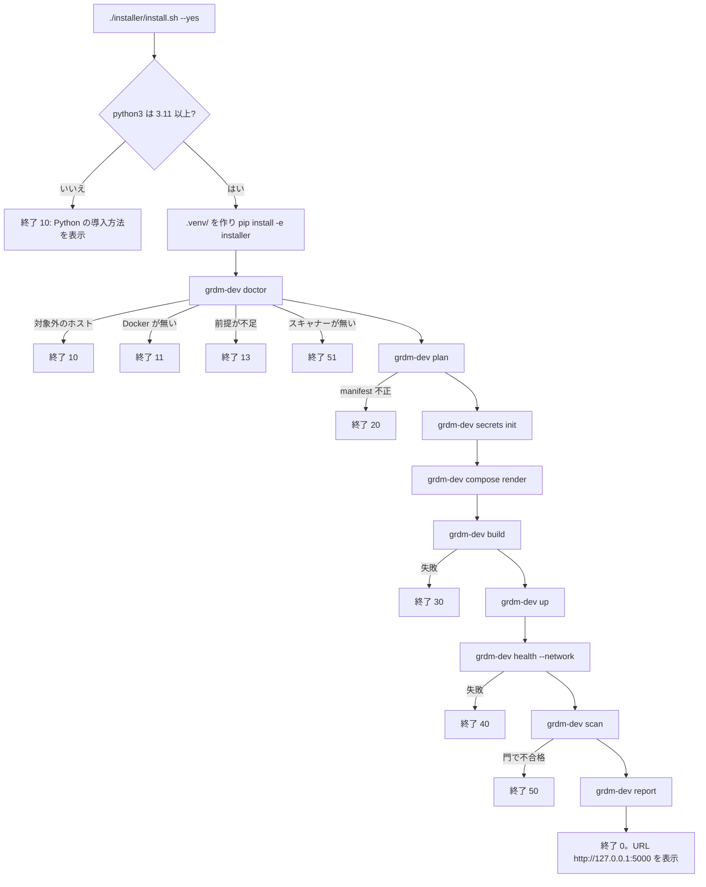

# SPEC-02 Installer CLI / インストーラー CLI

> **Summary:** The contract of the optional per-OS prerequisite scripts and of the two entry points that install the GakuNin RDM developer environment: the thin bootstrap `installer/install.sh` and the Python command `grdm-dev` with its subcommands, profiles, flags, exit codes, and directory layout.
> **概要:** 任意の OS ごとの前提条件スクリプトと、GakuNin RDM 開発環境を導入する二つの入口、薄い起動スクリプト `installer/install.sh` と Python コマンド `grdm-dev` の契約。サブコマンド、プロファイル、フラグ、終了コード、ディレクトリ構成を定める。

**Jump:** [English](#english) · [日本語](#japanese)

- Version / 版: 0.26 — 2026-11-10. **Learned:** a path check must read the path the way the system means it: the kernel escapes spaces in mount points (`\040`) and a symlink can carry a checkout onto the Windows disk, so the shared-folder check decodes mount fields and the WSL checks compare physical paths (`pwd -P`) ([PR #44 review r1](../reviews/2026-11-10_RDM-developer-guide_PR44_Per_OS_Installers_r1.md) R1, R2). ／ パスの検査は、システムが意味するとおりにパスを読まなければならない。カーネルは mount 先の空白を `\040` とエスケープし、シンボリックリンクはチェックアウトを Windows のディスクへ運びうる。そこで共有フォルダの検査は mount の欄を復号し、WSL の検査は実体のパス（`pwd -P`）で比べる（[PR #44 レビュー r1](../reviews/2026-11-10_RDM-developer-guide_PR44_Per_OS_Installers_r1.md) R1・R2）。
  0.25 — 2026-11-10. **Learned:** a change can be blocked by the permission needed to publish one part of it: the token that pushes this repository may not change `.github/workflows/`, so the two workflows of §10 wait on branch `feat/per-os-installers` while the scripts, fixes and records land now. ／ 変更の一部を公開する権限が無いために全体が止まることがある。このリポジトリに push するトークンは `.github/workflows/` を変えられないので、§10 の二つのワークフローはブランチ `feat/per-os-installers` で待ち、スクリプト・修正・記録は先に入れる。
  0.24 — 2026-11-10. **Learned:** a real Linux run disproves what a dry run cannot: Ubuntu 24.04's own `qemu-user-static` crashes inside an amd64 build after 48 minutes, QEMU builds ember about twice as slowly as Rosetta so the 1800 s wait stops a healthy install, and the cloud image lacks a library Playwright's driver needs; so emulation comes from a digest-pinned image, `doctor` refuses the measured-bad emulator, `up` waits longer on Linux arm64, and the accept hint names the Linux packages ([DEMO-21](../demo/21_core_install_ubuntu_arm64_lima.md)). ／ 実際の Linux での実行は dry run には分からないことを覆す。Ubuntu 24.04 自身の `qemu-user-static` は 48 分後に amd64 のビルドの中で落ち、QEMU は ember の組み立てに Rosetta のおよそ 2 倍かかるので 1800 秒の待ちは健全な導入を止め、クラウドイメージには Playwright のドライバーが要るライブラリが無い。そこでエミュレーションはダイジェストで固定したイメージから入れ、`doctor` は落ちると実測したエミュレーターを拒み、`up` は Linux arm64 では長く待ち、accept の案内は Linux のパッケージを示す（[DEMO-21](../demo/21_core_install_ubuntu_arm64_lima.md)）。
  0.23 — 2026-11-10. **Learned:** a prerequisite is whatever the whole install sequence needs, not only its first step: Trivy and gitleaks are missing on a fresh host and stop an otherwise good install with exit 51 at `scan`, so the per-OS scripts of §2.3 provide them ([ADR-08](../decisions/ADR-08_Per_OS_Installer_Entry_Points.md)). ／ 前提条件とは最初の段ではなく一連の導入全体に要るものである。新しいホストには Trivy と gitleaks が無く、ほかが良くても `scan` で終了 51 になるため、§2.3 の OS ごとのスクリプトがそれらを用意する（[ADR-08](../decisions/ADR-08_Per_OS_Installer_Entry_Points.md)）。
  0.22 — 2026-11-10. **Learned:** a lock that only the `db` commands take does not stop `up` from starting the server between their checks and their renames, so `up` and `reset` take it too (PR #42 review r2). ／ `db` のコマンドだけが取るロックでは、その確認と改名の間に `up` がサーバーを起動するのを止められないので、`up` と `reset` も同じロックを取る（PR #42 レビュー r2）。
  0.21 — 2026-11-10. **Learned:** a command that renames data directories needs a journal, a lock and a recovery path that every later command runs, not only checks before it starts (PR #42 review r1). ／ データディレクトリを改名するコマンドには、始める前の確認だけでなく、操作記録・ロック・後続のすべてのコマンドが通る復旧の道が要る（PR #42 レビュー r1）。
  0.20 — 2026-11-10. **Learned:** a new database major needs a command, not a note: a server refuses a data directory of another major, so `up` now says so with exit 15 and `db upgrade` moves the data by a verified dump and restore that never writes the old directory (ADR-12). ／ データベースの新しい版には注記でなくコマンドが要る。サーバーは別の版のデータディレクトリを拒むので、`up` はそれを終了 15 で告げ、`db upgrade` は旧ディレクトリに一度も書かない、照合つきのダンプと復元でデータを移す（ADR-12）。
  0.19 — 2026-11-10. **Learned:** a fixed client is only as good as the address and trust anchor it is given: osf.io's mongo URL was never rendered and fell back to PostgreSQL's host and port, so `osf.env` now names the TLS URL and the CA file. ／ 直したクライアントも、渡される接続先と信頼の起点しだいである。osf.io の mongo の URL は一度も描画されず、PostgreSQL のホストとポートに落ちていたので、`osf.env` に TLS の URL と CA ファイルを書くことにした。
  0.18 — 2026-11-10. **Learned:** a build record says what was built, not what should run: after the pin of osf.io moved, `compose render` ran before `build` and the stack silently ran the old image, so render now trusts the record only when it equals the manifest pin and otherwise renders the pin and warns with the fix. ／ ビルドの記録は何を組んだかを示すだけで、何を動かすべきかは示さない。osf.io の固定が動いた後、`build` より前に `compose render` を実行したため、スタックは古いイメージを黙って動かした。そこで render は記録が manifest の固定と一致するときだけそれを信じ、違うときは固定を書いて対処を添えて警告することにした。
  0.17 — 2026-11-10. **Learned:** a flag that changes what a server will serve belongs in the operating contract, not only in a template and a PR body, so the admin app's `--insecure` is now stated as a development-only, loopback-only exception (PR #40 review r1 R1-02). ／ サーバーが配信するものを変えるフラグは、テンプレートや PR 本文だけでなく運用の契約に書く。そのため管理画面の `--insecure` を、開発専用でループバック限定の例外として明記した（PR #40 レビュー r1 R1-02）。
  0.16 — 2026-11-10. **Learned:** the browser opens the wiki and file-editor sockets itself, so y_websocket and sharejs need loopback ports like any other page the browser loads. ／ wiki とファイル編集のソケットはブラウザが自分で開くため、y_websocket と sharejs にも、ブラウザが読む他のページと同じくループバックのポートが要る。
  0.15 — 2026-11-10. **Learned:** a byte count does not make a key usable by its consumer: a manually written key may be 43 `!` or 32 quoted spaces, so every CAS key must also be in the base64url alphabet, must not be a published default, and the TGC encryption key must decode canonically to 32 bytes (PR #39 review r1 R1-01). ／ バイト数だけでは、鍵が使う側で使えるとは言えない。手で書いた鍵は感嘆符 43 個や引用符で囲んだ空白 32 個でありうる。そこで CAS の鍵はすべて base64url の文字に限り、公開された既定値を拒み、TGC の暗号鍵は 32 バイトへ正準に復号できなければならない（PR #39 レビュー r1 R1-01）。
  0.14 — 2026-11-10. **Learned:** a key name that nothing reads looks exactly like a working secret, and a service that fails closed turns a wrong length into a stopped stack, so the keys now carry the names the image reads and `compose render` refuses a wrong length before anything starts (ADR-07 §7). ／ 誰も読まないキーの名前は、効いている秘密とまったく同じに見える。また閉じて失敗するサービスでは長さの誤りがスタックの停止になる。そこでキーにはイメージが読む名前を使い、`compose render` が起動前に誤った長さを拒むようにした（ADR-07 §7）。
- Version / 版: 0.13 — 2026-11-10. **Learned:** a writable root says nothing about what lies beneath it, and a probe must never reuse a name that may already exist: the access check walks existing data as the real uid and creates its file exclusively (PR #36 review r3). ／ ルートに書けても下のものについては何も分からず、確認用のファイルは既にあるかもしれない名前を使ってはならない。そこでアクセス確認は実際の uid で既存のデータを辿り、ファイルは排他的に作ると分かった（PR #36 レビュー r3）。
- Version / 版: 0.12 — 2026-11-10. **Learned:** a path check expires when the path changes and sees only what it looks at, and a command that exits 0 has not proved its effect: so `reset` revalidates at each step using the mount table, ownership is read back, and only a write as the real uid shows that a volume is usable (PR #36 review r2). ／ パスの検証はパスが変われば古くなり、見たものしか分からない。また終了 0 のコマンドは効果を証明しない。そこで `reset` は段ごとに mount 表で再検証し、所有者は読み返し、ボリュームが使えることは実際の uid での書き込みだけが示すと分かった（PR #36 レビュー r2）。
- Version / 版: 0.11 — 2026-11-10. **Learned:** a root process without capabilities still obeys file permissions, a container path does not confine the host path behind its bind mount, and a repair that trusts its top directory cannot finish a partial one; so volume paths are validated on the host, `unoconv` holds `DAC_OVERRIDE` for the shared directory, ownership is re-walked every time, and availability questions are asked of the filesystem or the engine rather than guessed from a path (PR #36 review r1). ／ capability を除いた root もファイル権限に従い、コンテナ内のパスは bind 元のホストパスを限定せず、一番上のディレクトリを信用する修復は途中で止まった修復を完了できない。そこでボリュームのパスはホスト側で検証し、`unoconv` は共有ディレクトリのために `DAC_OVERRIDE` を持ち、所有者は毎回全体を辿り、可否はパスから推測せずファイルシステムやエンジンに問うと分かった（PR #36 レビュー r1）。
- Version / 版: 0.10 — 2026-11-10. **Learned:** a check that fails after a 30-minute build teaches nothing, so `doctor` must prove every prerequisite up front: private repositories, scanners, memory floors, emulation and a checkout path Docker can see; and a fresh bind directory belongs to the host user, so ownership is one generic step derived from the writers instead of one init container per volume, while `reset` needs a container to delete what containers own (cross-OS audit, 2026-11-10; on Colima a bind mount from `/private/tmp` was measured to be silently empty). ／ 30 分のビルドの後で失敗する検査は何も教えない。だから `doctor` が非公開リポジトリ、スキャナー、メモリの下限、エミュレーション、Docker から見える配置先をすべて先に証明しなければならない。また新しい bind ディレクトリはホストの利用者の所有なので、所有者の設定はボリュームごとの init コンテナではなく書き手から導く一つの汎用の段にまとめ、`reset` はコンテナが所有するものをコンテナで消さねばならないと分かった（OS 横断の監査、2026-11-10。Colima では `/private/tmp` からの bind mount が黙って空になることを実測）。
  0.9 — 2026-11-10. **Learned:** a retired credential key stays in `runtime/.env` forever unless it is dropped explicitly, and a Compose file rendered before the key was retired still refers to it, so `compose render` must run before `secrets rotate` or a recreate after an upgrade (PR #35 review r1). ／ 廃止した資格情報のキーは明示的に消さなければ `runtime/.env` に残り続け、廃止前に生成した Compose ファイルはそのキーを参照し続ける。更新後は `secrets rotate` や再作成の前に `compose render` が必要と分かった（PR #35 レビュー r1）。
  0.8 — 2026-11-06. **Learned:** a stack that builds is not a stack that starts: a fresh database needs a one-shot initialisation (`osf_init`), Compose's short `tmpfs` is root-only, the memory budget must respect the Docker VM, and a prebuilt SPA must be built once into a volume rather than at every start under emulation (real install runs 9–13). ／ 組めるスタックは起動するスタックではない。新しいデータベースには一回限りの初期化（`osf_init`）が要り、Compose の短い `tmpfs` は root 専用で、メモリ予算は Docker VM を尊重しなければならず、prebuilt の SPA はエミュレーション下で毎回組むのではなくボリュームへ一度組む（実機第 9〜13 回）。
  0.7 — 2026-11-06. **Learned:** a service row in the profile table must correspond to a process that exists, so the overlay repository wiki-frontend is represented by a one-shot `wiki_assets` that fills a named volume and its readers wait with `condition: service_completed_successfully` ([ADR-06](../decisions/ADR-06_Wiki_Frontend_Overlay.md)), while a template `command` must have `$` escaped as `$$` for Compose (PR #30 review r1); and, independently, a glossary term is only explained for the reader when its note and REF-01 link sit at the first prose use, counting lower-case and plural forms, so first-use notes with links were added in both halves (SPEC-06 §3). ／ プロファイル表のサービス行は実在するプロセスに対応していなければならないため、オーバーレイである wiki-frontend は名前付きボリュームを満たす一回限りの `wiki_assets` で表し、それを読むサービスは `condition: service_completed_successfully` で待つ（[ADR-06](../decisions/ADR-06_Wiki_Frontend_Overlay.md)）。またテンプレートの `command` は Compose 向けに `$` を `$$` にエスケープする（PR #30 レビュー r1）。また別に、用語注と REF-01 へのリンクは、小文字や複数形も含めた本文の初出に置かなければ読者に届かないと分かったため、英和両方の初出にリンク付きの用語注を補った（SPEC-06 §3）。
- Version / 版: 0.6 — 2026-11-06. **Learned:** a `command` in a template is written for the container shell, but Compose interpolates `$VAR` in every string of the file first, so the renderer must escape `$` as `$$` and a test must run the rendered file through Compose's own parser; and a fresh bind volume belongs to the host user, so a non-root writer needs an owner step (PR #30 review r1). ／ テンプレートの `command` はコンテナのシェル向けに書くが、Compose はファイル中の全文字列の `$VAR` を先に展開する。だから出力側で `$` を `$$` にエスケープし、試験は出力ファイルを Compose 自身の解析器に通さねばならない。また新しい bind ボリュームはホストの利用者の所有なので、非 root の書き手には所有者を決める段が要る（PR #30 レビュー r1）。
  0.5 — 2026-11-06. **Learned:** a service row in the profile table must correspond to a process that exists: `wiki` had none, because the wiki-frontend repository is an overlay whose image only builds a webpack bundle (real install run 4, [ADR-06](../decisions/ADR-06_Wiki_Frontend_Overlay.md)); the honest row is a one-shot `wiki_assets` that fills a named volume, and the services that read the volume must wait for it with `condition: service_completed_successfully`. ／ プロファイル表のサービス行は実在するプロセスに対応していなければならないと分かった。`wiki` には無かった。wiki-frontend リポジトリは webpack の束を組むだけのイメージを持つオーバーレイだからである（実機第 4 回、[ADR-06](../decisions/ADR-06_Wiki_Frontend_Overlay.md)）。正直な行は名前付きボリュームを満たす一回限りの `wiki_assets` で、ボリュームを読むサービスは `condition: service_completed_successfully` でそれを待たねばならない。
- Version / 版: 0.5 — 2026-11-06. **Learned:** a glossary term is only explained for the reader when its note and REF-01 link sit at the first prose use, counting lower-case and plural forms, so first-use notes with links were added in both halves (SPEC-06 §3). ／ 用語注と REF-01 へのリンクは、小文字や複数形も含めた本文の初出に置かなければ読者に届かないと分かったため、英和両方の初出にリンク付きの用語注を補った（SPEC-06 §3）。
  0.4 — 2026-11-06. **Learned:** an operational failure that only a module docstring describes is invisible to the shell wrapper and to the Japanese message table, so every new failure cause of a subcommand needs its own row in `messages.tsv` and in this table before the code may return it (PR #23 review r1, U4: `upstream` returned 1 with no canonical entry). ／ モジュールの docstring にしか書かれていない運用上の失敗は、シェルの包み紙にも日本語の文言表にも見えない。サブコマンドの新しい失敗原因は、コードがその番号を返す前に `messages.tsv` とこの表に行を持たなければならないと分かった（PR #23 レビュー r1、U4: `upstream` が正本に無い 1 を返していた）。
  0.3 — 2026-11-05. **Learned:** `secrets rotate` had to become a coordinated database-password change plus container recreation, because `restart` keeps the old environment and leaves the captured credential valid (PR #21 review r1). ／ `restart` は旧い環境を保つため、捕られた資格情報が有効なまま残る。`secrets rotate` は DB パスワードの変更とコンテナ再作成を束ねた手順にする必要があると分かった（PR #21 レビュー r1）。
  0.2 — 2026-11-05. **Learned:** a profile table and the acceptance criteria that depend on it must change together, and a TOON row whose text contains a comma or a colon must be quoted or the parser sees extra columns. ／ プロファイル表と、それに依存する受入基準は同時に変えなければならず、カンマやコロンを含む TOON の行は引用符で囲まないと列が増えて解析に失敗すると分かった。
- Version / 版: 0.1 — 2026-11-05. **Learned:** keeping the shell part to a bootstrap and putting every decision in one Python command is the only way to make the OS differences, the manifest check, and the reports testable with `unittest`. ／ シェルは起動だけに留め、判断をすべて一つの Python コマンドに集めないと、OS の違い・manifest の整合・報告書を `unittest` で試験できないと分かった。
- Normative for: `installer/install.sh`, `installer/install-ubuntu.sh`, `installer/install-macos.sh`, `installer/install-windows.ps1`, `installer/prereq-lib.sh`, `.github/workflows/installer-prereq-lint.yml` and `.github/workflows/installer-full.yml` (pending on branch `feat/per-os-installers`), `installer/grdm_dev/`, `installer/tests/`, `runtime/`.
- Related: [SPEC-00 Overview](00_overview.md) · [SPEC-01 Manifest](01_manifest.md) · [SPEC-03 Security Gate](03_security_gate.md) · [SPEC-04 Acceptance Tests](04_acceptance_tests.md) · [SPEC-05 Upstream Tracking](05_upstream_tracking.md) · [SPEC-06 Documentation Conventions](06_documentation_conventions.md) · [ADR-02 Network Model](../decisions/ADR-02_Network_Model.md) · [ADR-03 Staged Security Gate](../decisions/ADR-03_Staged_Security_Gate.md) · [ADR-08 Per-OS Installer Entry Points](../decisions/ADR-08_Per_OS_Installer_Entry_Points.md) · [POL-01 Position](../policy/POL-01_Developer_Environment_2027_Position.md) · [docs/README.md](../README.md)

---

<a id="english"></a>
## English

[→ 日本語版へ](#japanese)

### 1. Scope and goal

The installer turns a fresh checkout of this repository into a running GakuNin RDM (GakuNin is Japan's academic network for logging in with a university account; see [REF-01](../reference/REF-01_Glossary.md)) developer environment with one command, on the hosts listed in [§8](#2-en-hosts). `install.sh` and `grdm-dev` never need `sudo` (a way to run a command as the computer's administrator), never change network settings on the host, and can be run again at any time without harm. Everything they create lives under `runtime/`, which is ignored by Git. The optional prerequisite scripts of [§2.3](#2-en-prereq) prepare the host beforehand and may use `sudo`, but only after showing the change and receiving consent ([ADR-08](../decisions/ADR-08_Per_OS_Installer_Entry_Points.md)).

**Glossary notes.** An *installer* is a program that prepares other programs so they can run. A *CLI* (command line interface) is a program you drive by typing commands. A *container* is a box that holds one program and everything it needs, so it runs the same on any computer. *Docker* (the tool that builds images and runs containers; see [REF-01](../reference/REF-01_Glossary.md)) and its companion *Docker Compose* (see [REF-01](../reference/REF-01_Glossary.md)) run them; Compose is the tool that starts many containers together from one description file. A *manifest* is the list that says exactly which version of each source repository we use ([SPEC-01](01_manifest.md)).

### 2. Entry points

There are two entry points that install the environment (§2.1, §2.2), and optional scripts that prepare a host for them ([§2.3](#2-en-prereq)).

#### 2.1 `installer/install.sh` — thin bootstrap

`install.sh` does four things and nothing else:

1. Runs with the `bash` that ships with macOS (version 3.2), so it uses no feature newer than that: no associative arrays, no `mapfile`, no `${var,,}`.
2. Finds `python3` and checks that it is 3.11 or newer. If not, it prints how to install one for the detected OS and exits with code 10.
3. Creates a *virtual environment* (a private folder of Python and its libraries, separate from the system) at `.venv/` and installs the `installer/` package into it with `pip install -e installer[scan]` (the `scan` extra brings Semgrep, which `grdm-dev scan` runs locally — SPEC-03 §4.2, real install run 17; `GRDM_WITHOUT_SCAN=1` leaves it out, `GRDM_WITH_ACCEPT=1` adds Playwright).
4. Hands every argument to `.venv/bin/grdm-dev install "$@"` and exits with that command's exit code.

OS differences are not written in `install.sh`. They live in `installer/grdm_dev/host.py`. User-facing messages come from `installer/grdm_dev/messages.tsv` (one line per code, English and Japanese columns) so that the script and the Python command say the same thing.

```mermaid
flowchart TD
  A[./installer/install.sh --yes] --> B{python3 >= 3.11?}
  B -- no --> X10[exit 10: how to install Python]
  B -- yes --> C[create .venv/ and pip install -e installer[scan]]
  C --> D[grdm-dev doctor]
  D -- unsupported host --> X10b[exit 10]
  D -- Docker missing --> X11[exit 11]
  D -- prerequisite missing --> X13[exit 13]
  D -- scanner missing --> X51[exit 51]
  D --> E[grdm-dev plan]
  E -- manifest invalid --> X20[exit 20]
  E --> F[grdm-dev secrets init]
  F --> G[grdm-dev compose render]
  G --> H[grdm-dev build]
  H -- failed --> X30[exit 30]
  H --> I[grdm-dev up]
  I --> J[grdm-dev health --network]
  J -- failed --> X40[exit 40]
  J --> K[grdm-dev scan]
  K -- gate failed --> X50[exit 50]
  K --> L[grdm-dev report]
  L --> Z[exit 0 and print URL http://127.0.0.1:5000]
```

#### 2.2 `grdm-dev` — the Python command

`grdm-dev` is the package `installer/grdm_dev/`, exposed as a console script. Rules:

- **Standard library first.** The command itself has no third-party dependency. The manifest is JSON (read with `json`), the host is read with `platform`, `shutil`, `socket`, and `subprocess`, and the generated Compose file is written as JSON, which Docker Compose accepts because JSON is valid YAML (a plain-text data format that uses indentation; see [REF-01](../reference/REF-01_Glossary.md)). PyYAML is therefore *not* required.
- **Optional extra `accept`.** `pip install -e "installer[accept]"` adds `pytest`, `pytest-playwright`, and `playwright`. Only `grdm-dev accept` imports them ([SPEC-04](04_acceptance_tests.md)).
- **External tools** are called as subprocesses and checked by `doctor`: `docker` (27 or newer) with the Compose plugin (v2 or newer) and buildx (Docker's helper that builds one image for several kinds of computer; see [REF-01](../reference/REF-01_Glossary.md)), `trivy`, `gitleaks`, and `semgrep` for `scan`, the OWASP ZAP (a tool that pokes at a running website the way an attacker would; see [REF-01](../reference/REF-01_Glossary.md)) container image for `scan --dynamic`, and `mkdocs` for `docs`. A missing scanner makes `scan` exit 51 ([SPEC-03 §8](03_security_gate.md#english)).
- Every subcommand supports `--json`, which prints the same report as machine-readable JSON instead of TOON (a compact text form of JSON, see [SPEC-06 §4](06_documentation_conventions.md#english)).

<a id="2-en-prereq"></a>
#### 2.3 Per-OS prerequisite scripts

These scripts prepare a host and then run `install.sh`. The reason for them is in [ADR-08](../decisions/ADR-08_Per_OS_Installer_Entry_Points.md). They hold no installation logic, so `install.sh` and `grdm-dev` still make every decision.

| Script | Host | What it can provide |
|---|---|---|
| `installer/install-ubuntu.sh` | Ubuntu 24.04 amd64 or arm64; Ubuntu 24.04 inside WSL2 | apt packages (git, Python, `python3-venv`, curl, gnupg), Docker Engine with the Compose and buildx plugins from Docker's signed apt repository, `docker` group membership, amd64 emulation on arm64 (QEMU registered from the digest-pinned `tonistiigi/binfmt` image, replacing Ubuntu's `qemu-user-static` 8.2.2, which crashed in a real build: [DEMO-21](../demo/21_core_install_ubuntu_arm64_lima.md)), Trivy and gitleaks in `~/.local/bin`, and `libatomic1` when `GRDM_WITH_ACCEPT=1`. Inside WSL2 it skips Docker Engine and requires Docker Desktop. |
| `installer/install-macos.sh` | macOS on Apple Silicon | Homebrew formulae (`python@3.12`, git, Trivy, gitleaks); starts an installed Docker Desktop. It detects Docker Desktop, OrbStack and Colima, and installs neither a Docker runtime nor Homebrew. |
| `installer/install-windows.ps1` | Windows 11 amd64 | WSL2 and the `Ubuntu-24.04` distribution; checks Docker Desktop and its WSL integration; clones this repository under the WSL home directory, never `/mnt/c`; then runs `install-ubuntu.sh` inside WSL. |

Rules that every script keeps:

- It shows what it will change, and asks before any `sudo` or administrator action. Joining the `docker` group is asked separately.
- `--yes` (`-Yes` in PowerShell, which also accepts `--yes`) gives consent. Without a terminal and without `--yes` it stops with exit 2, as in [§7](#english).
- `--dry-run` (`-DryRun`) detects and prints the plan and changes nothing.
- It can be run again: a prerequisite that is already present is skipped.
- It stops with a clear message on failure and uses only the exit codes 2, 10 and 11 of [§6](#english).
- A download is accepted only through a signed source or a pinned checksum, and nothing is piped into a shell.
- It never asks for, reads or stores a token. It only says how to give git access to the private integration repositories.
- Its last action is `installer/install.sh`, with every other argument passed unchanged.

### 3. Subcommands

| Subcommand | Contract | Touches Docker |
|---|---|---|
| `doctor` | Detects OS (macOS, Ubuntu, WSL2), CPU (`arm64`, `amd64`), memory, free disk, Docker ≥ 27, Compose plugin (v2 or newer), buildx, and proves what `install` needs so a problem appears before the long build: `git`; read access to the profile's private integration repositories, with `git ls-remote` that can never prompt (its output is never printed, a URL can hold a token); `trivy`, `gitleaks` and `semgrep`; the profile's memory floors against the smaller of the host and the Docker VM (`--memory-gib` turns this into a warning, a knowing overcommit); on Linux arm64 only, amd64 emulation (binfmt), printing the command that enables it, and refusing an emulator build measured to crash (Ubuntu 24.04's `qemu-user-static` 8.2.2, read from the registered interpreter's `--version`), printing the command that replaces it; a checkout Docker can use: on WSL2 a filesystem that keeps a `chmod 0600` read back from a test file (a Windows drive cannot hold `runtime/.env` at `0600`); on macOS one the engine can see, asked by bind-mounting it read-only into the `postgres` image that `up` needs (the only image this subcommand may pull; a mount the engine refuses or that comes up empty is exit 13, a probe that could not run is a warning) because a bind mount from a path the Docker VM does not share is silently empty, with `GRDM_DOCKER_SHARED=1` to skip the question when it cannot be run. Prints a TOON report. Exit 10 if the host is unsupported or the memory floors do not fit, 11 if Docker is missing or not running, 13 if a prerequisite is missing, 51 if a scanner is missing. | read-only |
| `plan` | Resolves manifest + profile and prints which images would be built and which services started, with the published ports ([§4](#2-en-ports)). Changes nothing. Exit 20 if the manifest fails [SPEC-01](01_manifest.md) checks. | no |
| `secrets init` / `secrets rotate` | `init` writes random secrets (database passwords, Django secret key, CAS keys) into `runtime/.env` with file mode `0600`. Never writes a default or example password. Refuses to overwrite an existing file unless `--force`. `rotate` regenerates every secret, changes the live PostgreSQL and RabbitMQ passwords, recreates the containers so they receive the new environment, and verifies that the old credentials are rejected; any failure restores the previous `runtime/.env` and exits 40. `init --force` and `rotate` drop retired credential keys. After an upgrade, run `compose render` before `rotate` or any recreate, because a previously rendered Compose file still refers to retired keys. Four keys have lengths the CAS image needs: `TGC_ENCRYPTION_KEY` is 43 characters, `TGC_SIGNING_KEY` is 86 characters, `OSF_API_INSTITUTIONS_AUTH_JWESECRET` is exactly 32 bytes and `OSF_API_INSTITUTIONS_AUTH_JWTSECRET` is at least 32 bytes; the last two are also osf.io's `JWE_SECRET` and `JWT_SECRET` ([ADR-07 §7](../decisions/ADR-07_Native_Builds_of_EOL_Middleware.md#english)). All four use only the base64url characters `A`–`Z`, `a`–`z`, `0`–`9`, `-` and `_` (no whitespace, quotes or padding), must not be a published default, and `TGC_ENCRYPTION_KEY` must decode canonically to 32 bytes. Used after a red-team capture ([SPEC-03 §6](03_security_gate.md#english)). | no / yes |
| `compose render` | Exits 2, naming the keys only, when `runtime/.env` lacks a generated key or holds a CAS key that CAS cannot use: wrong length, characters outside base64url, or a published default (fix either with `secrets rotate`). Writes `runtime/docker-compose.yml` from manifest + profile: the internal network `grdm` plus the publishing-only `grdm-edge` (`--egress <services>` attaches more, recorded in `runtime/.env`; [SPEC-03 §3.2](03_security_gate.md#english)), per-component `platform:` from the manifest's `build_platform`, ports published only on `127.0.0.1` ([§4](#2-en-ports)), non-root `user:` for every service, `read_only`, `cap_drop`, and resource limits (`mem_limit`, `cpus`, `pids_limit`) scaled from the smaller of the host memory `doctor` detected and the Docker engine's VM memory (`docker info`; on Docker Desktop the VM is a fraction of the host, real install run 10), where a template's `mem_min_mb` floor takes its share first and the others divide the rest, and from the CPU count the engine reports (`docker info`; the host's only when that is unknown), with per-service exceptions from `manifest/hardening.json` ([SPEC-03 §3.3](03_security_gate.md#english)), `platform:` chosen from `doctor`, named volumes mapped under `runtime/volumes/`, every `tmpfs` entry mounted with `mode=1777` (Compose's short form gives root-only `0755`, real install run 11), and the placeholders `{{HOST_PORT:<service>}}`, `{{CONTAINER_PORT:<service>}}` and `{{AUTH_URL}}` (fakecas's published URL, or web's when `--auth shibboleth` replaces fakecas) resolved in template values. The `image:` of a built component carries the tag of the last build (`runtime/reports/build_latest.json`) only when it equals the tag the manifest pins; a recorded build that differs from the pin is stale (the pin moved after the last `build`), so the pinned tag is rendered instead, the report lists the component under `stale_build_tags` (`component`, `pinned`, `recorded`, `image`), and stderr prints a warning block whose fix is `grdm-dev build`, then `grdm-dev up`. Render still exits 0 because `install` renders before it builds; an image that was never built makes `up` fail instead of running the old one. A component the manifest does not pin keeps the recorded tag. `osf.env` names osf.io's TLS connection to mongo, `SHAREJS_DB_URL=mongodb://mongo:27017/sharejs?ssl=true` with `SHAREJS_DB_CA_FILE=/mongo-tls/mongodb.crt`, and web, api, admin and worker mount `mongo_tls` read-only, as sharejs does ([ADR-07](../decisions/ADR-07_Native_Builds_of_EOL_Middleware.md)). Follows [ADR-02](../decisions/ADR-02_Network_Model.md). | no |
| `build` | Builds images with `docker buildx`. The platform is, in order of precedence, `--platform`, the component's `build_platform` in the manifest (for example `linux/amd64` for components whose EOL base cannot be built for arm64, run under emulation), otherwise the host platform; the image is loaded locally. A component with `prebuilt_image` ([SPEC-01](01_manifest.md)) is not built: the digest-pinned image is pulled once per requested platform and reported as `prebuilt` (`pull-failed` → exit 30). With `--push` a prebuilt image is never re-published to `ghcr.io/rcosdp` (it is a third party's artefact); the row is reported as `prebuilt-not-pushed` with `pushed: false`. `--push` pushes the multi-arch manifest to `ghcr.io/rcosdp/<name>` (private). Exit 30 on failure. | yes |
| `up` / `down` / `reset` | `up` first finishes or rolls back an interrupted `db` operation, then stops with exit 15 when `runtime/volumes/postgres_data` was written by another PostgreSQL major than the rendered image or its major cannot be read (ADR-12), otherwise starts the profile and waits for health; `down` stops containers and keeps volumes; `reset` stops and deletes `runtime/volumes/` after a confirmation (skipped by `--yes`), emptying it through a root container with only `DAC_OVERRIDE` and `FOWNER`, because on Linux the files belong to the containers' uids and the host user cannot remove them. Before anything is stopped or deleted the paths are validated on the host: a symlinked `runtime/` or volumes root, a root that resolves outside the checkout, a symlinked volume, or any mount at `runtime/`, at the volumes root or at any depth inside it (read from the host mount table, so same-filesystem bind mounts count; an unreadable table also refuses) stops with exit 14. `reset` repeats this after `down` and after the wipe, and stops if the volumes root has become a different directory. `compose render` and `up` apply the same validation with exit 13, because the owner step also runs as root against these paths. These are snapshots: Docker resolves the bind later and no check can close that window, so the checkout is assumed not to be changed concurrently by another user or process. | yes |
| `db status` / `db upgrade` / `db rollback` / `db recover` | `status` prints the PostgreSQL major of `runtime/volumes/postgres_data` and of the rendered `postgres` image and changes nothing. `upgrade` (all services stopped, after a confirmation that `--yes` skips) moves the data to the rendered major by dump and restore: the old major runs on the old directory with no network, the new major's `pg_dumpall` writes `runtime/backups/postgres-<old>-to-<new>-<timestamp>/`, a new directory is initialised and restored with `ON_ERROR_STOP`, every table's row count and sequence value is compared, and only then is the old directory renamed `postgres_data.pg<old>-<timestamp>` beside the new one. `rollback` puts that directory back. Both hold an exclusive lock, which `up` and `reset` also take for their checks and their start or deletion, and write a durable journal (`runtime/db-operation.json`) before they create or rename anything; `recover`, and first every later `db` command, `reset` and `up`, finish or roll back an operation that a crash or an interrupt left behind, and a free-disk estimate is checked before the old server starts. Exit 15 on failure, with the old or the new cluster usable, or with the journal kept when a compensating rename also failed. See [ADR-12](../decisions/ADR-12_PostgreSQL_18_and_Data_Directory_Upgrade.md#english). | yes |
| `health` | Checks every service's health endpoint: an HTTP GET on the published loopback port (`/` for most services, `/login/` for `web`, because osf.io's `/` proxies to ember and answers 500 while ember is still building — real install run 14); a one-shot counts as healthy once it has exited 0. With `--network`, also lists listening sockets on the host and fails (exit 40) if any container port is bound to a non-loopback address, or if a wildcard listener on a project port has no visible owner (fail closed). A *named* host program that is not Docker on a project port (macOS AirPlay Receiver on `*:5000`, real install run 16) is reported as a `foreign-listener` warning, not a failure: it is not our leak, and `GRDM_PORT_<SERVICE>` in `runtime/.env` moves our port. | read-only |
| `scan` | Runs the whole security gate of [SPEC-03](03_security_gate.md): baseline controls, Trivy SBOM (software bill of materials: the list of all parts inside an image) and CVE list, gitleaks, Semgrep, and OWASP ZAP; writes `runtime/reports/scan_<date>.json` plus TOON, and diffs findings against `manifest/allowlist.json` and `manifest/allowlist.baseline.json` for the milestone in `manifest/milestone.json`. Gate per [ADR-03](../decisions/ADR-03_Staged_Security_Gate.md): M1–M3 report only, M4 exit 50 on HIGH, M5 exit 50 on CRITICAL or HIGH. Flags `--baseline`, `--secrets`, `--dynamic` run one part only. Exit 51 if a scanner cannot run, 52 if `--dynamic` was asked for while services are unhealthy. | read-only |
| `redteam preflight` | Verifies, before an AI red-team run, that the attacker container of the red-team Compose project is isolated (proved with a reachable canary, see [SPEC-03 §6](03_security_gate.md#english)), that only the containers named in `manifest/redteam-targets.json` are attached, and that the approval record is present and current. Exit 53 if either check fails. See [SPEC-03 §6](03_security_gate.md#english). | yes (starts and removes a canary container and network for the probe) |
| `accept` | Runs the Playwright Python acceptance suite in the same `.venv/`. `--only <scenario>` runs one scenario; `--seed` creates the disposable test users. Exit 60 on any failing test. See [SPEC-04](04_acceptance_tests.md). | read-only |
| `upstream mirror` / `upstream integrate` | Runs the daily mirror or the weekly integration of [SPEC-05](05_upstream_tracking.md) by hand. Needs Git credentials for the private `-dev2027` repositories; never run in this repository's CI. Exit 70 when a fetch was refused or failed, a push failed, or a merge conflicted; the report is written in every case. | no (Git only) |
| `manifest check` / `manifest toon` | `check` validates `manifest/upstreams.json` ([SPEC-01 §5](01_manifest.md#english)) and verifies that every TOON excerpt in `docs/` and `manifest/upstreams.toon` agree with it. Exit 20 on mismatch. `toon` prints the excerpt that `upstreams.toon` must equal. | no |
| `docs build` / `docs check` | `build` runs MkDocs into `site/`. `check` enforces [SPEC-06 §8](06_documentation_conventions.md#english): anchors, Jump line, relative links, TOON consistency, Version line. | no |
| `report` | Bundles the latest reports of `doctor`, `plan`, `health`, `scan`, and `accept` into `runtime/reports/<timestamp>.toon` and `.json`. | no |
| `install` | The sequence shown in the flowchart. Stops at the first non-zero step. | yes |

<a id="2-en-ports"></a>
### 4. Profiles and published ports

```toon
profiles[3]{name,services,note}:
  minimum,"osf_init volume_owner_init volume_access_check_1000 web api postgres elasticsearch rabbitmq fakecas",smallest set that shows a login and a project page
  core,"minimum + admin worker wb wb_worker mfr unoconv ember_osf_web cas wiki_assets mongo sharejs elasticsearch6 redis y_websocket volume_access_check_999","the six core repositories with their infrastructure, plus y_websocket for Wiki collaborative editing; wiki_assets is a one-shot that copies the wiki editor bundle into the volume wiki_static (ADR-06)"
  full,"core + rdmcp aipf_mcp_data_grdm oasys shibboleth_sp test_idp",everything; shibboleth_sp replaces fakecas
```

Service names follow the upstream `docker-compose.yml` of RDM-osf.io so that existing guides keep working, and they are the `services[]` values of the manifest ([SPEC-01 §3](01_manifest.md#english)). The `wiki-frontend` component is an overlay of `osf.io` (`overlay_of`, [ADR-06](../decisions/ADR-06_Wiki_Frontend_Overlay.md)): its service is a *one-shot* (a container that runs once and exits, `restart: "no"`) on the bundle-builder image `grdm-dev/wiki-frontend:<osf_sha12>-<wiki_sha12>`: after `volume_owner_init` has handed the fresh volume `wiki_static` to uid 1000, `wiki_assets` copies the webpack output `/code/website/static/public/js/` into it and exits; `web`, `api`, `admin` and `worker` mount that volume read-only at `/code/website/static/public/js/wiki/` and depend on it with `condition: service_completed_successfully`, so `up` starts them only after the bundle is in place. `health` counts a one-shot as healthy once it has exited with code 0. The `shibboleth` Compose profile and the `fakecas` service are mutually exclusive: `compose render --profile full --auth shibboleth` removes `fakecas` and adds `shibboleth_sp` and `test_idp`; the default for `full` is `fakecas`. `y_websocket` belongs to `core`, not `full`, because Wiki collaborative editing is an M2 acceptance scenario (C4 in [SPEC-04 §4](04_acceptance_tests.md#english)); the manifest's `profile` for the `y-websocket` component is `core` accordingly ([SPEC-01 §3](01_manifest.md#english)).

`elasticsearch` runs the native image `grdm-dev/elasticsearch2:<tag>` that `build` makes from `installer/images/elasticsearch2` (manifest `image_build`, [ADR-07](../decisions/ADR-07_Native_Builds_of_EOL_Middleware.md)) as uid 1000 on a read-only root; the emulated `elasticsearch:2` is gone (real install run 19, PR #34 review r1). The one-shot `volume_owner_init` (the `postgres` image, for its GNU tools, as explicit root with `CAP_CHOWN` only, one exception in `manifest/hardening.json`) hands every writable bind volume to the `user:` of the services that mount it writable, because a fresh directory belongs to the host user and a PR #33 tree to uid 101: on a Linux or WSL2 host whose uid differs, a non-root writer (`redis` is uid 999, the others 1000) could otherwise not use it. Services that keep root never decide an owner: `postgres`, `mongo` and `rabbitmq` set their own, while `unoconv` shares `wb_tmp` with its uid-1000 writers and holds `DAC_OVERRIDE` (a bounded exception, because root without it obeys file permissions and LibreOffice could not write there). All writers wait with `condition: service_completed_successfully`. **Migration and retry contract.** Requires GNU `find` and `chown`. Every `up` walks each volume with no marker and no shortcut, so a stopped run is finished by the next one and a correct top directory cannot hide wrong descendants. With only `CAP_CHOWN` the step reaches another uid's private directory by taking ownership of it first, hands files to the target uid, verifies that none was missed, and hands directories over last. It does not follow symlinks or leave the volume. A failure, such as a directory with mode `000`, stops the step, naming the path, and writers do not start; run `up` again or `reset`. A `chown` that has no effect stops the step (results are read back, directories included), except on the VM shares that present every path as `root:root` (`virtiofs` measured on Colima; `fakeowner`, `fuse.grpcfuse`, `fuse.sshfs`, `9p`). There and everywhere else, the one-shots `volume_access_check_1000` and `volume_access_check_999` run as the writer's own uid: each creates a uniquely named file exclusively (`mktemp`, which never follows a symlink or touches existing data) and removes only that file, then walks the existing tree and refuses any directory the uid cannot enter, list or write and any file it cannot read, changing nothing. Writers do not start unless that works. `osf_init` (component `osf.io`, profile `minimum`) is another one-shot: on the osf.io image, as uid 1000, it runs the steps the upstream README lists for a new database — `manage.py migrate`, `scripts.populate_institutions -e test -a` and `scripts.register_oauth_scopes` — retrying `migrate` and the institution import every 10 s for up to 5 minutes until postgres and the emulated Elasticsearch (the search engine inside GRDM; see [REF-01](../reference/REF-01_Glossary.md)) accept connections, and exits 0; `web`, `api`, `admin` and `worker` wait for it with `condition: service_completed_successfully`. All three steps are idempotent, so the service runs at every `up` (real install run 12: without it a fresh database made `web` answer 500 with `relation "osf_institution" does not exist`, and each such error leaked one postgres connection of the development server). `ember_osf_web` (prebuilt until M4) takes its backend URLs from the environment (`OSF_URL`, `OSF_API_URL`, `OSF_RENDER_URL`, `OSF_FILE_URL`, `OSF_HELP_URL`, `CAS_URL = {{AUTH_URL}}`, `OSF_COOKIE_DOMAIN`), builds its `dist/` once into the named volume `ember_osf_web_dist` with a fingerprint of those values and serves that build with `ember serve --path`; the first build under amd64 (the CPU type of ordinary PCs and servers; see [REF-01](../reference/REF-01_Glossary.md)) emulation takes 10–25 minutes, later starts seconds, live reload is off.

**Published ports.** This table is the only place where default host ports are defined; [ADR-02](../decisions/ADR-02_Network_Model.md), [SPEC-03](03_security_gate.md), and [REF-01](../reference/REF-01_Glossary.md) point here. Every port is published on `127.0.0.1` only.

```toon
ports[9]{service,host_port,profile,url}:
  web,5000,minimum,http://127.0.0.1:5000
  api,8000,minimum,http://127.0.0.1:8000
  admin,8001,core,http://127.0.0.1:8001
  wb,7777,core,http://127.0.0.1:7777
  mfr,7778,core,http://127.0.0.1:7778
  fakecas,8080,minimum,http://127.0.0.1:8080
  ember_osf_web,4200,core,http://127.0.0.1:4200
  y_websocket,1234,core,http://127.0.0.1:1234
  sharejs,7007,core,http://127.0.0.1:7007
```

All other services (`cas`, `volume_owner_init`, `wiki_assets`, the subsystems, `test_idp`, databases and queues) are reached only inside the Compose network; when one of them needs a browser-facing port, `compose render` assigns it and `plan` prints it. `compose render` writes every chosen host port to `runtime/.env` as `GRDM_PORT_<SERVICE>` (upper case), which the acceptance tests read ([SPEC-04 §1](04_acceptance_tests.md#english)). If a default port is already in use (macOS AirPlay on `5000` is the known case), `compose render` takes the next free port and records the change in the install report; exit 12 is returned only when no free port is found.

The `admin` service runs Django's development server as `manage.py runserver 0.0.0.0:8001 --nothreading --insecure`. With `DEBUG = False` (the generated `admin_local.py`, which keeps `debug_toolbar` out), `runserver` serves no static files, so the admin pages would load without their style sheets, scripts and icon fonts; `--insecure` makes `runserver` serve them from the app's static directories. This is a **development-only exception**: the port is published only on `127.0.0.1` like every other port in this table (ADR-02), the server is not a production web server, and a deployment must serve the admin app's static files through its own web server (for example after `collectstatic`) instead of this flag. A unit test keeps every published port on the loopback address.

### 5. Flags

| Flag | Meaning |
|---|---|
| `--yes` | Answer every question with its default. Required when no terminal is attached. |
| `--profile minimum\|core\|full` | Default `core`. Saved in `runtime/.env` as `GRDM_PROFILE` and reused on later runs. |
| `--platform linux/arm64,linux/amd64` | Override the platforms for `build`. Default: host platform only. |
| `--memory-gib <GiB>` | `doctor`, `compose render` and `install`: scale the limits from this size instead of the detected one, a knowing overcommit when the profile's floors do not fit. |
| `--no-open` | Do not open the browser after `up`. |
| `--json` | Print reports as JSON instead of TOON. |

### 6. Exit codes

```toon
exit_codes[17]{code,meaning}:
  0,success
  2,"usage error: unknown flag or bad value"
  10,"host unsupported: OS, CPU, memory, or Python too old"
  11,"Docker missing, not running, or Compose / buildx plugin absent"
  12,a required port on 127.0.0.1 is in use and no free alternative was found
  13,"install prerequisite missing: git, repository access, amd64 emulation, or a checkout path Docker cannot use"
  14,reset could not delete runtime/volumes/
  15,"PostgreSQL data directory needs `grdm-dev db upgrade`, or the upgrade or rollback failed (the old directory is kept)"
  20,manifest invalid or TOON excerpt disagrees with JSON
  30,image build failed
  40,"health check failed, or a port listens on a non-loopback address"
  50,security scan gate failed for the current milestone
  51,"scanner could not run: tool missing or vulnerability database download failed"
  52,"services not healthy, so scan --dynamic could not run"
  53,"red-team preflight failed: egress reachable or a target outside redteam-targets.json"
  60,acceptance test failed
  70,"upstream mirror or integrate failed: fetch refused, push failed, or merge conflict"
```

Numbers are never reused for a new meaning; a new cause gets a new number. The canonical table is `installer/grdm_dev/messages.tsv`, and this TOON block must agree with it (`manifest check` verifies). Codes 50–53 are described in detail in [SPEC-03 §8](03_security_gate.md#english); code 70 in [SPEC-05 §2–§4](05_upstream_tracking.md#english).

### 7. Behavior rules

- **Non-interactive.** When `stdin` is not a terminal and `--yes` is absent, every question is answered "no" and the command exits 2 with a hint to add `--yes`.
- **Idempotent.** Running any subcommand twice gives the same result. `secrets init` keeps existing secrets, `compose render` overwrites only the generated file, `build` uses the buildx cache, `up` is a no-op for healthy services.
- **No secrets in Git.** `runtime/` is in `.gitignore`. `docs check` and the CI secret scan fail if a file under `runtime/` or a value that looks like a secret is committed.
- **No host network changes.** The loopback alias `192.168.168.167` from the old guide is not created; `compose render` rewrites the upstream `local.py` and `.docker-compose.*.env` settings to use service names inside the Compose network and `127.0.0.1` for the browser ([ADR-02](../decisions/ADR-02_Network_Model.md)).
- **First start is slow, later starts are not.** `up` waits up to 1800 s (`--timeout`) for health: on Apple Silicon (the chips Apple puts in its Macs since 2020; see [REF-01](../reference/REF-01_Glossary.md)) the first `up` builds ember-osf-web (the newer web pages of GRDM; see [REF-01](../reference/REF-01_Glossary.md)) under emulation (10–25 minutes) and runs `osf_init`; both leave their result in named volumes, so a second `up` is healthy within a minute or two (real install runs 10–18; the cold-start build took 13–25 minutes, which is why the default is 30 minutes). On Linux arm64 the emulation is QEMU, and ember's first build took 44 minutes on one core, so there the default is 5400 s when the profile has amd64 services ([DEMO-21](../demo/21_core_install_ubuntu_arm64_lima.md)); `--timeout` still overrides it.
- **No `-private` code here.** The installer clones the integration repositories by name and SHA (the fingerprint of one commit; see [REF-01](../reference/REF-01_Glossary.md)) from the manifest at run time; this public repository holds no code from them ([POL-01](../policy/POL-01_Developer_Environment_2027_Position.md)).

<a id="2-en-hosts"></a>
### 8. Supported hosts

**Memory.** `compose render` budgets 70 % of the smaller of the host memory and the Docker engine's VM memory and refuses (exit 10) a profile whose per-service floors do not fit, naming the required size; `--memory-gib` overrides the detection and is a knowing overcommit (PR #33 review r1 R1-04). `doctor` applies the same arithmetic first and names the remedy for the host: Docker Desktop's **Resources** page or `colima start --memory` on macOS, `.wslconfig` on WSL2 (the Resources page has no memory control under the WSL 2 backend). On Apple Silicon the `core` profile needs a Docker VM of about 24 GiB because ember-osf-web builds under emulation with an 8 GiB floor; `minimum` fits in 8 GiB.

| Host | CPU | Support |
|---|---|---|
| macOS 14 or newer with Docker Desktop | arm64 | official (M2 acceptance runs here) |
| Ubuntu 24.04 with Docker Engine | amd64, arm64 | official |
| Windows 11 with WSL2 (Ubuntu 24.04) and Docker Desktop | amd64 | required to work; CI parses and dry-runs `install-windows.ps1` only, and a real run needs owner hardware ([ADR-08 §5](../decisions/ADR-08_Per_OS_Installer_Entry_Points.md#en-limits)) |
| Other Linux, macOS on Intel | any | best-effort; `doctor` warns and continues |

### 9. Directory layout

```toon
layout:
  installer/install.sh: bash 3.2 bootstrap
  installer/install-ubuntu.sh: Ubuntu 24.04 and WSL2 prerequisites (§2.3)
  installer/install-macos.sh: macOS prerequisites (§2.3)
  installer/install-windows.ps1: Windows 11 prerequisites and WSL2 hand-over (§2.3)
  installer/prereq-lib.sh: helpers shared by the two bash prerequisite scripts
  installer/pyproject.toml: package metadata, console script grdm-dev, extra accept
  installer/grdm_dev/:
    cli.py: argument parsing, subcommand dispatch, exit codes
    host.py: OS, CPU, memory, disk, Docker detection
    manifest.py: load and validate manifest/upstreams.json, TOON comparison
    secrets.py: random secret generation, runtime/.env with mode 0600
    compose.py: render runtime/docker-compose.yml from manifest and profile
    database.py: PostgreSQL data directory status, upgrade by dump and restore, rollback (ADR-12)
    build.py: buildx wrapper, platform list, optional push
    health.py: service health and loopback-only check
    scan.py: baseline controls, Trivy SBOM and CVE, gitleaks, Semgrep, ZAP, allow-list diff, staged gate (SPEC-03)
    redteam.py: red-team preflight (SPEC-03 §6)
    upstream.py: mirror and integrate (SPEC-05)
    accept.py: run pytest-playwright in the same venv
    docs.py: MkDocs build and SPEC-06 checks
    report.py: bundle TOON and JSON reports
    messages.tsv: exit code, English message, Japanese message
  installer/tests/: unittest, files named test_*.py
  installer/acceptance/: Playwright Python, see SPEC-04
  manifest/:
    upstreams.json: canonical manifest (SPEC-01)
    upstreams.toon: excerpt generated by grdm-dev manifest toon (SPEC-01)
    allowlist.json: accepted findings (SPEC-03 §5.1)
    allowlist.baseline.json: allow-list count at the last milestone exit, owner-maintained (SPEC-03 §5.1)
    milestone.json: current milestone, owner-maintained (SPEC-03 §5.2)
    hardening.json: per-service exceptions to read-only root and cap_drop, with reasons (SPEC-03 §3.3)
    redteam-targets.json: container names the AI red team may touch (SPEC-03 §6)
  runtime/: generated, git-ignored (.env, docker-compose.yml, volumes/, reports/, backups/, db-operation.json and .lock)
```

### 10. Tests

`python3 -m unittest discover -s installer/tests` must pass on every PR (pull request: a proposed change waiting for review; see [REF-01](../reference/REF-01_Glossary.md)). Each module has a `test_<module>.py` that covers at least one success case and one rejection case, and every rejection case asserts the exit code from [§6](#english). Docker is never required by unit tests: `host.py` and `build.py` take an injectable runner so tests pass fake `docker` output. Integration and acceptance tiers are defined in [SPEC-04](04_acceptance_tests.md).

The prerequisite scripts of [§2.3](#2-en-prereq) are checked on every PR by `installer-prereq-lint.yml`: `bash -n`, shellcheck, the PowerShell parser on `windows-latest`, and a dry run on each OS. Unit tests run them only with `--dry-run` or `--help`, under a `PATH` of stubs. `installer-full.yml`, started by hand, does a full `minimum` install on `ubuntu-24.04` and `ubuntu-24.04-arm` and needs the repository secret `GRDM_INTEGRATION_READ_TOKEN`. What these runners cannot prove is listed in [ADR-08 §5](../decisions/ADR-08_Per_OS_Installer_Entry_Points.md#en-limits).

> **Note:** Both workflows, and their helper `.github/scripts/Test-PowerShellSyntax.ps1`, are **pending**: they wait on branch `feat/per-os-installers` until someone with a token that has the `workflow` scope pushes them. Until then the checks of this paragraph are run by hand, and the real Linux run is [DEMO-21](../demo/21_core_install_ubuntu_arm64_lima.md).

---

<a id="japanese"></a>
## 日本語

[→ To English](#english)

### 1. 範囲と目的

インストーラーは、このリポジトリを取り出した直後の状態から、[§8](#2-ja-hosts) に挙げたホストで、コマンド一つで GakuNin RDM（GakuNin＝学認。大学のアカウントでログインするための日本の学術ネットワーク。[REF-01](../reference/REF-01_Glossary.md)）の開発環境を動かすものです。`install.sh` と `grdm-dev` は `sudo`（コンピュータの管理者としてコマンドを動かす仕組み）を使わず、ホストのネットワーク設定を変えず、何度やり直しても壊れません。作られるものはすべて `runtime/` の下にあり、Git は無視します。任意の前提条件スクリプト（[§2.3](#2-ja-prereq)）は事前にホストを準備し、`sudo` を使うことがありますが、変更を示して同意を得た後に限ります（[ADR-08](../decisions/ADR-08_Per_OS_Installer_Entry_Points.md)）。

**用語注。** 「インストーラー」は、ほかのプログラムが動くように準備するプログラムです。「CLI」（コマンドラインインターフェース）は、文字でコマンドを打って使うプログラムです。「コンテナ」は、一つのプログラムと必要なものを一箱に入れ、どのコンピュータでも同じように動かすための箱です。「Docker」（イメージを作りコンテナを動かす道具。[REF-01](../reference/REF-01_Glossary.md)）とその相棒の「Docker Compose」（[REF-01](../reference/REF-01_Glossary.md)）がコンテナを動かします。Compose は一枚の設定ファイルから多くのコンテナをまとめて起動する道具です。「manifest」は、どのソースリポジトリのどの版を使うかを正確に書いた一覧です（[SPEC-01](01_manifest.md)）。

### 2. 入口

環境を導入する入口は二つです（§2.1、§2.2）。そのためにホストを準備する任意のスクリプトがあります（[§2.3](#2-ja-prereq)）。

#### 2.1 `installer/install.sh` — 薄い起動スクリプト

`install.sh` がすることは次の四つだけです。

1. macOS 標準の `bash`（版 3.2）で動く。そのため連想配列、`mapfile`、`${var,,}` のような新しい機能は使わない。
2. `python3` を探し、3.11 以上かを確かめる。足りなければ、判定した OS に合わせた導入方法を表示して終了コード 10 で終わる。
3. 「仮想環境」（システムとは別の、Python とライブラリだけの私用フォルダ）を `.venv/` に作り、`pip install -e installer[scan]` で `installer/` パッケージを入れる（追加 `scan` は `grdm-dev scan` がローカルで動かす Semgrep を含む。SPEC-03 §4.2、実機第 17 回。`GRDM_WITHOUT_SCAN=1` で外し、`GRDM_WITH_ACCEPT=1` で Playwright を加える）。
4. 引数をすべて `.venv/bin/grdm-dev install "$@"` に渡し、その終了コードで終わる。

OS の違いは `install.sh` には書きません。`installer/grdm_dev/host.py` に閉じ込めます。利用者向けの文言は `installer/grdm_dev/messages.tsv`（コードごとに一行、英語と日本語の列）から出し、スクリプトと Python コマンドが同じ言葉を話すようにします。



#### 2.2 `grdm-dev` — Python コマンド

`grdm-dev` はパッケージ `installer/grdm_dev/` を、コンソールスクリプトとして公開したものです。規則は次のとおりです。

- **標準ライブラリ優先。** コマンド本体は外部ライブラリに依存しません。manifest は JSON（`json` で読む）、ホストは `platform`・`shutil`・`socket`・`subprocess` で読み、生成する Compose ファイルは JSON で書き出します。JSON は YAML（字下げでデータを書く文字の形。[REF-01](../reference/REF-01_Glossary.md)）として正しいので Docker Compose がそのまま読めます。したがって PyYAML は要りません。
- **任意の追加 `accept`。** `pip install -e "installer[accept]"` で `pytest`・`pytest-playwright`・`playwright` が入ります。これらを読み込むのは `grdm-dev accept` だけです（[SPEC-04](04_acceptance_tests.md)）。
- **外部の道具** はサブプロセスとして呼び、`doctor` が有無を確かめます。`docker`（27 以上）と Compose プラグイン（v2 以上）・buildx（一つのイメージを何種類かの計算機向けに作る Docker の助手。[REF-01](../reference/REF-01_Glossary.md)）、`scan` 用の `trivy`・`gitleaks`・`semgrep`、`scan --dynamic` 用の OWASP ZAP（動いている Web サイトを攻撃者のやり方でつつく道具。[REF-01](../reference/REF-01_Glossary.md)）のコンテナイメージ、`docs` 用の `mkdocs` です。スキャナーが無いと `scan` は終了 51 で終わります（[SPEC-03 §8](03_security_gate.md#japanese)）。
- すべてのサブコマンドは `--json` を受け付け、TOON（JSON を短く書いた文字形式。[SPEC-06 §4](06_documentation_conventions.md#japanese)）の代わりに機械が読む JSON で同じ報告を出します。

<a id="2-ja-prereq"></a>
#### 2.3 OS ごとの前提条件スクリプト

これらのスクリプトはホストを準備してから `install.sh` を実行します。理由は [ADR-08](../decisions/ADR-08_Per_OS_Installer_Entry_Points.md) にあります。導入の判断は持たず、すべての判断は引き続き `install.sh` と `grdm-dev` が行います。

| スクリプト | ホスト | 用意できるもの |
|---|---|---|
| `installer/install-ubuntu.sh` | Ubuntu 24.04 の amd64・arm64、WSL2 の中の Ubuntu 24.04 | apt パッケージ（git、Python、`python3-venv`、curl、gnupg）、Docker の署名付き apt リポジトリからの Docker Engine と Compose・buildx プラグイン、`docker` グループへの追加、arm64 での amd64 エミュレーション（ダイジェストで固定した `tonistiigi/binfmt` イメージから QEMU を登録する。実際のビルドで落ちた Ubuntu の `qemu-user-static` 8.2.2 は置き換える。[DEMO-21](../demo/21_core_install_ubuntu_arm64_lima.md)）、`~/.local/bin` の Trivy と gitleaks、`GRDM_WITH_ACCEPT=1` のときの `libatomic1`。WSL2 の中では Docker Engine を飛ばし、Docker Desktop を求める。 |
| `installer/install-macos.sh` | Apple Silicon の macOS | Homebrew の formula（`python@3.12`、git、Trivy、gitleaks）。入っている Docker Desktop を起動する。Docker Desktop・OrbStack・Colima を検出し、Docker の実行基盤も Homebrew も入れない。 |
| `installer/install-windows.ps1` | Windows 11 の amd64 | WSL2 と `Ubuntu-24.04` のディストリビューション。Docker Desktop と WSL 連携を確認する。このリポジトリを WSL のホームの下に clone し（`/mnt/c` には決して置かない）、WSL の中で `install-ubuntu.sh` を実行する。 |

どのスクリプトも次を守ります。

- 何を変えるかを示し、`sudo` や管理者の操作の前に尋ねる。`docker` グループへの追加は別に尋ねる。
- `--yes`（PowerShell では `-Yes`。`--yes` も受け付ける）で同意する。端末が無く `--yes` も無ければ、[§7](#japanese) のとおり終了 2 で止まる。
- `--dry-run`（`-DryRun`）は判定して予定を表示し、何も変えない。
- 再実行できる。既にある前提条件は飛ばす。
- 失敗したら分かりやすい文言で止まり、[§6](#japanese) の終了コード 2・10・11 だけを使う。
- ダウンロードは署名された配布元か固定したチェックサムでだけ受け入れ、シェルへ流し込まない。
- トークンを尋ねず、読まず、保存しない。非公開の統合リポジトリへの権限を git に与える方法を案内するだけである。
- 最後に `installer/install.sh` を実行し、ほかの引数はそのまま渡す。

### 3. サブコマンド

| サブコマンド | 契約 | Docker に触れるか |
|---|---|---|
| `doctor` | OS（macOS・Ubuntu・WSL2）、CPU（`arm64`・`amd64`）、メモリ、空き容量、Docker 27 以上、Compose プラグイン（v2 以上）、buildx を判定し、長いビルドの前に問題が分かるよう `install` に要るものを確かめる。`git`、プロファイルの非公開統合リポジトリの読み取り権限（端末で問い合わせない `git ls-remote` で確かめ、URL にトークンが含まれ得るので出力は表示しない）、`trivy`・`gitleaks`・`semgrep`、Docker VM とホストの小さい方に対するプロファイルのメモリ下限（`--memory-gib` で警告に変わる。承知の上の過剰割当）、Linux arm64 に限り amd64 エミュレーション（binfmt。有効にするコマンドを表示し、落ちると実測したエミュレーター（Ubuntu 24.04 の `qemu-user-static` 8.2.2。登録済みインタープリターの `--version` で判定）は拒んで置き換えるコマンドを表示）、Docker が使える配置先（WSL2 では試験ファイルの `chmod 0600` を読み返して確かめ、モードを保持するファイルシステムであること。Windows のドライブは `runtime/.env` を `0600` に保てない。macOS ではエンジンから見えること。`up` が使う `postgres` イメージにリポジトリを読み取り専用で bind して問い合わせる。このサブコマンドが取得してよいイメージはこれだけ。エンジンが mount を拒むか中身が空なら終了 13、問い合わせ自体ができなければ警告。Docker VM が共有していない場所からの bind mount は黙って空になるため。問い合わせができないときは `GRDM_DOCKER_SHARED=1` で省ける）。TOON で報告する。対象外のホストかメモリ下限が収まらないときは終了 10、Docker が無い・動いていないときは 11、前提が不足なら 13、スキャナーが無ければ 51。 | 読むだけ |
| `plan` | manifest とプロファイルを解決し、どのイメージを作りどのサービスを起こすか、公開ポート（[§4](#2-ja-ports)）とともに表示する。何も変えない。manifest が [SPEC-01](01_manifest.md) の検査に落ちれば終了 20。 | 触れない |
| `secrets init` / `secrets rotate` | `init` は乱数の秘密（DB パスワード、Django の秘密鍵、CAS の鍵）を `runtime/.env` にモード `0600` で書く。既定値や例のパスワードは決して書かない。既存ファイルは `--force` がなければ上書きしない。`rotate` はすべての秘密を作り直し、稼働中の PostgreSQL と RabbitMQ のパスワードを変更し、新しい環境を受け取るようコンテナを再作成し、旧い資格情報が拒否されることを確かめる。どこかで失敗したら以前の `runtime/.env` に戻して 40 で終わる。`init --force` と `rotate` は廃止した資格情報のキーを消す。更新後は、`rotate` や再作成の前に `compose render` を実行する。以前に生成した Compose ファイルは廃止したキーを参照し続けるからである。四つのキーには CAS のイメージが要する長さがある。`TGC_ENCRYPTION_KEY` は 43 文字、`TGC_SIGNING_KEY` は 86 文字、`OSF_API_INSTITUTIONS_AUTH_JWESECRET` はちょうど 32 バイト、`OSF_API_INSTITUTIONS_AUTH_JWTSECRET` は 32 バイト以上で、後の二つは osf.io の `JWE_SECRET` と `JWT_SECRET` でもある（[ADR-07 §7](../decisions/ADR-07_Native_Builds_of_EOL_Middleware.md#japanese)）。四つとも base64url の文字（`A`–`Z`、`a`–`z`、`0`–`9`、`-`、`_`。空白・引用符・パディングは不可）だけを使い、公開された既定値であってはならず、`TGC_ENCRYPTION_KEY` は 32 バイトへ正準に復号できなければならない。レッドチームに秘密を取られた後に使う（[SPEC-03 §6](03_security_gate.md#japanese)）。 | 触れない / 触れる |
| `compose render` | `runtime/.env` に生成すべきキーが無いとき、または CAS のキーが使えないとき（長さの誤り、base64url 以外の文字、公開された既定値）は、キーの名前だけを示して終了 2 で止まる（どちらも `secrets rotate` で直す）。manifest とプロファイルから `runtime/docker-compose.yml` を書く。内部ネットワーク `grdm` と公開専用の `grdm-edge`（`--egress <services>` で追加接続し `runtime/.env` に記録。[SPEC-03 §3.2](03_security_gate.md#japanese)）、部品ごとの `platform:` は manifest の `build_platform` から、ポートは `127.0.0.1` にだけ公開（[§4](#2-ja-ports)）、全サービスに非 root の `user:`、`read_only`・`cap_drop`・資源制限（`mem_limit`・`cpus`・`pids_limit`。`doctor` が検出したホストのメモリと Docker エンジンの VM メモリ（`docker info`。Docker Desktop では VM はホストの一部。実機第 10 回）の小さい方に応じて決め、テンプレートの下限 `mem_min_mb` が先に取り分を確保し、残りを他が分け合う。CPU はエンジンが報告する数（`docker info`。不明なときだけホストの数）から決める）、サービスごとの例外は `manifest/hardening.json` から（[SPEC-03 §3.3](03_security_gate.md#japanese)）、`platform:` は `doctor` の結果から選ぶ、名前付きボリュームは `runtime/volumes/` の下、`tmpfs` の各項目は `mode=1777` で mount（Compose の短い記法は root 専用の `0755` になる。実機第 11 回）、テンプレート値のプレースホルダ `{{HOST_PORT:<service>}}`・`{{CONTAINER_PORT:<service>}}`・`{{AUTH_URL}}`（fakecas の公開 URL。`--auth shibboleth` で fakecas が外れるときは web の URL）を解決する。組み立てる部品の `image:` に最後のビルド（`runtime/reports/build_latest.json`）のタグを使うのは、manifest が固定するタグと同じときだけである。記録されたビルドが固定と違うときは古い（最後の `build` の後で固定が動いた）とみなし、代わりに固定のタグを書き、報告の `stale_build_tags`（`component`・`pinned`・`recorded`・`image`）に載せ、標準エラーに警告の囲みを出して対処（`grdm-dev build` を実行してから `grdm-dev up`）を示す。`install` は組む前に render するので、終了コードは 0 のままである。一度も組んでいないイメージは古いものを動かす代わりに `up` を失敗させる。manifest が固定しない部品は記録されたタグを使う。`osf.env` には osf.io から mongo への TLS 接続 `SHAREJS_DB_URL=mongodb://mongo:27017/sharejs?ssl=true` と `SHAREJS_DB_CA_FILE=/mongo-tls/mongodb.crt` を書き、web・api・admin・worker は sharejs と同じく `mongo_tls` を読み取り専用でマウントする（[ADR-07](../decisions/ADR-07_Native_Builds_of_EOL_Middleware.md)）。[ADR-02](../decisions/ADR-02_Network_Model.md) に従う。 | 触れない |
| `build` | `docker buildx` でイメージを作る。プラットフォームは優先順に `--platform`、manifest の部品の `build_platform`（例: EOL ベースで arm64 に組めない部品は `linux/amd64` にしてエミュレーションで動かす）、それもなければホストと同じ。イメージはローカルに読み込む。`prebuilt_image`（[SPEC-01](01_manifest.md)）を持つ部品は組まず、ダイジェスト固定のイメージを要求された platform ごとに取得して `prebuilt` と報告する（`pull-failed` は終了 30）。`--push` でも prebuilt のイメージは `ghcr.io/rcosdp` に再公開しない（第三者の成果物であるため）。行は `prebuilt-not-pushed`、`pushed: false` と報告する。`--push` で multi-arch の manifest を `ghcr.io/rcosdp/<name>`（非公開）へ送る。失敗は終了 30。 | 触れる |
| `up` / `down` / `reset` | `up` は中断された `db` の操作をまず完了か巻き戻しし、`runtime/volumes/postgres_data` が生成済みのイメージと別の PostgreSQL の版で書かれているか版を読めなければ終了 15 で止まり（ADR-12）、そうでなければプロファイルを起動し健康になるまで待つ。`down` はコンテナを止めボリュームを残す。`reset` は止めたうえで確認の後に `runtime/volumes/` を消す（`--yes` で確認を省く）。Linux ではファイルがコンテナの uid の所有でホストの利用者には消せないので、`DAC_OVERRIDE` と `FOWNER` だけを持つ root のコンテナで中身を空にする。何かを止めたり消したりする前にホスト側でパスを検証し、シンボリックリンクの `runtime/` やボリュームのルート、リポジトリの外へ解決されるルート、シンボリックリンクのボリューム、`runtime/` やボリュームのルートやその下の任意の深さの mount（ホストの mount 表から読むので同じファイルシステムの bind mount も含む。表が読めないときも拒む）は終了 14 で止まる。`reset` は `down` の後と消去の後にも繰り返し、ボリュームのルートが別のディレクトリに変わっていれば止まる。`compose render` と `up` も、所有者設定の段が同じパスに root で働くので、同じ検証を終了 13 で行う。これらは時点の確認であり、Docker は後で bind を解決するのでこの隙間はどの検査でも塞げない。リポジトリを他の利用者やプロセスが同時に変更しないことを前提とする。 | 触れる |
| `db status` / `db upgrade` / `db rollback` / `db recover` | `status` は `runtime/volumes/postgres_data` と生成済みの `postgres` イメージの PostgreSQL の版を表示し、何も変えない。`upgrade`（全サービス停止中、`--yes` で省ける確認の後）はダンプと復元でデータを生成済みの版へ移す。旧版をネットワークなしで旧ディレクトリの上に動かし、新版の `pg_dumpall` が `runtime/backups/postgres-<旧>-to-<新>-<時刻>/` に書き、新しいディレクトリを初期化して `ON_ERROR_STOP` で復元し、全表の行数とシーケンスの値を突き合わせ、その後で初めて旧ディレクトリを新しいものの隣の `postgres_data.pg<旧>-<時刻>` に改名する。`rollback` はそのディレクトリを戻す。どちらも何かを作るか改名する前に排他ロック（`up` と `reset` も確認と起動・削除の間に取る）を取り、永続的な操作記録（`runtime/db-operation.json`）を書く。`recover`、そして後続のすべての `db` コマンド・`reset`・`up` は、クラッシュや中断が残した操作を最初に完了か巻き戻しする。旧サーバーの起動前に空き容量の見積りを確かめる。失敗すれば旧か新のクラスタが使える状態で終了 15。補償の改名まで失敗したときは操作記録を残して終了 15。[ADR-12](../decisions/ADR-12_PostgreSQL_18_and_Data_Directory_Upgrade.md#japanese) を参照。 | 触れる |
| `health` | 各サービスの健康確認用の URL を調べる。公開したループバックのポートへの HTTP GET（多くは `/`。`web` は `/login/`。osf.io の `/` は ember へ転送するので ember がビルド中は 500 を返す。実機第 14 回）で、一回限りのサービスは 0 で終了していれば健康と数える。`--network` を付けると、ホストで待ち受けているソケットも一覧し、コンテナのポートがループバック以外の番地に結び付いているか、プロジェクトのポート上のワイルドカードの待ち受けの所有者が見えなければ終了 40（安全側に失敗）。Docker でない*名前の分かる*ホストのプログラムがプロジェクトのポートにいる場合（macOS の AirPlay レシーバーの `*:5000`。実機第 16 回）は `foreign-listener` の警告として報告し、失敗にはしない。我々の漏れではなく、`runtime/.env` の `GRDM_PORT_<SERVICE>` で我々のポートを移せる。 | 読むだけ |
| `scan` | [SPEC-03](03_security_gate.md) のセキュリティ門を全部動かす。基本対策、Trivy の SBOM（ソフトウェア部品表。イメージに入っている部品の一覧）と CVE の一覧、gitleaks、Semgrep、OWASP ZAP。`runtime/reports/scan_<日付>.json` と TOON を書き、`manifest/milestone.json` の節目に合わせて `manifest/allowlist.json` と `manifest/allowlist.baseline.json` と差分を取る。門は [ADR-03](../decisions/ADR-03_Staged_Security_Gate.md) どおり、M1〜M3 は報告のみ、M4 は HIGH で終了 50、M5 は CRITICAL か HIGH で終了 50。フラグ `--baseline`・`--secrets`・`--dynamic` は一部だけを動かす。スキャナーが動かなければ終了 51、サービスが健全でないのに `--dynamic` を求めたら終了 52。 | 読むだけ |
| `redteam preflight` | AI レッドチームの実行前に、レッドチーム用 Compose プロジェクトの攻撃側コンテナが隔離されていること（届くはずのカナリアで証明する。[SPEC-03 §6](03_security_gate.md#japanese)）、`manifest/redteam-targets.json` に名前のあるコンテナだけが接続していること、承認記録があり新しいことを確かめる。どちらかが外れれば終了 53。詳細は [SPEC-03 §6](03_security_gate.md#japanese)。 | 触れる（検査用のカナリアのコンテナとネットワークを作って消す） |
| `accept` | Playwright Python の受入試験を同じ `.venv/` で実行する。`--only <シナリオ>` で一つだけ、`--seed` で使い捨ての試験利用者を作る。一件でも失敗すれば終了 60。詳細は [SPEC-04](04_acceptance_tests.md)。 | 読むだけ |
| `upstream mirror` / `upstream integrate` | [SPEC-05](05_upstream_tracking.md) の日次ミラーと週次統合を手で動かす。非公開の `-dev2027` への Git 認証情報が要り、このリポジトリの CI では決して動かさない。fetch が拒まれた・失敗した、push が失敗した、マージが衝突したときは終了 70。報告はどの場合も書く。 | 触れない（Git のみ） |
| `manifest check` / `manifest toon` | `check` は `manifest/upstreams.json` を検証し（[SPEC-01 §5](01_manifest.md#japanese)）、`docs/` 内の TOON の抄録と `manifest/upstreams.toon` がそれと一致するか確かめる。不一致は終了 20。`toon` は `upstreams.toon` が一致すべき抄録を出力する。 | 触れない |
| `docs build` / `docs check` | `build` は MkDocs で `site/` を作る。`check` は [SPEC-06 §8](06_documentation_conventions.md#japanese) のアンカー、Jump 行、相対リンク、TOON の一致、Version 行を検査する。 | 触れない |
| `report` | `doctor`・`plan`・`health`・`scan`・`accept` の最新の報告を `runtime/reports/<時刻>.toon` と `.json` にまとめる。 | 触れない |
| `install` | 流れ図の順に実行する。最初に 0 以外で終わった段で止まる。 | 触れる |

<a id="2-ja-ports"></a>
### 4. プロファイルと公開ポート

```toon
profiles[3]{name,services,note}:
  minimum,"osf_init volume_owner_init volume_access_check_1000 web api postgres elasticsearch rabbitmq fakecas",ログインとプロジェクト画面が見える最小の組
  core,"minimum + admin worker wb wb_worker mfr unoconv ember_osf_web cas wiki_assets mongo sharejs elasticsearch6 redis y_websocket volume_access_check_999",コア 6 リポジトリと基盤。Wiki 共同編集の y_websocket を含む。wiki_assets はボリューム wiki_static に Wiki エディタの束を写す一回限りのサービス（ADR-06）
  full,"core + rdmcp aipf_mcp_data_grdm oasys shibboleth_sp test_idp",全部。shibboleth_sp は fakecas と入れ替わる
```

サービス名は RDM-osf.io 上流の `docker-compose.yml` に合わせ、既存の手引きがそのまま使えるようにします。これは manifest の `services[]` の値でもあります（[SPEC-01 §3](01_manifest.md#japanese)）。`wiki-frontend` 部品は `osf.io` のオーバーレイ（`overlay_of`、[ADR-06](../decisions/ADR-06_Wiki_Frontend_Overlay.md)）です。そのサービスは「一回限り」（一度動いて終了するコンテナ。`restart: "no"`）で、束を組むイメージ `grdm-dev/wiki-frontend:<osf の sha12>-<wiki の sha12>` を動かします。`volume_owner_init` が新しいボリューム `wiki_static` を uid 1000 に渡した後で、`wiki_assets` が webpack の出力 `/code/website/static/public/js/` をそこへ写して終了します。`web`・`api`・`admin`・`worker` はそのボリュームを `/code/website/static/public/js/wiki/` に読み取り専用で mount し、`condition: service_completed_successfully` で待つので、`up` は束が置かれてからそれらを起動します。`health` は終了コード 0 で終わった一回限りのサービスを健康と数えます。Compose プロファイル `shibboleth` とサービス `fakecas` は排他です。`compose render --profile full --auth shibboleth` は `fakecas` を外して `shibboleth_sp` と `test_idp` を足します。`full` の既定は `fakecas` です。`y_websocket` は `full` でなく `core` に属します。Wiki 共同編集が M2 の受入シナリオ（[SPEC-04 §4](04_acceptance_tests.md#japanese) の C4）だからです。manifest の `y-websocket` 部品の `profile` もそれに合わせて `core` です（[SPEC-01 §3](01_manifest.md#japanese)）。

`elasticsearch` は `build` が `installer/images/elasticsearch2` から組むネイティブイメージ `grdm-dev/elasticsearch2:<tag>`（manifest の `image_build`、[ADR-07](../decisions/ADR-07_Native_Builds_of_EOL_Middleware.md)）を uid 1000・読み取り専用ルートで動かします。エミュレーションの `elasticsearch:2` は無くなりました（実機第 19 回、PR #34 レビュー r1）。一回限りの `volume_owner_init`（GNU の道具を持つ `postgres` イメージを明示の root で、`CAP_CHOWN` のみ。`manifest/hardening.json` の例外は一件）は、書き込みで使うすべての bind ボリュームを、それを書き込みで mount するサービスの `user:` に渡します。新しいディレクトリはホストの利用者の、PR #33 の木は uid 101 の所有で、uid の違う Linux や WSL2 のホストでは非 root の書き手（`redis` は uid 999、他は 1000）が使えないからです。root のままのサービスは所有者を決めません。`postgres`・`mongo`・`rabbitmq` は自分で整え、`unoconv` は uid 1000 の書き手と `wb_tmp` を共有し `DAC_OVERRIDE` を持ちます（限定した例外。これが無い root はファイル権限に従い、LibreOffice がそこに書けません）。書き手はすべて `condition: service_completed_successfully` で待ちます。**移行と再試行の約束。** GNU の `find` と `chown` を前提にします。どの `up` でも、印も近道も使わず各ボリュームを全部辿るので、途中で止まった実行は次の実行が完了させ、一番上のディレクトリが正しくても下の誤りは隠れません。`CAP_CHOWN` だけなので、他の uid の私用ディレクトリには先に所有者になってから入り、ファイルを目的の uid に渡して漏れが無いことを確かめ、ディレクトリを最後に渡します。シンボリックリンクは辿らず、ボリュームの外へも出ません。モード `000` のディレクトリなどの失敗ではパスを示して止まり、書き手は起動しません。`up` をやり直すか `reset` してください。効果の無い `chown` は段を止めます（結果はディレクトリも含めて読み返します）。例外はすべてのパスを `root:root` と見せる VM 共有だけです（`virtiofs` は Colima で実測。`fakeowner`・`fuse.grpcfuse`・`fuse.sshfs`・`9p`）。そこでも他でも、一回限りの `volume_access_check_1000` と `volume_access_check_999` が書き手自身の uid で動き、一意の名前のファイルを排他的に作って（`mktemp`。シンボリックリンクを辿らず既存のデータに触れない）そのファイルだけを消し、続いて既存の木を辿って、その uid が入れない・一覧できない・書けないディレクトリと読めないファイルを、何も変えずに拒みます。それが成功しなければ書き手は起動しません。`osf_init`（部品 `osf.io`、プロファイル `minimum`）ももう一つの一回限りのサービスです。osf.io のイメージで uid 1000 として、上流 README が新しいデータベース向けに挙げる手順 `manage.py migrate`・`scripts.populate_institutions -e test -a`・`scripts.register_oauth_scopes` を実行し、postgres とエミュレーション下の Elasticsearch が接続を受け付けるまで `migrate` と機関の投入を 10 秒ごとに最長 5 分やり直して 0 で終了します。`web`・`api`・`admin`・`worker` は `condition: service_completed_successfully` でこれを待ちます。三つの手順はどれも何度実行しても同じ結果になるので、サービスは `up` のたびに動きます（実機第 12 回: これが無いと新しいデータベースで `web` が `relation "osf_institution" does not exist` の 500 を返し、そのエラーごとに開発サーバーが postgres の接続を 1 本漏らした）。`ember_osf_web`（M4 まで prebuilt）はバックエンドの URL を環境変数（`OSF_URL`・`OSF_API_URL`・`OSF_RENDER_URL`・`OSF_FILE_URL`・`OSF_HELP_URL`・`CAS_URL = {{AUTH_URL}}`・`OSF_COOKIE_DOMAIN`）から受け取り、それらの値の指紋とともに `dist/` を名前付きボリューム `ember_osf_web_dist` へ一度だけ組み、`ember serve --path` でその成果を配信します。amd64 エミュレーション下の初回ビルドは 10〜25 分、以後の起動は数秒で、ライブリロードは無効です。

**公開ポート。** 既定のホスト側ポートを定めるのはこの表だけです。[ADR-02](../decisions/ADR-02_Network_Model.md)、[SPEC-03](03_security_gate.md)、[REF-01](../reference/REF-01_Glossary.md) はここを指します。すべて `127.0.0.1` にだけ公開します。

```toon
ports[9]{service,host_port,profile,url}:
  web,5000,minimum,http://127.0.0.1:5000
  api,8000,minimum,http://127.0.0.1:8000
  admin,8001,core,http://127.0.0.1:8001
  wb,7777,core,http://127.0.0.1:7777
  mfr,7778,core,http://127.0.0.1:7778
  fakecas,8080,minimum,http://127.0.0.1:8080
  ember_osf_web,4200,core,http://127.0.0.1:4200
  y_websocket,1234,core,http://127.0.0.1:1234
  sharejs,7007,core,http://127.0.0.1:7007
```

ほかのサービス（`cas`、`volume_owner_init`、`wiki_assets`、サブシステム、`test_idp`、データベースとキュー）には Compose ネットワークの中からだけ届きます。ブラウザ向けのポートが要るときは `compose render` が割り当て、`plan` が表示します。`compose render` は選んだホスト側ポートをすべて `runtime/.env` に `GRDM_PORT_<SERVICE>`（大文字）として書き、受入試験はそれを読みます（[SPEC-04 §1](04_acceptance_tests.md#japanese)）。既定のポートが使用中なら（macOS の AirPlay と `5000` が既知の例）、`compose render` は次の空きポートを取り、導入報告書に記録します。終了 12 は空きポートが見つからないときだけです。

`admin` サービスは Django の開発用サーバーを `manage.py runserver 0.0.0.0:8001 --nothreading --insecure` で動かします。`DEBUG = False`（`debug_toolbar` を読み込ませないために生成する `admin_local.py` の設定）では `runserver` が静的ファイルを配信しないため、管理画面はスタイルシート・スクリプト・アイコンフォントなしで表示されます。`--insecure` は、アプリの静的ディレクトリから `runserver` にそれらを配信させます。これは**開発専用の例外**です。ポートはこの表のほかのポートと同じく `127.0.0.1` にだけ公開し（ADR-02）、このサーバーは本番用の Web サーバーではありません。本番の配備では、このフラグを使わず、自前の Web サーバーで管理画面の静的ファイルを配信してください（たとえば `collectstatic` の後）。公開ポートがすべてループバックアドレスにあることは単体試験で確かめています。

### 5. フラグ

| フラグ | 意味 |
|---|---|
| `--yes` | すべての質問に既定で答える。端末がないときは必須。 |
| `--profile minimum\|core\|full` | 既定は `core`。`runtime/.env` に `GRDM_PROFILE` として保存し、次回以降も使う。 |
| `--platform linux/arm64,linux/amd64` | `build` の platform を上書きする。既定はホストの platform だけ。 |
| `--memory-gib <GiB>` | `doctor`・`compose render`・`install` で、検出値の代わりにこの大きさで制限を決める。プロファイルの下限が収まらないときの承知の上の過剰割当。 |
| `--no-open` | `up` の後にブラウザを開かない。 |
| `--json` | 報告を TOON でなく JSON で出す。 |

### 6. 終了コード

```toon
exit_codes[17]{code,meaning}:
  0,成功
  2,指定の誤り。不明なフラグや値の形の誤り
  10,対象外のホスト。OS・CPU・メモリ、または Python が古い
  11,Docker が無い・動いていない、または Compose / buildx プラグインが無い
  12,必要なポートが 127.0.0.1 で使用中で、空きの代わりも見つからない
  13,導入の前提が不足。git、リポジトリの読み取り権限、amd64 エミュレーション、または Docker が使えない配置先
  14,reset が runtime/volumes/ を削除できない
  15,PostgreSQL のデータディレクトリに `grdm-dev db upgrade` が要る、または更新か巻き戻しに失敗（旧ディレクトリは残る）
  20,manifest が不正、または TOON の抄録が JSON と一致しない
  30,イメージのビルドに失敗
  40,健康確認に失敗、またはループバック以外の番地で待ち受けている
  50,今の節目のセキュリティスキャンの門で不合格
  51,スキャナーが動かない。道具が無い、または脆弱性データベースの取得に失敗
  52,サービスが健全でなく scan --dynamic を実行できない
  53,レッドチームの事前確認に失敗。外向き通信が可能、または redteam-targets.json 外の対象
  60,受入試験に失敗
  70,上流のミラーか統合に失敗。fetch が拒まれた、push が失敗した、またはマージが衝突した
```

番号を別の意味に使い回しません。新しい原因には新しい番号を振ります。正本は `installer/grdm_dev/messages.tsv` で、この TOON ブロックはそれと一致していなければなりません（`manifest check` が確かめます）。50〜53 の詳細は [SPEC-03 §8](03_security_gate.md#japanese)、70 は [SPEC-05 §2〜§4](05_upstream_tracking.md#japanese) にあります。

### 7. 振る舞いの規則

- **対話なしで動く。** `stdin` が端末でなく `--yes` もないとき、すべての質問は「いいえ」と扱い、`--yes` を付けるよう促して終了 2 で終わる。
- **何度でも同じ結果。** どのサブコマンドも二度実行して同じ結果になる。`secrets init` は既存の秘密を残し、`compose render` は生成ファイルだけを上書きし、`build` は buildx のキャッシュを使い、`up` は健康なサービスには何もしない。
- **秘密を Git に入れない。** `runtime/` は `.gitignore` に入れる。`runtime/` の下のファイルや秘密に見える値がコミットされると、`docs check` と CI の秘密スキャンが不合格にする。
- **ホストのネットワークを変えない。** 旧手引きのループバック別名 `192.168.168.167` は作らない。`compose render` が上流の `local.py` と `.docker-compose.*.env` の設定を、Compose ネットワーク内ではサービス名、ブラウザ向けには `127.0.0.1` を使うよう書き換える（[ADR-02](../decisions/ADR-02_Network_Model.md)）。
- **初回の起動は遅く、二度目からは速い。** `up` は health を最長 1800 秒（`--timeout`）待つ。Apple Silicon では初回の `up` が ember-osf-web をエミュレーション下で組み（10〜25 分）、`osf_init` を実行する。どちらも結果を名前付きボリュームに残すので、二度目の `up` は 1〜2 分で健康になる（実機第 10〜18 回。初回ビルドは 13〜25 分かかったので既定を 30 分にした）。Linux arm64 ではエミュレーションが QEMU で、ember の初回ビルドは 1 コアで 44 分かかったため、プロファイルに amd64 のサービスがあるときの既定は 5400 秒とする（[DEMO-21](../demo/21_core_install_ubuntu_arm64_lima.md)）。`--timeout` で上書きできるのは同じ。
- **`-private` のコードを置かない。** インストーラーは実行時に manifest の名前と SHA（コミット一つの指紋。[REF-01](../reference/REF-01_Glossary.md)）で統合リポジトリを取得する。この公開リポジトリにはそれらのコードを置かない（[POL-01](../policy/POL-01_Developer_Environment_2027_Position.md)）。

<a id="2-ja-hosts"></a>
### 8. 対応ホスト

**メモリ。** `compose render` はホストのメモリと Docker エンジンの VM メモリの小さい方の 70 % を予算とし、サービスごとの下限が収まらないプロファイルは必要量を示して拒む（終了 10）。`--memory-gib` は検出を上書きし、承知の上の過剰割当になる（PR #33 レビュー r1 R1-04）。`doctor` は同じ計算を先に行い、ホストに応じた対処を示す。macOS では Docker Desktop の **Resources** または `colima start --memory`、WSL2 では `.wslconfig`（WSL 2 バックエンドの Resources にはメモリの設定がない）。Apple Silicon では `core` プロファイルに約 24 GiB の Docker VM が要る（ember-osf-web がエミュレーション下で組まれ下限 8 GiB）。`minimum` は 8 GiB に収まる。

| ホスト | CPU | 対応 |
|---|---|---|
| macOS 14 以上 と Docker Desktop | arm64 | 正式（M2 の受入はここで実行） |
| Ubuntu 24.04 と Docker Engine | amd64・arm64 | 正式 |
| Windows 11 の WSL2（Ubuntu 24.04）と Docker Desktop | amd64 | 動くことを必須とする。CI は `install-windows.ps1` の解析と dry run のみで、実際の実行には所有者の実機が要る（[ADR-08 §5](../decisions/ADR-08_Per_OS_Installer_Entry_Points.md#ja-limits)） |
| その他の Linux、Intel の macOS | 任意 | できる範囲で対応。`doctor` が警告して続行 |

### 9. ディレクトリ構成

```toon
layout:
  installer/install.sh: bash 3.2 の起動スクリプト
  installer/install-ubuntu.sh: Ubuntu 24.04 と WSL2 の前提条件（§2.3）
  installer/install-macos.sh: macOS の前提条件（§2.3）
  installer/install-windows.ps1: Windows 11 の前提条件と WSL2 への受け渡し（§2.3）
  installer/prereq-lib.sh: bash の前提条件スクリプト二つが共有する部品
  installer/pyproject.toml: パッケージ情報、コンソールスクリプト grdm-dev、追加 accept
  installer/grdm_dev/:
    cli.py: 引数の解釈、サブコマンドの振り分け、終了コード
    host.py: OS・CPU・メモリ・ディスク・Docker の判定
    manifest.py: manifest/upstreams.json の読み込みと検証、TOON との比較
    secrets.py: 乱数の秘密の生成、モード 0600 の runtime/.env
    compose.py: manifest とプロファイルから runtime/docker-compose.yml を生成
    database.py: PostgreSQL のデータディレクトリの状態、ダンプと復元による更新、巻き戻し（ADR-12）
    build.py: buildx の呼び出し、platform の一覧、任意の push
    health.py: サービスの健康確認とループバック限定の確認
    scan.py: 基本対策、Trivy の SBOM と CVE、gitleaks、Semgrep、ZAP、許容リストとの差分、段階的な門（SPEC-03）
    redteam.py: レッドチームの事前確認（SPEC-03 §6）
    upstream.py: ミラーと統合（SPEC-05）
    accept.py: 同じ venv で pytest-playwright を実行
    docs.py: MkDocs のビルドと SPEC-06 の検査
    report.py: TOON と JSON の報告をまとめる
    messages.tsv: 終了コード、英語の文言、日本語の文言
  installer/tests/: unittest。ファイル名は test_*.py
  installer/acceptance/: Playwright Python。SPEC-04 を参照
  manifest/:
    upstreams.json: manifest の正本（SPEC-01）
    upstreams.toon: grdm-dev manifest toon が生成する抄録（SPEC-01）
    allowlist.json: 許容する検出（SPEC-03 §5.1）
    allowlist.baseline.json: 前の節目の終了時の許容リスト件数。所有者が保守（SPEC-03 §5.1）
    milestone.json: 現在の節目。所有者が保守（SPEC-03 §5.2）
    hardening.json: 読み取り専用ルートと cap_drop のサービスごとの例外と理由（SPEC-03 §3.3）
    redteam-targets.json: AI レッドチームが触れてよいコンテナ名（SPEC-03 §6）
  runtime/: 生成物。Git は無視（.env、docker-compose.yml、volumes/、reports/、backups/、db-operation.json と .lock）
```

### 10. 試験

`python3 -m unittest discover -s installer/tests` はすべての PR（プルリクエスト。レビュー待ちの変更の提案。[REF-01](../reference/REF-01_Glossary.md)）で合格していなければなりません。各モジュールに `test_<モジュール>.py` を置き、成功ケースと拒否ケースを少なくとも一つずつ含め、拒否ケースでは [§6](#japanese) の終了コードを assert します。単体試験は Docker を要求しません。`host.py` と `build.py` は実行器を差し替えられる作りにし、試験では偽の `docker` の出力を渡します。統合と受入の段は [SPEC-04](04_acceptance_tests.md) で定めます。

[§2.3](#2-ja-prereq) の前提条件スクリプトは、すべての PR で `installer-prereq-lint.yml` が確かめます。`bash -n`、shellcheck、`windows-latest` の PowerShell パーサー、各 OS での dry run です。単体試験はスタブだけの `PATH` の下で `--dry-run` か `--help` でだけ実行します。手で起動する `installer-full.yml` は `ubuntu-24.04` と `ubuntu-24.04-arm` で `minimum` の完全な導入を行い、リポジトリのシークレット `GRDM_INTEGRATION_READ_TOKEN` を必要とします。これらのランナーで証明できないことは [ADR-08 §5](../decisions/ADR-08_Per_OS_Installer_Entry_Points.md#ja-limits) に挙げています。

> **Note:** 二つのワークフローとその補助 `.github/scripts/Test-PowerShellSyntax.ps1` は**保留中**です。`workflow` スコープを持つトークンで誰かが push するまで、ブランチ `feat/per-os-installers` で待ちます。それまでこの段落の確認は手で行い、実際の Linux での実行は [DEMO-21](../demo/21_core_install_ubuntu_arm64_lima.md) が示します。

---

## Glossary / 用語

| Term | English note | 日本語注 |
|---|---|---|
| Virtual environment (venv) | A private folder of Python and its libraries, separate from the system's. | システムとは別の、Python とライブラリだけの私用フォルダ。 |
| buildx | The part of Docker that builds images for more than one kind of CPU at once. | 複数の種類の CPU 向けのイメージを一度に作る Docker の機能。 |
| Loopback / 127.0.0.1 | The address that means "this same computer"; nothing outside can reach it. | 「この同じコンピュータ」を指す番地。外からは届かない。 |
| SBOM | A list of every software part inside an image, like an ingredients label. | イメージに入っている部品の一覧。食品の原材料表示のようなもの。 |
| CVE | A public record number for one known security weakness. | 一つの既知の弱点に付いた公開の番号。 |
| Exit code | The number a program returns when it stops; 0 means success. | プログラムが終わるときに返す数。0 が成功。 |
