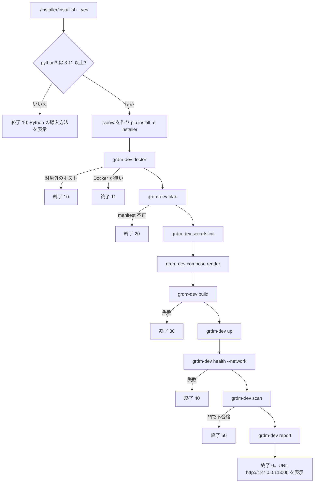

# SPEC-02 Installer CLI / インストーラー CLI

> **Summary:** The contract of the two entry points that install the GakuNin RDM developer environment: the thin bootstrap `installer/install.sh` and the Python command `grdm-dev` with its subcommands, profiles, flags, exit codes, and directory layout.
> **概要:** GakuNin RDM 開発環境を導入する二つの入口、薄い起動スクリプト `installer/install.sh` と Python コマンド `grdm-dev` の契約。サブコマンド、プロファイル、フラグ、終了コード、ディレクトリ構成を定める。

**Jump:** [English](#english) · [日本語](#japanese)

- Version / 版: 0.9 — 2026-11-10. **Learned:** a retired credential key stays in `runtime/.env` forever unless it is dropped explicitly, and a Compose file rendered before the key was retired still refers to it, so `compose render` must run before `secrets rotate` or a recreate after an upgrade (PR #35 review r1). ／ 廃止した資格情報のキーは明示的に消さなければ `runtime/.env` に残り続け、廃止前に生成した Compose ファイルはそのキーを参照し続ける。更新後は `secrets rotate` や再作成の前に `compose render` が必要と分かった（PR #35 レビュー r1）。
- Version / 版: 0.8 — 2026-11-06. **Learned:** a stack that builds is not a stack that starts: a fresh database needs a one-shot initialisation (`osf_init`), Compose's short `tmpfs` is root-only, the memory budget must respect the Docker VM, and a prebuilt SPA must be built once into a volume rather than at every start under emulation (real install runs 9–13). ／ 組めるスタックは起動するスタックではない。新しいデータベースには一回限りの初期化（`osf_init`）が要り、Compose の短い `tmpfs` は root 専用で、メモリ予算は Docker VM を尊重しなければならず、prebuilt の SPA はエミュレーション下で毎回組むのではなくボリュームへ一度組む（実機第 9〜13 回）。
  0.7 — 2026-11-06. **Learned:** a service row in the profile table must correspond to a process that exists, so the overlay repository wiki-frontend is represented by a one-shot `wiki_assets` that fills a named volume and its readers wait with `condition: service_completed_successfully` ([ADR-06](../decisions/ADR-06_Wiki_Frontend_Overlay.md)), while a template `command` must have `$` escaped as `$$` for Compose (PR #30 review r1); and, independently, a glossary term is only explained for the reader when its note and REF-01 link sit at the first prose use, counting lower-case and plural forms, so first-use notes with links were added in both halves (SPEC-06 §3). ／ プロファイル表のサービス行は実在するプロセスに対応していなければならないため、オーバーレイである wiki-frontend は名前付きボリュームを満たす一回限りの `wiki_assets` で表し、それを読むサービスは `condition: service_completed_successfully` で待つ（[ADR-06](../decisions/ADR-06_Wiki_Frontend_Overlay.md)）。またテンプレートの `command` は Compose 向けに `$` を `$$` にエスケープする（PR #30 レビュー r1）。また別に、用語注と REF-01 へのリンクは、小文字や複数形も含めた本文の初出に置かなければ読者に届かないと分かったため、英和両方の初出にリンク付きの用語注を補った（SPEC-06 §3）。
- Version / 版: 0.6 — 2026-11-06. **Learned:** a `command` in a template is written for the container shell, but Compose interpolates `$VAR` in every string of the file first, so the renderer must escape `$` as `$$` and a test must run the rendered file through Compose's own parser; and a fresh bind volume belongs to the host user, so a non-root writer needs an owner step (PR #30 review r1). ／ テンプレートの `command` はコンテナのシェル向けに書くが、Compose はファイル中の全文字列の `$VAR` を先に展開する。だから出力側で `$` を `$$` にエスケープし、試験は出力ファイルを Compose 自身の解析器に通さねばならない。また新しい bind ボリュームはホストの利用者の所有なので、非 root の書き手には所有者を決める段が要る（PR #30 レビュー r1）。
  0.5 — 2026-11-06. **Learned:** a service row in the profile table must correspond to a process that exists: `wiki` had none, because the wiki-frontend repository is an overlay whose image only builds a webpack bundle (real install run 4, [ADR-06](../decisions/ADR-06_Wiki_Frontend_Overlay.md)); the honest row is a one-shot `wiki_assets` that fills a named volume, and the services that read the volume must wait for it with `condition: service_completed_successfully`. ／ プロファイル表のサービス行は実在するプロセスに対応していなければならないと分かった。`wiki` には無かった。wiki-frontend リポジトリは webpack の束を組むだけのイメージを持つオーバーレイだからである（実機第 4 回、[ADR-06](../decisions/ADR-06_Wiki_Frontend_Overlay.md)）。正直な行は名前付きボリュームを満たす一回限りの `wiki_assets` で、ボリュームを読むサービスは `condition: service_completed_successfully` でそれを待たねばならない。
- Version / 版: 0.5 — 2026-11-06. **Learned:** a glossary term is only explained for the reader when its note and REF-01 link sit at the first prose use, counting lower-case and plural forms, so first-use notes with links were added in both halves (SPEC-06 §3). ／ 用語注と REF-01 へのリンクは、小文字や複数形も含めた本文の初出に置かなければ読者に届かないと分かったため、英和両方の初出にリンク付きの用語注を補った（SPEC-06 §3）。
  0.4 — 2026-11-06. **Learned:** an operational failure that only a module docstring describes is invisible to the shell wrapper and to the Japanese message table, so every new failure cause of a subcommand needs its own row in `messages.tsv` and in this table before the code may return it (PR #23 review r1, U4: `upstream` returned 1 with no canonical entry). ／ モジュールの docstring にしか書かれていない運用上の失敗は、シェルの包み紙にも日本語の文言表にも見えない。サブコマンドの新しい失敗原因は、コードがその番号を返す前に `messages.tsv` とこの表に行を持たなければならないと分かった（PR #23 レビュー r1、U4: `upstream` が正本に無い 1 を返していた）。
  0.3 — 2026-11-05. **Learned:** `secrets rotate` had to become a coordinated database-password change plus container recreation, because `restart` keeps the old environment and leaves the captured credential valid (PR #21 review r1). ／ `restart` は旧い環境を保つため、捕られた資格情報が有効なまま残る。`secrets rotate` は DB パスワードの変更とコンテナ再作成を束ねた手順にする必要があると分かった（PR #21 レビュー r1）。
  0.2 — 2026-11-05. **Learned:** a profile table and the acceptance criteria that depend on it must change together, and a TOON row whose text contains a comma or a colon must be quoted or the parser sees extra columns. ／ プロファイル表と、それに依存する受入基準は同時に変えなければならず、カンマやコロンを含む TOON の行は引用符で囲まないと列が増えて解析に失敗すると分かった。
- Version / 版: 0.1 — 2026-11-05. **Learned:** keeping the shell part to a bootstrap and putting every decision in one Python command is the only way to make the OS differences, the manifest check, and the reports testable with `unittest`. ／ シェルは起動だけに留め、判断をすべて一つの Python コマンドに集めないと、OS の違い・manifest の整合・報告書を `unittest` で試験できないと分かった。
- Normative for: `installer/install.sh`, `installer/grdm_dev/`, `installer/tests/`, `runtime/`.
- Related: [SPEC-00 Overview](00_overview.md) · [SPEC-01 Manifest](01_manifest.md) · [SPEC-03 Security Gate](03_security_gate.md) · [SPEC-04 Acceptance Tests](04_acceptance_tests.md) · [SPEC-05 Upstream Tracking](05_upstream_tracking.md) · [SPEC-06 Documentation Conventions](06_documentation_conventions.md) · [ADR-02 Network Model](../decisions/ADR-02_Network_Model.md) · [ADR-03 Staged Security Gate](../decisions/ADR-03_Staged_Security_Gate.md) · [POL-01 Position](../policy/POL-01_Developer_Environment_2027_Position.md) · [docs/README.md](../README.md)

---

<a id="english"></a>
## English

[→ 日本語版へ](#japanese)

### 1. Scope and goal

The installer turns a fresh checkout of this repository into a running GakuNin RDM (GakuNin is Japan's academic network for logging in with a university account; see [REF-01](../reference/REF-01_Glossary.md)) developer environment with one command, on the hosts listed in [§8](#2-en-hosts). It never needs `sudo` (a way to run a command as the computer's administrator), never changes network settings on the host, and can be run again at any time without harm. Everything it creates lives under `runtime/`, which is ignored by Git.

**Glossary notes.** An *installer* is a program that prepares other programs so they can run. A *CLI* (command line interface) is a program you drive by typing commands. A *container* is a box that holds one program and everything it needs, so it runs the same on any computer. *Docker* (the tool that builds images and runs containers; see [REF-01](../reference/REF-01_Glossary.md)) and its companion *Docker Compose* (see [REF-01](../reference/REF-01_Glossary.md)) run them; Compose is the tool that starts many containers together from one description file. A *manifest* is the list that says exactly which version of each source repository we use ([SPEC-01](01_manifest.md)).

### 2. Two entry points

#### 2.1 `installer/install.sh` — thin bootstrap

`install.sh` does four things and nothing else:

1. Runs with the `bash` that ships with macOS (version 3.2), so it uses no feature newer than that: no associative arrays, no `mapfile`, no `${var,,}`.
2. Finds `python3` and checks that it is 3.11 or newer. If not, it prints how to install one for the detected OS and exits with code 10.
3. Creates a *virtual environment* (a private folder of Python and its libraries, separate from the system) at `.venv/` and installs the `installer/` package into it with `pip install -e installer[scan]` (the `scan` extra brings Semgrep, which `grdm-dev scan` runs locally — SPEC-03 §4.2, real install run 17; `GRDM_WITHOUT_SCAN=1` leaves it out, `GRDM_WITH_ACCEPT=1` adds Playwright).
4. Hands every argument to `.venv/bin/grdm-dev install "$@"` and exits with that command's exit code.

OS differences are not written in `install.sh`. They live in `installer/grdm_dev/host.py`. User-facing messages come from `installer/grdm_dev/messages.tsv` (one line per code, English and Japanese columns) so that the script and the Python command say the same thing.

```mermaid
flowchart TD
  A[./installer/install.sh --yes] --> B{python3 >= 3.11?}
  B -- no --> X10[exit 10: how to install Python]
  B -- yes --> C[create .venv/ and pip install -e installer[scan]]
  C --> D[grdm-dev doctor]
  D -- unsupported host --> X10b[exit 10]
  D -- Docker missing --> X11[exit 11]
  D --> E[grdm-dev plan]
  E -- manifest invalid --> X20[exit 20]
  E --> F[grdm-dev secrets init]
  F --> G[grdm-dev compose render]
  G --> H[grdm-dev build]
  H -- failed --> X30[exit 30]
  H --> I[grdm-dev up]
  I --> J[grdm-dev health --network]
  J -- failed --> X40[exit 40]
  J --> K[grdm-dev scan]
  K -- gate failed --> X50[exit 50]
  K --> L[grdm-dev report]
  L --> Z[exit 0 and print URL http://127.0.0.1:5000]
```

#### 2.2 `grdm-dev` — the Python command

`grdm-dev` is the package `installer/grdm_dev/`, exposed as a console script. Rules:

- **Standard library first.** The command itself has no third-party dependency. The manifest is JSON (read with `json`), the host is read with `platform`, `shutil`, `socket`, and `subprocess`, and the generated Compose file is written as JSON, which Docker Compose accepts because JSON is valid YAML (a plain-text data format that uses indentation; see [REF-01](../reference/REF-01_Glossary.md)). PyYAML is therefore *not* required.
- **Optional extra `accept`.** `pip install -e "installer[accept]"` adds `pytest`, `pytest-playwright`, and `playwright`. Only `grdm-dev accept` imports them ([SPEC-04](04_acceptance_tests.md)).
- **External tools** are called as subprocesses and checked by `doctor`: `docker` (27 or newer) with the Compose plugin (v2 or newer) and buildx (Docker's helper that builds one image for several kinds of computer; see [REF-01](../reference/REF-01_Glossary.md)), `trivy`, `gitleaks`, and `semgrep` for `scan`, the OWASP ZAP (a tool that pokes at a running website the way an attacker would; see [REF-01](../reference/REF-01_Glossary.md)) container image for `scan --dynamic`, and `mkdocs` for `docs`. A missing scanner makes `scan` exit 51 ([SPEC-03 §8](03_security_gate.md#english)).
- Every subcommand supports `--json`, which prints the same report as machine-readable JSON instead of TOON (a compact text form of JSON, see [SPEC-06 §4](06_documentation_conventions.md#english)).

### 3. Subcommands

| Subcommand | Contract | Touches Docker |
|---|---|---|
| `doctor` | Detects OS (macOS, Ubuntu, WSL2), CPU (`arm64`, `amd64`), memory, free disk, Docker ≥ 27, Compose plugin (v2 or newer), buildx. Prints a TOON report. Exit 10 if the host is unsupported, 11 if Docker is missing or not running. | read-only |
| `plan` | Resolves manifest + profile and prints which images would be built and which services started, with the published ports ([§4](#2-en-ports)). Changes nothing. Exit 20 if the manifest fails [SPEC-01](01_manifest.md) checks. | no |
| `secrets init` / `secrets rotate` | `init` writes random secrets (database passwords, Django secret key, CAS keys) into `runtime/.env` with file mode `0600`. Never writes a default or example password. Refuses to overwrite an existing file unless `--force`. `rotate` regenerates every secret, changes the live PostgreSQL and RabbitMQ passwords, recreates the containers so they receive the new environment, and verifies that the old credentials are rejected; any failure restores the previous `runtime/.env` and exits 40. `init --force` and `rotate` drop retired credential keys. After an upgrade, run `compose render` before `rotate` or any recreate, because a previously rendered Compose file still refers to retired keys. Used after a red-team capture ([SPEC-03 §6](03_security_gate.md#english)). | no / yes |
| `compose render` | Writes `runtime/docker-compose.yml` from manifest + profile: the internal network `grdm` plus the publishing-only `grdm-edge` (`--egress <services>` attaches more, recorded in `runtime/.env`; [SPEC-03 §3.2](03_security_gate.md#english)), per-component `platform:` from the manifest's `build_platform`, ports published only on `127.0.0.1` ([§4](#2-en-ports)), non-root `user:` for every service, `read_only`, `cap_drop`, and resource limits (`mem_limit`, `cpus`, `pids_limit`) scaled from the smaller of the host memory `doctor` detected and the Docker engine's VM memory (`docker info`; on Docker Desktop the VM is a fraction of the host, real install run 10), where a template's `mem_min_mb` floor takes its share first and the others divide the rest, with per-service exceptions from `manifest/hardening.json` ([SPEC-03 §3.3](03_security_gate.md#english)), `platform:` chosen from `doctor`, named volumes mapped under `runtime/volumes/`, every `tmpfs` entry mounted with `mode=1777` (Compose's short form gives root-only `0755`, real install run 11), and the placeholders `{{HOST_PORT:<service>}}`, `{{CONTAINER_PORT:<service>}}` and `{{AUTH_URL}}` (fakecas's published URL, or web's when `--auth shibboleth` replaces fakecas) resolved in template values. Follows [ADR-02](../decisions/ADR-02_Network_Model.md). | no |
| `build` | Builds images with `docker buildx`. The platform is, in order of precedence, `--platform`, the component's `build_platform` in the manifest (for example `linux/amd64` for components whose EOL base cannot be built for arm64, run under emulation), otherwise the host platform; the image is loaded locally. A component with `prebuilt_image` ([SPEC-01](01_manifest.md)) is not built: the digest-pinned image is pulled once per requested platform and reported as `prebuilt` (`pull-failed` → exit 30). With `--push` a prebuilt image is never re-published to `ghcr.io/rcosdp` (it is a third party's artefact); the row is reported as `prebuilt-not-pushed` with `pushed: false`. `--push` pushes the multi-arch manifest to `ghcr.io/rcosdp/<name>` (private). Exit 30 on failure. | yes |
| `up` / `down` / `reset` | `up` starts the profile and waits for health; `down` stops containers and keeps volumes; `reset` stops and deletes `runtime/volumes/` after a confirmation (skipped by `--yes`). | yes |
| `health` | Checks every service's health endpoint: an HTTP GET on the published loopback port (`/` for most services, `/login/` for `web`, because osf.io's `/` proxies to ember and answers 500 while ember is still building — real install run 14); a one-shot counts as healthy once it has exited 0. With `--network`, also lists listening sockets on the host and fails (exit 40) if any container port is bound to a non-loopback address, or if a wildcard listener on a project port has no visible owner (fail closed). A *named* host program that is not Docker on a project port (macOS AirPlay Receiver on `*:5000`, real install run 16) is reported as a `foreign-listener` warning, not a failure: it is not our leak, and `GRDM_PORT_<SERVICE>` in `runtime/.env` moves our port. | read-only |
| `scan` | Runs the whole security gate of [SPEC-03](03_security_gate.md): baseline controls, Trivy SBOM (software bill of materials: the list of all parts inside an image) and CVE list, gitleaks, Semgrep, and OWASP ZAP; writes `runtime/reports/scan_<date>.json` plus TOON, and diffs findings against `manifest/allowlist.json` and `manifest/allowlist.baseline.json` for the milestone in `manifest/milestone.json`. Gate per [ADR-03](../decisions/ADR-03_Staged_Security_Gate.md): M1–M3 report only, M4 exit 50 on HIGH, M5 exit 50 on CRITICAL or HIGH. Flags `--baseline`, `--secrets`, `--dynamic` run one part only. Exit 51 if a scanner cannot run, 52 if `--dynamic` was asked for while services are unhealthy. | read-only |
| `redteam preflight` | Verifies, before an AI red-team run, that the attacker container of the red-team Compose project is isolated (proved with a reachable canary, see [SPEC-03 §6](03_security_gate.md#english)), that only the containers named in `manifest/redteam-targets.json` are attached, and that the approval record is present and current. Exit 53 if either check fails. See [SPEC-03 §6](03_security_gate.md#english). | yes (starts and removes a canary container and network for the probe) |
| `accept` | Runs the Playwright Python acceptance suite in the same `.venv/`. `--only <scenario>` runs one scenario; `--seed` creates the disposable test users. Exit 60 on any failing test. See [SPEC-04](04_acceptance_tests.md). | read-only |
| `upstream mirror` / `upstream integrate` | Runs the daily mirror or the weekly integration of [SPEC-05](05_upstream_tracking.md) by hand. Needs Git credentials for the private `-dev2027` repositories; never run in this repository's CI. Exit 70 when a fetch was refused or failed, a push failed, or a merge conflicted; the report is written in every case. | no (Git only) |
| `manifest check` / `manifest toon` | `check` validates `manifest/upstreams.json` ([SPEC-01 §5](01_manifest.md#english)) and verifies that every TOON excerpt in `docs/` and `manifest/upstreams.toon` agree with it. Exit 20 on mismatch. `toon` prints the excerpt that `upstreams.toon` must equal. | no |
| `docs build` / `docs check` | `build` runs MkDocs into `site/`. `check` enforces [SPEC-06 §8](06_documentation_conventions.md#english): anchors, Jump line, relative links, TOON consistency, Version line. | no |
| `report` | Bundles the latest reports of `doctor`, `plan`, `health`, `scan`, and `accept` into `runtime/reports/<timestamp>.toon` and `.json`. | no |
| `install` | The sequence shown in the flowchart. Stops at the first non-zero step. | yes |

<a id="2-en-ports"></a>
### 4. Profiles and published ports

```toon
profiles[3]{name,services,note}:
  minimum,"osf_init elasticsearch_data_init web api postgres elasticsearch rabbitmq fakecas",smallest set that shows a login and a project page
  core,"minimum + admin worker wb wb_worker mfr unoconv ember_osf_web cas wiki_static_init wiki_assets mongo sharejs elasticsearch6 redis y_websocket","the six core repositories with their infrastructure, plus y_websocket for Wiki collaborative editing; wiki_static_init and wiki_assets are one-shots that prepare the volume wiki_static and copy the wiki editor bundle into it (ADR-06)"
  full,"core + rdmcp aipf_mcp_data_grdm oasys shibboleth_sp test_idp",everything; shibboleth_sp replaces fakecas
```

Service names follow the upstream `docker-compose.yml` of RDM-osf.io so that existing guides keep working, and they are the `services[]` values of the manifest ([SPEC-01 §3](01_manifest.md#english)). The `wiki-frontend` component is an overlay of `osf.io` (`overlay_of`, [ADR-06](../decisions/ADR-06_Wiki_Frontend_Overlay.md)): its services are *one-shots* (containers that run once and exit, `restart: "no"`) on the bundle-builder image `grdm-dev/wiki-frontend:<osf_sha12>-<wiki_sha12>`: `wiki_static_init` makes the fresh volume `wiki_static` writable by uid 1000 (root with `CAP_CHOWN` only, a documented exception in `manifest/hardening.json`), then `wiki_assets` copies the webpack output `/code/website/static/public/js/` into it and exits; `web`, `api`, `admin` and `worker` mount that volume read-only at `/code/website/static/public/js/wiki/` and depend on it with `condition: service_completed_successfully`, so `up` starts them only after the bundle is in place. `health` counts a one-shot as healthy once it has exited with code 0. The `shibboleth` Compose profile and the `fakecas` service are mutually exclusive: `compose render --profile full --auth shibboleth` removes `fakecas` and adds `shibboleth_sp` and `test_idp`; the default for `full` is `fakecas`. `y_websocket` belongs to `core`, not `full`, because Wiki collaborative editing is an M2 acceptance scenario (C4 in [SPEC-04 §4](04_acceptance_tests.md#english)); the manifest's `profile` for the `y-websocket` component is `core` accordingly ([SPEC-01 §3](01_manifest.md#english)).

`elasticsearch` runs the native image `grdm-dev/elasticsearch2:<tag>` that `build` makes from `installer/images/elasticsearch2` (manifest `image_build`, [ADR-07](../decisions/ADR-07_Native_Builds_of_EOL_Middleware.md)) as uid 1000 on a read-only root, after the one-shot `elasticsearch_data_init` (the same image as explicit root with `CAP_CHOWN` only) has handed the data volume to uid 1000 — a fresh bind directory belongs to the host user, a PR #33 tree to uid 101; the emulated `elasticsearch:2` is gone (real install run 19, PR #34 review r1). `osf_init` (component `osf.io`, profile `minimum`) is a third one-shot: on the osf.io image, as uid 1000, it runs the steps the upstream README lists for a new database — `manage.py migrate`, `scripts.populate_institutions -e test -a` and `scripts.register_oauth_scopes` — retrying `migrate` and the institution import every 10 s for up to 5 minutes until postgres and the emulated Elasticsearch (the search engine inside GRDM; see [REF-01](../reference/REF-01_Glossary.md)) accept connections, and exits 0; `web`, `api`, `admin` and `worker` wait for it with `condition: service_completed_successfully`. All three steps are idempotent, so the service runs at every `up` (real install run 12: without it a fresh database made `web` answer 500 with `relation "osf_institution" does not exist`, and each such error leaked one postgres connection of the development server). `ember_osf_web` (prebuilt until M4) takes its backend URLs from the environment (`OSF_URL`, `OSF_API_URL`, `OSF_RENDER_URL`, `OSF_FILE_URL`, `OSF_HELP_URL`, `CAS_URL = {{AUTH_URL}}`, `OSF_COOKIE_DOMAIN`), builds its `dist/` once into the named volume `ember_osf_web_dist` with a fingerprint of those values and serves that build with `ember serve --path`; the first build under amd64 (the CPU type of ordinary PCs and servers; see [REF-01](../reference/REF-01_Glossary.md)) emulation takes 10–25 minutes, later starts seconds, live reload is off.

**Published ports.** This table is the only place where default host ports are defined; [ADR-02](../decisions/ADR-02_Network_Model.md), [SPEC-03](03_security_gate.md), and [REF-01](../reference/REF-01_Glossary.md) point here. Every port is published on `127.0.0.1` only.

```toon
ports[7]{service,host_port,profile,url}:
  web,5000,minimum,http://127.0.0.1:5000
  api,8000,minimum,http://127.0.0.1:8000
  admin,8001,core,http://127.0.0.1:8001
  wb,7777,core,http://127.0.0.1:7777
  mfr,7778,core,http://127.0.0.1:7778
  fakecas,8080,minimum,http://127.0.0.1:8080
  ember_osf_web,4200,core,http://127.0.0.1:4200
```

All other services (`cas`, `wiki_static_init`, `wiki_assets`, `y_websocket`, the subsystems, `test_idp`, databases and queues) are reached only inside the Compose network; when one of them needs a browser-facing port, `compose render` assigns it and `plan` prints it. `compose render` writes every chosen host port to `runtime/.env` as `GRDM_PORT_<SERVICE>` (upper case), which the acceptance tests read ([SPEC-04 §1](04_acceptance_tests.md#english)). If a default port is already in use (macOS AirPlay on `5000` is the known case), `compose render` takes the next free port and records the change in the install report; exit 12 is returned only when no free port is found.

### 5. Flags

| Flag | Meaning |
|---|---|
| `--yes` | Answer every question with its default. Required when no terminal is attached. |
| `--profile minimum\|core\|full` | Default `core`. Saved in `runtime/.env` as `GRDM_PROFILE` and reused on later runs. |
| `--platform linux/arm64,linux/amd64` | Override the platforms for `build`. Default: host platform only. |
| `--no-open` | Do not open the browser after `up`. |
| `--json` | Print reports as JSON instead of TOON. |

### 6. Exit codes

```toon
exit_codes[14]{code,meaning}:
  0,success
  2,"usage error: unknown flag or bad value"
  10,"host unsupported: OS, CPU, memory, or Python too old"
  11,"Docker missing, not running, or Compose / buildx plugin absent"
  12,a required port on 127.0.0.1 is in use and no free alternative was found
  20,manifest invalid or TOON excerpt disagrees with JSON
  30,image build failed
  40,"health check failed, or a port listens on a non-loopback address"
  50,security scan gate failed for the current milestone
  51,"scanner could not run: tool missing or vulnerability database download failed"
  52,"services not healthy, so scan --dynamic could not run"
  53,"red-team preflight failed: egress reachable or a target outside redteam-targets.json"
  60,acceptance test failed
  70,"upstream mirror or integrate failed: fetch refused, push failed, or merge conflict"
```

Numbers are never reused for a new meaning; a new cause gets a new number. The canonical table is `installer/grdm_dev/messages.tsv`, and this TOON block must agree with it (`manifest check` verifies). Codes 50–53 are described in detail in [SPEC-03 §8](03_security_gate.md#english); code 70 in [SPEC-05 §2–§4](05_upstream_tracking.md#english).

### 7. Behavior rules

- **Non-interactive.** When `stdin` is not a terminal and `--yes` is absent, every question is answered "no" and the command exits 2 with a hint to add `--yes`.
- **Idempotent.** Running any subcommand twice gives the same result. `secrets init` keeps existing secrets, `compose render` overwrites only the generated file, `build` uses the buildx cache, `up` is a no-op for healthy services.
- **No secrets in Git.** `runtime/` is in `.gitignore`. `docs check` and the CI secret scan fail if a file under `runtime/` or a value that looks like a secret is committed.
- **No host network changes.** The loopback alias `192.168.168.167` from the old guide is not created; `compose render` rewrites the upstream `local.py` and `.docker-compose.*.env` settings to use service names inside the Compose network and `127.0.0.1` for the browser ([ADR-02](../decisions/ADR-02_Network_Model.md)).
- **First start is slow, later starts are not.** `up` waits up to 1800 s (`--timeout`) for health: on Apple Silicon (the chips Apple puts in its Macs since 2020; see [REF-01](../reference/REF-01_Glossary.md)) the first `up` builds ember-osf-web (the newer web pages of GRDM; see [REF-01](../reference/REF-01_Glossary.md)) under emulation (10–25 minutes) and runs `osf_init`; both leave their result in named volumes, so a second `up` is healthy within a minute or two (real install runs 10–18; the cold-start build took 13–25 minutes, which is why the default is 30 minutes).
- **No `-private` code here.** The installer clones the integration repositories by name and SHA (the fingerprint of one commit; see [REF-01](../reference/REF-01_Glossary.md)) from the manifest at run time; this public repository holds no code from them ([POL-01](../policy/POL-01_Developer_Environment_2027_Position.md)).

<a id="2-en-hosts"></a>
### 8. Supported hosts

**Memory.** `compose render` budgets 70 % of the smaller of the host memory and the Docker engine's VM memory and refuses (exit 10) a profile whose per-service floors do not fit, naming the required size; `--memory-gib` overrides the detection and is a knowing overcommit (PR #33 review r1 R1-04). On Apple Silicon the `core` profile needs a Docker VM of about 24 GiB because ember-osf-web builds under emulation with an 8 GiB floor; `minimum` fits in 8 GiB.

| Host | CPU | Support |
|---|---|---|
| macOS 14 or newer with Docker Desktop | arm64 | official (M2 acceptance runs here) |
| Ubuntu 24.04 with Docker Engine | amd64, arm64 | official |
| Windows 11 with WSL2 (Ubuntu 24.04) and Docker Desktop | amd64 | required to work; checked in CI as build-only |
| Other Linux, macOS on Intel | any | best-effort; `doctor` warns and continues |

### 9. Directory layout

```toon
layout:
  installer/install.sh: bash 3.2 bootstrap
  installer/pyproject.toml: package metadata, console script grdm-dev, extra accept
  installer/grdm_dev/:
    cli.py: argument parsing, subcommand dispatch, exit codes
    host.py: OS, CPU, memory, disk, Docker detection
    manifest.py: load and validate manifest/upstreams.json, TOON comparison
    secrets.py: random secret generation, runtime/.env with mode 0600
    compose.py: render runtime/docker-compose.yml from manifest and profile
    build.py: buildx wrapper, platform list, optional push
    health.py: service health and loopback-only check
    scan.py: baseline controls, Trivy SBOM and CVE, gitleaks, Semgrep, ZAP, allow-list diff, staged gate (SPEC-03)
    redteam.py: red-team preflight (SPEC-03 §6)
    upstream.py: mirror and integrate (SPEC-05)
    accept.py: run pytest-playwright in the same venv
    docs.py: MkDocs build and SPEC-06 checks
    report.py: bundle TOON and JSON reports
    messages.tsv: exit code, English message, Japanese message
  installer/tests/: unittest, files named test_*.py
  installer/acceptance/: Playwright Python, see SPEC-04
  manifest/:
    upstreams.json: canonical manifest (SPEC-01)
    upstreams.toon: excerpt generated by grdm-dev manifest toon (SPEC-01)
    allowlist.json: accepted findings (SPEC-03 §5.1)
    allowlist.baseline.json: allow-list count at the last milestone exit, owner-maintained (SPEC-03 §5.1)
    milestone.json: current milestone, owner-maintained (SPEC-03 §5.2)
    hardening.json: per-service exceptions to read-only root and cap_drop, with reasons (SPEC-03 §3.3)
    redteam-targets.json: container names the AI red team may touch (SPEC-03 §6)
  runtime/: generated, git-ignored (.env, docker-compose.yml, volumes/, reports/)
```

### 10. Tests

`python3 -m unittest discover -s installer/tests` must pass on every PR (pull request: a proposed change waiting for review; see [REF-01](../reference/REF-01_Glossary.md)). Each module has a `test_<module>.py` that covers at least one success case and one rejection case, and every rejection case asserts the exit code from [§6](#english). Docker is never required by unit tests: `host.py` and `build.py` take an injectable runner so tests pass fake `docker` output. Integration and acceptance tiers are defined in [SPEC-04](04_acceptance_tests.md).

---

<a id="japanese"></a>
## 日本語

[→ To English](#english)

### 1. 範囲と目的

インストーラーは、このリポジトリを取り出した直後の状態から、[§8](#2-ja-hosts) に挙げたホストで、コマンド一つで GakuNin RDM（GakuNin＝学認。大学のアカウントでログインするための日本の学術ネットワーク。[REF-01](../reference/REF-01_Glossary.md)）の開発環境を動かすものです。`sudo`（コンピュータの管理者としてコマンドを動かす仕組み）を使わず、ホストのネットワーク設定を変えず、何度やり直しても壊れません。作られるものはすべて `runtime/` の下にあり、Git は無視します。

**用語注。** 「インストーラー」は、ほかのプログラムが動くように準備するプログラムです。「CLI」（コマンドラインインターフェース）は、文字でコマンドを打って使うプログラムです。「コンテナ」は、一つのプログラムと必要なものを一箱に入れ、どのコンピュータでも同じように動かすための箱です。「Docker」（イメージを作りコンテナを動かす道具。[REF-01](../reference/REF-01_Glossary.md)）とその相棒の「Docker Compose」（[REF-01](../reference/REF-01_Glossary.md)）がコンテナを動かします。Compose は一枚の設定ファイルから多くのコンテナをまとめて起動する道具です。「manifest」は、どのソースリポジトリのどの版を使うかを正確に書いた一覧です（[SPEC-01](01_manifest.md)）。

### 2. 二つの入口

#### 2.1 `installer/install.sh` — 薄い起動スクリプト

`install.sh` がすることは次の四つだけです。

1. macOS 標準の `bash`（版 3.2）で動く。そのため連想配列、`mapfile`、`${var,,}` のような新しい機能は使わない。
2. `python3` を探し、3.11 以上かを確かめる。足りなければ、判定した OS に合わせた導入方法を表示して終了コード 10 で終わる。
3. 「仮想環境」（システムとは別の、Python とライブラリだけの私用フォルダ）を `.venv/` に作り、`pip install -e installer[scan]` で `installer/` パッケージを入れる（追加 `scan` は `grdm-dev scan` がローカルで動かす Semgrep を含む。SPEC-03 §4.2、実機第 17 回。`GRDM_WITHOUT_SCAN=1` で外し、`GRDM_WITH_ACCEPT=1` で Playwright を加える）。
4. 引数をすべて `.venv/bin/grdm-dev install "$@"` に渡し、その終了コードで終わる。

OS の違いは `install.sh` には書きません。`installer/grdm_dev/host.py` に閉じ込めます。利用者向けの文言は `installer/grdm_dev/messages.tsv`（コードごとに一行、英語と日本語の列）から出し、スクリプトと Python コマンドが同じ言葉を話すようにします。



#### 2.2 `grdm-dev` — Python コマンド

`grdm-dev` はパッケージ `installer/grdm_dev/` を、コンソールスクリプトとして公開したものです。規則は次のとおりです。

- **標準ライブラリ優先。** コマンド本体は外部ライブラリに依存しません。manifest は JSON（`json` で読む）、ホストは `platform`・`shutil`・`socket`・`subprocess` で読み、生成する Compose ファイルは JSON で書き出します。JSON は YAML（字下げでデータを書く文字の形。[REF-01](../reference/REF-01_Glossary.md)）として正しいので Docker Compose がそのまま読めます。したがって PyYAML は要りません。
- **任意の追加 `accept`。** `pip install -e "installer[accept]"` で `pytest`・`pytest-playwright`・`playwright` が入ります。これらを読み込むのは `grdm-dev accept` だけです（[SPEC-04](04_acceptance_tests.md)）。
- **外部の道具** はサブプロセスとして呼び、`doctor` が有無を確かめます。`docker`（27 以上）と Compose プラグイン（v2 以上）・buildx（一つのイメージを何種類かの計算機向けに作る Docker の助手。[REF-01](../reference/REF-01_Glossary.md)）、`scan` 用の `trivy`・`gitleaks`・`semgrep`、`scan --dynamic` 用の OWASP ZAP（動いている Web サイトを攻撃者のやり方でつつく道具。[REF-01](../reference/REF-01_Glossary.md)）のコンテナイメージ、`docs` 用の `mkdocs` です。スキャナーが無いと `scan` は終了 51 で終わります（[SPEC-03 §8](03_security_gate.md#japanese)）。
- すべてのサブコマンドは `--json` を受け付け、TOON（JSON を短く書いた文字形式。[SPEC-06 §4](06_documentation_conventions.md#japanese)）の代わりに機械が読む JSON で同じ報告を出します。

### 3. サブコマンド

| サブコマンド | 契約 | Docker に触れるか |
|---|---|---|
| `doctor` | OS（macOS・Ubuntu・WSL2）、CPU（`arm64`・`amd64`）、メモリ、空き容量、Docker 27 以上、Compose プラグイン（v2 以上）、buildx を判定し TOON で報告する。対象外のホストは終了 10、Docker が無い・動いていないときは 11。 | 読むだけ |
| `plan` | manifest とプロファイルを解決し、どのイメージを作りどのサービスを起こすか、公開ポート（[§4](#2-ja-ports)）とともに表示する。何も変えない。manifest が [SPEC-01](01_manifest.md) の検査に落ちれば終了 20。 | 触れない |
| `secrets init` / `secrets rotate` | `init` は乱数の秘密（DB パスワード、Django の秘密鍵、CAS の鍵）を `runtime/.env` にモード `0600` で書く。既定値や例のパスワードは決して書かない。既存ファイルは `--force` がなければ上書きしない。`rotate` はすべての秘密を作り直し、稼働中の PostgreSQL と RabbitMQ のパスワードを変更し、新しい環境を受け取るようコンテナを再作成し、旧い資格情報が拒否されることを確かめる。どこかで失敗したら以前の `runtime/.env` に戻して 40 で終わる。`init --force` と `rotate` は廃止した資格情報のキーを消す。更新後は、`rotate` や再作成の前に `compose render` を実行する。以前に生成した Compose ファイルは廃止したキーを参照し続けるからである。レッドチームに秘密を取られた後に使う（[SPEC-03 §6](03_security_gate.md#japanese)）。 | 触れない / 触れる |
| `compose render` | manifest とプロファイルから `runtime/docker-compose.yml` を書く。内部ネットワーク `grdm` と公開専用の `grdm-edge`（`--egress <services>` で追加接続し `runtime/.env` に記録。[SPEC-03 §3.2](03_security_gate.md#japanese)）、部品ごとの `platform:` は manifest の `build_platform` から、ポートは `127.0.0.1` にだけ公開（[§4](#2-ja-ports)）、全サービスに非 root の `user:`、`read_only`・`cap_drop`・資源制限（`mem_limit`・`cpus`・`pids_limit`。`doctor` が検出したホストのメモリと Docker エンジンの VM メモリ（`docker info`。Docker Desktop では VM はホストの一部。実機第 10 回）の小さい方に応じて決め、テンプレートの下限 `mem_min_mb` が先に取り分を確保し、残りを他が分け合う）、サービスごとの例外は `manifest/hardening.json` から（[SPEC-03 §3.3](03_security_gate.md#japanese)）、`platform:` は `doctor` の結果から選ぶ、名前付きボリュームは `runtime/volumes/` の下、`tmpfs` の各項目は `mode=1777` で mount（Compose の短い記法は root 専用の `0755` になる。実機第 11 回）、テンプレート値のプレースホルダ `{{HOST_PORT:<service>}}`・`{{CONTAINER_PORT:<service>}}`・`{{AUTH_URL}}`（fakecas の公開 URL。`--auth shibboleth` で fakecas が外れるときは web の URL）を解決する。[ADR-02](../decisions/ADR-02_Network_Model.md) に従う。 | 触れない |
| `build` | `docker buildx` でイメージを作る。プラットフォームは優先順に `--platform`、manifest の部品の `build_platform`（例: EOL ベースで arm64 に組めない部品は `linux/amd64` にしてエミュレーションで動かす）、それもなければホストと同じ。イメージはローカルに読み込む。`prebuilt_image`（[SPEC-01](01_manifest.md)）を持つ部品は組まず、ダイジェスト固定のイメージを要求された platform ごとに取得して `prebuilt` と報告する（`pull-failed` は終了 30）。`--push` でも prebuilt のイメージは `ghcr.io/rcosdp` に再公開しない（第三者の成果物であるため）。行は `prebuilt-not-pushed`、`pushed: false` と報告する。`--push` で multi-arch の manifest を `ghcr.io/rcosdp/<name>`（非公開）へ送る。失敗は終了 30。 | 触れる |
| `up` / `down` / `reset` | `up` はプロファイルを起動し健康になるまで待つ。`down` はコンテナを止めボリュームを残す。`reset` は止めたうえで確認の後に `runtime/volumes/` を消す（`--yes` で確認を省く）。 | 触れる |
| `health` | 各サービスの健康確認用の URL を調べる。公開したループバックのポートへの HTTP GET（多くは `/`。`web` は `/login/`。osf.io の `/` は ember へ転送するので ember がビルド中は 500 を返す。実機第 14 回）で、一回限りのサービスは 0 で終了していれば健康と数える。`--network` を付けると、ホストで待ち受けているソケットも一覧し、コンテナのポートがループバック以外の番地に結び付いているか、プロジェクトのポート上のワイルドカードの待ち受けの所有者が見えなければ終了 40（安全側に失敗）。Docker でない*名前の分かる*ホストのプログラムがプロジェクトのポートにいる場合（macOS の AirPlay レシーバーの `*:5000`。実機第 16 回）は `foreign-listener` の警告として報告し、失敗にはしない。我々の漏れではなく、`runtime/.env` の `GRDM_PORT_<SERVICE>` で我々のポートを移せる。 | 読むだけ |
| `scan` | [SPEC-03](03_security_gate.md) のセキュリティ門を全部動かす。基本対策、Trivy の SBOM（ソフトウェア部品表。イメージに入っている部品の一覧）と CVE の一覧、gitleaks、Semgrep、OWASP ZAP。`runtime/reports/scan_<日付>.json` と TOON を書き、`manifest/milestone.json` の節目に合わせて `manifest/allowlist.json` と `manifest/allowlist.baseline.json` と差分を取る。門は [ADR-03](../decisions/ADR-03_Staged_Security_Gate.md) どおり、M1〜M3 は報告のみ、M4 は HIGH で終了 50、M5 は CRITICAL か HIGH で終了 50。フラグ `--baseline`・`--secrets`・`--dynamic` は一部だけを動かす。スキャナーが動かなければ終了 51、サービスが健全でないのに `--dynamic` を求めたら終了 52。 | 読むだけ |
| `redteam preflight` | AI レッドチームの実行前に、レッドチーム用 Compose プロジェクトの攻撃側コンテナが隔離されていること（届くはずのカナリアで証明する。[SPEC-03 §6](03_security_gate.md#japanese)）、`manifest/redteam-targets.json` に名前のあるコンテナだけが接続していること、承認記録があり新しいことを確かめる。どちらかが外れれば終了 53。詳細は [SPEC-03 §6](03_security_gate.md#japanese)。 | 触れる（検査用のカナリアのコンテナとネットワークを作って消す） |
| `accept` | Playwright Python の受入試験を同じ `.venv/` で実行する。`--only <シナリオ>` で一つだけ、`--seed` で使い捨ての試験利用者を作る。一件でも失敗すれば終了 60。詳細は [SPEC-04](04_acceptance_tests.md)。 | 読むだけ |
| `upstream mirror` / `upstream integrate` | [SPEC-05](05_upstream_tracking.md) の日次ミラーと週次統合を手で動かす。非公開の `-dev2027` への Git 認証情報が要り、このリポジトリの CI では決して動かさない。fetch が拒まれた・失敗した、push が失敗した、マージが衝突したときは終了 70。報告はどの場合も書く。 | 触れない（Git のみ） |
| `manifest check` / `manifest toon` | `check` は `manifest/upstreams.json` を検証し（[SPEC-01 §5](01_manifest.md#japanese)）、`docs/` 内の TOON の抄録と `manifest/upstreams.toon` がそれと一致するか確かめる。不一致は終了 20。`toon` は `upstreams.toon` が一致すべき抄録を出力する。 | 触れない |
| `docs build` / `docs check` | `build` は MkDocs で `site/` を作る。`check` は [SPEC-06 §8](06_documentation_conventions.md#japanese) のアンカー、Jump 行、相対リンク、TOON の一致、Version 行を検査する。 | 触れない |
| `report` | `doctor`・`plan`・`health`・`scan`・`accept` の最新の報告を `runtime/reports/<時刻>.toon` と `.json` にまとめる。 | 触れない |
| `install` | 流れ図の順に実行する。最初に 0 以外で終わった段で止まる。 | 触れる |

<a id="2-ja-ports"></a>
### 4. プロファイルと公開ポート

```toon
profiles[3]{name,services,note}:
  minimum,"osf_init elasticsearch_data_init web api postgres elasticsearch rabbitmq fakecas",ログインとプロジェクト画面が見える最小の組
  core,"minimum + admin worker wb wb_worker mfr unoconv ember_osf_web cas wiki_static_init wiki_assets mongo sharejs elasticsearch6 redis y_websocket",コア 6 リポジトリと基盤。Wiki 共同編集の y_websocket を含む。wiki_static_init と wiki_assets はボリューム wiki_static を用意し Wiki エディタの束を写す一回限りのサービス（ADR-06）
  full,"core + rdmcp aipf_mcp_data_grdm oasys shibboleth_sp test_idp",全部。shibboleth_sp は fakecas と入れ替わる
```

サービス名は RDM-osf.io 上流の `docker-compose.yml` に合わせ、既存の手引きがそのまま使えるようにします。これは manifest の `services[]` の値でもあります（[SPEC-01 §3](01_manifest.md#japanese)）。`wiki-frontend` 部品は `osf.io` のオーバーレイ（`overlay_of`、[ADR-06](../decisions/ADR-06_Wiki_Frontend_Overlay.md)）です。そのサービスは「一回限り」（一度動いて終了するコンテナ。`restart: "no"`）で、束を組むイメージ `grdm-dev/wiki-frontend:<osf の sha12>-<wiki の sha12>` を動かします。`wiki_static_init` が新しいボリューム `wiki_static` を uid 1000 が書けるようにし（root と `CAP_CHOWN` のみ。`manifest/hardening.json` に記した例外）、続いて `wiki_assets` が webpack の出力 `/code/website/static/public/js/` をそこへ写して終了します。`web`・`api`・`admin`・`worker` はそのボリュームを `/code/website/static/public/js/wiki/` に読み取り専用で mount し、`condition: service_completed_successfully` で待つので、`up` は束が置かれてからそれらを起動します。`health` は終了コード 0 で終わった一回限りのサービスを健康と数えます。Compose プロファイル `shibboleth` とサービス `fakecas` は排他です。`compose render --profile full --auth shibboleth` は `fakecas` を外して `shibboleth_sp` と `test_idp` を足します。`full` の既定は `fakecas` です。`y_websocket` は `full` でなく `core` に属します。Wiki 共同編集が M2 の受入シナリオ（[SPEC-04 §4](04_acceptance_tests.md#japanese) の C4）だからです。manifest の `y-websocket` 部品の `profile` もそれに合わせて `core` です（[SPEC-01 §3](01_manifest.md#japanese)）。

`elasticsearch` は `build` が `installer/images/elasticsearch2` から組むネイティブイメージ `grdm-dev/elasticsearch2:<tag>`（manifest の `image_build`、[ADR-07](../decisions/ADR-07_Native_Builds_of_EOL_Middleware.md)）を uid 1000・読み取り専用ルートで動かします。その前に一回限りの `elasticsearch_data_init`（同じイメージを明示の root で、`CAP_CHOWN` のみ）がデータボリュームを uid 1000 に渡します — 新しい bind ディレクトリはホストの利用者の、PR #33 の木は uid 101 の所有だからです。エミュレーションの `elasticsearch:2` は無くなりました（実機第 19 回、PR #34 レビュー r1）。`osf_init`（部品 `osf.io`、プロファイル `minimum`）は三つ目の一回限りのサービスです。osf.io のイメージで uid 1000 として、上流 README が新しいデータベース向けに挙げる手順 `manage.py migrate`・`scripts.populate_institutions -e test -a`・`scripts.register_oauth_scopes` を実行し、postgres とエミュレーション下の Elasticsearch が接続を受け付けるまで `migrate` と機関の投入を 10 秒ごとに最長 5 分やり直して 0 で終了します。`web`・`api`・`admin`・`worker` は `condition: service_completed_successfully` でこれを待ちます。三つの手順はどれも何度実行しても同じ結果になるので、サービスは `up` のたびに動きます（実機第 12 回: これが無いと新しいデータベースで `web` が `relation "osf_institution" does not exist` の 500 を返し、そのエラーごとに開発サーバーが postgres の接続を 1 本漏らした）。`ember_osf_web`（M4 まで prebuilt）はバックエンドの URL を環境変数（`OSF_URL`・`OSF_API_URL`・`OSF_RENDER_URL`・`OSF_FILE_URL`・`OSF_HELP_URL`・`CAS_URL = {{AUTH_URL}}`・`OSF_COOKIE_DOMAIN`）から受け取り、それらの値の指紋とともに `dist/` を名前付きボリューム `ember_osf_web_dist` へ一度だけ組み、`ember serve --path` でその成果を配信します。amd64 エミュレーション下の初回ビルドは 10〜25 分、以後の起動は数秒で、ライブリロードは無効です。

**公開ポート。** 既定のホスト側ポートを定めるのはこの表だけです。[ADR-02](../decisions/ADR-02_Network_Model.md)、[SPEC-03](03_security_gate.md)、[REF-01](../reference/REF-01_Glossary.md) はここを指します。すべて `127.0.0.1` にだけ公開します。

```toon
ports[7]{service,host_port,profile,url}:
  web,5000,minimum,http://127.0.0.1:5000
  api,8000,minimum,http://127.0.0.1:8000
  admin,8001,core,http://127.0.0.1:8001
  wb,7777,core,http://127.0.0.1:7777
  mfr,7778,core,http://127.0.0.1:7778
  fakecas,8080,minimum,http://127.0.0.1:8080
  ember_osf_web,4200,core,http://127.0.0.1:4200
```

ほかのサービス（`cas`、`wiki_static_init`、`wiki_assets`、`y_websocket`、サブシステム、`test_idp`、データベースとキュー）には Compose ネットワークの中からだけ届きます。ブラウザ向けのポートが要るときは `compose render` が割り当て、`plan` が表示します。`compose render` は選んだホスト側ポートをすべて `runtime/.env` に `GRDM_PORT_<SERVICE>`（大文字）として書き、受入試験はそれを読みます（[SPEC-04 §1](04_acceptance_tests.md#japanese)）。既定のポートが使用中なら（macOS の AirPlay と `5000` が既知の例）、`compose render` は次の空きポートを取り、導入報告書に記録します。終了 12 は空きポートが見つからないときだけです。

### 5. フラグ

| フラグ | 意味 |
|---|---|
| `--yes` | すべての質問に既定で答える。端末がないときは必須。 |
| `--profile minimum\|core\|full` | 既定は `core`。`runtime/.env` に `GRDM_PROFILE` として保存し、次回以降も使う。 |
| `--platform linux/arm64,linux/amd64` | `build` の platform を上書きする。既定はホストの platform だけ。 |
| `--no-open` | `up` の後にブラウザを開かない。 |
| `--json` | 報告を TOON でなく JSON で出す。 |

### 6. 終了コード

```toon
exit_codes[14]{code,meaning}:
  0,成功
  2,指定の誤り。不明なフラグや値の形の誤り
  10,対象外のホスト。OS・CPU・メモリ、または Python が古い
  11,Docker が無い・動いていない、または Compose / buildx プラグインが無い
  12,必要なポートが 127.0.0.1 で使用中で、空きの代わりも見つからない
  20,manifest が不正、または TOON の抄録が JSON と一致しない
  30,イメージのビルドに失敗
  40,健康確認に失敗、またはループバック以外の番地で待ち受けている
  50,今の節目のセキュリティスキャンの門で不合格
  51,スキャナーが動かない。道具が無い、または脆弱性データベースの取得に失敗
  52,サービスが健全でなく scan --dynamic を実行できない
  53,レッドチームの事前確認に失敗。外向き通信が可能、または redteam-targets.json 外の対象
  60,受入試験に失敗
  70,上流のミラーか統合に失敗。fetch が拒まれた、push が失敗した、またはマージが衝突した
```

番号を別の意味に使い回しません。新しい原因には新しい番号を振ります。正本は `installer/grdm_dev/messages.tsv` で、この TOON ブロックはそれと一致していなければなりません（`manifest check` が確かめます）。50〜53 の詳細は [SPEC-03 §8](03_security_gate.md#japanese)、70 は [SPEC-05 §2〜§4](05_upstream_tracking.md#japanese) にあります。

### 7. 振る舞いの規則

- **対話なしで動く。** `stdin` が端末でなく `--yes` もないとき、すべての質問は「いいえ」と扱い、`--yes` を付けるよう促して終了 2 で終わる。
- **何度でも同じ結果。** どのサブコマンドも二度実行して同じ結果になる。`secrets init` は既存の秘密を残し、`compose render` は生成ファイルだけを上書きし、`build` は buildx のキャッシュを使い、`up` は健康なサービスには何もしない。
- **秘密を Git に入れない。** `runtime/` は `.gitignore` に入れる。`runtime/` の下のファイルや秘密に見える値がコミットされると、`docs check` と CI の秘密スキャンが不合格にする。
- **ホストのネットワークを変えない。** 旧手引きのループバック別名 `192.168.168.167` は作らない。`compose render` が上流の `local.py` と `.docker-compose.*.env` の設定を、Compose ネットワーク内ではサービス名、ブラウザ向けには `127.0.0.1` を使うよう書き換える（[ADR-02](../decisions/ADR-02_Network_Model.md)）。
- **初回の起動は遅く、二度目からは速い。** `up` は health を最長 1800 秒（`--timeout`）待つ。Apple Silicon では初回の `up` が ember-osf-web をエミュレーション下で組み（10〜25 分）、`osf_init` を実行する。どちらも結果を名前付きボリュームに残すので、二度目の `up` は 1〜2 分で健康になる（実機第 10〜18 回。初回ビルドは 13〜25 分かかったので既定を 30 分にした）。
- **`-private` のコードを置かない。** インストーラーは実行時に manifest の名前と SHA（コミット一つの指紋。[REF-01](../reference/REF-01_Glossary.md)）で統合リポジトリを取得する。この公開リポジトリにはそれらのコードを置かない（[POL-01](../policy/POL-01_Developer_Environment_2027_Position.md)）。

<a id="2-ja-hosts"></a>
### 8. 対応ホスト

**メモリ。** `compose render` はホストのメモリと Docker エンジンの VM メモリの小さい方の 70 % を予算とし、サービスごとの下限が収まらないプロファイルは必要量を示して拒む（終了 10）。`--memory-gib` は検出を上書きし、承知の上の過剰割当になる（PR #33 レビュー r1 R1-04）。Apple Silicon では `core` プロファイルに約 24 GiB の Docker VM が要る（ember-osf-web がエミュレーション下で組まれ下限 8 GiB）。`minimum` は 8 GiB に収まる。

| ホスト | CPU | 対応 |
|---|---|---|
| macOS 14 以上 と Docker Desktop | arm64 | 正式（M2 の受入はここで実行） |
| Ubuntu 24.04 と Docker Engine | amd64・arm64 | 正式 |
| Windows 11 の WSL2（Ubuntu 24.04）と Docker Desktop | amd64 | 動くことを必須とする。CI ではビルド確認のみ |
| その他の Linux、Intel の macOS | 任意 | できる範囲で対応。`doctor` が警告して続行 |

### 9. ディレクトリ構成

```toon
layout:
  installer/install.sh: bash 3.2 の起動スクリプト
  installer/pyproject.toml: パッケージ情報、コンソールスクリプト grdm-dev、追加 accept
  installer/grdm_dev/:
    cli.py: 引数の解釈、サブコマンドの振り分け、終了コード
    host.py: OS・CPU・メモリ・ディスク・Docker の判定
    manifest.py: manifest/upstreams.json の読み込みと検証、TOON との比較
    secrets.py: 乱数の秘密の生成、モード 0600 の runtime/.env
    compose.py: manifest とプロファイルから runtime/docker-compose.yml を生成
    build.py: buildx の呼び出し、platform の一覧、任意の push
    health.py: サービスの健康確認とループバック限定の確認
    scan.py: 基本対策、Trivy の SBOM と CVE、gitleaks、Semgrep、ZAP、許容リストとの差分、段階的な門（SPEC-03）
    redteam.py: レッドチームの事前確認（SPEC-03 §6）
    upstream.py: ミラーと統合（SPEC-05）
    accept.py: 同じ venv で pytest-playwright を実行
    docs.py: MkDocs のビルドと SPEC-06 の検査
    report.py: TOON と JSON の報告をまとめる
    messages.tsv: 終了コード、英語の文言、日本語の文言
  installer/tests/: unittest。ファイル名は test_*.py
  installer/acceptance/: Playwright Python。SPEC-04 を参照
  manifest/:
    upstreams.json: manifest の正本（SPEC-01）
    upstreams.toon: grdm-dev manifest toon が生成する抄録（SPEC-01）
    allowlist.json: 許容する検出（SPEC-03 §5.1）
    allowlist.baseline.json: 前の節目の終了時の許容リスト件数。所有者が保守（SPEC-03 §5.1）
    milestone.json: 現在の節目。所有者が保守（SPEC-03 §5.2）
    hardening.json: 読み取り専用ルートと cap_drop のサービスごとの例外と理由（SPEC-03 §3.3）
    redteam-targets.json: AI レッドチームが触れてよいコンテナ名（SPEC-03 §6）
  runtime/: 生成物。Git は無視（.env、docker-compose.yml、volumes/、reports/）
```

### 10. 試験

`python3 -m unittest discover -s installer/tests` はすべての PR（プルリクエスト。レビュー待ちの変更の提案。[REF-01](../reference/REF-01_Glossary.md)）で合格していなければなりません。各モジュールに `test_<モジュール>.py` を置き、成功ケースと拒否ケースを少なくとも一つずつ含め、拒否ケースでは [§6](#japanese) の終了コードを assert します。単体試験は Docker を要求しません。`host.py` と `build.py` は実行器を差し替えられる作りにし、試験では偽の `docker` の出力を渡します。統合と受入の段は [SPEC-04](04_acceptance_tests.md) で定めます。

---

## Glossary / 用語

| Term | English note | 日本語注 |
|---|---|---|
| Virtual environment (venv) | A private folder of Python and its libraries, separate from the system's. | システムとは別の、Python とライブラリだけの私用フォルダ。 |
| buildx | The part of Docker that builds images for more than one kind of CPU at once. | 複数の種類の CPU 向けのイメージを一度に作る Docker の機能。 |
| Loopback / 127.0.0.1 | The address that means "this same computer"; nothing outside can reach it. | 「この同じコンピュータ」を指す番地。外からは届かない。 |
| SBOM | A list of every software part inside an image, like an ingredients label. | イメージに入っている部品の一覧。食品の原材料表示のようなもの。 |
| CVE | A public record number for one known security weakness. | 一つの既知の弱点に付いた公開の番号。 |
| Exit code | The number a program returns when it stops; 0 means success. | プログラムが終わるときに返す数。0 が成功。 |
