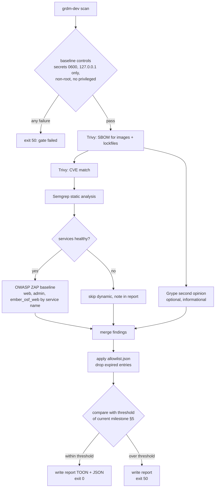
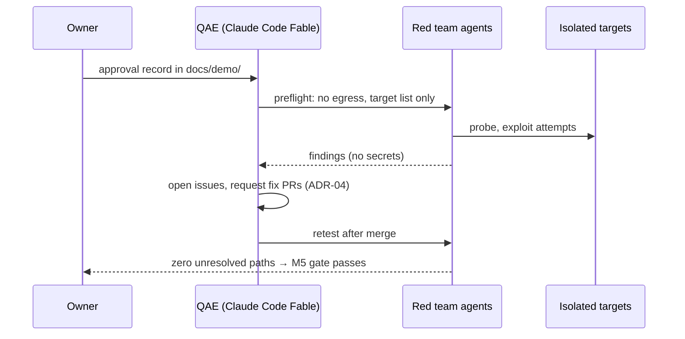
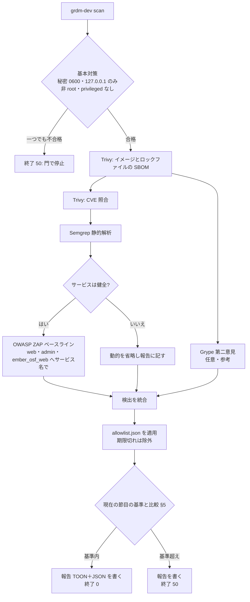
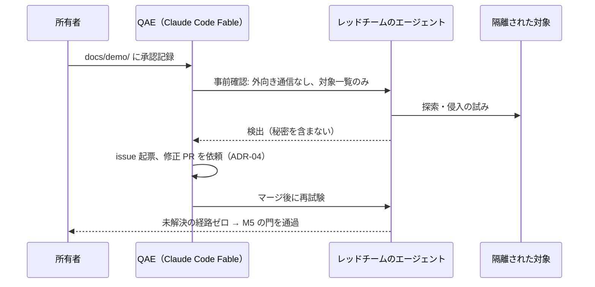

# SPEC-03 Security Gate / セキュリティの門

> **Summary:** What the development environment protects, which controls every install must have from the first milestone, how `grdm-dev scan` finds vulnerabilities, how the allow-list works, and how the gate tightens from "report" (M1) to "zero CRITICAL/HIGH plus a passing AI red team" (M5).
> **概要:** 開発環境が何を守るか、最初の節目から全導入に必須の対策、`grdm-dev scan` が脆弱性を見つける手順、許容リストの決まり、そして門が「報告のみ」（M1）から「CRITICAL/HIGH ゼロ＋AI レッドチーム合格」（M5）へ段階的に厳しくなる様子を定める。

**Jump:** [English](#english) · [日本語](#japanese)

- Version / 版: 0.15 — 2026-11-11. **Learned:** naming the image was not enough: with a wildcard component the entry accepted every package of that image for the CVE, and since fix status was not kept, a finding whose fix appears later stayed hidden. So an entry now names exact packages, and it matches only while Trivy reports no fixed version ([PR #45 review r1](../reviews/2026-11-11_RDM-developer-guide_PR45_Pin_Py313_r1.md) R1-01). ／ イメージを名指すだけでは足りなかった。部品がワイルドカードだと、その CVE についてイメージ内のすべてのパッケージを許容した。修正状態も保持していなかったので、後から修正版が出た検出も隠れたままになった。そこで項目は正確なパッケージを名指しし、Trivy が修正版なしと報告する間だけ当てはまるようにした（[PR #45 レビュー r1](../reviews/2026-11-11_RDM-developer-guide_PR45_Pin_Py313_r1.md) R1-01）。
  0.14 — 2026-11-11. **Learned:** an entry that names only a CVE and a package would also hide that CVE in every other image that carries the package, including older Debian images where a fixed version exists, so an entry for packages without a fix in one image now names that image (`image`), as the Python 3.13 WaterButler and MFR images first needed. ／ CVE とパッケージだけを書いた項目は、そのパッケージを持つ他のすべてのイメージ（修正版がある古い Debian のイメージを含む）でも同じ CVE を隠してしまう。そのため、あるイメージで修正版の無いパッケージの項目はそのイメージを名指し（`image`）するようにした。Python 3.13 の WaterButler と MFR のイメージで初めて必要になった。
  0.13 — 2026-11-10. **Learned:** a type check that runs after a blocking open never runs: a FIFO in place of a report hung the scan, so report files are opened with `O_NONBLOCK` and `O_NOFOLLOW` and their descriptor type is checked before any read or write; and the private-parent check is a snapshot, so the user's own checkout and its ancestors are a precondition, not something the scan defends ([PR #44 review r2](../reviews/2026-11-10_RDM-developer-guide_PR44_Per_OS_Installers_r2.md)). ／ 止まる open の後の型検査は実行されない。報告の代わりの FIFO でスキャンが止まったので、報告ファイルは `O_NONBLOCK` と `O_NOFOLLOW` で開き、読み書きの前に記述子の型を確かめる。また非公開の親の確認は一時点のもので、利用者自身のチェックアウトと祖先は前提条件であり、スキャンが守るものではない（[PR #44 レビュー r2](../reviews/2026-11-10_RDM-developer-guide_PR44_Per_OS_Installers_r2.md)）。
  0.12 — 2026-11-10. **Learned:** a world-writable directory is safe only while its private parent really is private, so the ZAP work directories are created only after `runtime/` is verified as a 0700 real directory owned by the user, under unpredictable names, and a report that is a symlink is refused ([PR #44 review r1](../reviews/2026-11-10_RDM-developer-guide_PR44_Per_OS_Installers_r1.md) R3). ／ 誰でも書けるディレクトリが安全なのは、非公開の親が実際に非公開である間だけである。そこで ZAP の作業ディレクトリは、`runtime/` が利用者の所有の実ディレクトリで 0700 だと確かめてから、予測できない名前で作り、シンボリックリンクの報告は拒む（[PR #44 レビュー r1](../reviews/2026-11-10_RDM-developer-guide_PR44_Per_OS_Installers_r1.md) R3）。
  0.11 — 2026-11-10. **Learned:** a hardening exception that blames an image's start command expires with that image, so building CAS from source removed it entirely, while the secure-cookie default had to be switched off explicitly and in one place because the stack is plain HTTP on loopback (ADR-07 §7). ／ イメージの起動コマンドを理由にした堅牢化の例外はそのイメージとともに期限が切れる。CAS をソースから組むとこの例外はまるごと消えた。一方、スタックはループバック上の平文 HTTP なので、Secure Cookie の既定は一か所で明示して切る必要があった（ADR-07 §7）。
  0.10 — 2026-11-10. **Learned:** a converter behind HTTP needs no shared volume and no capability, so the exception for its old image could be removed once the client was changed. ／ HTTP の背後の変換サービスは共有ボリュームも capability も要らないので、クライアントを変えた時点で旧イメージの例外を除けた。
  0.9 — 2026-11-10. **Learned:** a native rebuild removed the elasticsearch6 hardening entry as well as its Log4Shell findings, while a scan count alone would have approved a unoconv image that MFR's client cannot use, so an image change is accepted only with its client's real path proven (ADR-07 §5). ／ ネイティブの組み直しで elasticsearch6 の堅牢化の項目も Log4Shell の検出も消えた。一方、検出数だけなら MFR のクライアントが使えない unoconv イメージを通していたので、イメージの変更はクライアントの実経路を証明して初めて受け入れる（ADR-07 §5）。
  0.8 — 2026-11-10. **Learned:** per-volume init containers multiplied hardening exceptions and still missed redis and the other uid-1000 volumes, so one generic owner step, derived from each volume's writers, replaces them (cross-OS audit, 2026-11-10). ／ ボリュームごとの init コンテナは堅牢化の例外を増やすだけで redis や他の uid 1000 のボリュームを取りこぼしていた。各ボリュームの書き手から導く一つの汎用の所有者設定の段に置き換えると分かった（OS 横断の監査、2026-11-10）。
- Version / 版: 0.7 — 2026-11-06. **Learned:** a scanner that did not finish a rule has proved nothing about that file; at the reporting milestones that is a recorded coverage gap, at the strict milestones it keeps the run incomplete (PR #33 review r2 R2-02). ／ ルールを終えなかったスキャナーはそのファイルについて何も証明していない。報告の節目では記録された網羅性の穴、厳格な節目では実行を不完全のままにする（PR #33 レビュー r2 R2-02）。
  0.6 — 2026-11-06. **Learned:** "every service is non-root" was true of the generated default but not of the recorded exceptions, so the specification now states the bounded exception policy itself (controls, reason, review date, milestone, reporting) and keeps it apart from the CVE allow-list (PR #33 review r1 R1-03). ／ 「全サービスが非 root」は生成の既定には当てはまるが記録した例外には当てはまらなかった。仕様自体に限定された例外の方針（統制・理由・見直し日・節目・報告）を書き、CVE の許容リストと区別した（PR #33 レビュー r1 R1-03）。
  0.5 — 2026-11-06. **Learned:** a source scan must not phone remote package registries (Maven Central rate-limits and blocks), and the scan targets must follow the build decisions (no stale checkout of a prebuilt component, no assembled overlay copy) — real install run 17. ／ ソースの検査は遠隔のパッケージ登録所に問い合わせてはならない（Maven Central は速度制限し遮断する）。検査対象はビルドの決定に従う（prebuilt 部品の古い checkout や組み立てたオーバーレイの写しは対象外）。実機第 17 回。
  0.4 — 2026-11-06. **Learned:** a glossary term is only explained for the reader when its note and REF-01 link sit at the first prose use, counting lower-case and plural forms, so first-use notes with links were added in both halves (SPEC-06 §3). ／ 用語注と REF-01 へのリンクは、小文字や複数形も含めた本文の初出に置かなければ読者に届かないと分かったため、英和両方の初出にリンク付きの用語注を補った（SPEC-06 §3）。
- Version / 版: 0.3 — 2026-11-05. **Learned:** the first rendered configuration showed that a single internal network cannot publish ports, so the baseline needs two networks (`grdm` internal, `grdm-edge` for publishing) and an explicit, recorded egress choice; the red-team preflight must prove isolation with a reachable canary rather than infer it from a failed lookup (review r1 of PR #21). ／ 最初に描画した構成で、内部ネットワーク一つではポートを公開できないと分かった。基本対策は二つのネットワーク（内部の `grdm` と公開用の `grdm-edge`）と、記録された明示的な egress の選択を要する。レッドチームの事前確認は、失敗した名前解決から推測せず、到達できるカナリアで隔離を証明する（PR #21 レビュー r1）。
  0.2 — 2026-11-05. **Learned:** a scanner that runs inside a container must address its targets by Compose service name, because loopback inside that container is the scanner itself; and a promised scanner must say what it scans at each milestone. ／ コンテナの中で動くスキャナーは相手を Compose のサービス名で指さなければならない。そのコンテナの中のループバックはスキャナー自身だからだ。また約束したスキャナーは節目ごとに何を検査するかを明記する必要があると分かった。
- Version / 版: 0.1 — 2026-11-05. **Learned:** the gate must be written as a schedule, not a single threshold, because every current base image is end-of-life and a zero gate on day one would stop the first install before anything could be measured. ／ 現行のベースイメージがすべてサポート終了のため、門を一つの基準値でなく「節目ごとの予定表」として書かないと、初日の導入が何も測れないまま止まると分かった。
- Normative for: `installer/grdm_dev/` (`scan`, `redteam preflight`, `health --network`, `secrets`), `manifest/allowlist.json`, `manifest/allowlist.baseline.json`, `manifest/milestone.json`, `manifest/hardening.json`, `manifest/redteam-targets.json`, `.github/workflows/security.yml`, every `docker-compose` file generated by `grdm-dev`, and every AI red-team run.
- Related: [SPEC-00 Overview](00_overview.md) · [SPEC-02 Installer CLI](02_installer_cli.md) · [SPEC-04 Acceptance Tests](04_acceptance_tests.md) · [SPEC-05 Upstream Tracking](05_upstream_tracking.md) · [SPEC-06 Documentation Conventions](06_documentation_conventions.md) · [POL-01 Position](../policy/POL-01_Developer_Environment_2027_Position.md) · [ADR-02 Network Model](../decisions/ADR-02_Network_Model.md) · [ADR-03 Staged Security Gate](../decisions/ADR-03_Staged_Security_Gate.md) · [ADR-04 AI Autonomy and Roles](../decisions/ADR-04_AI_Autonomy_and_Roles.md) · [docs/README.md](../README.md)

---

<a id="english"></a>
## English

[→ 日本語版へ](#japanese)

### 1. Scope

This specification defines the *security gate* (a checkpoint that an install must pass before it is called good) of the GRDM developer environment 2027. It covers what we protect, the baseline controls that apply from milestone M1, the scanners, the allow-list (the short list of known problems we have looked at and accept for now; see [REF-01](../reference/REF-01_Glossary.md)), the staged thresholds up to M5, the AI red team, the evidence format, and the exit codes. The decision to stage the gate instead of enforcing zero from the start is recorded in [ADR-03](../decisions/ADR-03_Staged_Security_Gate.md). Who may fix, review, and merge is recorded in [ADR-04](../decisions/ADR-04_AI_Autonomy_and_Roles.md).

**Glossary notes.** A *vulnerability* is a known weak spot in a program that someone could use to break in. A *CVE* (Common Vulnerabilities and Exposures) is the public ID number given to one vulnerability, like `CVE-2026-12345`. *Severity* is how bad it is: CRITICAL, HIGH, MEDIUM, LOW. A *milestone* (M1 to M5) is one of the five planned stages of this project, defined in [POL-01](../policy/POL-01_Developer_Environment_2027_Position.md).

### 2. Threat model

A *threat model* is a short list of what we are protecting and who we imagine is trying to harm it. It keeps the controls honest: every control in §3 must answer at least one line of this table.

What we protect:

| Asset | Why it matters |
|---|---|
| The developer's machine | It holds the developer's own files, browser sessions, and SSH keys. A container that escapes could reach them. |
| Credentials | Database passwords, session keys, OAuth client secrets, and the GitHub token that mirrors upstream repositories. |
| `-private` code | The security-hardened variants of the six core repositories are private to RCOSDP. They must never leave the private `-dev2027` repositories or appear in this public repository. |
| The integrity of the gate itself | If an attacker can edit a scan report or the allow-list, every other control is meaningless. |

Attackers we consider:

| Attacker | What they can do | Main controls |
|---|---|---|
| Anyone on the same LAN (office Wi-Fi, home router) | Open a port that the developer left published; guess a default password. | §3.2 publish only on `127.0.0.1`; §3.1 random secrets. |
| A malicious dependency (a library that `pip` or `npm` downloads) | Run code at build or start time; read environment variables; call home. | §3.4 pinned digests; §4 SBOM + CVE scan; §4.4 dependency bots; §3.2 internal network. |
| A compromised container (one service already broken into) | Reach other services; write to the host; use host resources. | §3.3 non-root, read-only root, no privileged, resource limits; §3.2 internal network. |
| An adversarial top-tier AI agent probing the running system | Chain small weaknesses fast; try every public exploit for every CVE in the SBOM; brute-force weak defaults. | §5 staged gate to zero CRITICAL/HIGH; §6 AI red team that uses the same capability on our side first. |

Out of scope: attacks on the developer's operating system itself, phishing of the developer, and the production GRDM service. Those belong to the operating institution, not to the developer environment.

### 3. Baseline controls (apply from M1, every install)

These controls are not negotiable and have no allow-list. `grdm-dev health --network` and `grdm-dev scan --baseline` verify them; failure of any one is exit code 50 even at M1.

#### 3.1 Secrets

- Every secret (a password or key that only the system should know) is generated at install time by `grdm-dev secrets init` from the operating system's random source.
- Secrets are written to `runtime/.env` ([SPEC-02 §3](02_installer_cli.md#english)) with file mode `0600` (only the owner can read and write). `runtime/` is listed in `.gitignore`; the secret scanner in §3.5 confirms the file never enters a commit.
- No default passwords. Upstream (the original repositories our copies come from; see [REF-01](../reference/REF-01_Glossary.md)) `docker-compose.yml` files ship with values such as `postgres`/`postgres` and `changeme`; the installer replaces every one of them and fails if one is still present.
- Reports and logs never print a secret. `grdm-dev report` masks any value that matches a key in `runtime/.env` before writing.

#### 3.2 Network

- Services talk to each other only on the Compose network `grdm`, which is declared `internal: true` (a private virtual network inside Docker with no route to the host's interfaces, the LAN, or the Internet), so a compromised container (a box that holds one program and everything it needs, so it runs the same anywhere; see [REF-01](../reference/REF-01_Glossary.md)) cannot call home from it. See [ADR-02](../decisions/ADR-02_Network_Model.md).
- Docker cannot publish a port from an internal network, so the services a browser must reach (`web`, `api`, `admin`, `wb`, `mfr`, `fakecas`, `ember_osf_web`) are additionally attached to a second, ordinary bridge network `grdm-edge`. Ports are published from it on `127.0.0.1` only; no other service joins it by default.
- Egress (outbound traffic to the Internet) is therefore not available to the remaining services. A developer who needs it, for example to reach an external storage provider while developing an add-on, attaches named services with `grdm-dev compose render --egress <service>[,<service>...]`. The choice is recorded in `runtime/.env` as `GRDM_EGRESS_SERVICES`, shown in the compose and install reports, and read by `grdm-dev scan --baseline`; `--egress none` clears it. Egress granted this way is a recorded developer choice, not a baseline violation; an undeclared service on `grdm-edge` is a violation (`BASE-NETWORK`), and a grant that names a service which is not actually attached is also a finding (`BASE-EGRESS-STALE`): the record and the running configuration must agree.
- `grdm-dev health --network` enumerates the project's own bindings (`docker compose ps`, `docker inspect`) and the host's listening sockets and fails if any address is not `127.0.0.1`, including a listener on a project port whose owning process is not visible.
- Ports that a browser needs are published only on `127.0.0.1`; the list of default ports (`5000` web, `8000` api, `8001` admin, `7777` wb, `7778` mfr, `8080` fakecas, `4200` ember) is the ports table in [SPEC-02 §4](02_installer_cli.md#2-en-ports). Nothing is published on `0.0.0.0` or on a LAN address. The old loopback alias `192.168.168.167` is gone.
- `grdm-dev health --network` lists every listening socket of the Compose project and fails if any address is not `127.0.0.1`.

#### 3.3 Container hardening

- Every service runs as a non-root user. Where an upstream image (the recipe and ingredients a container is made from; see [REF-01](../reference/REF-01_Glossary.md)) runs as root, the generated Compose sets `user:` to a fixed UID/GID and the installer creates writable volumes for the few paths that need it.
- **Bounded hardening exceptions.** A service may deviate from the non-root, read-only or `cap_drop: ALL` baseline only through an entry in `manifest/hardening.json` that names the relaxed controls (`user`, `read_only`, `cap_add` with the exact capabilities), the reason tied to the upstream image, a review date and the modernization milestone that removes it. `compose render` applies nothing that is not recorded there; `scan --baseline` reports every applied entry under `baseline_exceptions` and fails on a root user, a writable root or an added capability that has no entry, on an entry past its review date, and on `privileged` or a disabled `no-new-privileges` in any case. These entries are distinct from the CVE allow-list (§5): they describe how an EOL image must be started, not a vulnerability that is tolerated. Their count is reported at every milestone exit and may not grow after M3; M4 removes those tied to Python 3.5/3.6 and JDK 8 images, M5 the rest (PR #33 review r1 R1-03). Current entries: postgres, mongo, rabbitmq, shibboleth_sp, test_idp and the one generic one-shot owner step volume_owner_init (the elasticsearch, elasticsearch6 and cas services lost their entries when they became native images, ADR-07).
- Root filesystem is read-only (`read_only: true`) where the service tolerates it; writable paths are explicit `tmpfs` or named volumes. Exceptions are listed per service in `manifest/hardening.json` with a reason.
- `privileged: true` is forbidden. `cap_drop: [ALL]` is the default; a service that needs a capability adds it back by name with a reason.
- Every service has `mem_limit`, `cpus`, and `pids_limit`. `grdm-dev compose render` ([SPEC-02 §3](02_installer_cli.md#english)) writes them, scaled from the memory that `doctor` detected.

#### 3.4 Supply chain

- Images are pulled by *digest* (the exact fingerprint of one image version, `sha256:...`), never by a floating tag such as `latest`. The digest of each base image is the `base_image_digest` field of `manifest/upstreams.json`, next to the Git SHAs ([SPEC-01 §3](01_manifest.md#english)); it is `null` until the image is pinned, at the latest at M2.
- Locally built images record the base-image digest in a label so that `grdm-dev scan` can tell which base they came from.

#### 3.5 Secret scanning in CI

Because this repository is public, every pull request and every push to `develop` runs a secret scanner in CI (continuous integration: automatic checks on every change; see [REF-01](../reference/REF-01_Glossary.md)) (`gitleaks` or an equivalent that detects private keys, tokens, and passwords in the diff and in history). One finding fails the workflow. The same scanner runs locally in `grdm-dev scan --secrets`. False positives are suppressed by a rule in `.gitleaks.toml` with a reason, never by deleting the finding from the report.

### 4. Scanning

`grdm-dev scan` runs four kinds of scanners and writes one combined report. A scanner runs either inside the Compose project, where it reaches services by their Compose service names (ZAP, §4.3), or on the host, where it looks at the `127.0.0.1` ports (the network baseline check, §3.2); none sends data to an outside service except to download its vulnerability database.

#### 4.1 SBOM and CVE: Trivy (required), Grype (optional second opinion)

- An *SBOM* (software bill of materials: the complete list of every library inside an image or project) is generated by Trivy for every image in the Compose project and for every lockfile (`requirements*.txt`, `poetry.lock`, `package-lock.json`, `yarn.lock`, `build.gradle`) in the integration repositories. Source scans run with `--offline-scan` (no remote Maven lookups: Maven Central answered 429 and blocked the host in real install run 17); the assembled overlay context under `runtime/src/_overlay/` and the stale checkout of a component that now uses `prebuilt_image` are skipped with a note, and the repository scan excludes `runtime/`, `.venv/` and `site/`.
- Trivy then matches the SBOM against its CVE database. Output is JSON (canonical) plus a TOON (a compact text form of JSON; see [REF-01](../reference/REF-01_Glossary.md)) excerpt in the report.
- Grype may run on the same SBOM as a second opinion. Grype findings are informational and never change the gate result unless the owner promotes one to the allow-list process.
- **M1 scope.** At M1 no image exists yet (`grdm-dev build` arrives with M2), so the Trivy job in `security.yml` scans the repository file system only, in report-only mode: it writes its findings to the job log and never fails the PR (pull request: a proposed change waiting for someone to review and accept it; see [REF-01](../reference/REF-01_Glossary.md)). Image and lockfile scanning of the integration repositories starts with the first build.

#### 4.2 Static analysis: Semgrep and CodeQL

*Static analysis* reads source code without running it and flags dangerous patterns (for example, building an SQL query from user text). Semgrep (a tool that reads source code looking for dangerous patterns; see [REF-01](../reference/REF-01_Glossary.md)) runs locally and in CI on every PR with the `p/default`, `p/python`, `p/javascript`, and `p/docker-compose` rule packs. CodeQL runs in the private `-dev2027` repositories on `develop` nightly. Findings of severity ERROR count as HIGH in the gate; WARNING counts as MEDIUM. Semgrep runs with a 30-second per-rule-per-file timeout (three timeouts drop a file). A rule timeout is a *coverage gap*: at M1–M3 (report-only, count-not-growing) `scan` records it as a warning on the tool row and still judges the findings it has; at M4 and M5 (fail-high, zero) a rule that never finished cannot establish a clean result, so the run is incomplete (exit 51) until the scan is repeated on an idle host or with a longer `--timeout` (real install run 20, PR #33 review r2).

#### 4.3 Dynamic scan: OWASP ZAP baseline

A *dynamic scan* pokes the running web application like a browser would. `grdm-dev scan --dynamic` starts OWASP ZAP (a tool that pokes at a running website the way an attacker would; see [REF-01](../reference/REF-01_Glossary.md)) in a container attached to the Compose internal network ([ADR-02 §3](../decisions/ADR-02_Network_Model.md#english)) and runs the baseline scan against the Compose service names and container ports: `http://web:5000` (web), `http://admin:8001` (admin), and `http://ember_osf_web:4200` (ember). It never targets `127.0.0.1`: inside the ZAP container, loopback is ZAP itself, not a service and not the host. The container ports are the ports the services listen on inside the network; their numbers equal the default host ports in the ports table of [SPEC-02 §4](02_installer_cli.md#2-en-ports), but that table defines *host* ports, which browsers, acceptance tests, and `grdm-dev health --network` use. When `compose render` remaps a host port on collision and records it as `GRDM_PORT_<SERVICE>` in `runtime/.env` ([SPEC-02 §4](02_installer_cli.md#2-en-ports)), host-side checks read the new number from there and the ZAP targets do not change. ZAP risk High maps to HIGH, Medium to MEDIUM. The scan runs only after `grdm-dev health` reports all services healthy: a full `grdm-dev scan` skips the dynamic part and notes it in the report, while an explicit `scan --dynamic` exits 52. ZAP runs as its own uid, so each target gets a work directory writable by every uid, created exclusively under an unpredictable name below `runtime/reports/` and removed after the report is copied. This is allowed only while `runtime/` is a real directory owned by the user with mode 0700 and `reports/` is a real directory owned by the user; otherwise ZAP is not run and the dynamic part is incomplete (exit 51). A report that is not a regular file, such as a symlink or a FIFO, is refused: report files are opened with `O_NOFOLLOW` and `O_NONBLOCK`, and the descriptor's type is checked before anything is read or written. The checks are taken once before the run; they assume that the user's checkout and its ancestors are not changed by someone else meanwhile, and they do not make the scan race-proof against the owner.

#### 4.4 Dependency update bots

The private `-dev2027` repositories enable Dependabot (or Renovate) for Python, npm, Gradle, and Docker base images, grouped weekly. The bot opens a PR; the PR enters the normal flow of [ADR-04](../decisions/ADR-04_AI_Autonomy_and_Roles.md): AID (AI開発担当者) adapts the code if needed, REV (担当レビュワ) reviews, QAE (QA担当) runs regression, the owner merges.

#### 4.5 Flow of `grdm-dev scan`



### 5. Allow-list and staged gate

#### 5.1 Allow-list

The *allow-list* is the written list of findings we know about, have judged, and accept for a limited time. Canonical file: `manifest/allowlist.json`. The TOON excerpt in `docs/status/` is regenerated by `grdm-dev scan` and checked by `grdm-dev manifest check` (see [SPEC-06 §4](06_documentation_conventions.md)).

Rules:

1. Every entry has all six fields: `cve`, `component`, `reason`, `owner`, `expires`, `added_at`. An entry with a missing field is invalid and the scan fails with exit 50. `component` names an exact package, `name` or `name@version`; a wildcard (`*`) or an empty value is invalid. Optional fields: `severity`; `image`, an image name without tag (for example `grdm-dev/waterbutler`); and `packages`, a list of exact `name@version` strings, required with `image` (then `component` is the first of them). An empty `image` or `packages` is invalid like a missing field. An entry matches a finding only when all of these hold:
   - the same id (CVE);
   - for a Trivy vulnerability, Trivy reports no fixed version: `FixedVersion` is empty and `Status` is `affected`, `will_not_fix`, `fix_deferred` or `end_of_life`. A finding whose fix appears later, or whose status is unknown, counts again without any edit to the entry;
   - with `image`: the finding is an OS package (Trivy class `os-pkgs`) of exactly that image (target `<image>:<tag> (<os>)` or `<image>@<digest>`), never a language package and never a sibling image name, so a package without a fixed version in one image does not hide the same CVE in another image;
   - the package name equals one the entry names (`packages`, else `component`) as a whole, never as a prefix, and a version in the entry equals the installed version.
2. `reason` says why the finding is not exploitable here or why it cannot be fixed yet (for example "code path not reachable in dev profile", "fix requires Python 3.13 port scheduled for M4").
3. `owner` is a person or a role from the [role table](../decisions/ADR-04_AI_Autonomy_and_Roles.md), never "team".
4. `expires` is a date no later than the start of the next milestone. On expiry the entry is ignored and the finding counts again.
5. **The number of entries must never increase from one milestone to the next.** `grdm-dev scan` compares the count with `manifest/allowlist.baseline.json`, which the owner updates at each milestone exit, and fails if the count went up.
6. Only the owner approves additions. AID may propose an entry in a PR; REV and QAE check it; the owner merges.

```toon
allowlist:
  milestone: M2
  baseline_count: 3
  entries[3]{cve,component,severity,reason,owner,expires,added_at}:
    CVE-2021-3177,python:3.6-base,HIGH,"EOL interpreter; removed by Python 3.13 port in M4",AID,2027-03-31,2026-11-20
    CVE-2022-24785,moment@2.24,HIGH,"ember dev build only; not served to browser in dev profile",AID,2027-01-31,2026-11-20
    CVE-2020-8265,node:12-base,CRITICAL,"EOL runtime; replaced by node 20 image in M4",AID,2027-03-31,2026-11-20
```

> **Note:** the TOON block above is an example of the shape. The real content lives in `manifest/allowlist.json` and is regenerated into `docs/status/` by `grdm-dev scan`.

#### 5.2 Staged gate

| Milestone | Gate rule | What happens when a finding is over the rule |
|---|---|---|
| M1 | Baseline controls (§3) must pass. CVE findings are **reported**; allow-list is created. | Install continues. Report shows the count. |
| M2 | Baseline must pass. Allow-list count ≤ M1 count. | Install continues. Scan exits 50 only if the count grew or a baseline control failed. |
| M3 | Baseline must pass. Allow-list count ≤ M2 count. | Same as M2. |
| M4 | **Fail on any HIGH or CRITICAL** not in the allow-list. First AI red team run (§6) must be completed and every found path fixed or allow-listed. | `grdm-dev install` stops before starting services; exit 50. |
| M5 | **Fail on any CRITICAL or HIGH, allow-list for CRITICAL/HIGH must be empty.** AI red team must report **zero unresolved intrusion paths.** | Exit 50; the environment is not distributable until fixed. |
| Steady state | Same as M5. Daily scan; a new HIGH opens a fix PR automatically (ADR-04). | Exit 50 in CI; owner is notified. |

The current milestone is read from `manifest/milestone.json`; only the owner changes it.

### 6. AI red team

An *AI red team* is a group of AI agents that is told to attack our own test system, in a sealed box, so that we find our weaknesses before a real attacker does. It is defensive, authorized testing of our own isolated environment only.

Rules, all mandatory:

1. **Isolation.** The red team runs inside a dedicated Compose project on a Docker network with `internal: true` and no egress (no route to the internet or the LAN). `manifest/redteam-targets.json` names the project, the network, the attacker container (`attacker`) and the targets. `grdm-dev redteam preflight` proves isolation instead of inferring it: it starts a canary container on a separate ordinary network, checks that the canary is reachable from its own network (otherwise the probe is inconclusive and the preflight fails), then, inside the attacker container, first self-tests the probe tool against a listener it starts itself (an open port must connect and a closed port must be refused, otherwise the tool is unreliable and the result is inconclusive) and only then checks that neither the canary nor an external address is reachable; a connection error counts as blocked, any other tool error counts as inconclusive, and inconclusive fails the preflight. The attacker must be attached to exactly one network. The approval record (`docs/demo/<date>_redteam_<run>.md`) must carry a header with `approved_by`, `approved_on` (an ISO date, not in the future and at most 30 days old), `scope` (the target container names) and `run_id`; a missing or stale record, or a target outside the scope, fails the preflight. `grdm-dev redteam preflight` verifies that no external address is reachable from the attacker container before any test starts.
2. **Target list.** The targets are exactly our own containers in that isolated project, listed by name in `manifest/redteam-targets.json`. Nothing else is ever a target: not the developer's machine, not other containers, not any address outside the project.
3. **Approval record.** Before each run, a record is written to `docs/demo/` as `nn_redteam_<date>.md` with: who approved (owner), when, scope (target list and commit SHAs), the model and runner used, and the stop conditions. No record, no run.
4. **Findings to fixes.** Every intrusion path found becomes an issue, then a fix PR through the normal flow (AID fix → REV review → QAE regression → owner merge), then a retest with the same scenario. A path is "resolved" only when the retest fails to reproduce it.
5. **Never outside.** Techniques learned here are for finding our own weaknesses. Running them against any system outside the isolated project, including production GRDM or upstream services, is forbidden.
6. **No secrets in findings.** Findings quote the weakness, not the harvested secret. If a secret was captured, the finding says "credential obtained" and the secret is rotated by `grdm-dev secrets rotate`.



### 7. Evidence format

Every scan writes `runtime/reports/scan_<date>.json` (canonical, [SPEC-02 §3](02_installer_cli.md#english)) and the TOON excerpt below into `docs/status/security_<milestone>.md`. The report **must not contain any secret** (§3.1). Fields:

```toon
scan:
  date: 2026-11-20T09:12:00Z
  milestone: M2
  commit: 1a2b3c4d
  host: macos-arm64
  baseline: pass
  tools[4]{name,version,result}:
    trivy,0.68.0,ok
    grype,0.98.0,ok
    semgrep,1.140.0,ok
    zap,2.17.0,ok
  findings_total: 212
  findings_by_severity{critical,high,medium,low}: 9,48,120,35
  allowlisted: 3
  allowlist_baseline: 3
  over_threshold: 0
  gate: pass
  exit_code: 0
```

### 8. Exit codes

Exit codes are defined in [SPEC-02 §6](02_installer_cli.md#english); this table explains the ones `scan` and `redteam preflight` return:

| Code | Meaning |
|---|---|
| 0 | Gate passed (or, at M1–M3, report written and count did not grow). |
| 50 | **Gate failed**: baseline control violated, allow-list invalid or grew, finding over the milestone threshold, or red team unresolved at M5. |
| 51 | Scanner could not run (tool missing, database download failed). Not a pass. |
| 52 | `scan --dynamic` was requested while services were not healthy. The static part of the report is still written. A full `scan` does not return 52; it skips the dynamic part and notes it. |
| 53 | `redteam preflight` failed: an external address was reachable from the attacker container, or a target outside `manifest/redteam-targets.json` was reachable. No red-team run starts. |

### 9. Checks

- `python3 -m unittest discover -s installer/tests` covers: secret file mode, default-password detection, listening-address check, allow-list field validation, count comparison, severity mapping, and secret masking in reports.
- CI workflow `security.yml` runs gitleaks, Semgrep, and Trivy on every PR; at M1 Trivy is report-only over the repository file system because no image exists yet (§4.1). The arm64 (one of the two kinds of computer chip we support, the one in recent Macs; see [REF-01](../reference/REF-01_Glossary.md)) self-hosted runner runs the full `grdm-dev scan` nightly on `develop` once the installer exists (M2).

---

<a id="japanese"></a>
## 日本語

[→ To English](#english)

### 1. 範囲

この仕様は、GRDM 開発環境 2027 版の「セキュリティの門」（導入が合格と呼ばれる前に必ず通る検問所）を定めます。守るもの、節目 M1 から適用する基本対策、スキャナー、許容リスト（見た上で今は受け入れる、既知の問題の短い一覧。[REF-01](../reference/REF-01_Glossary.md)）、M5 までの段階的な基準、AI レッドチーム、証跡の形式、終了コードを扱います。最初からゼロを求めず段階化する決定は [ADR-03](../decisions/ADR-03_Staged_Security_Gate.md) に、誰が修正・レビュー・マージするかは [ADR-04](../decisions/ADR-04_AI_Autonomy_and_Roles.md) にあります。

**用語注。** 「脆弱性」は、プログラムの中の、誰かが侵入に使えると分かっている弱い所です。「CVE」（Common Vulnerabilities and Exposures）は、一つの脆弱性に付く公開の番号で、`CVE-2026-12345` のように書きます。「深刻度」はどれほど危ないかで、CRITICAL・HIGH・MEDIUM・LOW の四段階です。「節目」（M1〜M5）は計画の五つの段階で、[POL-01](../policy/POL-01_Developer_Environment_2027_Position.md) に定義があります。

### 2. 脅威モデル

「脅威モデル」は、何を守るか、誰が壊そうとすると想定するかを短く書いた一覧です。§3 の各対策は、この表のどれか一行に必ず答えます。

守るもの:

| 資産 | 大事な理由 |
|---|---|
| 開発者のパソコン | 開発者自身のファイル、ブラウザのログイン、SSH の鍵がある。コンテナから抜け出されると届く。 |
| 資格情報 | データベースのパスワード、セッション鍵、OAuth のクライアント秘密、上流リポジトリをミラーする GitHub トークン。 |
| `-private` のコード | コア 6 本のセキュリティ検証版は RCOSDP 内限定。非公開の `-dev2027` から出さず、この公開リポジトリにも置かない。 |
| 門そのものの正しさ | 攻撃者がスキャン報告や許容リストを書き換えられるなら、ほかの対策は意味を失う。 |

想定する攻撃者:

| 攻撃者 | できること | 主な対策 |
|---|---|---|
| 同じ LAN（職場の Wi-Fi、家のルーター）にいる誰か | 開発者が公開したままのポートを開く。既定のパスワードを当てる。 | §3.2 `127.0.0.1` のみ公開、§3.1 乱数の秘密 |
| 悪意ある依存ライブラリ（`pip` や `npm` が取ってくる部品） | ビルド時や起動時にコードを動かす。環境変数を読む。外へ通信する。 | §3.4 ダイジェスト固定、§4 SBOM＋CVE、§4.4 更新ボット、§3.2 内部ネットワーク |
| 乗っ取られたコンテナ（すでに侵入された一つのサービス） | ほかのサービスへ届く。ホストに書く。ホストの資源を使う。 | §3.3 非 root・読み取り専用・privileged 禁止・資源制限、§3.2 内部ネットワーク |
| 稼働中のシステムを探る、最上位の敵対的 AI エージェント | 小さな弱点を素早くつなげる。SBOM の全 CVE に公開の攻撃コードを試す。弱い既定値を総当たりする。 | §5 段階的な門で CRITICAL/HIGH ゼロへ、§6 同じ能力を先に味方として使う AI レッドチーム |

範囲外: 開発者の OS 自体への攻撃、開発者をだます手口、本番 GRDM サービス。これらは運用機関の責任で、開発環境の責任ではありません。

### 3. 基本対策（M1 から全導入に適用）

次の対策は交渉の余地がなく、許容リストもありません。`grdm-dev health --network` と `grdm-dev scan --baseline` が確認し、一つでも外れると M1 でも終了コード 50 です。

#### 3.1 秘密

- すべての秘密（システムだけが知っていてよいパスワードや鍵）は、導入時に `grdm-dev secrets init` が OS の乱数源から生成する。
- 秘密は `runtime/.env`（[SPEC-02 §3](02_installer_cli.md#japanese)）に、ファイルモード `0600`（所有者だけが読み書きできる）で書く。`runtime/` は `.gitignore` に載せ、§3.5 の秘密スキャンがこのファイルがコミットに入らないことを確かめる。
- 既定のパスワードを使わない。上流（写しの元のリポジトリ。[REF-01](../reference/REF-01_Glossary.md)）の `docker-compose.yml` には `postgres`/`postgres` や `changeme` のような値が残っているが、インストーラーがすべて置き換え、残っていれば失敗する。
- 報告とログに秘密を書かない。`grdm-dev report` は書き出す前に `runtime/.env` の値と一致する文字列を伏せ字にする。

#### 3.2 ネットワーク

- サービス同士は Compose ネットワーク `grdm` だけで通信する。`grdm` は `internal: true` で宣言し（Docker の中だけにある私設の仮想ネットワークで、ホストのインターフェース・LAN・インターネットへの経路を持たない）、侵入されたコンテナ（一つのプログラムと必要なものを一箱に入れ、どこでも同じように動かす箱。[REF-01](../reference/REF-01_Glossary.md)）もここからは外へ通信できない。詳しくは [ADR-02](../decisions/ADR-02_Network_Model.md)。
- Docker は内部ネットワークからポートを公開できないため、ブラウザが届く必要のあるサービス（`web`、`api`、`admin`、`wb`、`mfr`、`fakecas`、`ember_osf_web`）は、もう一つの通常の bridge ネットワーク `grdm-edge` にも接続する。公開はそこから `127.0.0.1` のみに行い、既定ではほかのサービスは接続しない。
- したがって、それ以外のサービスには外向き通信（egress。インターネットへ出る通信）がない。必要な開発者（例: アドオン開発で外部ストレージへ接続する）は `grdm-dev compose render --egress <service>[,<service>...]` で名指ししたサービスを `grdm-edge` に接続する。選択は `runtime/.env` の `GRDM_EGRESS_SERVICES` に記録され、compose と install の報告に表示され、`grdm-dev scan --baseline` が読む。`--egress none` で解除する。この方法で与えた egress は記録された開発者の選択であり基本対策違反ではない。宣言なしに `grdm-edge` にいるサービスは違反（`BASE-NETWORK`）であり、許可に名前があるのに実際には接続していないサービスも所見（`BASE-EGRESS-STALE`）とする。記録と動いている構成は一致していなければならない。
- `grdm-dev health --network` はプロジェクト自身の公開（`docker compose ps`、`docker inspect`）とホストの待ち受けソケットを列挙し、`127.0.0.1` 以外のアドレスが一つでもあれば失敗する。所有プロセスが見えないプロジェクトポート上の待ち受けも失敗とする。
- ブラウザが必要とするポートは `127.0.0.1` だけに公開する。既定のポートの一覧（`5000` web、`8000` api、`8001` admin、`7777` wb、`7778` mfr、`8080` fakecas、`4200` ember）は [SPEC-02 §4](02_installer_cli.md#2-ja-ports) のポート表にある。`0.0.0.0` や LAN のアドレスには公開しない。旧来のループバック別名 `192.168.168.167` は廃止。
- `grdm-dev health --network` は Compose プロジェクトの待ち受けソケットを列挙し、`127.0.0.1` 以外があれば失敗にする。

#### 3.3 コンテナの堅牢化

- 全サービスを非 root ユーザーで動かす。上流イメージ（コンテナの元になるレシピと材料。[REF-01](../reference/REF-01_Glossary.md)）が root で動く場合、生成する Compose に固定の UID/GID を `user:` で指定し、書き込みが必要な少数のパスにはインストーラーがボリュームを用意する。
- **限定された堅牢化の例外。** サービスが非 root・読み取り専用・`cap_drop: ALL` の基準から外れてよいのは、`manifest/hardening.json` の項目を通じてだけである。項目には緩める統制（`user`・`read_only`・正確な capability を挙げた `cap_add`）、上流イメージに結び付いた理由、見直し日、例外を除く近代化の節目を書く。`compose render` はそこに記録の無いものを一切適用しない。`scan --baseline` は適用した全項目を `baseline_exceptions` として報告し、項目の無い root 実行・書込可能なルート・追加 capability、見直し日を過ぎた項目、そしてどの場合でも `privileged` や `no-new-privileges` の無効化があれば不合格にする。これらの項目は CVE の許容リスト（§5）とは別物で、EOL イメージをどう起動しなければならないかを記すものであり、許容する脆弱性ではない。件数は各節目の出口で報告し、M3 以降は増やしてはならない。M4 で Python 3.5/3.6 と JDK 8 のイメージに結び付くものを、M5 で残りを取り除く（PR #33 レビュー r1 R1-03）。現在の項目: postgres・mongo・rabbitmq・shibboleth_sp・test_idp と、一回限りの汎用の所有者設定 volume_owner_init（elasticsearch・elasticsearch6・cas のサービスはネイティブイメージになり項目が消えた。ADR-07）。
- ルートファイルシステムは、サービスが耐えられる限り読み取り専用（`read_only: true`）にし、書き込み先は明示的な `tmpfs` か名前付きボリュームにする。例外はサービスごとに `manifest/hardening.json` へ理由付きで記す。
- `privileged: true` は禁止。`cap_drop: [ALL]` を既定にし、必要な権限だけを名前と理由を書いて戻す。
- 全サービスに `mem_limit`、`cpus`、`pids_limit` を付ける。`grdm-dev compose render`（[SPEC-02 §3](02_installer_cli.md#japanese)）が、`doctor` が検出したメモリに応じて値を決めて書く。

#### 3.4 サプライチェーン

- イメージは「ダイジェスト」（一つのイメージ版の正確な指紋。`sha256:...`）で取得し、`latest` のような動くタグは使わない。各ベースイメージのダイジェストは `manifest/upstreams.json` の `base_image_digest` 項目で、Git の SHA と並べて置く（[SPEC-01 §3](01_manifest.md#japanese)）。イメージを固定するまで（遅くとも M2）は `null`。
- ローカルでビルドしたイメージにはベースイメージのダイジェストをラベルに記録し、`grdm-dev scan` がどのベースから作られたか分かるようにする。

#### 3.5 CI での秘密スキャン

このリポジトリは公開のため、すべての PR（プルリクエスト。誰かが見て受け入れるのを待っている変更の提案。[REF-01](../reference/REF-01_Glossary.md)）と `develop` への push で、CI（continuous integration。変更ごとに自動で走る検査。[REF-01](../reference/REF-01_Glossary.md)）の中で秘密スキャナー（`gitleaks` か同等品。差分と履歴の中の秘密鍵・トークン・パスワードを検出する）を動かす。一件の検出でワークフローは失敗する。同じスキャナーをローカルでは `grdm-dev scan --secrets` が動かす。誤検出は `.gitleaks.toml` のルールに理由を書いて抑え、報告から消して対処しない。

### 4. スキャン

`grdm-dev scan` は四種類のスキャナーを動かし、一つの報告にまとめます。スキャナーは、Compose プロジェクトの中で Compose のサービス名で相手に届くか（ZAP。§4.3）、ホスト上で `127.0.0.1` のポートを調べるか（ネットワークの基本対策の確認。§3.2）のどちらかで動き、脆弱性データベースの取得以外で外部のサービスへデータを送りません。

#### 4.1 SBOM と CVE: Trivy（必須）、Grype（任意の第二意見）

- 「SBOM」（ソフトウェア部品表。イメージやプロジェクトの中にあるライブラリの完全な一覧）を、Compose プロジェクトの全イメージと、統合リポジトリの全ロックファイル（`requirements*.txt`、`poetry.lock`、`package-lock.json`、`yarn.lock`、`build.gradle`）について Trivy が作る。 ソースの検査は `--offline-scan` で行う（遠隔の Maven への問い合わせをしない。実機第 17 回で Maven Central が 429 を返しホストを遮断した）。`runtime/src/_overlay/` に組み立てたオーバーレイの文脈と、いまは `prebuilt_image` を使う部品の古い checkout は注記つきで飛ばし、リポジトリの検査は `runtime/`・`.venv/`・`site/` を除く。
- Trivy は SBOM を CVE データベースと照合する。出力は JSON（正本）と、報告内の TOON（JSON を短く書いた文字の形。[REF-01](../reference/REF-01_Glossary.md)）抄録。
- Grype は同じ SBOM に対し第二意見として動かしてよい。Grype の検出は参考情報で、所有者が許容リストの手続きに乗せるまで門の結果を変えない。
- **M1 の範囲。** M1 ではイメージがまだ存在しない（`grdm-dev build` は M2 から）ので、`security.yml` の Trivy ジョブはリポジトリのファイルシステムだけを報告のみの方式で検査する。検出はジョブのログに書き、PR を不合格にはしない。統合リポジトリのイメージとロックファイルの検査は最初のビルドから始める。

#### 4.2 静的解析: Semgrep と CodeQL

「静的解析」はソースコードを動かさずに読み、危ない書き方（たとえば利用者の入力文字から SQL を組み立てる）を見つけます。Semgrep（ソースコードを読んで危ない書き方を探す道具。[REF-01](../reference/REF-01_Glossary.md)）はローカルと CI で全 PR に対し `p/default`、`p/python`、`p/javascript`、`p/docker-compose` のルール集で動かします。CodeQL は非公開の `-dev2027` リポジトリの `develop` で毎晩動かします。深刻度 ERROR は門では HIGH、WARNING は MEDIUM として数えます。 Semgrep はルール・ファイルごとに 30 秒のタイムアウトで動く（3 回超えたファイルは落とす）。ルールのタイムアウトは*網羅性の穴*である。M1〜M3（報告のみ・件数非増加）では `scan` が道具の行の警告として記録し、得られた検出で判定する。M4・M5（fail-high・zero）では終わらなかったルールは「きれい」を立証できないので、空いたホストで、または長い `--timeout` で検査をやり直すまで不完全（終了 51）とする（実機第 20 回、PR #33 レビュー r2）。

#### 4.3 動的スキャン: OWASP ZAP ベースライン

「動的スキャン」は、動いている Web アプリをブラウザのように突いて調べます。`grdm-dev scan --dynamic` は Compose の内部ネットワークにつないだコンテナで OWASP ZAP（動いている Web サイトを攻撃者のやり方でつつく道具。[REF-01](../reference/REF-01_Glossary.md)）を起動し（[ADR-02 §3](../decisions/ADR-02_Network_Model.md#japanese)）、Compose のサービス名とコンテナ側ポート、すなわち `http://web:5000`（web）、`http://admin:8001`（admin）、`http://ember_osf_web:4200`（ember）に対してベースラインスキャンを行います。`127.0.0.1` を対象にすることはありません。ZAP のコンテナの中では、ループバックはサービスでもホストでもなく ZAP 自身だからです。コンテナ側ポートはサービスがネットワークの中で待ち受けるポートで、番号は [SPEC-02 §4](02_installer_cli.md#2-ja-ports) のポート表の既定のホスト側ポートと同じですが、その表が定めるのは「ホスト側」のポートで、ブラウザ・受入試験・`grdm-dev health --network` が使います。`compose render` が衝突でホスト側ポートを付け替えて `runtime/.env` に `GRDM_PORT_<SERVICE>` として記録したとき（[SPEC-02 §4](02_installer_cli.md#2-ja-ports)）、ホスト側の確認はそこから新しい番号を読み、ZAP の対象は変わりません。ZAP のリスク High は HIGH、Medium は MEDIUM に対応させます。`grdm-dev health` が全サービス健全と報告した後にだけ動かします。`grdm-dev scan` 全体では動的部分を省略して報告に記し、`scan --dynamic` を明示したときは終了 52 で終わります。ZAP は自分の uid で動くので、対象ごとに誰でも書ける作業ディレクトリを、`runtime/reports/` の下に予測できない名前で排他的に作り、報告を写した後に消します。これを許すのは、`runtime/` が利用者の所有の実ディレクトリでモード 0700、`reports/` が利用者の所有の実ディレクトリである間だけです。そうでなければ ZAP を動かさず、動的部分は不完全（終了 51）とします。通常のファイルでない報告（シンボリックリンクや FIFO など）は拒みます。報告ファイルは `O_NOFOLLOW` と `O_NONBLOCK` で開き、読み書きの前に記述子の型を確かめます。確認は実行前の一度だけで、その間に利用者のチェックアウトと祖先を他人が変えないことを前提とし、所有者自身の変更に対して競合に強いとは主張しません。

#### 4.4 依存更新ボット

非公開の `-dev2027` リポジトリでは Dependabot（または Renovate）を Python・npm・Gradle・Docker ベースイメージに対して有効にし、週ごとにまとめます。ボットが PR を開き、その PR は [ADR-04](../decisions/ADR-04_AI_Autonomy_and_Roles.md) の通常の流れに入ります。必要なら AID（AI開発担当者）がコードを合わせ、REV（担当レビュワ）がレビューし、QAE（QA担当）が回帰を実行し、所有者がマージします。

#### 4.5 `grdm-dev scan` の流れ



### 5. 許容リストと段階的な門

#### 5.1 許容リスト

「許容リスト」は、知っていて、判断済みで、期限付きで受け入れる検出を書いた一覧です。正本は `manifest/allowlist.json`。`docs/status/` の TOON 抄録は `grdm-dev scan` が再生成し、`grdm-dev manifest check` が一致を確かめます（[SPEC-06 §4](06_documentation_conventions.md)）。

決まり:

1. 各項目は六つの欄をすべて持つ: `cve`、`component`、`reason`、`owner`、`expires`、`added_at`。欄が欠けた項目は無効で、スキャンは終了コード 50 で失敗する。`component` は正確なパッケージ（`name` または `name@version`）を名指す。ワイルドカード（`*`）や空の値は無効。任意の欄は三つある: `severity`、タグを除いたイメージ名の `image`（例: `grdm-dev/waterbutler`）、正確な `name@version` の一覧の `packages`。`image` を持つ項目には `packages` が必須で、`component` はその先頭とする。空の `image` や `packages` は欄の欠けと同じく無効。項目が検出に当てはまるのは、次のすべてを満たすときだけ:
   - 同じ ID（CVE）であること。
   - Trivy の脆弱性の場合、Trivy が修正版なしと報告していること。つまり `FixedVersion` が空で、`Status` が `affected`・`will_not_fix`・`fix_deferred`・`end_of_life` のいずれか。後から修正版が出た検出や状態が不明な検出は、項目を書き換えなくても再び数えられる。
   - `image` がある場合、検出がちょうどそのイメージの OS パッケージ（Trivy の分類 `os-pkgs`、対象 `<image>:<tag> (<os>)` または `<image>@<digest>`）であること。言語のパッケージや、名前が似た別のイメージには当てはまらない。あるイメージで修正版の無いパッケージが、別のイメージの同じ CVE を隠さないためである。
   - パッケージ名が、項目の名指す名前（`packages`、無ければ `component`）と前方一致でなく全体で等しいこと。項目に版があれば、導入済みの版と等しいこと。
2. `reason` には、ここでは悪用できない理由か、まだ直せない理由を書く（例:「開発プロファイルでは到達しないコード経路」「修正には M4 予定の Python 3.13 移植が必要」）。
3. `owner` は人か、[役割表](../decisions/ADR-04_AI_Autonomy_and_Roles.md) の役割。「チーム」とは書かない。
4. `expires` は次の節目の開始日以前の日付。期限が切れた項目は無視され、その検出は再び数えられる。
5. **項目数は節目をまたいで増えてはならない。** `grdm-dev scan` は `manifest/allowlist.baseline.json`（各節目の終了時に所有者が更新する）と件数を比べ、増えていれば失敗にする。
6. 追加を承認できるのは所有者だけ。AID は PR で項目を提案でき、REV と QAE が確認し、所有者がマージする。

```toon
allowlist:
  milestone: M2
  baseline_count: 3
  entries[3]{cve,component,severity,reason,owner,expires,added_at}:
    CVE-2021-3177,python:3.6-base,HIGH,"サポート終了の処理系。M4 の Python 3.13 移植で除去",AID,2027-03-31,2026-11-20
    CVE-2022-24785,moment@2.24,HIGH,"ember の開発ビルドのみ。開発プロファイルではブラウザへ配信しない",AID,2027-01-31,2026-11-20
    CVE-2020-8265,node:12-base,CRITICAL,"サポート終了の実行環境。M4 で node 20 イメージへ置換",AID,2027-03-31,2026-11-20
```

> **Note:** 上の TOON は形の例です。実際の内容は `manifest/allowlist.json` にあり、`grdm-dev scan` が `docs/status/` へ再生成します。

#### 5.2 段階的な門

| 節目 | 門の決まり | 基準を超えたときの動き |
|---|---|---|
| M1 | 基本対策（§3）は合格必須。CVE の検出は**報告のみ**。許容リストを作る。 | 導入は続く。報告に件数を示す。 |
| M2 | 基本対策は合格必須。許容リスト件数 ≤ M1 の件数。 | 導入は続く。件数が増えたか基本対策が外れたときだけ終了 50。 |
| M3 | 基本対策は合格必須。許容リスト件数 ≤ M2 の件数。 | M2 と同じ。 |
| M4 | **許容リストにない HIGH・CRITICAL が一件でもあれば不合格。** 初回の AI レッドチーム（§6）を完了し、見つかった経路はすべて修正か許容リスト登録。 | `grdm-dev install` はサービス起動前に止まる。終了 50。 |
| M5 | **CRITICAL・HIGH が一件でもあれば不合格。CRITICAL/HIGH の許容リストは空でなければならない。** AI レッドチームが**未解決の侵入経路ゼロ**を報告すること。 | 終了 50。直すまで配布可能な状態にならない。 |
| 恒常 | M5 と同じ。日次スキャン。新しい HIGH は自動で修正 PR を開く（ADR-04）。 | CI で終了 50。所有者に通知。 |

現在の節目は `manifest/milestone.json` から読み、変更できるのは所有者だけです。

### 6. AI レッドチーム

「AI レッドチーム」は、密閉した箱の中で自分たちの試験システムを攻撃するよう指示された AI エージェントの集まりで、本物の攻撃者より先に自分たちの弱点を見つけるためのものです。守るための、承認された、自分たちの隔離環境だけに対する試験です。

決まり（すべて必須）:

1. **隔離。** レッドチームは専用の Compose プロジェクトの中、`internal: true` で外向き通信のない（インターネットにも LAN にも経路がない）Docker ネットワークで動かす。`manifest/redteam-targets.json` にプロジェクト、ネットワーク、攻撃側コンテナ（`attacker`）、対象を記す。`grdm-dev redteam preflight` は隔離を推測ではなく証明する。別の通常ネットワークにカナリア（見張り役）のコンテナを起動し、まずカナリアが自分のネットワークから届くことを確かめ（届かなければ検査自体が不確かなので不合格）、次に攻撃側コンテナの中で、まず自分で起こした聴取口に対して探査の道具を自己試験し（開いた口には接続でき、閉じた口は拒否されること。どちらかが外れれば道具は信用できず結果は「不確か」）、そのうえでカナリアにも外部アドレスにも届かないことを確かめる。接続の失敗は「遮断」、それ以外の道具の異常は「不確か」と数え、不確かなら事前確認は不合格。攻撃側はちょうど一つのネットワークにだけ接続していなければならない。承認記録（`docs/demo/<日付>_redteam_<実行>.md`）には `approved_by`、`approved_on`（ISO 日付。未来でなく 30 日以内）、`scope`（対象コンテナ名）、`run_id` のヘッダが必須で、記録がない・古い・scope 外の対象がある場合は不合格。試験の前に `grdm-dev redteam preflight` が、攻撃側コンテナから外部アドレスへ届かないことを確かめる。
2. **対象一覧。** 対象は、その隔離プロジェクト内の自分たちのコンテナだけで、`manifest/redteam-targets.json` に名前で列挙する。開発者のパソコン、ほかのコンテナ、プロジェクト外のアドレスは決して対象にしない。
3. **承認記録。** 各回の前に `docs/demo/` へ `nn_redteam_<日付>.md` を書く。内容は、誰が承認したか（所有者）、いつ、範囲（対象一覧とコミット SHA）、使うモデルと実行基盤、停止条件。記録がなければ実施しない。
4. **検出から修正へ。** 見つかった侵入経路はすべて issue にし、通常の流れ（AID 修正 → REV レビュー → QAE 回帰 → 所有者マージ）で修正 PR にし、同じシナリオで再試験する。再試験で再現しなくなったときだけ「解決」とする。
5. **外へは決して向けない。** ここで得た手法は自分たちの弱点を見つけるためのもの。本番 GRDM や上流サービスを含め、隔離プロジェクト外のどのシステムにも使ってはならない。
6. **検出に秘密を書かない。** 検出は弱点を書き、取得した秘密そのものは書かない。秘密を取得できた場合は「資格情報を取得」と記し、`grdm-dev secrets rotate` で秘密を更新する。



### 7. 証跡の形式

各スキャンは `runtime/reports/scan_<日付>.json`（正本。[SPEC-02 §3](02_installer_cli.md#japanese)）と、次の TOON 抄録を `docs/status/security_<節目>.md` に書きます。報告には**秘密を一切含めません**（§3.1）。欄:

```toon
scan:
  date: 2026-11-20T09:12:00Z
  milestone: M2
  commit: 1a2b3c4d
  host: macos-arm64
  baseline: pass
  tools[4]{name,version,result}:
    trivy,0.68.0,ok
    grype,0.98.0,ok
    semgrep,1.140.0,ok
    zap,2.17.0,ok
  findings_total: 212
  findings_by_severity{critical,high,medium,low}: 9,48,120,35
  allowlisted: 3
  allowlist_baseline: 3
  over_threshold: 0
  gate: pass
  exit_code: 0
```

### 8. 終了コード

終了コードは [SPEC-02 §6](02_installer_cli.md#japanese) で定めます。この表は `scan` と `redteam preflight` が返すものを説明します。

| コード | 意味 |
|---|---|
| 0 | 門を通過（M1〜M3 では、報告を書き、件数が増えていない）。 |
| 50 | **門で停止**: 基本対策の違反、許容リストの不備または増加、節目の基準を超える検出、M5 でレッドチーム未解決。 |
| 51 | スキャナーが動かなかった（道具がない、データベース取得失敗）。合格ではない。 |
| 52 | サービスが健全でないのに `scan --dynamic` を求めた。静的部分の報告は書く。`scan` 全体では 52 を返さず、動的部分を省略して報告に記す。 |
| 53 | `redteam preflight` に失敗。攻撃側コンテナから外部アドレスへ届く、または `manifest/redteam-targets.json` 外の対象へ届く。レッドチームは開始しない。 |

### 9. 検査

- `python3 -m unittest discover -s installer/tests` が、秘密ファイルのモード、既定パスワードの検出、待ち受けアドレスの確認、許容リストの欄の検証、件数比較、深刻度の対応、報告での秘密の伏せ字を検査する。
- CI の `security.yml` は全 PR で gitleaks・Semgrep・Trivy を動かす。M1 ではイメージがまだないため、Trivy はリポジトリのファイルシステムに対する報告のみ（§4.1）。arm64（対応する二種類のチップのうち、最近の Mac に使われている方。[REF-01](../reference/REF-01_Glossary.md)）のセルフホストランナーは、インストーラーができてから（M2）`develop` で毎晩 `grdm-dev scan` の全体を動かす。

---

## Glossary / 用語

| Term | English note | 日本語注 |
|---|---|---|
| Security gate | A checkpoint an install must pass before it is called good. | 導入が合格と呼ばれる前に必ず通る検問所。 |
| Vulnerability | A known weak spot that someone could use to break in. | 侵入に使えると分かっている弱い所。 |
| CVE | The public ID number of one vulnerability. | 一つの脆弱性に付く公開の番号。 |
| SBOM | The complete list of every library inside an image or project. | イメージやプロジェクトに入っている部品の完全な一覧。 |
| Allow-list | Findings we know, judged, and accept for a limited time. | 知っていて、判断済みで、期限付きで受け入れる検出の一覧。 |
| Digest | The exact fingerprint of one image version. | 一つのイメージ版の正確な指紋。 |
| Internal network | A private network inside Docker that the outside cannot reach. | Docker の中だけにあり、外から届かないネットワーク。 |
| Static analysis | Reading code without running it to find dangerous patterns. | コードを動かさずに読み、危ない書き方を見つけること。 |
| Dynamic scan | Poking the running application like a browser would. | 動いているアプリをブラウザのように突いて調べること。 |
| AI red team | AI agents told to attack our own sealed test system so we find weaknesses first. | 密閉した自分たちの試験システムを攻撃させ、弱点を先に見つける AI エージェント。 |
| Egress | Traffic leaving a network toward the outside. | ネットワークから外へ出ていく通信。 |
