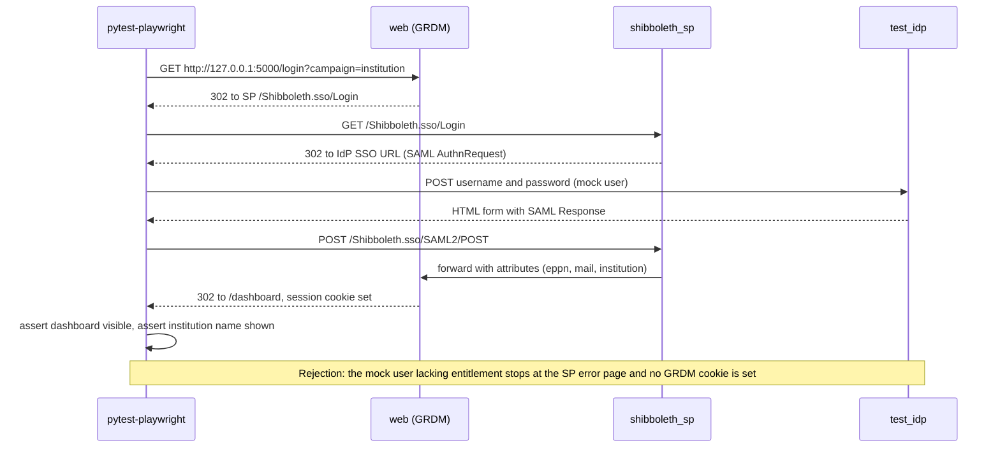
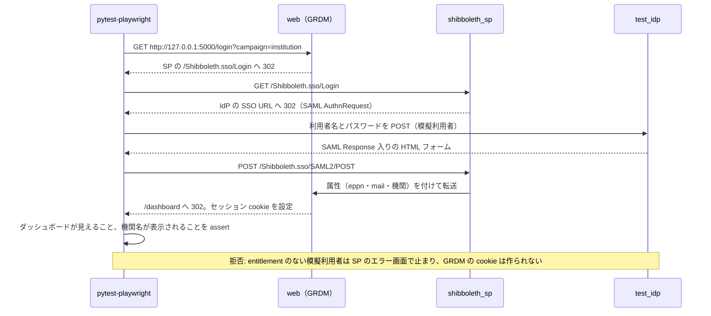

# SPEC-04 Acceptance Tests / 受入試験

> **Summary:** How we prove that an installed GakuNin RDM developer environment really works: the three test tiers, the browser scenarios for the core and each subsystem, test data, evidence, and the pass criteria for each milestone.
> **概要:** 導入した GakuNin RDM 開発環境が本当に動くことを示す方法。三つの試験の段、コアと各サブシステムのブラウザシナリオ、試験データ、証跡、節目ごとの合格基準を定める。

**Jump:** [English](#english) · [日本語](#japanese)

- Version / 版: 0.7 — 2026-11-09. **Learned:** the GRDM pages of today load a few third-party assets (first real login, acceptance run 9), so "abort and fail" alone would keep every browser scenario red; rule 4 now keeps blocking them and counts only a fixed list that must be empty at M5. ／ 現在の GRDM の画面は少数の外部資産を読み込む（初の実ログイン、受入第 9 回）ため、「中断して失敗」だけではすべてのブラウザシナリオが不合格のままになる。規則 4 は遮断を続け、M5 までに空にする固定の一覧だけを件数の記録にとどめる。
- Version / 版: 0.6 — 2026-11-06. **Learned:** a glossary term is only explained for the reader when its note and REF-01 link sit at the first prose use, counting lower-case and plural forms, so first-use notes with links were added in both halves (SPEC-06 §3). ／ 用語注と REF-01 へのリンクは、小文字や複数形も含めた本文の初出に置かなければ読者に届かないと分かったため、英和両方の初出にリンク付きの用語注を補った（SPEC-06 §3）。
- Version / 版: 0.5 — 2026-11-06. **Learned:** a subsystem scenario written as one sentence per case cannot be implemented without guessing; naming the user, the port variable, the path and the exact status in the table turned the five M3 stubs into tests whose only unknowns are selectors, and showed that three subsystems have no browser-facing port yet. ／ 一ケース一文で書いたサブシステムのシナリオは推測なしに実装できない。表に利用者・ポート変数・パス・正確なステータスを書くことで、五つの M3 の骨格はセレクタだけが未知の試験になり、三つのサブシステムにまだブラウザ向けポートがないことも分かった。
  0.4 — 2026-11-05. **Learned:** a browser trace is raw evidence that can carry cookies and response bodies, so it cannot live under the public evidence folder; it is off by default and quarantined under `runtime/` when requested (PR #21 review r2, R2-01). ／ ブラウザのトレースは cookie や応答本文を含み得る生の証跡なので、公開される証跡フォルダには置けない。既定では記録せず、求められたときだけ `runtime/` 配下に隔離する（PR #21 レビュー r2、R2-01）。
  0.3 — 2026-11-05. **Learned:** downloading a browser inside a test run would make the run depend on the network, so installation is a separate, explicit step and `accept` only checks for it. ／ 試験の実行中にブラウザをダウンロードすると実行がネットワークに依存するため、導入は別の明示的な手順にし、`accept` は有無を確かめるだけにする。
  0.2 — 2026-11-05. **Learned:** a case that may skip in the profile a milestone is judged on cannot be a pass criterion, and a diagram that renders in one language half must parse in the other too. ／ 節目を判定するプロファイルでスキップし得るケースは合格基準になれず、片方の言語で描ける図はもう片方でも解析できなければならないと分かった。
- Version / 版: 0.1 — 2026-11-05. **Learned:** a scenario without a rejection case proves only that the happy path renders; permission and authentication bugs are found by the case that must fail. ／ 拒否ケースのないシナリオは画面が出ることしか示さず、権限と認証の不具合は「失敗しなければならないケース」で初めて見つかると分かった。
- Normative for: `installer/acceptance/`, `grdm-dev accept`, `docs/demo/` result files, CI workflow `acceptance-arm64`.
- Related: [SPEC-00 Overview](00_overview.md) · [SPEC-01 Manifest](01_manifest.md) · [SPEC-02 Installer CLI](02_installer_cli.md) · [SPEC-03 Security Gate](03_security_gate.md) · [SPEC-05 Upstream Tracking](05_upstream_tracking.md) · [SPEC-06 Documentation Conventions](06_documentation_conventions.md) · [ADR-02 Network Model](../decisions/ADR-02_Network_Model.md) · [ADR-03 Staged Security Gate](../decisions/ADR-03_Staged_Security_Gate.md) · [ADR-05 Test IdP for Shibboleth](../decisions/ADR-05_Test_IdP_for_Shibboleth.md) · [POL-01 Position](../policy/POL-01_Developer_Environment_2027_Position.md) · [docs/README.md](../README.md)

---

<a id="english"></a>
## English

[→ 日本語版へ](#japanese)

### 1. Scope and tooling

Acceptance tests drive a real browser against the environment that [SPEC-02](02_installer_cli.md) installed, the way a researcher would use it. They are written in Python with **Playwright** (a library that opens a browser and clicks, types, and reads pages for you) through **pytest-playwright** (a plugin that lets the *pytest* test runner hand each test a ready browser page).

- Location: `installer/acceptance/`, one file per scenario, named `test_<scenario>.py`.
- Runner: `grdm-dev accept [--profile ...] [--only <scenario>] [--json]`. It runs `pytest` inside the same `.venv/` that `install.sh` created ([SPEC-02 §2.2](02_installer_cli.md#english)) and exits 60 if any test fails.
- Browsers: `grdm-dev accept` checks that Chromium is present under `PLAYWRIGHT_BROWSERS_PATH=.venv/.playwright/` and, if not, exits 2 and prints the exact install command (`pip install -e "installer[accept]"` then `playwright install chromium` with that variable). The download is a one-time setup step, never part of a test run. Nothing is installed outside the venv (a private box of Python tools for one project; see [REF-01](../reference/REF-01_Glossary.md)).
- Target URL: always `http://127.0.0.1:<port>` as published by `compose render` ([ADR-02](../decisions/ADR-02_Network_Model.md); defaults in the ports table of [SPEC-02 §4](02_installer_cli.md#2-en-ports)). Tests read the ports from `runtime/.env` (`GRDM_PORT_<SERVICE>`); they never hard-code them.

### 2. Test tiers

| Tier | Where | Tool | Needs Docker | What it proves |
|---|---|---|---|---|
| Unit | `installer/tests/` | `unittest` | no | Each `grdm_dev` module and every exit code in [SPEC-02 §6](02_installer_cli.md#english) |
| Integration | `installer/acceptance/integration/` | `pytest` + `urllib` | yes | `compose up` reaches health, API answers over HTTP, loopback-only binding |
| Acceptance | `installer/acceptance/` | `pytest-playwright` | yes | A person can do the core tasks in a browser, and forbidden actions are refused |

`grdm-dev accept` runs integration first and stops before acceptance if integration fails, because a browser test against a half-started stack produces noise, not evidence.

### 3. Scenario rules

1. **Every scenario has a success case and a rejection case.** The rejection case is one of: an unauthenticated request, or a logged-in user doing something outside their permission. It asserts the HTTP status (`401`, `403`, or `404` as the product defines) *or* a visible error message, never "the page looked wrong".
2. **Deterministic.** No `sleep` for luck; wait for a selector, a network response, or a health state. A test that passes only on retry is a failed test.
3. **Time-boxed.** Each test has `timeout=120s`; the whole suite has 30 minutes. Exceeding either is a failure.
4. **No external network.** Tests set `PLAYWRIGHT_OFFLINE=1` semantics by routing: any request whose host is not `127.0.0.1` is aborted and the test fails. This also catches containers that try to call the internet. One fixed list, `KNOWN_EXTERNAL_ASSETS` in `installer/acceptance/netguard.py`, names the assets the GRDM pages load today: the es6-shim and MathJax scripts on cdnjs, the Google Fonts style sheet, and gravatar avatar images. These requests are aborted as well, so nothing leaves the machine, but they are counted (`known_external_blocked` in `results.json`) instead of failing the test. A match needs the host, the path prefix and the resource type; a navigation, an API call, a WebSocket or any other host still fails. The list may only shrink, and it must be empty at M5.
5. **Disposable data only.** Every run creates a fresh user, project, and files under a run id (`acc-<timestamp>-<6 hex>`), and deletes them in teardown. No real names, emails, or files of real people, ever ([POL-01](../policy/POL-01_Developer_Environment_2027_Position.md)).
6. **One assertion target per test.** A test checks one scenario and one case; helpers live in `installer/acceptance/conftest.py`.

### 4. Core scenarios (M2)

```toon
core_scenarios[6]{id,scenario,success_case,rejection_case,services}:
  C1,Login via fakecas,test user signs in and sees dashboard,"GET /dashboard without session -> 302 to login; API GET /v2/users/me/ -> 401","web api fakecas"
  C2,Create project,new project appears with title and user as admin,"second user (contributor read-only) PATCH /v2/nodes/<id>/ -> 403","web api"
  C3,Upload and download file,upload via waterbutler then download bytes equal,"anonymous GET of private file -> 401/403; non-contributor PUT -> 403","wb wb_worker osfstorage"
  C4,Wiki collaborative edit,two browser contexts type and both see merged text,"logged-out context connecting to wiki websocket -> closed with 4401","web y_websocket sharejs"
  C5,File preview,uploaded PDF renders in mfr iframe,"preview URL of private file without session -> 401/403","mfr unoconv"
  C6,Institution admin screen,institution admin lists institution users,"ordinary user opens admin URL -> 403 or redirect; API -> 403","admin api"
```

Scenario C4 uses two independent Playwright *browser contexts* (two separate browsers in one test, with their own cookies) so that the second user's cursor and text appear in the first user's page through the `y-websocket` service. `y_websocket` is part of the `core` profile ([SPEC-02 §4](02_installer_cli.md#2-en-ports)) because collaborative editing is an M2 scenario, so C4 runs and must pass in both `core` and `full`; it never skips.

### 5. Subsystem scenarios (M3)

```toon
subsystem_scenarios[5]{id,subsystem,success_case,rejection_case,services,prerequisite}:
  S1,y-websocket,"user_a and user_b (write contributor) open the Wiki of the run's project in two contexts; a sentence typed by A is in B's editor within 5 s; the page's WebSocket is ws://127.0.0.1:<port>","the captured WebSocket URL reopened from a logged-out context without its token -> close code 4401 and zero document frames before the close","web wiki y_websocket","none (core profile)"
  S2,rdmcp (MCP endpoint),"user_a's personal access token: initialize, tools/list returns tools, resources/read of grdm://nodes/<run project> returns its title","no Authorization header -> 401; user_b's token reading user_a's private project -> 403 (404 not acceptable)",rdmcp,"GRDM_PORT_RDMCP in runtime/.env (host_port in the template); otherwise the test skips with that reason"
  S3,aipf_mcp_data_grdm,"user_a's token calls the project-metadata tool for the run's project; id and title equal the OSF API's","user_b's token for user_a's project -> 403, or an empty answer with an explicit denial code; a silent empty list fails",aipf_mcp_data_grdm,"GRDM_PORT_AIPF_MCP_DATA_GRDM in runtime/.env; otherwise skip with reason"
  S4,OASys,"user_a signed in to GRDM opens http://127.0.0.1:<GRDM_PORT_OASYS>/ -> 200; the projects page lists the run's project with a link to its GRDM page (same origin as web)","anonymous GET of a session-protected OASys API path -> 401 (not a login page, not 404)",oasys,"GRDM_PORT_OASYS in runtime/.env; otherwise skip with reason"
  S5,Shibboleth-SP via test IdP,"mock-user-01 (eduPersonAffiliation member) : web /login?campaign=institution -> SP -> test IdP form -> SAML POST -> GRDM dashboard served by web; osf cookie set; /v2/users/me/institutions/ includes MOCK Institution","mock-user-noaff (eduPersonAffiliation affiliate only) -> the SP RequestMap answers 403 with its error page; no osf cookie; API /v2/users/me/ -> 401","web shibboleth_sp test_idp","--auth shibboleth render (GRDM_AUTH=shibboleth in runtime/.env; fakecas absent); mock users from installer/acceptance/fixtures/idp/mock_users.json; ADR-05"
```

The table is the contract of `installer/acceptance/test_s1_y_websocket.py` … `test_s5_shibboleth.py`. Until M3 the five files carry `skip(reason="M3")` and `TODO(M3)` marks on every locator and path that has not been seen on the real subsystem; the success and rejection logic is written in full so that M3 only verifies selectors. Services without a host port today (`rdmcp`, `aipf_mcp_data_grdm`, `oasys`) get one in their template at M3; a test whose port is missing from `runtime/.env` skips with that exact reason instead of failing on a wrong URL. The test IdP (identity provider: the server that checks who you are when you log in; see [REF-01](../reference/REF-01_Glossary.md)) and its mock-attribute rule are decided in [ADR-05](../decisions/ADR-05_Test_IdP_for_Shibboleth.md).

**MCP** (Model Context Protocol) is a standard way for an AI assistant to ask a service for tools and data; `rdmcp` and `aipf_mcp_data_grdm` expose GRDM through it. Their tests use an HTTP client in the same `pytest` session, not a browser.

#### 5.1 Shibboleth scenario

With `compose render --profile full --auth shibboleth` ([SPEC-02 §4](02_installer_cli.md#2-en-ports)) `fakecas` is removed and a bundled test *IdP* (identity provider: the server that checks who you are, like a university login page) answers for the *SP* (service provider: the part of GRDM that trusts the IdP) through Shibboleth (the software that lets you log in once with your university account; see [REF-01](../reference/REF-01_Glossary.md)). Mock attributes used by the test IdP (names like `Test User 01`, `test01@idp.test`) live only in `installer/acceptance/fixtures/idp/` and are clearly labeled `MOCK`; they never resemble real institution attributes, as [POL-01](../policy/POL-01_Developer_Environment_2027_Position.md) requires for separating mock and real data.



### 6. Fixtures and test data

- `conftest.py` provides: `run_id`, `base_urls` (from `runtime/.env`), `admin_user`, `user_a`, `user_b` (created through the API with random passwords, deleted in teardown), `tmp_pdf` and `tmp_txt` (generated bytes, 1 KiB and 1 MiB).
- Users are created with the `--yes` helper `grdm-dev accept --seed`, which calls the Django management command inside the `web` container. The admin user is created only for C6 and removed after.
- Fixtures never read the host's home directory or environment beyond `runtime/.env`.

### 7. Evidence

Each run writes, under `docs/demo/runs/<run_id>/`:

```toon
evidence:
  results.toon: one line per test with id, case, status, duration_ms, http_status
  results.json: same data, canonical, consumed by grdm-dev report
  junit.xml: for CI and the GitHub checks tab
  screenshots/: <test>_<case>.png, taken only on failure
  trace: "off by default. With --trace, Playwright trace zips are retained only on failure and moved to runtime/reports/quarantine/<run_id>/ (0700, git-ignored, raw: may hold cookies and bodies). Any zip left under docs/demo/runs/ is sanitized member by member"
```

`grdm-dev report` ([SPEC-02 §3](02_installer_cli.md#english)) copies `results.toon` into the bundle. The demo document for the milestone (`docs/demo/20_core_install_mac_studio.md` and similar) links to the run folder; the TOON (a compact text form of JSON; see [REF-01](../reference/REF-01_Glossary.md)) in the document must agree with `results.json` (`docs check`).

### 8. Pass criteria per milestone

| Milestone | Required green | Host | Note |
|---|---|---|---|
| M2 | C1–C6, every success and rejection case | Mac Studio arm64 (self-hosted runner) | amd64: `grdm-dev build --platform linux/amd64` succeeds on a GitHub runner; no acceptance |
| M3 | M2 plus S1–S5 | Mac Studio arm64 | Shibboleth profile run separately from fakecas profile |
| M4 | M3, unchanged after Python 3.13 migration | Mac Studio arm64 | Acceptance is the regression gate for the port |
| M5 | M4 plus [SPEC-03](03_security_gate.md) final gate | Mac Studio arm64 and Ubuntu 24.04 amd64 | Full acceptance on both architectures |

A milestone is not passed by the author of the change. The QAE (the role that checks that the work is correct; see [REF-01](../reference/REF-01_Glossary.md)) role runs `grdm-dev accept` and records the run id in `docs/status/`; the owner approves ([SPEC-00](00_overview.md)).

The Mac Studio self-hosted runner is registered only with the private `-dev2027` repositories, never with this public repository ([REF-01](../reference/REF-01_Glossary.md)). The `acceptance-arm64` workflow therefore runs there, and the QAE brings the run folder into `docs/demo/runs/` here through a PR (pull request: a proposed change waiting for someone to review and accept it; see [REF-01](../reference/REF-01_Glossary.md)).

---

<a id="japanese"></a>
## 日本語

[→ To English](#english)

### 1. 範囲と道具

受入試験は、[SPEC-02](02_installer_cli.md) で導入した環境に対して本物のブラウザを動かし、研究者が使うのと同じ操作で確かめます。Python で書き、**Playwright**（ブラウザを開いてクリック・入力・読み取りを代わりにしてくれるライブラリ）を **pytest-playwright**（試験の実行器 *pytest* が各試験に準備済みのブラウザ画面を渡せるようにする追加部品）経由で使います。

- 置き場: `installer/acceptance/`。シナリオごとに一ファイル、名前は `test_<シナリオ>.py`。
- 実行器: `grdm-dev accept [--profile ...] [--only <シナリオ>] [--json]`。`install.sh` が作った同じ `.venv/` の中で `pytest` を動かし（[SPEC-02 §2.2](02_installer_cli.md#japanese)）、一件でも失敗すれば終了 60。
- ブラウザ: `grdm-dev accept` は `PLAYWRIGHT_BROWSERS_PATH=.venv/.playwright/` に Chromium があるかを確かめ、なければ終了コード 2 で導入コマンド（`pip install -e "installer[accept]"` のあと同じ変数を付けて `playwright install chromium`）をそのまま表示する。ダウンロードは一度だけの準備であり、試験の実行には含めない。venv（プロジェクトごとの Python 道具箱。[REF-01](../reference/REF-01_Glossary.md)）の外には何も入れない。
- 対象 URL: 常に `compose render` が公開した `http://127.0.0.1:<ポート>`（[ADR-02](../decisions/ADR-02_Network_Model.md)。既定値は [SPEC-02 §4](02_installer_cli.md#2-ja-ports) のポート表）。ポートは `runtime/.env`（`GRDM_PORT_<SERVICE>`）から読み、決め打ちしない。

### 2. 試験の段

| 段 | 場所 | 道具 | Docker が要るか | 示すこと |
|---|---|---|---|---|
| 単体 | `installer/tests/` | `unittest` | 不要 | `grdm_dev` の各モジュールと [SPEC-02 §6](02_installer_cli.md#japanese) の全終了コード |
| 統合 | `installer/acceptance/integration/` | `pytest` + `urllib` | 要る | `compose up` が健康に達し、API が HTTP で応え、ループバックにだけ結び付いている |
| 受入 | `installer/acceptance/` | `pytest-playwright` | 要る | 人がブラウザでコアの作業をでき、禁止された操作が拒まれる |

`grdm-dev accept` は統合を先に動かし、統合が落ちたら受入の前で止まります。半分しか起動していない環境へのブラウザ試験は、証跡ではなく雑音になるからです。

### 3. シナリオの規則

1. **すべてのシナリオに成功ケースと拒否ケースを置く。** 拒否ケースは、未認証の要求か、ログイン済みの利用者が権限の外の操作をするもの。HTTP ステータス（製品の定義どおり `401`・`403`・`404`）**か**、画面に見えるエラー文言を assert する。「画面が変だった」では確かめない。
2. **決定的に動く。** 運に頼る `sleep` を使わず、セレクタ、ネットワーク応答、健康状態を待つ。再試行で通る試験は失敗した試験と見なす。
3. **時間を区切る。** 各試験は `timeout=120s`、全体は 30 分。超えたら失敗。
4. **外部ネットワークに出ない。** 経路の制御で、ホストが `127.0.0.1` でない要求はすべて中断し、その試験を失敗にする。これでインターネットへ出ようとするコンテナも見つかる。例外は `installer/acceptance/netguard.py` の固定の一覧 `KNOWN_EXTERNAL_ASSETS` だけで、現在の GRDM の画面が読み込む資産（cdnjs の es6-shim と MathJax のスクリプト、Google Fonts のスタイルシート、gravatar のアバター画像）を挙げる。これらの要求も中断するので外部には出ないが、試験を失敗にせず件数を記録する（`results.json` の `known_external_blocked`）。一致にはホスト、パスの先頭、資産の種類のすべてが必要で、画面遷移、API 呼び出し、WebSocket、ほかのホストは従来どおり失敗にする。一覧は減らすだけで、M5 で空にする。
5. **使い捨てのデータだけ。** 毎回、実行 ID（`acc-<時刻>-<6 桁の16進>`）の下に新しい利用者・プロジェクト・ファイルを作り、後片付けで消す。実在の人の名前・メール・ファイルは決して使わない（[POL-01](../policy/POL-01_Developer_Environment_2027_Position.md)）。
6. **一試験一対象。** 一つの試験は一つのシナリオの一つのケースだけを確かめる。共通処理は `installer/acceptance/conftest.py` に置く。

### 4. コアのシナリオ（M2）

```toon
core_scenarios[6]{id,scenario,success_case,rejection_case,services}:
  C1,fakecas でログイン,試験利用者がログインしダッシュボードを見る,"セッションなしで GET /dashboard -> ログインへ 302。API GET /v2/users/me/ -> 401","web api fakecas"
  C2,プロジェクト作成,題名付きの新プロジェクトができ利用者が管理者になる,"二人目（読取のみの共同研究者）が PATCH /v2/nodes/<id>/ -> 403","web api"
  C3,ファイルの上下載,waterbutler で上げたファイルを下ろしバイト列が一致,"匿名で非公開ファイルを GET -> 401/403。共同研究者でない人が PUT -> 403","wb wb_worker osfstorage"
  C4,Wiki 共同編集,二つのブラウザ文脈で入力し双方に統合された文が見える,"ログアウトした文脈が wiki の websocket に接続 -> 4401 で切断","web y_websocket sharejs"
  C5,ファイルプレビュー,上げた PDF が mfr の iframe に描かれる,"セッションなしで非公開ファイルのプレビュー URL -> 401/403","mfr unoconv"
  C6,機関管理画面,機関管理者が機関の利用者一覧を見る,"一般利用者が管理 URL を開く -> 403 か転送。API -> 403","admin api"
```

シナリオ C4 は独立した二つの Playwright の「ブラウザ文脈」（一つの試験の中にある、cookie を別々に持つ二つのブラウザ）を使い、二人目の文字が `y-websocket` サービスを通して一人目の画面に現れることを確かめます。共同編集は M2 のシナリオなので `y_websocket` は `core` プロファイルに含まれ（[SPEC-02 §4](02_installer_cli.md#2-ja-ports)）、C4 は `core` でも `full` でも実行して合格が必須です。スキップはしません。

### 5. サブシステムのシナリオ（M3）

```toon
subsystem_scenarios[5]{id,subsystem,success_case,rejection_case,services,prerequisite}:
  S1,y-websocket,"user_a と user_b（書込の共同研究者）が二つの文脈で実行中プロジェクトの Wiki を開き、A が打った一文が 5 秒以内に B のエディタに現れる。ページの WebSocket は ws://127.0.0.1:<port>","捕らえた WebSocket の URL をトークンなしでログアウト文脈から開き直す -> 終了コード 4401。閉じる前の文書フレームは 0","web wiki y_websocket","なし（core プロファイル）"
  S2,rdmcp（MCP の口）,"user_a の個人アクセストークンで initialize、tools/list がツールを返し、grdm://nodes/<実行中プロジェクト> の resources/read が題名を返す","Authorization ヘッダなし -> 401。user_b のトークンで user_a の非公開プロジェクトを読む -> 403（404 は不可）",rdmcp,"runtime/.env に GRDM_PORT_RDMCP（テンプレートの host_port）。なければその理由でスキップ"
  S3,aipf_mcp_data_grdm,"user_a のトークンで実行中プロジェクトのメタデータ取得ツールを呼び、id と題名が OSF API と一致する","user_b のトークンで user_a のプロジェクト -> 403、または明示の拒否コード付きの空。黙った空の一覧は失敗",aipf_mcp_data_grdm,"runtime/.env に GRDM_PORT_AIPF_MCP_DATA_GRDM。なければ理由付きでスキップ"
  S4,OASys,"GRDM にログイン済みの user_a が http://127.0.0.1:<GRDM_PORT_OASYS>/ を開く -> 200。プロジェクト一覧に実行中プロジェクトがあり、GRDM の画面（web と同じ起点）へリンクする","セッションが要る OASys API のパスを匿名で GET -> 401（ログイン画面も 404 も不可）",oasys,"runtime/.env に GRDM_PORT_OASYS。なければ理由付きでスキップ"
  S5,テスト IdP 経由の Shibboleth-SP,"mock-user-01（eduPersonAffiliation に member）: web /login?campaign=institution -> SP -> テスト IdP のフォーム -> SAML POST -> web が出す GRDM ダッシュボード。osf cookie あり。/v2/users/me/institutions/ に MOCK Institution","mock-user-noaff（eduPersonAffiliation は affiliate のみ）-> SP の RequestMap がエラー画面で 403。osf cookie なし。API /v2/users/me/ -> 401","web shibboleth_sp test_idp","--auth shibboleth での描画（runtime/.env に GRDM_AUTH=shibboleth。fakecas なし）。模擬利用者は installer/acceptance/fixtures/idp/mock_users.json。ADR-05"
```

この表が `installer/acceptance/test_s1_y_websocket.py` 〜 `test_s5_shibboleth.py` の契約です。M3 までは五つのファイルが `skip(reason="M3")` を持ち、実機のサブシステムで未確認のロケータとパスに `TODO(M3)` を付けます。成功と拒否の論理は全部書いてあり、M3 ではセレクタの確認だけをします。今日ホスト側ポートを持たないサービス（`rdmcp`、`aipf_mcp_data_grdm`、`oasys`）は M3 でテンプレートにポートを得ます。`runtime/.env` にポートがない試験は、誤った URL で失敗するのでなく、その理由を書いてスキップします。テスト IdP（アイデンティティプロバイダ。ログインのときに「あなたが誰か」を確かめるサーバ。[REF-01](../reference/REF-01_Glossary.md)）と模擬属性の規則は [ADR-05](../decisions/ADR-05_Test_IdP_for_Shibboleth.md) で決めます。

**MCP**（Model Context Protocol）は、AI アシスタントがサービスに道具とデータを尋ねるための共通の決まりです。`rdmcp` と `aipf_mcp_data_grdm` は GRDM をこの決まりで公開します。これらの試験はブラウザでなく、同じ `pytest` セッション内の HTTP クライアントで行います。

#### 5.1 Shibboleth のシナリオ

`compose render --profile full --auth shibboleth`（[SPEC-02 §4](02_installer_cli.md#2-ja-ports)）では `fakecas` を外し、同梱したテスト用 *IdP*（アイデンティティプロバイダ。大学のログイン画面のように「あなたが誰か」を確かめるサーバ）が *SP*（サービスプロバイダ。IdP を信頼する GRDM 側の部品）に Shibboleth（大学のアカウントで一度ログインすれば済むようにするソフト。[REF-01](../reference/REF-01_Glossary.md)）経由で応えます。テスト IdP の模擬属性（`Test User 01`、`test01@idp.test` のような名前）は `installer/acceptance/fixtures/idp/` にだけ置き、`MOCK` と明記します。実在の機関の属性に似せてはならず、模擬と実データの分離は [POL-01](../policy/POL-01_Developer_Environment_2027_Position.md) の要求どおりです。



### 6. フィクスチャと試験データ

- `conftest.py` が提供するもの: `run_id`、`base_urls`（`runtime/.env` から）、`admin_user`・`user_a`・`user_b`（API で乱数パスワード付きに作り、後片付けで消す）、`tmp_pdf`・`tmp_txt`（生成したバイト列。1 KiB と 1 MiB）。
- 利用者は `--yes` 付きの補助 `grdm-dev accept --seed` で作り、これは `web` コンテナ内の Django 管理コマンドを呼ぶ。管理者利用者は C6 のためだけに作り、終わったら消す。
- フィクスチャは `runtime/.env` 以外に、ホストのホームディレクトリや環境変数を読まない。

### 7. 証跡

毎回の実行は `docs/demo/runs/<run_id>/` の下に次を書きます。

```toon
evidence:
  results.toon: 試験ごとに一行。id・case・status・duration_ms・http_status
  results.json: 同じデータの正本。grdm-dev report が読む
  junit.xml: CI と GitHub の checks タブ向け
  screenshots/: <試験>_<ケース>.png。失敗時だけ撮る
  trace: "既定では記録しない。--trace のときだけ失敗時に Playwright のトレース zip を残し、runtime/reports/quarantine/<run_id>/（0700、git 管理外、生データで cookie や本文を含み得る）へ隔離する。docs/demo/runs/ に残った zip はメンバー単位で無害化する"
```

`grdm-dev report`（[SPEC-02 §3](02_installer_cli.md#japanese)）が `results.toon` を束に写します。節目の実証文書（`docs/demo/20_core_install_mac_studio.md` およびその類）は実行フォルダへリンクし、文書内の TOON（JSON を短く書いた文字の形。[REF-01](../reference/REF-01_Glossary.md)）は `results.json` と一致していなければなりません（`docs check`）。

### 8. 節目ごとの合格基準

| 節目 | 全件合格が必要なもの | ホスト | 備考 |
|---|---|---|---|
| M2 | C1〜C6 の成功・拒否ケースすべて | Mac Studio arm64（セルフホストランナー） | amd64 は GitHub ランナーで `grdm-dev build --platform linux/amd64` が成功すること。受入は行わない |
| M3 | M2 に加え S1〜S5 | Mac Studio arm64 | Shibboleth プロファイルは fakecas プロファイルと別に実行 |
| M4 | M3 が Python 3.13 移植後も変わらず合格 | Mac Studio arm64 | 受入が移植の回帰判定の門になる |
| M5 | M4 に加え [SPEC-03](03_security_gate.md) の最終の門 | Mac Studio arm64 と Ubuntu 24.04 amd64 | 両アーキテクチャで全受入 |

節目の合格は変更の作者が判定しません。QAE（QA担当。成果が正しいか検査する役割。[REF-01](../reference/REF-01_Glossary.md)）の役割が `grdm-dev accept` を実行し、実行 ID を `docs/status/` に記録し、所有者が承認します（[SPEC-00](00_overview.md)）。

Mac Studio のセルフホストランナーは非公開の `-dev2027` リポジトリにだけ登録し、公開のこのリポジトリには登録しません（[REF-01](../reference/REF-01_Glossary.md)）。そのため `acceptance-arm64` ワークフローはそちらで動き、QAE が実行フォルダを PR（プルリクエスト。誰かが見て受け入れるのを待っている変更の提案。[REF-01](../reference/REF-01_Glossary.md)）でこのリポジトリの `docs/demo/runs/` へ持ち込みます。

---

## Glossary / 用語

| Term | English note | 日本語注 |
|---|---|---|
| Playwright | A library that opens a browser and clicks, types, and reads pages for you. | ブラウザを開き、クリック・入力・読み取りを代わりにしてくれるライブラリ。 |
| pytest | A Python tool that finds and runs test functions and reports which passed. | Python の試験関数を見つけて動かし、合否を報告する道具。 |
| Browser context | A separate browser session with its own cookies, inside one test. | 一つの試験の中にある、cookie を別々に持つ独立したブラウザのセッション。 |
| Fixture | Ready-made test data or setup that a test receives before it starts. | 試験が始まる前に受け取る、用意済みのデータや準備。 |
| IdP / SP | The server that checks who you are / the service that trusts that answer. | 「あなたが誰か」を確かめるサーバ／その答えを信頼するサービス。 |
| SAML | The message format an IdP and an SP use to pass a login result. | IdP と SP がログイン結果を渡し合うための文書の形式。 |
| MCP | A standard way for an AI assistant to ask a service for tools and data. | AI アシスタントがサービスに道具とデータを尋ねるための共通の決まり。 |
| JUnit XML | A common file format that CI systems read to show test results. | CI が試験結果を表示するために読む、よく使われるファイル形式。 |
