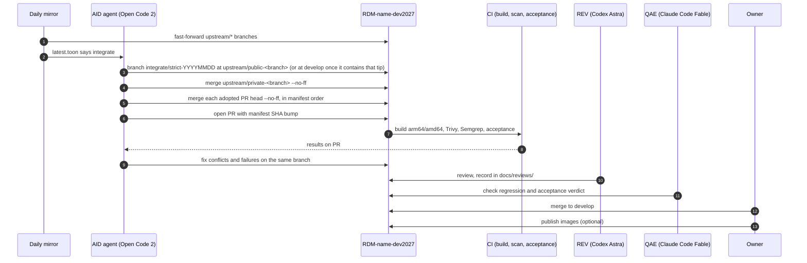
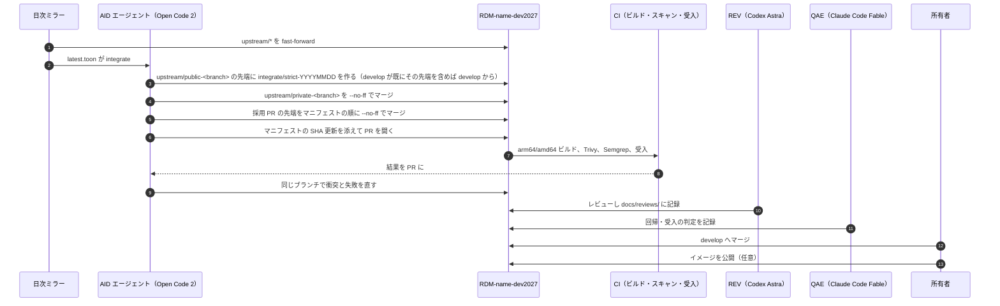

# SPEC-05 Upstream Tracking / 上流追従

> **Summary:** How the integration repositories stay current with their upstreams: a daily job mirrors the `upstream/*` branches and writes a diff report, a weekly job lets an AI agent open one integration PR per repository, conflicts are solved on the PR, review and checks are automatic, and only merge and publish are human. Also how the COS original is tracked for reference and what happens if COS archives OSF.
> **概要:** 統合リポジトリを上流に追従させる仕組み。日次ジョブが `upstream/*` をミラーして差分報告を書き、週次ジョブで AI エージェントがリポジトリごとに統合 PR を一本開く。衝突は PR 上で解く。レビューと検査は自動、マージと公開だけが人。COS 本家を参照用に追う方法と、COS が OSF を凍結したときの扱いも定める。

**Jump:** [English](#english) · [日本語](#japanese)

- Version / 版: 0.3 — 2026-11-06. **Learned:** PR #23 review r1 showed three ways a "safe" automation silently stops being safe: a publish decision taken from "did my local ref move" skips publication after a dry-run or a failed push, so it must be taken from the remote state; `checkout -B` turns a rerun into a reset of hand-made conflict resolutions, so branch creation must refuse an existing local branch and a dry-run must leave no branch; and a report generated before the status branch is checked out blocks the checkout and a failed run never publishes its report, so the status checkout comes first and publication runs `always()`. The job's failure also needs a canonical exit code (70) rather than a bare 1. ／ PR #23 レビュー r1 で、「安全な」自動化が黙って安全でなくなる三つの経路が分かった。「ローカルの参照が動いたか」で公開を決めると dry-run や push 失敗の後に公開されないので、公開はリモートの状態から決める。`checkout -B` は再実行を手作業の衝突解決のリセットに変えるので、ブランチ作成はローカルの既存ブランチを拒み、dry-run はブランチを残さない。status ブランチの checkout より前に報告を生成すると checkout を妨げ、失敗した実行は報告を公開しないので、status の checkout を先に用意し公開は `always()` で行う。ジョブの失敗にも素の 1 でなく正本の終了コード（70）が要る。
  0.2 — 2026-11-06. **Learned:** writing the mirror showed that a non-forced `git fetch src:dst` refspec is itself the force-push detector, that the tracking branches of the integration repository (not a local clone) are the only trustworthy "previous SHA", and that the strict reconstruction of ADR-01 §5 needs an explicit second case — once `develop` already contains the public tip, the weekly branch must start at `develop`, or every earlier integration would be discarded. ／ ミラーを実装して分かったこと: `+` を付けない `git fetch src:dst` の refspec がそのまま force push の検出器になる。「昨日の SHA」として信じられるのは統合リポジトリ側の追跡ブランチだけで、ローカルの写しではない。ADR-01 §5 の厳密再構築には第二の場合を明示する必要がある — `develop` が既に公開先端を含むなら週次ブランチは `develop` から始めなければ、それまでの統合を全部捨ててしまう。
- Version / 版: 0.1 — 2026-11-05. **Learned:** the 2026-11-05 survey found eleven upstreams that moved on five different days in one week; without a daily mirror and a weekly merge the integration branch would drift into large, unreviewable conflicts. ／ 2026-11-05 の調査で、上流 11 本が一週間に 5 つの異なる日に動いていた。日次ミラーと週次マージが無ければ、統合ブランチは大きくレビュー不能な衝突にはまると分かった。
- Normative for: the `upstream-mirror` and `upstream-integrate` workflows in every `RDM-<name>-dev2027` repository, the `grdm-dev upstream` subcommand ([SPEC-02](02_installer_cli.md)), and `docs/status/upstream/`.
- Related: [SPEC-00 Overview](00_overview.md) · [SPEC-01 Manifest](01_manifest.md) · [SPEC-06 Documentation conventions](06_documentation_conventions.md) · [POL-01 Position](../policy/POL-01_Developer_Environment_2027_Position.md) · [ADR-01 Integration repository placement](../decisions/ADR-01_Integration_Repository_Placement.md) · [ADR-04 AI autonomy and roles](../decisions/ADR-04_AI_Autonomy_and_Roles.md) · [docs/README.md](../README.md)

---

<a id="english"></a>
## English

[→ 日本語版へ](#japanese)

### 1. Branches that are tracked

Every integration repository `RDM-<name>-dev2027` ([SPEC-00 §3](00_overview.md#3-integration-model)) has one *tracking branch* (a read-only copy of a branch that lives in another repository) per `upstreams[]` entry of the manifest ([SPEC-01 §3](01_manifest.md#english)). The name is `upstream/<kind>-<branch>`, where `<branch>` is the upstream branch name with every `/` replaced by `-`; a second upstream of the same kind inserts a tag, `upstream/<kind>-<tag>-<branch>` ([SPEC-01 §4](01_manifest.md#4-rules) rule 7).

```toon
tracking[4]{branch,source,kind,merged_into_develop,examples}:
  upstream/public-<branch>,"RDM-<name> default branch",public,yes,"upstream/public-develop (osf.io, waterbutler, mfr, cas-overlay, wiki-frontend); upstream/public-master (ember-osf-web, y-websocket)"
  upstream/private-<branch>,"RDM-<name>-*-private default branch",private,yes,"upstream/private-develop; upstream/private-master (ember-osf-web, y-websocket); upstream/private-main (OASys, Shibboleth-SP, rdmcp, aipf_mcp_data_grdm)"
  upstream/cos-develop,"CenterForOpenScience/<name> develop",cos,no (compare only),"five cores; wiki-frontend has no COS original"
  upstream/<kind>-<tag>-<branch>,"a second upstream of the same kind",private,no (candidate),"upstream/private-sec-test-fix-sec-test = RDM-osf.io-private fix/sec-test"
```

A component has only the branches its manifest entry lists: the five private subsystems have `upstream/private-main` alone; the cores have `public`, `private`, and (except wiki-frontend) `cos`.

Rules that never bend:

- `upstream/*` branches are **written only by the mirror job**. No human and no agent commits to them.
- `upstream/*` branches are **never rewritten**. The mirror job fast-forwards; if the source itself was force-pushed, the job keeps the old branch, reports `non-fast-forward` / `halt`, and exits 70 ([SPEC-02 §6](02_installer_cli.md#english)) so the workflow fails visibly; the AID agent opens an issue from that failure.
- Nobody **force-pushes** anywhere in a `-dev2027` repository. Branch protection on `develop` enforces this.

### 2. Daily job: mirror and diff report

The `upstream-mirror` workflow runs once a day (03:00 JST) in each `-dev2027` repository, and can be run by hand with `grdm-dev upstream mirror [--component <id>] [--workdir runtime/upstream] [--report-dir docs/status/upstream] [--dry-run]` ([SPEC-02](02_installer_cli.md)). The workflow template that a `-dev2027` repository adopts is `installer/grdm_dev/templates/workflows/upstream-mirror.yml`; it is not a workflow of this repository, because this repository's CI never holds credentials for the private repositories.

For every component with an `integration_repo` (private subsystems included; infra components have none):

1. Clone the integration repository under `--workdir` (or fetch it when already present). The clone and fetch addresses are composed at run time from the bare names in the manifest; a `repo` that carries its owner (`CenterForOpenScience/osf.io`) is used as is, a bare name belongs to RCOSDP.
2. For each `upstreams[]` entry — merged, reference and candidate alike ([SPEC-01 §4](01_manifest.md#4-rules) rule 6) — set the local `tracking_branch` to the value the integration repository has (the *previous SHA*) — or delete the local ref when the integration repository does not have the branch yet, so that a ref left behind by an earlier `--dry-run` or by a failed push never stands in for the published state — then `git fetch <source> refs/heads/<branch>:refs/heads/<tracking_branch>`. The refspec carries no `+`, so Git refuses a non-fast-forward: that refusal is the force-push detection of §1. The old branch is kept, the row is `non-fast-forward`, the repository's `action` is `halt`, and the job exits 70. Nothing is ever forced.
3. Push every tracking branch whose fetched SHA differs from what the integration repository publishes (the branch is missing there, or its SHA is older), with one explicit refspec each, `git push origin refs/heads/upstream/X:refs/heads/upstream/X`, never `--force`. The decision is taken from the remote state, never from "did the local ref move": a `--dry-run` or a failed push followed by a real run therefore still publishes. The report lists the branches selected (`to_publish`) and those actually pushed (`pushed`). `--dry-run` fetches and reports but pushes nothing.
4. Compare each tracking branch with `develop` (`ahead_of_develop`, `behind_develop`, `develop_contains`) and with the SHA pinned in the manifest ([SPEC-01](01_manifest.md), `manifest_sha_matches`).
5. Write the diff report. The workflow then commits it to the bot branch `status/upstream` of this public repository, from which a daily PR brings it into `develop`; the CLI itself only writes the files.

Exit code: 0 whether or not anything moved; 70 (`UPSTREAM_FAILED`, [SPEC-02 §6](02_installer_cli.md#english), canonical message in `messages.tsv`) when a fetch was refused (`non-fast-forward`) or failed, or a push failed. The report is written in every case, so a failure is visible in it; the workflow template publishes the report with `if: always()`, so a failed run's report reaches the status branch too, while the job itself still fails.

**Where the report lives.** Chosen: `docs/status/upstream/latest.json` (canonical) and `latest.toon` (the same content in TOON, a compact text form of JSON; [SPEC-06 §4](06_documentation_conventions.md#4-diagrams-and-data)) are overwritten every run, and the same content is archived as `docs/status/upstream/archive/YYYY-MM-DD.json` and `.toon`. Archives older than 90 days are deleted by the job. The `--report-dir` flag relocates all of these.

> **Warning:** The report is public. It contains repository names, branch names, SHAs, and commit counts only. It never contains an address (`https://`, `git@`, `github.com`), a commit message, an author name, a file path, or diff text from `private` upstreams. The tests assert this on the written files.

Example report (one of the eleven repositories; the repeated digits are placeholders):

```toon
report:
  generated_at: "2026-11-06T03:00:12+09:00"
  dry_run: false
  repositories[1]:
    - component: osf.io
      integration_repo: RDM-osf.io-dev2027
      develop_sha: 1111111111111111111111111111111111111111
      upstreams[3]{branch,kind,source_repo,source_branch,previous_sha,sha,ahead_of_develop,behind_develop,develop_contains,manifest_sha_matches,moved_since_yesterday,status}:
        upstream/public-develop,public,RDM-osf.io,develop,2222222222222222222222222222222222222222,3333333333333333333333333333333333333333,14,0,false,false,true,updated
        upstream/private-develop,private,RDM-osf.io-develop-private,develop,4444444444444444444444444444444444444444,4444444444444444444444444444444444444444,0,0,true,true,false,unchanged
        upstream/cos-develop,cos,CenterForOpenScience/osf.io,develop,5555555555555555555555555555555555555555,6666666666666666666666666666666666666666,310,0,false,false,true,updated
      to_publish[2]:
        - upstream/public-develop
        - upstream/cos-develop
      pushed[2]:
        - upstream/public-develop
        - upstream/cos-develop
      action: integrate
      errors[0]:
  summary:
    repositories: 1
    repositories_needing_integration: 1
    force_push_detected: 0
    branches_moved: 2
    branches_pushed: 2
    errors: 0
```

Per row, `status` is `created` (the integration repository had no such branch yet), `updated`, `unchanged`, `non-fast-forward`, or `fetch-failed`. Per repository, `action` is `integrate` when a merged `public` or `private` upstream is ahead of `develop`, `halt` when a force push was detected, `error` when a fetch or push failed and nothing is ahead, and `none` otherwise.

### 3. Weekly integration PR

The `upstream-integrate` workflow runs once a week (Monday 04:00 JST), or by hand with `grdm-dev upstream integrate`, and is executed by an AI agent in the AID role (an *AI agent* is a program that reads instructions, edits code, and reports back). For each `-dev2027` repository whose latest report says `integrate`:



Steps in words, as `grdm-dev upstream integrate [--component <id>] [--date YYYYMMDD] [--dry-run]` performs them for every component **in scope** — a component with a `public` upstream of `status: merged` ([ADR-01 §5](../decisions/ADR-01_Integration_Repository_Placement.md)). A private-only component (the five subsystems) has nothing to reconstruct: its `develop` is seeded from `upstream/private-<branch>`, so it is reported `skipped` with a note and no branch is made.

1. Create branch `integrate/strict-<YYYYMMDD>` (the ADR-01 §5 name). **Starting point rule:** when `develop` does *not* yet contain the tip of `upstream/public-<branch>`, the branch starts at that tip (`mode: strict`, ADR-01 §5 step 1). When `develop` already contains it — the strict order was established by an earlier integration — the branch starts at `develop` (`mode: on-develop`), because starting again from the public tip would discard every earlier integration. In both modes the merge order below is the same. The branch is created with `git switch -c` (create only), never with `checkout -B`: a branch of that name that already exists in the integration repository **or in the local clone** is never rewritten — the run stops with an error, because the local branch may hold a conflict resolution committed by hand (§4). With `--dry-run` no branch is created at all: the merges run on a detached HEAD at the same starting point, so a dry-run leaves no local branch that a later run could reset or refuse.
2. Merge the `private` tracking branch with `status: merged` (`upstream/private-develop`, `upstream/private-master`) with `git merge --no-ff --no-edit`. Candidate upstreams such as `upstream/private-sec-test-fix-sec-test` and the `cos` reference are never merged. Then, for each `adopted_prs[]` entry in list order, fetch `refs/pull/<n>/head` from the PR's repository and merge it `--no-ff` as its own merge commit (ADR-01 §5 step 3). A source already contained in the branch is `already-contained` and creates no commit.
3. When the branch tip equals `develop` after all merges (identical tips), the result is `no-op`: nothing is pushed and no PR is opened. Otherwise push the branch (plain `git push`, never forced) and open one PR per repository to `develop` with `gh pr create`, titled `統合: upstream YYYY-MM-DD（<name>）`. The body (Japanese) states the starting point, the `develop` SHA, and the merge order with each source's SHA and status; it names repositories, never addresses. With `--dry-run` the merges are performed locally on a detached HEAD (so conflicts are still detected) but no branch is created, nothing is pushed and no PR is opened. In this public repository, a matching PR bumps `manifest/upstreams.json` and `upstreams.toon` to the new SHAs ([SPEC-01 §4](01_manifest.md#4-rules) rule 2); that bump is not automated yet.
4. CI runs the build, the security gate ([SPEC-03](03_security_gate.md)), and the acceptance tests ([SPEC-04](04_acceptance_tests.md)).

Exit code: 0 when every component opened a PR, was `no-op`, or was `skipped`; 70 (`UPSTREAM_FAILED`, [SPEC-02 §6](02_installer_cli.md#english)) when a merge conflicted, a fetch or push failed, the branch already existed, or `gh pr create` failed (the branch is then already pushed and the detail says so).

### 4. Conflict handling

A *merge conflict* happens when two sides changed the same lines and Git cannot choose. On the integration PR:

- `grdm-dev upstream integrate` does not resolve conflicts: it lists the conflicted files in the report, runs `git merge --abort`, marks the component `conflict`, and exits 70 without pushing. The AID agent then resolves conflicts **on the PR branch** with ordinary commits — by running the same merges by hand on `integrate/strict-<date>` — and explains each resolution in the commit body in Japanese.
- Resolution preference: keep the `private` change when the conflict is a security fix; keep the `public` change when it is a feature; when unclear, keep both behind a comment and label the PR `needs-owner-decision`.
- The agent **never** force-pushes the PR branch, never rebases it after review began, never touches `upstream/*`, and never edits `develop` directly.
- If an adopted PR no longer applies, the agent does not drop it silently: it marks that entry `candidate` with `reason: "no longer applies after <sha>"` in the manifest PR and labels the PR `adopted-pr-broken`.
- If CI fails for reasons the agent cannot fix within its budget, it leaves the PR open with a summary comment and the daily report keeps saying `integrate`.

### 5. Review, check, merge

- **REV (Codex Astra)** reviews every integration PR and writes `docs/reviews/YYYY-MM-DD_Upstream_Integration_<name>_rN.md` plus PR comments.
- **QAE (Claude Code Fable)** checks the regression and acceptance results and records the verdict on the PR.
- **Owner** merges. Squash is forbidden on integration PRs (it would hide upstream history); use a merge commit.
- No agent merges. The autonomy boundary is **detection → fix PR → review → regression and acceptance** automatic; **merge and publish** human ([ADR-04](../decisions/ADR-04_AI_Autonomy_and_Roles.md)).

### 6. COS reference tracking

`CenterForOpenScience/*` repositories are mirrored to `upstream/cos-develop` only. They are never merged, because RCOSDP's code has diverged for years. They are used to:

- Compare how COS solved the same modernization (for example the Python 3.12 port of osf.io) when we do ours at M4.
- Spot security fixes COS made that RCOSDP has not yet made; the weekly PR body is to list commits on `upstream/cos-develop` whose message mentions `CVE`, `security`, or `vuln`. (`grdm-dev upstream integrate` does not write this list yet; the mirror report carries the `cos` row's SHAs and counts.)

**If COS archives OSF** (an *archived* repository is frozen read-only by its owner):

1. The mirror job detects the archived flag and stops fetching that source.
2. The manifest keeps the last `cos` SHA with `fetched_at` frozen and `kind: cos`, plus a note `archived: YYYY-MM-DD`.
3. `upstream/cos-develop` stays in the repository as history. Nothing else changes: the daily mirror, the weekly PR, the security gate, and the AI vulnerability work continue on `public` and `private` upstreams and on our own `develop`. This is the point of POL-01: GRDM keeps building whether COS does or not.

---

<a id="japanese"></a>
## 日本語

[→ To English](#english)

### 1. 追跡するブランチ

すべての統合リポジトリ `RDM-<name>-dev2027`（[SPEC-00 §3](00_overview.md#3-統合の仕組み)）には、マニフェストの `upstreams[]` の要素ごとに一本の「追跡ブランチ」（他のリポジトリにあるブランチの読み取り専用の写し）があります（[SPEC-01 §3](01_manifest.md#japanese)）。名前は `upstream/<kind>-<branch>` で、`<branch>` は上流のブランチ名の `/` をすべて `-` に置き換えたものです。同じ kind の上流が二つあるときは `upstream/<kind>-<tag>-<branch>` とタグを挟みます（[SPEC-01 §4](01_manifest.md#4-規則) の規則 7）。

```toon
tracking[4]{branch,source,kind,merged_into_develop,examples}:
  upstream/public-<branch>,"RDM-<name> の既定ブランチ",public,yes,"upstream/public-develop（osf.io、waterbutler、mfr、cas-overlay、wiki-frontend）、upstream/public-master（ember-osf-web、y-websocket）"
  upstream/private-<branch>,"RDM-<name>-*-private の既定ブランチ",private,yes,"upstream/private-develop、upstream/private-master（ember-osf-web、y-websocket）、upstream/private-main（OASys、Shibboleth-SP、rdmcp、aipf_mcp_data_grdm）"
  upstream/cos-develop,"CenterForOpenScience/<name> の develop",cos,no（比較のみ）,"コア 5 本。wiki-frontend には COS 本家がない"
  upstream/<kind>-<tag>-<branch>,"同じ kind の二つ目の上流",private,no（候補）,"upstream/private-sec-test-fix-sec-test = RDM-osf.io-private の fix/sec-test"
```

部品が持つのはマニフェストの要素に対応するブランチだけです。非公開サブシステム 5 本は `upstream/private-main` のみ、コアは `public`・`private` と（wiki-frontend 以外は）`cos` を持ちます。

決して曲げない規則:

- `upstream/*` に書くのは **ミラージョブだけ** です。人もエージェントもコミットしません。
- `upstream/*` は **書き換えません**。ミラージョブは fast-forward（まっすぐ前に進める）だけを行い、元のリポジトリ側が force push されていたら古いブランチを残し、`non-fast-forward` / `halt` と報告して終了 70（[SPEC-02 §6](02_installer_cli.md#japanese)）で止まります（ワークフローが見える形で失敗する）。その失敗から Issue を開くのは AID エージェントです。
- `-dev2027` のどこにも **force push しません**。`develop` のブランチ保護がこれを強制します。

### 2. 日次ジョブ: ミラーと差分報告

`upstream-mirror` ワークフローは、各 `-dev2027` リポジトリで毎日一回（JST 03:00）動きます。手で動かすなら `grdm-dev upstream mirror [--component <id>] [--workdir runtime/upstream] [--report-dir docs/status/upstream] [--dry-run]` です（[SPEC-02](02_installer_cli.md)）。`-dev2027` リポジトリが取り込むワークフローの雛形は `installer/grdm_dev/templates/workflows/upstream-mirror.yml` です。このリポジトリ自身のワークフローではありません。このリポジトリの CI は非公開リポジトリの認証情報を決して持たないからです。

`integration_repo` を持つ部品ごとに（非公開サブシステムも含む。基盤部品には無い）:

1. 統合リポジトリを `--workdir` の下に clone する（既にあれば fetch）。clone と fetch の宛先はマニフェストの素の名前から実行時に組み立てる。持ち主を含む `repo`（`CenterForOpenScience/osf.io`）はそのまま、素の名前は RCOSDP のものとして扱う。
2. `upstreams[]` の各要素について — merged・reference・candidate の区別なく（[SPEC-01 §4](01_manifest.md#4-規則) の規則 6）— ローカルの `tracking_branch` を統合リポジトリが持つ値（「昨日の SHA」）に合わせる — 統合リポジトリにまだそのブランチが無ければローカルの参照を削除し、以前の `--dry-run` や失敗した push が残した参照を公開済みの状態の代わりに使わない — そして `git fetch <元> refs/heads/<branch>:refs/heads/<tracking_branch>` を行う。refspec に `+` を付けないので、fast-forward でなければ Git が拒む。この拒否が §1 の force push 検出である。古いブランチは残し、行は `non-fast-forward`、そのリポジトリの `action` は `halt`、ジョブは終了 70。何も強制しない。
3. 取得した SHA が統合リポジトリの公開している値と違う追跡ブランチ（そこにブランチが無い、または SHA が古い）を、一本ずつ明示の refspec `git push origin refs/heads/upstream/X:refs/heads/upstream/X` で push する。`--force` は使わない。公開するかどうかは「ローカルの参照が動いたか」でなくリモートの状態から決める。だから `--dry-run` や失敗した push の後の本実行でも公開される。報告には選ばれたブランチ（`to_publish`）と実際に push したブランチ（`pushed`）を書く。`--dry-run` は fetch と報告だけ行い、何も push しない。
4. 各追跡ブランチを `develop` と比べ（`ahead_of_develop`・`behind_develop`・`develop_contains`）、マニフェスト（[SPEC-01](01_manifest.md)）に固定した SHA とも比べる（`manifest_sha_matches`）。
5. 差分報告を書く。ワークフローがそれをこの公開リポジトリのボット用ブランチ `status/upstream` にコミットし、日次の PR が `develop` に取り込む。CLI 自体はファイルを書くだけである。

終了コード: 何かが動いたかどうかに関わらず 0。fetch が拒まれた（`non-fast-forward`）か失敗したとき、または push が失敗したときは 70（`UPSTREAM_FAILED`。[SPEC-02 §6](02_installer_cli.md#japanese)。正本の文言は `messages.tsv`）。報告はどの場合も書くので、失敗は報告の中に見える。ワークフローの雛形は報告の公開を `if: always()` で行うので、失敗した実行の報告も status ブランチに届く。ジョブ自体はそれでも失敗する。

**報告の置き場。** 採用: `docs/status/upstream/latest.json`（正本）と `latest.toon`（同じ内容の TOON。JSON を短く字下げで書いた形。[SPEC-06 §4](06_documentation_conventions.md#4-図とデータ)）を毎回上書きし、同じ内容を `docs/status/upstream/archive/YYYY-MM-DD.json` と `.toon` として保管します。90 日より古い保管分はジョブが削除します。`--report-dir` でこれら全部の置き場を変えられます。

> **Warning:** 報告は公開です。中身はリポジトリ名、ブランチ名、SHA、コミット数だけです。アドレス（`https://`・`git@`・`github.com`）、コミットメッセージ、作者名、ファイルパス、`private` の上流の差分本文は決して含めません。テストが書き出したファイルに対してこれを確認します。

報告の例（11 本のうち 1 本。同じ数字の並びは仮の値）:

```toon
report:
  generated_at: "2026-11-06T03:00:12+09:00"
  dry_run: false
  repositories[1]:
    - component: osf.io
      integration_repo: RDM-osf.io-dev2027
      develop_sha: 1111111111111111111111111111111111111111
      upstreams[3]{branch,kind,source_repo,source_branch,previous_sha,sha,ahead_of_develop,behind_develop,develop_contains,manifest_sha_matches,moved_since_yesterday,status}:
        upstream/public-develop,public,RDM-osf.io,develop,2222222222222222222222222222222222222222,3333333333333333333333333333333333333333,14,0,false,false,true,updated
        upstream/private-develop,private,RDM-osf.io-develop-private,develop,4444444444444444444444444444444444444444,4444444444444444444444444444444444444444,0,0,true,true,false,unchanged
        upstream/cos-develop,cos,CenterForOpenScience/osf.io,develop,5555555555555555555555555555555555555555,6666666666666666666666666666666666666666,310,0,false,false,true,updated
      to_publish[2]:
        - upstream/public-develop
        - upstream/cos-develop
      pushed[2]:
        - upstream/public-develop
        - upstream/cos-develop
      action: integrate
      errors[0]:
  summary:
    repositories: 1
    repositories_needing_integration: 1
    force_push_detected: 0
    branches_moved: 2
    branches_pushed: 2
    errors: 0
```

行ごとの `status` は `created`（統合リポジトリにまだそのブランチが無かった）、`updated`、`unchanged`、`non-fast-forward`、`fetch-failed` のいずれかです。リポジトリごとの `action` は、`merged` の `public` か `private` の上流が `develop` より進んでいれば `integrate`、force push を検出したら `halt`、fetch か push が失敗しかつ何も進んでいなければ `error`、そうでなければ `none` です。

### 3. 週次の統合 PR

`upstream-integrate` ワークフローは週一回（月曜 JST 04:00）に動きます。手で動かすなら `grdm-dev upstream integrate` です。実行するのは AID 役の AI エージェント（指示を読み、コードを直し、結果を報告するプログラム）です。最新の報告が `integrate` と言う `-dev2027` リポジトリごとに次を行います。



言葉で書くと、`grdm-dev upstream integrate [--component <id>] [--date YYYYMMDD] [--dry-run]` が **対象の** 部品 — `status: merged` の `public` 上流を持つ部品（[ADR-01 §5](../decisions/ADR-01_Integration_Repository_Placement.md)）— ごとに次を行います。非公開のみの部品（サブシステム 5 本）には再構築するものがありません。その `develop` は `upstream/private-<branch>` から始まっているので、注を付けて `skipped` と報告し、ブランチは作りません。

1. `integrate/strict-<YYYYMMDD>` ブランチ（ADR-01 §5 の名前）を作る。**開始点の規則:** `develop` が `upstream/public-<branch>` の先端を *まだ* 含まないなら、その先端から始める（`mode: strict`。ADR-01 §5 の手順 1）。`develop` が既に含むなら — 以前の統合で厳密な順が確立している — `develop` から始める（`mode: on-develop`）。公開先端から再び始めると、それまでの統合を全部捨ててしまうからである。どちらの mode でも以下のマージ順は同じ。ブランチは `git switch -c`（作成のみ）で作り、`checkout -B` は使わない。同名のブランチが統合リポジトリ **またはローカルの clone** に既にあれば決して書き換えず、エラーで止まる。ローカルのブランチには手で解いた衝突のコミット（§4）があり得るからである。`--dry-run` ではブランチを一切作らない。同じ開始点の detached HEAD 上でマージを行うので、dry-run は後の実行がリセットしたり拒んだりするブランチを残さない。
2. `status: merged` の `private` 追跡ブランチ（`upstream/private-develop`、`upstream/private-master`）を `git merge --no-ff --no-edit` でマージする。`upstream/private-sec-test-fix-sec-test` のような候補の上流と `cos` の参照は決してマージしない。次に `adopted_prs[]` を並び順に、PR のリポジトリから `refs/pull/<n>/head` を fetch して、それぞれ独立したマージコミットとして `--no-ff` でマージする（ADR-01 §5 の手順 3）。既にブランチに含まれる元は `already-contained` となり、コミットを作らない。
3. 全部のマージの後でブランチの先端が `develop` と同じなら（先端が一致）、結果は `no-op`。何も push せず PR も開かない。そうでなければブランチを push し（素の `git push`。決して強制しない）、`gh pr create` で `develop` への PR をリポジトリごとに一本、`統合: upstream YYYY-MM-DD（<name>）` の題で開く。本文（日本語）には開始点、`develop` の SHA、マージ順と各元の SHA・状態を書く。リポジトリは名前で書き、アドレスは書かない。`--dry-run` ではマージをローカルの detached HEAD 上で行う（だから衝突は検出される）が、ブランチは作らず、push も PR も行わない。この公開リポジトリ側では、対になる PR が `manifest/upstreams.json` と `upstreams.toon` を新しい SHA に進める（[SPEC-01 §4](01_manifest.md#4-規則) の規則 2）。この更新はまだ自動化していない。
4. CI がビルド、セキュリティ門（[SPEC-03](03_security_gate.md)）、受入試験（[SPEC-04](04_acceptance_tests.md)）を実行する。

終了コード: すべての部品が PR を開いた・`no-op`・`skipped` のいずれかなら 0。マージが衝突した、fetch か push が失敗した、ブランチが既にあった、`gh pr create` が失敗した（ブランチは既に push 済みで、詳細にそう書く）なら 70（`UPSTREAM_FAILED`。[SPEC-02 §6](02_installer_cli.md#japanese)）。

### 4. 衝突の扱い

「マージの衝突」は、両側が同じ行を変えていて Git が選べないときに起きます。統合 PR では:

- `grdm-dev upstream integrate` は衝突を解きません。衝突したファイルを報告に列挙し、`git merge --abort` を行い、部品を `conflict` として push せずに終了 70 で止まります。その後 AID エージェントが衝突を **PR のブランチ上で** 通常のコミットとして解きます — `integrate/strict-<date>` 上で同じマージを手で行います — 。解き方の理由をコミット本文に日本語で書きます。
- 優先順: セキュリティ修正の衝突なら `private` 側を残す。機能の衝突なら `public` 側を残す。判断できないときは両方をコメント付きで残し、PR にラベル `needs-owner-decision` を付ける。
- エージェントは PR ブランチを **決して** force push せず、レビュー開始後に rebase せず、`upstream/*` に触れず、`develop` を直接編集しません。
- 採用 PR が当たらなくなったら、黙って落とさず、マニフェストの PR でその項目を `candidate` にして `reason: "no longer applies after <sha>"` を書き、PR にラベル `adopted-pr-broken` を付けます。
- 予算内で直せない理由で CI が落ちたら、要約コメントを残して PR を開いたままにします。日次報告は `integrate` を出し続けます。

### 5. レビュー・検査・マージ

- **REV（Codex Astra）** が全統合 PR をレビューし、`docs/reviews/YYYY-MM-DD_Upstream_Integration_<name>_rN.md` と PR コメントに書きます。
- **QAE（Claude Code Fable）** が回帰・受入の結果を検査し、判定を PR に記録します。
- **所有者** がマージします。統合 PR では squash（複数コミットを一つに潰す）を禁止します。上流の履歴が消えるからです。マージコミットを使います。
- エージェントはマージしません。自律の境界は、**検出 → 修正 PR → レビュー → 回帰・受入** までが自動、**マージと公開** が人です（[ADR-04](../decisions/ADR-04_AI_Autonomy_and_Roles.md)）。

### 6. COS 本家の参照追跡

`CenterForOpenScience/*` は `upstream/cos-develop` にミラーするだけです。RCOSDP のコードは何年も前に分かれているので、マージはしません。使い方は次の二つです。

- 同じ近代化（例: osf.io の Python 3.12 移植）を COS がどう解いたかを、M4 で私たちが移植するときに比べる。
- COS が行い RCOSDP がまだ行っていないセキュリティ修正を見つける。週次 PR の本文に、`upstream/cos-develop` のコミットのうちメッセージに `CVE`・`security`・`vuln` を含むものを列挙する予定である（`grdm-dev upstream integrate` はまだこの一覧を書かない。ミラー報告が `cos` 行の SHA とコミット数を持つ）。

**COS が OSF をアーカイブしたら**（「アーカイブ」は持ち主がリポジトリを読み取り専用に凍結すること）:

1. ミラージョブがアーカイブの印を検出し、その元の取得を止める。
2. マニフェストは最後の `cos` の SHA を `fetched_at` を凍結して `kind: cos` のまま保ち、`archived: YYYY-MM-DD` の注を足す。
3. `upstream/cos-develop` は履歴としてリポジトリに残す。ほかは何も変わらない。日次ミラー、週次 PR、セキュリティ門、AI による脆弱性対応は、`public` と `private` の上流と私たち自身の `develop` の上で続く。これが POL-01 の要点で、COS が続けても止めても GRDM は組み続けられる。

---

## Glossary / 用語

| Term | English note | 日本語注 |
|---|---|---|
| Mirror | A copy that is kept identical to the original. | 元と同じ中身に保たれる写し。 |
| Fast-forward | Moving a branch straight ahead to a newer commit without creating a merge. | マージを作らずにブランチを新しいコミットへまっすぐ進めること。 |
| Force push | Overwriting a branch's history on the server. Forbidden here. | サーバ上のブランチの履歴を上書きすること。ここでは禁止。 |
| Merge conflict | Two sides changed the same lines and Git cannot choose. | 両側が同じ行を変えて Git が選べない状態。 |
| Cherry-pick | Copying one commit from one branch onto another. | あるブランチの一つのコミットを別のブランチに写すこと。 |
| Squash | Combining several commits into one, losing the individual history. | 複数のコミットを一つに潰し、個々の履歴を失うこと。 |
| Archived repository | A repository its owner froze read-only. | 持ち主が読み取り専用に凍結したリポジトリ。 |
| CVE | A public identification number for one known vulnerability. | 一つの既知の脆弱性に付く公開の識別番号。 |
