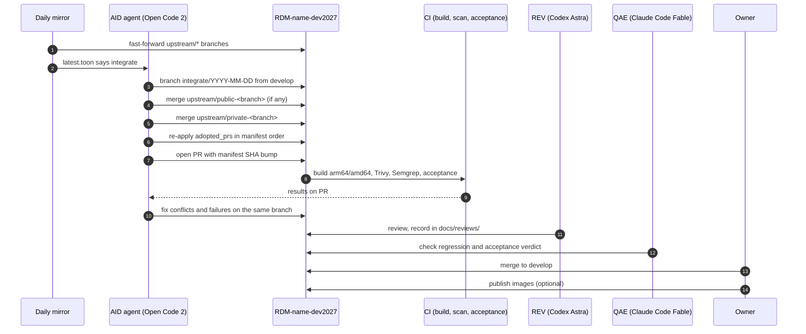
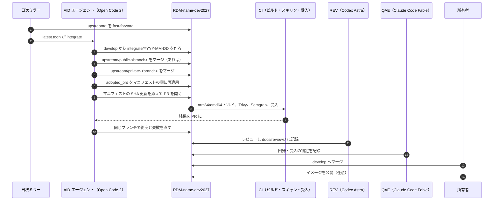

# SPEC-05 Upstream Tracking / 上流追従

> **Summary:** How the integration repositories stay current with their upstreams: a daily job mirrors the `upstream/*` branches and writes a diff report, a weekly job lets an AI agent open one integration PR per repository, conflicts are solved on the PR, review and checks are automatic, and only merge and publish are human. Also how the COS original is tracked for reference and what happens if COS archives OSF.
> **概要:** 統合リポジトリを上流に追従させる仕組み。日次ジョブが `upstream/*` をミラーして差分報告を書き、週次ジョブで AI エージェントがリポジトリごとに統合 PR を一本開く。衝突は PR 上で解く。レビューと検査は自動、マージと公開だけが人。COS 本家を参照用に追う方法と、COS が OSF を凍結したときの扱いも定める。

**Jump:** [English](#english) · [日本語](#japanese)

- Version / 版: 0.1 — 2026-11-05. **Learned:** the 2026-11-05 survey found eleven upstreams that moved on five different days in one week; without a daily mirror and a weekly merge the integration branch would drift into large, unreviewable conflicts. ／ 2026-11-05 の調査で、上流 11 本が一週間に 5 つの異なる日に動いていた。日次ミラーと週次マージが無ければ、統合ブランチは大きくレビュー不能な衝突にはまると分かった。
- Normative for: the `upstream-mirror` and `upstream-integrate` workflows in every `RDM-<name>-dev2027` repository, the `grdm-dev upstream` subcommand ([SPEC-02](02_installer_cli.md)), and `docs/status/upstream/`.
- Related: [SPEC-00 Overview](00_overview.md) · [SPEC-01 Manifest](01_manifest.md) · [SPEC-06 Documentation conventions](06_documentation_conventions.md) · [POL-01 Position](../policy/POL-01_Developer_Environment_2027_Position.md) · [ADR-01 Integration repository placement](../decisions/ADR-01_Integration_Repository_Placement.md) · [ADR-04 AI autonomy and roles](../decisions/ADR-04_AI_Autonomy_and_Roles.md) · [docs/README.md](../README.md)

---

<a id="english"></a>
## English

[→ 日本語版へ](#japanese)

### 1. Branches that are tracked

Every integration repository `RDM-<name>-dev2027` ([SPEC-00 §3](00_overview.md#3-integration-model)) has one *tracking branch* (a read-only copy of a branch that lives in another repository) per `upstreams[]` entry of the manifest ([SPEC-01 §3](01_manifest.md#english)). The name is `upstream/<kind>-<branch>`, where `<branch>` is the upstream branch name with every `/` replaced by `-`; a second upstream of the same kind inserts a tag, `upstream/<kind>-<tag>-<branch>` ([SPEC-01 §4](01_manifest.md#4-rules) rule 7).

```toon
tracking[4]{branch,source,kind,merged_into_develop,examples}:
  upstream/public-<branch>,"RDM-<name> default branch",public,yes,"upstream/public-develop (osf.io, waterbutler, mfr, cas-overlay, wiki-frontend); upstream/public-master (ember-osf-web, y-websocket)"
  upstream/private-<branch>,"RDM-<name>-*-private default branch",private,yes,"upstream/private-develop; upstream/private-master (ember-osf-web, y-websocket); upstream/private-main (OASys, Shibboleth-SP, rdmcp, aipf_mcp_data_grdm)"
  upstream/cos-develop,"CenterForOpenScience/<name> develop",cos,no (compare only),"five cores; wiki-frontend has no COS original"
  upstream/<kind>-<tag>-<branch>,"a second upstream of the same kind",private,no (candidate),"upstream/private-sec-test-fix-sec-test = RDM-osf.io-private fix/sec-test"
```

A component has only the branches its manifest entry lists: the five private subsystems have `upstream/private-main` alone; the cores have `public`, `private`, and (except wiki-frontend) `cos`.

Rules that never bend:

- `upstream/*` branches are **written only by the mirror job**. No human and no agent commits to them.
- `upstream/*` branches are **never rewritten**. The mirror job fast-forwards; if the source itself was force-pushed, the job stops, keeps the old branch, and opens an issue.
- Nobody **force-pushes** anywhere in a `-dev2027` repository. Branch protection on `develop` enforces this.

### 2. Daily job: mirror and diff report

The `upstream-mirror` workflow runs once a day (03:00 JST) in each `-dev2027` repository, and can be run by hand with `grdm-dev upstream mirror`.

1. Fetch each source repository at the `branch` named in the manifest.
2. Fast-forward the matching `tracking_branch`. Record the new SHA (the 40-character fingerprint of a commit).
3. Compare each `upstream/*` branch with `develop` and with the SHA pinned in the manifest ([SPEC-01](01_manifest.md)).
4. Write the diff report and push it to this public repository as a PR-less commit on a bot branch `status/upstream`, which a daily PR brings into `develop`.

**Where the report lives.** Chosen: `docs/status/upstream/latest.toon` is overwritten every day, and the same content is archived as `docs/status/upstream/archive/YYYY-MM-DD.toon`. Archives older than 90 days are deleted by the job. The report is in TOON (a compact text form of JSON; [SPEC-06 §4](06_documentation_conventions.md#4-diagrams-and-data)); the canonical JSON sits beside it as `latest.json`.

> **Warning:** The report is public. It contains repository names, branch names, SHAs, and commit counts only. It never contains commit messages, author names, file paths, or diff text from `private` upstreams.

Example report:

```toon
report:
  generated_at: 2026-11-05T03:00:12+09:00
  repositories[2]:
    - integration_repo: RDM-osf.io-dev2027
      develop_sha: 1111111111111111111111111111111111111111
      upstreams[3]{branch,kind,sha,ahead_of_develop,behind_develop,manifest_sha_matches,moved_since_yesterday}:
        upstream/public-develop,public,2222222222222222222222222222222222222222,14,0,false,true
        upstream/private-develop,private,3333333333333333333333333333333333333333,0,0,true,false
        upstream/cos-develop,cos,4444444444444444444444444444444444444444,310,0,true,true
      action: integrate
    - integration_repo: RDM-wiki-frontend-dev2027
      develop_sha: 5555555555555555555555555555555555555555
      upstreams[2]{branch,kind,sha,ahead_of_develop,behind_develop,manifest_sha_matches,moved_since_yesterday}:
        upstream/public-develop,public,6666666666666666666666666666666666666666,0,0,true,false
        upstream/private-develop,private,6666666666666666666666666666666666666666,0,0,true,false
      action: none
  summary:
    repositories_needing_integration: 1
    force_push_detected: 0
```

The repeated digits are placeholders for the example only. `action` is `integrate` when any merged upstream is ahead of `develop`, `none` otherwise, and `halt` when a force-push was detected.

### 3. Weekly integration PR

The `upstream-integrate` workflow runs once a week (Monday 04:00 JST), or by hand with `grdm-dev upstream integrate`, and is executed by an AI agent in the AID role (an *AI agent* is a program that reads instructions, edits code, and reports back). For each `-dev2027` repository whose latest report says `integrate`:



Steps in words:

1. Create branch `integrate/YYYY-MM-DD` from `develop`.
2. Merge the `public` tracking branch with `status: merged` (`upstream/public-develop` for osf.io, `upstream/public-master` for ember-osf-web); the private subsystems have none and skip this step. Then merge the `private` tracking branch (`upstream/private-develop`, `upstream/private-master`, or `upstream/private-main`). Candidate upstreams such as `upstream/private-sec-test-fix-sec-test` are never merged. Then re-apply each `adopted_prs[]` entry from the manifest in list order (`git cherry-pick` of the PR's commits, or `git merge` of its branch when the PR is still open).
3. Open one PR per repository titled `統合: upstream YYYY-MM-DD（<name>）`. The PR body lists the three source SHAs, the commit counts, and the adopted PRs touched. In this public repository, a matching PR bumps `manifest/upstreams.json` and `upstreams.toon` to the new SHAs ([SPEC-01 §4](01_manifest.md#4-rules) rule 2).
4. CI runs the build, the security gate ([SPEC-03](03_security_gate.md)), and the acceptance tests ([SPEC-04](04_acceptance_tests.md)).

### 4. Conflict handling

A *merge conflict* happens when two sides changed the same lines and Git cannot choose. On the integration PR:

- The AID agent resolves conflicts **on the PR branch** with ordinary commits. It explains each resolution in the commit body in Japanese.
- Resolution preference: keep the `private` change when the conflict is a security fix; keep the `public` change when it is a feature; when unclear, keep both behind a comment and label the PR `needs-owner-decision`.
- The agent **never** force-pushes the PR branch, never rebases it after review began, never touches `upstream/*`, and never edits `develop` directly.
- If an adopted PR no longer applies, the agent does not drop it silently: it marks that entry `candidate` with `reason: "no longer applies after <sha>"` in the manifest PR and labels the PR `adopted-pr-broken`.
- If CI fails for reasons the agent cannot fix within its budget, it leaves the PR open with a summary comment and the daily report keeps saying `integrate`.

### 5. Review, check, merge

- **REV (Codex Astra)** reviews every integration PR and writes `docs/reviews/YYYY-MM-DD_Upstream_Integration_<name>_rN.md` plus PR comments.
- **QAE (Claude Code Fable)** checks the regression and acceptance results and records the verdict on the PR.
- **Owner** merges. Squash is forbidden on integration PRs (it would hide upstream history); use a merge commit.
- No agent merges. The autonomy boundary is **detection → fix PR → review → regression and acceptance** automatic; **merge and publish** human ([ADR-04](../decisions/ADR-04_AI_Autonomy_and_Roles.md)).

### 6. COS reference tracking

`CenterForOpenScience/*` repositories are mirrored to `upstream/cos-develop` only. They are never merged, because RCOSDP's code has diverged for years. They are used to:

- Compare how COS solved the same modernization (for example the Python 3.12 port of osf.io) when we do ours at M4.
- Spot security fixes COS made that RCOSDP has not yet made; the weekly PR body lists commits on `upstream/cos-develop` whose message mentions `CVE`, `security`, or `vuln`.

**If COS archives OSF** (an *archived* repository is frozen read-only by its owner):

1. The mirror job detects the archived flag and stops fetching that source.
2. The manifest keeps the last `cos` SHA with `fetched_at` frozen and `kind: cos`, plus a note `archived: YYYY-MM-DD`.
3. `upstream/cos-develop` stays in the repository as history. Nothing else changes: the daily mirror, the weekly PR, the security gate, and the AI vulnerability work continue on `public` and `private` upstreams and on our own `develop`. This is the point of POL-01: GRDM keeps building whether COS does or not.

---

<a id="japanese"></a>
## 日本語

[→ To English](#english)

### 1. 追跡するブランチ

すべての統合リポジトリ `RDM-<name>-dev2027`（[SPEC-00 §3](00_overview.md#3-統合の仕組み)）には、マニフェストの `upstreams[]` の要素ごとに一本の「追跡ブランチ」（他のリポジトリにあるブランチの読み取り専用の写し）があります（[SPEC-01 §3](01_manifest.md#japanese)）。名前は `upstream/<kind>-<branch>` で、`<branch>` は上流のブランチ名の `/` をすべて `-` に置き換えたものです。同じ kind の上流が二つあるときは `upstream/<kind>-<tag>-<branch>` とタグを挟みます（[SPEC-01 §4](01_manifest.md#4-規則) の規則 7）。

```toon
tracking[4]{branch,source,kind,merged_into_develop,examples}:
  upstream/public-<branch>,"RDM-<name> の既定ブランチ",public,yes,"upstream/public-develop（osf.io、waterbutler、mfr、cas-overlay、wiki-frontend）、upstream/public-master（ember-osf-web、y-websocket）"
  upstream/private-<branch>,"RDM-<name>-*-private の既定ブランチ",private,yes,"upstream/private-develop、upstream/private-master（ember-osf-web、y-websocket）、upstream/private-main（OASys、Shibboleth-SP、rdmcp、aipf_mcp_data_grdm）"
  upstream/cos-develop,"CenterForOpenScience/<name> の develop",cos,no（比較のみ）,"コア 5 本。wiki-frontend には COS 本家がない"
  upstream/<kind>-<tag>-<branch>,"同じ kind の二つ目の上流",private,no（候補）,"upstream/private-sec-test-fix-sec-test = RDM-osf.io-private の fix/sec-test"
```

部品が持つのはマニフェストの要素に対応するブランチだけです。非公開サブシステム 5 本は `upstream/private-main` のみ、コアは `public`・`private` と（wiki-frontend 以外は）`cos` を持ちます。

決して曲げない規則:

- `upstream/*` に書くのは **ミラージョブだけ** です。人もエージェントもコミットしません。
- `upstream/*` は **書き換えません**。ミラージョブは fast-forward（まっすぐ前に進める）だけを行い、元のリポジトリ側が force push されていたら止まって、古いブランチを残し、Issue を開きます。
- `-dev2027` のどこにも **force push しません**。`develop` のブランチ保護がこれを強制します。

### 2. 日次ジョブ: ミラーと差分報告

`upstream-mirror` ワークフローは、各 `-dev2027` リポジトリで毎日一回（JST 03:00）動きます。手で動かすなら `grdm-dev upstream mirror` です。

1. 各元リポジトリをマニフェストの `branch` で取得する。
2. 対応する `tracking_branch` を fast-forward する。新しい SHA（コミットの 40 文字の指紋）を記録する。
3. 各 `upstream/*` を `develop` と、マニフェスト（[SPEC-01](01_manifest.md)）に固定した SHA と比べる。
4. 差分報告を書き、この公開リポジトリのボット用ブランチ `status/upstream` にコミットする。日次の PR がそれを `develop` に取り込む。

**報告の置き場。** 採用: `docs/status/upstream/latest.toon` を毎日上書きし、同じ内容を `docs/status/upstream/archive/YYYY-MM-DD.toon` として保管します。90 日より古い保管分はジョブが削除します。報告は TOON（JSON を短く字下げで書いた形。[SPEC-06 §4](06_documentation_conventions.md#4-図とデータ)）で、正本の JSON を `latest.json` として隣に置きます。

> **Warning:** 報告は公開です。中身はリポジトリ名、ブランチ名、SHA、コミット数だけです。`private` の上流のコミットメッセージ、作者名、ファイルパス、差分の本文は決して含めません。

報告の例:

```toon
report:
  generated_at: 2026-11-05T03:00:12+09:00
  repositories[2]:
    - integration_repo: RDM-osf.io-dev2027
      develop_sha: 1111111111111111111111111111111111111111
      upstreams[3]{branch,kind,sha,ahead_of_develop,behind_develop,manifest_sha_matches,moved_since_yesterday}:
        upstream/public-develop,public,2222222222222222222222222222222222222222,14,0,false,true
        upstream/private-develop,private,3333333333333333333333333333333333333333,0,0,true,false
        upstream/cos-develop,cos,4444444444444444444444444444444444444444,310,0,true,true
      action: integrate
    - integration_repo: RDM-wiki-frontend-dev2027
      develop_sha: 5555555555555555555555555555555555555555
      upstreams[2]{branch,kind,sha,ahead_of_develop,behind_develop,manifest_sha_matches,moved_since_yesterday}:
        upstream/public-develop,public,6666666666666666666666666666666666666666,0,0,true,false
        upstream/private-develop,private,6666666666666666666666666666666666666666,0,0,true,false
      action: none
  summary:
    repositories_needing_integration: 1
    force_push_detected: 0
```

同じ数字の並びは例のための仮の値です。`action` は、マージ対象の上流のどれかが `develop` より進んでいれば `integrate`、そうでなければ `none`、force push を検出したら `halt` です。

### 3. 週次の統合 PR

`upstream-integrate` ワークフローは週一回（月曜 JST 04:00）に動きます。手で動かすなら `grdm-dev upstream integrate` です。実行するのは AID 役の AI エージェント（指示を読み、コードを直し、結果を報告するプログラム）です。最新の報告が `integrate` と言う `-dev2027` リポジトリごとに次を行います。



言葉で書くと:

1. `develop` から `integrate/YYYY-MM-DD` ブランチを作る。
2. `status: merged` の `public` の追跡ブランチ（osf.io は `upstream/public-develop`、ember-osf-web は `upstream/public-master`）をマージする。非公開サブシステムにはこれがないので飛ばす。次に `private` の追跡ブランチ（`upstream/private-develop`、`upstream/private-master`、または `upstream/private-main`）をマージする。`upstream/private-sec-test-fix-sec-test` のような候補の上流は決してマージしない。最後にマニフェストの `adopted_prs[]` を並び順に再適用する（PR のコミットを `git cherry-pick`。PR がまだ開いていればそのブランチを `git merge`）。
3. リポジトリごとに一本の PR を `統合: upstream YYYY-MM-DD（<name>）` の題で開く。PR 本文には三つの元 SHA、コミット数、触った採用 PR を書く。この公開リポジトリ側では、対になる PR が `manifest/upstreams.json` と `upstreams.toon` を新しい SHA に進める（[SPEC-01 §4](01_manifest.md#4-規則) の規則 2）。
4. CI がビルド、セキュリティ門（[SPEC-03](03_security_gate.md)）、受入試験（[SPEC-04](04_acceptance_tests.md)）を実行する。

### 4. 衝突の扱い

「マージの衝突」は、両側が同じ行を変えていて Git が選べないときに起きます。統合 PR では:

- AID エージェントは衝突を **PR のブランチ上で** 通常のコミットとして解きます。解き方の理由をコミット本文に日本語で書きます。
- 優先順: セキュリティ修正の衝突なら `private` 側を残す。機能の衝突なら `public` 側を残す。判断できないときは両方をコメント付きで残し、PR にラベル `needs-owner-decision` を付ける。
- エージェントは PR ブランチを **決して** force push せず、レビュー開始後に rebase せず、`upstream/*` に触れず、`develop` を直接編集しません。
- 採用 PR が当たらなくなったら、黙って落とさず、マニフェストの PR でその項目を `candidate` にして `reason: "no longer applies after <sha>"` を書き、PR にラベル `adopted-pr-broken` を付けます。
- 予算内で直せない理由で CI が落ちたら、要約コメントを残して PR を開いたままにします。日次報告は `integrate` を出し続けます。

### 5. レビュー・検査・マージ

- **REV（Codex Astra）** が全統合 PR をレビューし、`docs/reviews/YYYY-MM-DD_Upstream_Integration_<name>_rN.md` と PR コメントに書きます。
- **QAE（Claude Code Fable）** が回帰・受入の結果を検査し、判定を PR に記録します。
- **所有者** がマージします。統合 PR では squash（複数コミットを一つに潰す）を禁止します。上流の履歴が消えるからです。マージコミットを使います。
- エージェントはマージしません。自律の境界は、**検出 → 修正 PR → レビュー → 回帰・受入** までが自動、**マージと公開** が人です（[ADR-04](../decisions/ADR-04_AI_Autonomy_and_Roles.md)）。

### 6. COS 本家の参照追跡

`CenterForOpenScience/*` は `upstream/cos-develop` にミラーするだけです。RCOSDP のコードは何年も前に分かれているので、マージはしません。使い方は次の二つです。

- 同じ近代化（例: osf.io の Python 3.12 移植）を COS がどう解いたかを、M4 で私たちが移植するときに比べる。
- COS が行い RCOSDP がまだ行っていないセキュリティ修正を見つける。週次 PR の本文に、`upstream/cos-develop` のコミットのうちメッセージに `CVE`・`security`・`vuln` を含むものを列挙する。

**COS が OSF をアーカイブしたら**（「アーカイブ」は持ち主がリポジトリを読み取り専用に凍結すること）:

1. ミラージョブがアーカイブの印を検出し、その元の取得を止める。
2. マニフェストは最後の `cos` の SHA を `fetched_at` を凍結して `kind: cos` のまま保ち、`archived: YYYY-MM-DD` の注を足す。
3. `upstream/cos-develop` は履歴としてリポジトリに残す。ほかは何も変わらない。日次ミラー、週次 PR、セキュリティ門、AI による脆弱性対応は、`public` と `private` の上流と私たち自身の `develop` の上で続く。これが POL-01 の要点で、COS が続けても止めても GRDM は組み続けられる。

---

## Glossary / 用語

| Term | English note | 日本語注 |
|---|---|---|
| Mirror | A copy that is kept identical to the original. | 元と同じ中身に保たれる写し。 |
| Fast-forward | Moving a branch straight ahead to a newer commit without creating a merge. | マージを作らずにブランチを新しいコミットへまっすぐ進めること。 |
| Force push | Overwriting a branch's history on the server. Forbidden here. | サーバ上のブランチの履歴を上書きすること。ここでは禁止。 |
| Merge conflict | Two sides changed the same lines and Git cannot choose. | 両側が同じ行を変えて Git が選べない状態。 |
| Cherry-pick | Copying one commit from one branch onto another. | あるブランチの一つのコミットを別のブランチに写すこと。 |
| Squash | Combining several commits into one, losing the individual history. | 複数のコミットを一つに潰し、個々の履歴を失うこと。 |
| Archived repository | A repository its owner froze read-only. | 持ち主が読み取り専用に凍結したリポジトリ。 |
| CVE | A public identification number for one known vulnerability. | 一つの既知の脆弱性に付く公開の識別番号。 |
