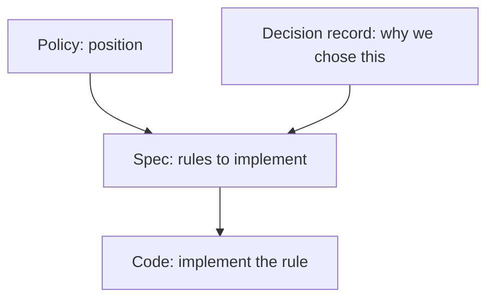
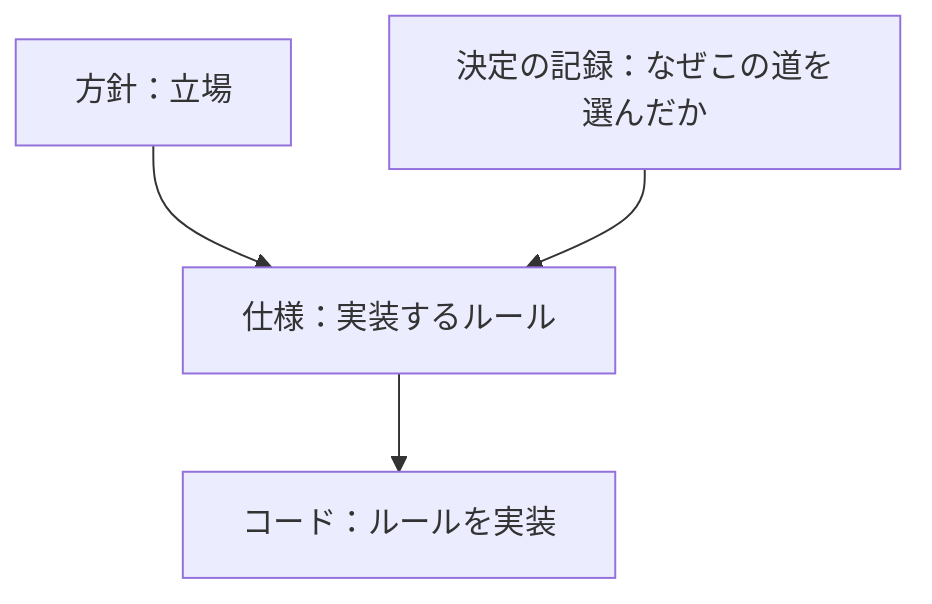

# Specifications / 仕様

> **Summary:** Rules to implement: how the installer works, security gate thresholds, acceptance test scenarios, upstream tracking, documentation conventions. These documents tell implementers what to build.
> **概要:** 実装するルール：インストーラーの仕組み、セキュリティ門の基準、受入試験のシナリオ、上流追従、文書規約。これらの文書は実装者に何を構築すべきかを伝えます。

**Jump:** [English](#english) · [日本語](#japanese)

- Version / 版: 0.1 — 2026-11-05. **Learned:** the installer, the security gate and the acceptance tests had to be written down as rules before any code, otherwise each implementer would fill the gaps differently. ／ インストーラー、セキュリティの門、受入試験は、コードより先に規則として書いておかないと、実装する人ごとに隙間の埋め方が変わると分かった。
- Normative for: [SPEC-00 Overview](./00_overview.md) through [SPEC-06 Documentation Conventions](./06_documentation_conventions.md).
- Related: [../README.md](../README.md) · [policy/](../policy/README.md) · [decisions/](../decisions/README.md) · [reference/REF-01_Glossary.md](./../reference/REF-01_Glossary.md)

---

## English

[→ 日本語版へ](#japanese)

### 1. What belongs here

A *specification* is a rule book that implementers must follow. This folder contains:

| ID | File | Purpose |
|---|---|---|
| SPEC-00 | [00_overview.md](./00_overview.md) | Component map, milestones, roles, the big picture. |
| SPEC-01 | [01_manifest.md](./01_manifest.md) | The manifest: which upstream commits and PRs the installer builds. |
| SPEC-02 | [02_installer_cli.md](./02_installer_cli.md) | The `grdm-dev` CLI and `install.sh`: host checks, secrets, compose, build, health, reports. |
| SPEC-03 | [03_security_gate.md](./03_security_gate.md) | SBOM, CVE scan, static analysis, ZAP, AI red team, per-milestone thresholds. |
| SPEC-04 | [04_acceptance_tests.md](./04_acceptance_tests.md) | Playwright Python acceptance: success and rejection cases per feature. |
| SPEC-05 | [05_upstream_tracking.md](./05_upstream_tracking.md) | Daily mirror and diff report, weekly AI integration PR, COS reference tracking. |
| SPEC-06 | [06_documentation_conventions.md](./06_documentation_conventions.md) | How every document is written. |

### 2. Creating a new specification

1. Name the file `NN_<Topic>.md` (two-digit number, next available).
2. Follow [SPEC-06 documentation conventions](./06_documentation_conventions.md).
3. Link to related policies (POL-NN) and decisions (ADR-NN).
4. Create a decision record if the specification records a choice.
5. The owner approves; QAE writes specifications for new features.

### 3. How specifications relate to other documents

---

## 日本語

[→ To English](#english)

### 1. ここに属するもの

「仕様」は実装する人が守るルールブックです。このフォルダには次が含まれます：

| ID | ファイル | 目的 |
|---|---|---|
| SPEC-00 | [00_overview.md](./00_overview.md) | 部品の地図、節目、役割、全体像。 |
| SPEC-01 | [01_manifest.md](./01_manifest.md) | マニフェスト：どの上流のコミットと PR を組むか。 |
| SPEC-02 | [02_installer_cli.md](./02_installer_cli.md) | `grdm-dev` CLI と `install.sh`：ホスト判定、秘密、compose、ビルド、健康確認、報告。 |
| SPEC-03 | [03_security_gate.md](./03_security_gate.md) | SBOM、CVE スキャン、静的解析、ZAP、AI レッドチーム、節目ごとの基準。 |
| SPEC-04 | [04_acceptance_tests.md](./04_acceptance_tests.md) | Playwright Python 受入：機能ごとの成功・拒否ケース。 |
| SPEC-05 | [05_upstream_tracking.md](./05_upstream_tracking.md) | 日次ミラーと差分報告、週次の AI 統合 PR、COS 参照追跡。 |
| SPEC-06 | [06_documentation_conventions.md](./06_documentation_conventions.md) | すべての文書の書き方。 |

### 2. 新しい仕様をつくるには

1. ファイル名を `NN_<題>.md`（2 桁の番号、次に空いているもの）にする。
2. [SPEC-06 文書規約](./06_documentation_conventions.md)に従う。
3. 関連する方針（POL-NN）と決定（ADR-NN）へリンクする。
4. 仕様が選択を記録する場合は決定の記録を作成する。
5. 所有者が承認；QAE が新機能の仕様を書く。

### 3. 仕様が他の文書とどう関係するか

---

## Glossary / 用語

| Term | English note | 日本語注 |
|---|---|---|
| Specification | A rule book that implementers must follow. | 実装する人が守るルールブック。 |
| Policy | A statement of our position on what we will and will not do. | 我々が何をし、何をしないかの立場。 |
| Decision record (ADR) | A note explaining why we chose one way and not another. | なぜその道を選び、ほかを選ばなかったかのメモ。 |
| Implementation | Writing code that follows the spec. | 仕様に従ってコードを書くこと。 |
| Milestone | A checkpoint with a pass/fail test. | 合否の試験がある関門。 |
| Acceptance test | A check that the whole thing does what the user asked for. | 全体が利用者の望みどおりに動くかの確認。 |
